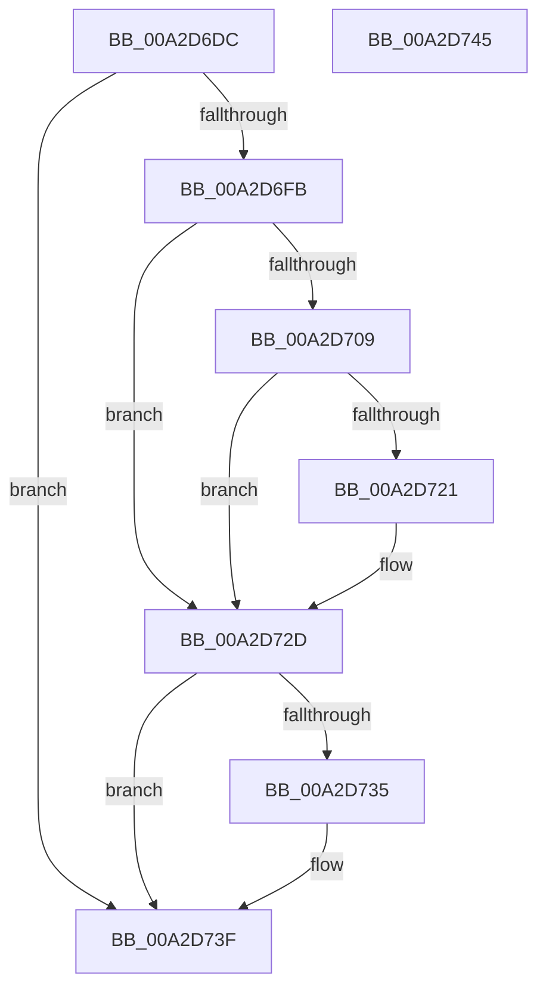

# PopPowerRequestStatsCreate

- RVA: `0x00A2D6DC`–`0x00A2D746` (길이 `106` bytes)
- VA: `0x0000000140A2D6DC`
- 실행 섹션: `PAGE`
- PDB 이름 있음: `예`; PDB Function 태그: `아니요`
- unwind 정보 RVA: `0x000AC81C`
- 디코드: `27`개 명령, `106/106` bytes 표시
- 미해석 바이트: `0` (있으면 어셈블리에 `.byte`로 보존)

> 이 문서는 커널 이미지의 기계어와 PDB 기호를 분석해 생성했습니다. 4번과 5번은 함수 원형과 자료형을 바이너리 사용 방식에서 추정한 C 해석이며 원본 소스 복구 결과는 아닙니다.

## 1. Dependencies

- 직접 호출 지점: **3**; 고유 호출 대상: **3**
- 직접 호출자로 확인된 함수: **1**
- RIP 상대 이미지 참조: **1**

### Outgoing calls
- `0x00A2D700` → [PopPowerRequestStatsGetIdForRequest](PopPowerRequestStatsGetIdForRequest_function_00A2D784.md) (function, `0x00A2D784`)
- `0x00A2D718` → [PopPowerRequestStatsCreateSleepstudyBlocker](PopPowerRequestStatsCreateSleepstudyBlocker_function_00A2D9B0.md) (function, `0x00A2D9B0`)
- `0x00A2D73A` → [PopPowerRequestStatsFreeId](PopPowerRequestStatsFreeId_function_00A2D74C.md) (function, `0x00A2D74C`)

### Direct callers
- [PopPowerRequestCreateCommon](../../text/23/PopPowerRequestCreateCommon_function_00230150.md) at `0x0023027A`

### Static image references
- `0x00A2D6F1` → RVA `0x00F07670` (`.data`; read)

## 2. Other-region calls and transfers

- 다른 실행 섹션으로 향하는 call: **0**
- 별도 외부 분기/꼬리 이동을 확인하지 못했습니다.

## 3. Assembly (complete function range)

```asm
00A2D6DC  40 57                           push rdi
00A2D6DE  48 83 EC 20                     sub rsp, 0x20
00A2D6E2  48 83 64 24 40 00               and qword ptr [rsp + 0x40], 0
00A2D6E8  48 8B F9                        mov rdi, rcx
00A2D6EB  48 83 64 24 38 00               and qword ptr [rsp + 0x38], 0
00A2D6F1  48 83 3D 77 9F 4D 00 00         cmp qword ptr [rip + 0x4d9f77], 0
00A2D6F9  74 44                           je 0x140a2d73f
00A2D6FB  48 8D 54 24 38                  lea rdx, [rsp + 0x38]
00A2D700  E8 7F 00 00 00                  call 0x140a2d784
00A2D705  85 C0                           test eax, eax
00A2D707  78 24                           js 0x140a2d72d
00A2D709  48 8B 4C 24 38                  mov rcx, qword ptr [rsp + 0x38]
00A2D70E  4C 8D 44 24 40                  lea r8, [rsp + 0x40]
00A2D713  BA 07 00 00 00                  mov edx, 7
00A2D718  E8 93 02 00 00                  call 0x140a2d9b0
00A2D71D  85 C0                           test eax, eax
00A2D71F  78 0C                           js 0x140a2d72d
00A2D721  48 8B 44 24 40                  mov rax, qword ptr [rsp + 0x40]
00A2D726  48 89 87 A0 00 00 00            mov qword ptr [rdi + 0xa0], rax
00A2D72D  48 83 7C 24 38 00               cmp qword ptr [rsp + 0x38], 0
00A2D733  74 0A                           je 0x140a2d73f
00A2D735  48 8B 4C 24 38                  mov rcx, qword ptr [rsp + 0x38]
00A2D73A  E8 0D 00 00 00                  call 0x140a2d74c
00A2D73F  48 83 C4 20                     add rsp, 0x20
00A2D743  5F                              pop rdi
00A2D744  C3                              ret
00A2D745  CC                              int3
```

## 4. C-style interpretation (structured pseudocode)

```c
__int64 __fastcall PopPowerRequestStatsCreate(__int64 a1)
{
    __int64 result;
    __int64 v_rsp;
    unsigned __int64 v_stack_p10;
    unsigned __int64 v_stack_p18;

    v_rsp = (v_rsp) - (32);
    if ((*(unsigned __int64 *)(v_rip + 5087095)) == 0) goto loc_00A2D73F;
    result = PopPowerRequestStatsGetIdForRequest(a1, v_stack_p10, a3, a4);
    if (sign_flag) goto loc_00A2D72D;
    result = PopPowerRequestStatsCreateSleepstudyBlocker(v_stack_p10, 7, v_stack_p18, a4);
    if (!(sign_flag)) {
        result = v_stack_p18;
        *(unsigned __int64 *)(a1 + 160) = result;
    }
    if (v_stack_p10 != 0) {
        a1 = v_stack_p10;
        result = PopPowerRequestStatsFreeId(a1, 7, v_stack_p18, a4);
    }
    v_rsp = (v_rsp) + (32);
    return result;
}
```

## 5. (Beta) C Style

```c
int64_t PopPowerRequestStatsCreate(void *Arg1)
{
    uint8_t *arg1 = (uint8_t *)Arg1;

    int64_t result;
    int64_t local_rsp;
    uint64_t v_stack_p10;
    uint64_t v_stack_p18;

    local_rsp = (local_rsp) - (32);
    if ((*(uint64_t *)(v_rip + 0x4D9F77)) == 0) goto loc_00A2D73F;
    result = PopPowerRequestStatsGetIdForRequest(Arg1, v_stack_p10, a3, a4);
    if (sign_flag) goto loc_00A2D72D;
    result = PopPowerRequestStatsCreateSleepstudyBlocker(v_stack_p10, 7, v_stack_p18, a4);
    if (!(sign_flag)) {
        result = v_stack_p18;
        *(uint64_t *)(arg1 + 0xA0) = result;
    }
    if (v_stack_p10 != 0) {
        Arg1 = v_stack_p10;
        result = PopPowerRequestStatsFreeId(Arg1, 7, v_stack_p18, a4);
    }
    local_rsp = (local_rsp) + (32);
    return result;
}
```

### 관측된 메모리 오프셋

구조체 형식이 확인되지 않은 접근은 인자 기준의 오프셋으로만 기록했습니다.

| 기준 인자 | 오프셋 표현 | 폭 (bit) | 접근 |
|---|---:|---:|---|
| `Arg1` | `+ 0xA0` | `64` | `W` |

## 6. Execution-region graph

[열기: 2D/3D 그래프와 함수 탐색 컨트롤 패널](../../../control-panel.html?section=page&rva=0x00A2D6DC&view=graph)

- 2D 그래프는 위에서 아래로 흐르고, 3D 그래프는 빈 공간을 드래그해 회전합니다. Shift+드래그는 이동, 휠은 확대·축소, 함수 노드 선택은 대상 보고서 이동입니다.

### Static fallback


