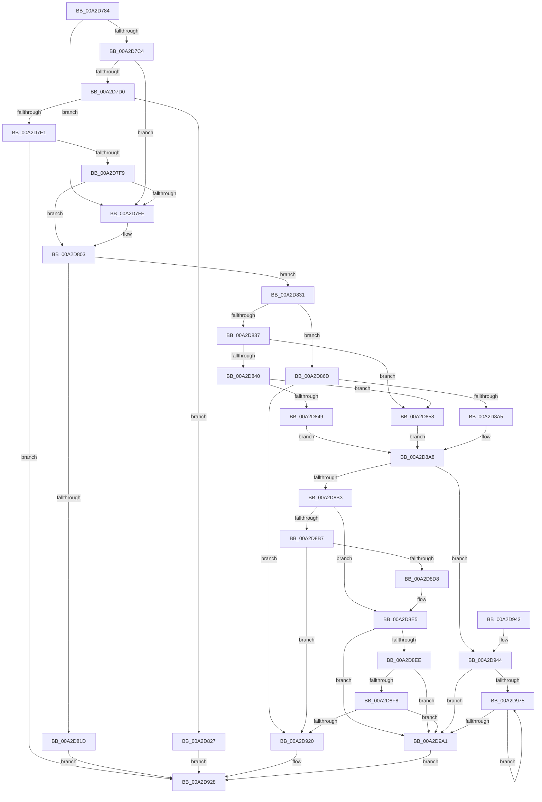

# PopPowerRequestStatsGetIdForRequest

- RVA: `0x00A2D784`–`0x00A2D9A8` (길이 `548` bytes)
- VA: `0x0000000140A2D784`
- 실행 섹션: `PAGE`
- PDB 이름 있음: `예`; PDB Function 태그: `아니요`
- unwind 정보 RVA: `0x000AC828`
- 디코드: `155`개 명령, `548/548` bytes 표시
- 미해석 바이트: `0` (있으면 어셈블리에 `.byte`로 보존)

> 이 문서는 커널 이미지의 기계어와 PDB 기호를 분석해 생성했습니다. 4번과 5번은 함수 원형과 자료형을 바이너리 사용 방식에서 추정한 C 해석이며 원본 소스 복구 결과는 아닙니다.

## 1. Dependencies

- 직접 호출 지점: **11**; 고유 호출 대상: **8**
- 직접 호출자로 확인된 함수: **1**
- RIP 상대 이미지 참조: **1**

### Outgoing calls
- `0x00A2D7B4` → [PopPowerRequestStatsIsDetailedRequestReason](../70/PopPowerRequestStatsIsDetailedRequestReason_function_00705490.md) (function, `0x00705490`)
- `0x00A2D810` → [ExAllocatePool2](../../poolcode/B8/ExAllocatePool2_function_00B820F0.md) (function, `0x00B820F0`)
- `0x00A2D866` → [RtlInitUnicodeString](../../text/42/RtlInitUnicodeString_function_0042A780.md) (function, `0x0042A780`)
- `0x00A2D889` → [RtlInitAnsiString](../../text/47/RtlInitAnsiString_function_00470F40.md) (function, `0x00470F40`)
- `0x00A2D89A` → [PopAnsiStringToUnicodeString](../A7/PopAnsiStringToUnicodeString_function_00A7AB48.md) (function, `0x00A7AB48`)
- `0x00A2D8CD` → [PopUnicodeStringDeepCopy](PopUnicodeStringDeepCopy_function_00A2E6B8.md) (function, `0x00A2E6B8`)
- `0x00A2D904` → [RtlInitUnicodeString](../../text/42/RtlInitUnicodeString_function_0042A780.md) (function, `0x0042A780`)
- `0x00A2D911` → [PopPowerRequestStatsIdConcat](../A8/PopPowerRequestStatsIdConcat_function_00A80018.md) (function, `0x00A80018`)
- `0x00A2D923` → [PopPowerRequestStatsFreeId](PopPowerRequestStatsFreeId_function_00A2D74C.md) (function, `0x00A2D74C`)
- `0x00A2D962` → [RtlInitUnicodeString](../../text/42/RtlInitUnicodeString_function_0042A780.md) (function, `0x0042A780`)
- `0x00A2D983` → [RtlInitUnicodeString](../../text/42/RtlInitUnicodeString_function_0042A780.md) (function, `0x0042A780`)

### Direct callers
- [PopPowerRequestStatsCreate](PopPowerRequestStatsCreate_function_00A2D6DC.md) at `0x00A2D700`

### Static image references
- `0x00A2D85F` → RVA `0x00FD8810` (`PAGEDATA`; read)

## 2. Other-region calls and transfers

- 다른 실행 섹션으로 향하는 call: **6**
  - `0x00A2D810` → [ExAllocatePool2](../../poolcode/B8/ExAllocatePool2_function_00B820F0.md) (`PAGE` → `POOLCODE`)
  - `0x00A2D866` → [RtlInitUnicodeString](../../text/42/RtlInitUnicodeString_function_0042A780.md) (`PAGE` → `.text`)
  - `0x00A2D889` → [RtlInitAnsiString](../../text/47/RtlInitAnsiString_function_00470F40.md) (`PAGE` → `.text`)
  - `0x00A2D904` → [RtlInitUnicodeString](../../text/42/RtlInitUnicodeString_function_0042A780.md) (`PAGE` → `.text`)
  - `0x00A2D962` → [RtlInitUnicodeString](../../text/42/RtlInitUnicodeString_function_0042A780.md) (`PAGE` → `.text`)
  - `0x00A2D983` → [RtlInitUnicodeString](../../text/42/RtlInitUnicodeString_function_0042A780.md) (`PAGE` → `.text`)
- 별도 외부 분기/꼬리 이동을 확인하지 못했습니다.

## 3. Assembly (complete function range)

```asm
00A2D784  48 8B C4                        mov rax, rsp
00A2D787  48 89 58 08                     mov qword ptr [rax + 8], rbx
00A2D78B  48 89 68 10                     mov qword ptr [rax + 0x10], rbp
00A2D78F  48 89 70 18                     mov qword ptr [rax + 0x18], rsi
00A2D793  57                              push rdi
00A2D794  41 56                           push r14
00A2D796  41 57                           push r15
00A2D798  48 83 EC 40                     sub rsp, 0x40
00A2D79C  48 8B 69 60                     mov rbp, qword ptr [rcx + 0x60]
00A2D7A0  0F 57 C0                        xorps xmm0, xmm0
00A2D7A3  0F 57 C9                        xorps xmm1, xmm1
00A2D7A6  48 8B CD                        mov rcx, rbp
00A2D7A9  4C 8B FA                        mov r15, rdx
00A2D7AC  0F 11 40 D8                     movups xmmword ptr [rax - 0x28], xmm0
00A2D7B0  0F 11 48 C8                     movups xmmword ptr [rax - 0x38], xmm1
00A2D7B4  E8 D7 7C CD FF                  call 0x140705490
00A2D7B9  33 F6                           xor esi, esi
00A2D7BB  44 8A F0                        mov r14b, al
00A2D7BE  48 39 75 30                     cmp qword ptr [rbp + 0x30], rsi
00A2D7C2  74 3A                           je 0x140a2d7fe
00A2D7C4  48 8D 75 3F                     lea rsi, [rbp + 0x3f]
00A2D7C8  48 83 E6 F8                     and rsi, 0xfffffffffffffff8
00A2D7CC  84 C0                           test al, al
00A2D7CE  74 2E                           je 0x140a2d7fe
00A2D7D0  8B 56 14                        mov edx, dword ptr [rsi + 0x14]
00A2D7D3  B9 FF FF FF FF                  mov ecx, 0xffffffff
00A2D7D8  48 C1 E2 04                     shl rdx, 4
00A2D7DC  48 3B D1                        cmp rdx, rcx
00A2D7DF  77 46                           ja 0x140a2d827
00A2D7E1  8D 42 30                        lea eax, [rdx + 0x30]
00A2D7E4  3B C2                           cmp eax, edx
00A2D7E6  0F 43 C8                        cmovae ecx, eax
00A2D7E9  1B DB                           sbb ebx, ebx
00A2D7EB  81 E3 95 00 00 C0               and ebx, 0xc0000095
00A2D7F1  3B C2                           cmp eax, edx
00A2D7F3  0F 82 2F 01 00 00               jb 0x140a2d928
00A2D7F9  83 F9 40                        cmp ecx, 0x40
00A2D7FC  77 05                           ja 0x140a2d803
00A2D7FE  B9 40 00 00 00                  mov ecx, 0x40
00A2D803  8B D1                           mov edx, ecx
00A2D805  41 B8 50 57 51 54               mov r8d, 0x54515750
00A2D80B  B9 00 01 00 00                  mov ecx, 0x100
00A2D810  E8 DB 48 15 00                  call 0x140b820f0
00A2D815  48 8B F8                        mov rdi, rax
00A2D818  48 85 C0                        test rax, rax
00A2D81B  75 14                           jne 0x140a2d831
00A2D81D  BB 9A 00 00 C0                  mov ebx, 0xc000009a
00A2D822  E9 01 01 00 00                  jmp 0x140a2d928
00A2D827  BB 95 00 00 C0                  mov ebx, 0xc0000095
00A2D82C  E9 F7 00 00 00                  jmp 0x140a2d928
00A2D831  83 7D 00 00                     cmp dword ptr [rbp], 0
00A2D835  75 36                           jne 0x140a2d86d
00A2D837  48 8B 45 08                     mov rax, qword ptr [rbp + 8]
00A2D83B  48 85 C0                        test rax, rax
00A2D83E  74 18                           je 0x140a2d858
00A2D840  48 8B 48 08                     mov rcx, qword ptr [rax + 8]
00A2D844  48 85 C9                        test rcx, rcx
00A2D847  74 0F                           je 0x140a2d858
00A2D849  0F 10 41 38                     movups xmm0, xmmword ptr [rcx + 0x38]
00A2D84D  48 8D 6F 08                     lea rbp, [rdi + 8]
00A2D851  F3 0F 7F 45 00                  movdqu xmmword ptr [rbp], xmm0
00A2D856  EB 50                           jmp 0x140a2d8a8
00A2D858  48 8D 6F 08                     lea rbp, [rdi + 8]
00A2D85C  48 8B CD                        mov rcx, rbp
00A2D85F  48 8D 15 AA AF 5A 00            lea rdx, [rip + 0x5aafaa]
00A2D866  E8 15 CF 9F FF                  call 0x14042a780
00A2D86B  EB 3B                           jmp 0x140a2d8a8
00A2D86D  65 48 8B 04 25 88 01 00 00      mov rax, qword ptr gs:[0x188]
00A2D876  48 8D 4C 24 30                  lea rcx, [rsp + 0x30]
00A2D87B  48 8B 90 B8 00 00 00            mov rdx, qword ptr [rax + 0xb8]
00A2D882  48 81 C2 38 03 00 00            add rdx, 0x338
00A2D889  E8 B2 36 A4 FF                  call 0x140470f40
00A2D88E  48 8D 6F 08                     lea rbp, [rdi + 8]
00A2D892  48 8B CD                        mov rcx, rbp
00A2D895  48 8D 54 24 30                  lea rdx, [rsp + 0x30]
00A2D89A  E8 A9 D2 04 00                  call 0x140a7ab48
00A2D89F  8B D8                           mov ebx, eax
00A2D8A1  85 C0                           test eax, eax
00A2D8A3  78 7B                           js 0x140a2d920
00A2D8A5  83 0F 02                        or dword ptr [rdi], 2
00A2D8A8  8B 07                           mov eax, dword ptr [rdi]
00A2D8AA  45 84 F6                        test r14b, r14b
00A2D8AD  0F 85 91 00 00 00               jne 0x140a2d944
00A2D8B3  A8 02                           test al, 2
00A2D8B5  75 2E                           jne 0x140a2d8e5
00A2D8B7  0F 57 C0                        xorps xmm0, xmm0
00A2D8BA  48 8D 4C 24 20                  lea rcx, [rsp + 0x20]
00A2D8BF  41 B9 50 57 51 54               mov r9d, 0x54515750
00A2D8C5  48 8B D5                        mov rdx, rbp
00A2D8C8  0F 11 44 24 20                  movups xmmword ptr [rsp + 0x20], xmm0
00A2D8CD  E8 E6 0D 00 00                  call 0x140a2e6b8
00A2D8D2  8B D8                           mov ebx, eax
00A2D8D4  85 C0                           test eax, eax
00A2D8D6  78 48                           js 0x140a2d920
00A2D8D8  0F 10 44 24 20                  movups xmm0, xmmword ptr [rsp + 0x20]
00A2D8DD  83 0F 02                        or dword ptr [rdi], 2
00A2D8E0  F3 0F 7F 45 00                  movdqu xmmword ptr [rbp], xmm0
00A2D8E5  48 85 F6                        test rsi, rsi
00A2D8E8  0F 84 B3 00 00 00               je 0x140a2d9a1
00A2D8EE  8B 06                           mov eax, dword ptr [rsi]
00A2D8F0  A8 01                           test al, 1
00A2D8F2  0F 84 A9 00 00 00               je 0x140a2d9a1
00A2D8F8  48 8B 56 08                     mov rdx, qword ptr [rsi + 8]
00A2D8FC  48 8D 4C 24 20                  lea rcx, [rsp + 0x20]
00A2D901  48 03 D6                        add rdx, rsi
00A2D904  E8 77 CE 9F FF                  call 0x14042a780
00A2D909  48 8D 54 24 20                  lea rdx, [rsp + 0x20]
00A2D90E  48 8B CD                        mov rcx, rbp
00A2D911  E8 02 27 05 00                  call 0x140a80018
00A2D916  8B D8                           mov ebx, eax
00A2D918  85 C0                           test eax, eax
00A2D91A  0F 89 81 00 00 00               jns 0x140a2d9a1
00A2D920  48 8B CF                        mov rcx, rdi
00A2D923  E8 24 FE FF FF                  call 0x140a2d74c
00A2D928  48 8B 6C 24 68                  mov rbp, qword ptr [rsp + 0x68]
00A2D92D  8B C3                           mov eax, ebx
00A2D92F  48 8B 5C 24 60                  mov rbx, qword ptr [rsp + 0x60]
00A2D934  48 8B 74 24 70                  mov rsi, qword ptr [rsp + 0x70]
00A2D939  48 83 C4 40                     add rsp, 0x40
00A2D93D  41 5F                           pop r15
00A2D93F  41 5E                           pop r14
00A2D941  5F                              pop rdi
00A2D942  C3                              ret
00A2D943  CC                              int3
00A2D944  83 C8 01                        or eax, 1
00A2D947  48 8D 4F 18                     lea rcx, [rdi + 0x18]
00A2D94B  89 07                           mov dword ptr [rdi], eax
00A2D94D  0F B7 46 10                     movzx eax, word ptr [rsi + 0x10]
00A2D951  66 89 47 28                     mov word ptr [rdi + 0x28], ax
00A2D955  8B 46 14                        mov eax, dword ptr [rsi + 0x14]
00A2D958  89 47 2C                        mov dword ptr [rdi + 0x2c], eax
00A2D95B  48 8B 56 08                     mov rdx, qword ptr [rsi + 8]
00A2D95F  48 03 D6                        add rdx, rsi
00A2D962  E8 19 CE 9F FF                  call 0x14042a780
00A2D967  48 8B 6E 18                     mov rbp, qword ptr [rsi + 0x18]
00A2D96B  48 03 EE                        add rbp, rsi
00A2D96E  33 F6                           xor esi, esi
00A2D970  39 77 2C                        cmp dword ptr [rdi + 0x2c], esi
00A2D973  76 2C                           jbe 0x140a2d9a1
00A2D975  48 8D 4E 03                     lea rcx, [rsi + 3]
00A2D979  48 8B D5                        mov rdx, rbp
00A2D97C  48 C1 E1 04                     shl rcx, 4
00A2D980  48 03 CF                        add rcx, rdi
00A2D983  E8 F8 CD 9F FF                  call 0x14042a780
00A2D988  48 8D 46 03                     lea rax, [rsi + 3]
00A2D98C  48 83 C5 02                     add rbp, 2
00A2D990  48 03 C0                        add rax, rax
00A2D993  FF C6                           inc esi
00A2D995  0F B7 04 C7                     movzx eax, word ptr [rdi + rax*8]
00A2D999  48 03 E8                        add rbp, rax
00A2D99C  3B 77 2C                        cmp esi, dword ptr [rdi + 0x2c]
00A2D99F  72 D4                           jb 0x140a2d975
00A2D9A1  49 89 3F                        mov qword ptr [r15], rdi
00A2D9A4  33 DB                           xor ebx, ebx
00A2D9A6  EB 80                           jmp 0x140a2d928
```

## 4. C-style interpretation (structured pseudocode)

```c
__int64 __fastcall PopPowerRequestStatsGetIdForRequest(__int64 a1, __int64 a2)
{
    __int64 result;
    __int64 v_rbp;
    __int64 v_rbx;
    __int64 v_rsi;
    __int64 v_rsp;
    unsigned __int64 v_stack_m28;
    unsigned __int64 v_stack_m38;
    unsigned __int64 v_stack_p10;
    unsigned __int64 v_stack_p18;
    unsigned __int64 v_stack_p8;

    *(unsigned __int64 *)(v_rsp + 8) = v_rbx;
    *(unsigned __int64 *)(v_rsp + 16) = v_rbp;
    *(unsigned __int64 *)(v_rsp + 24) = v_rsi;
    v_rsp = (v_rsp) - (64);
    *(unsigned __int64 *)(v_rsp - 40) = v_xmm0;
    *(unsigned __int64 *)(v_rsp - 56) = v_xmm1;
    result = PopPowerRequestStatsIsDetailedRequestReason(*(unsigned __int64 *)(a1 + 96), a2, a3, a4);
    v_rsi = 0;
    if ((*(unsigned __int64 *)(*(unsigned __int64 *)(a1 + 96) + 48)) == 0) goto loc_00A2D7FE;
    v_rsi = (*(unsigned __int64 *)(a1 + 96) + 63) & (-8);
    if ((unsigned __int8)(result) == 0) goto loc_00A2D7FE;
    a2 = ((unsigned int)(*(unsigned int *)(v_rsi + 20))) << (4);
    if (a2 > ((unsigned int)(0xFFFFFFFFULL))) goto loc_00A2D827;
    a1 = (unsigned int)(0xFFFFFFFFULL);
    if (((unsigned int)(a2 + 48)) >= ((unsigned int)(a2))) { a1 = (unsigned int)(a2 + 48); }
    v_rbx = (unsigned int)((v_rbx) & (0xC0000095ULL));
    if (((unsigned int)(a2 + 48)) < ((unsigned int)(a2))) goto loc_00A2D928;
    if (((unsigned int)(a1)) <= 64) {
        a1 = 64;
    }
    result = ExAllocatePool2(256, (unsigned int)((unsigned int)(a1)), (unsigned int)(0x54515750ULL), a4);
    if (result != 0) goto loc_00A2D831;
    goto loc_00A2D928;
loc_00A2D827:
    goto loc_00A2D928;
loc_00A2D831:
    if ((*(unsigned int *)(*(unsigned __int64 *)(a1 + 96))) != 0) goto loc_00A2D86D;
    if (*(unsigned __int64 *)(*(unsigned __int64 *)(a1 + 96) + 8) == 0) goto loc_00A2D858;
    if (*(unsigned __int64 *)(*(unsigned __int64 *)(*(unsigned __int64 *)(a1 + 96) + 8) + 8) == 0) goto loc_00A2D858;
    *(unsigned __int64 *)(result + 8) = v_xmm0;
    goto loc_00A2D8A8;
loc_00A2D858:
    result = RtlInitUnicodeString(result + 8, v_rip + 5943210, (unsigned int)(0x54515750ULL), a4);
    goto loc_00A2D8A8;
loc_00A2D86D:
    a2 = (*(unsigned __int64 *)(*(unsigned __int64 *)(gs_base + (0 + 392)) + 184)) + (824);
    result = RtlInitAnsiString(v_stack_m28, a2, (unsigned int)(0x54515750ULL), a4);
    result = PopAnsiStringToUnicodeString(result + 8, v_stack_m28, (unsigned int)(0x54515750ULL), a4);
    if (sign_flag) goto loc_00A2D920;
loc_00A2D8A8:
    if ((unsigned __int8)((unsigned __int8)(result)) != 0) goto loc_00A2D944;
    if ((((unsigned __int8)((unsigned int)(*(unsigned int *)(result)))) & (2)) != 0) goto loc_00A2D8E5;
    v_stack_m38 = v_xmm0;
    result = PopUnicodeStringDeepCopy(v_stack_m38, result + 8, (unsigned int)(0x54515750ULL), (unsigned int)(0x54515750ULL));
    if (sign_flag) goto loc_00A2D920;
    *(unsigned __int64 *)(result + 8) = v_xmm0;
loc_00A2D8E5:
    if (v_rsi == 0) goto loc_00A2D9A1;
    if ((((unsigned __int8)((unsigned int)(*(unsigned int *)(v_rsi)))) & (1)) == 0) goto loc_00A2D9A1;
    a2 = (*(unsigned __int64 *)(v_rsi + 8)) + (v_rsi);
    result = RtlInitUnicodeString(v_stack_m38, a2, (unsigned int)(0x54515750ULL), (unsigned int)(0x54515750ULL));
    result = PopPowerRequestStatsIdConcat(result + 8, v_stack_m38, (unsigned int)(0x54515750ULL), (unsigned int)(0x54515750ULL));
    if (!sign_flag) goto loc_00A2D9A1;
loc_00A2D920:
    result = PopPowerRequestStatsFreeId(result, v_stack_m38, (unsigned int)(0x54515750ULL), (unsigned int)(0x54515750ULL));
loc_00A2D928:
    v_rsp = (v_rsp) + (64);
    return (unsigned int)((unsigned int)((unsigned int)((unsigned int)(result))));
loc_00A2D944:
    result = (unsigned int)(((unsigned int)((unsigned int)((unsigned int)((unsigned int)(result))))) | (1));
    *(unsigned int *)(result) = (unsigned int)(result);
    *(unsigned __int16 *)(result + 40) = (unsigned __int16)(*(unsigned __int16 *)(v_stack_p18 + 16));
    *(unsigned int *)(result + 44) = (unsigned int)((unsigned int)(*(unsigned int *)(v_stack_p18 + 20)));
    a2 = (*(unsigned __int64 *)(v_stack_p18 + 8)) + (v_stack_p18);
    result = RtlInitUnicodeString(result + 24, a2, (unsigned int)(0x54515750ULL), (unsigned int)(0x54515750ULL));
    v_rbp = (*(unsigned __int64 *)(v_stack_p18 + 24)) + (v_stack_p18);
    v_rsi = 0;
    if ((*(unsigned int *)(result + 44)) <= 0) goto loc_00A2D9A1;
loc_00A2D975:
    a1 = (v_rsi + 3) << (4);
    a1 = (a1) + (result);
    result = RtlInitUnicodeString(a1, v_rbp, (unsigned int)(0x54515750ULL), (unsigned int)(0x54515750ULL));
    v_rbp = (v_rbp) + (2);
    result = (v_rsi + 3) + (v_rsi + 3);
    v_rsi = (unsigned int)((v_rsi) + 1);
    v_rbp = (v_rbp) + (*(unsigned __int16 *)(result + result * 8));
    if (((unsigned int)(v_rsi)) < (*(unsigned int *)(result + 44))) goto loc_00A2D975;
loc_00A2D9A1:
    *(unsigned __int64 *)(a2) = result;
    v_rbx = 0;
    goto loc_00A2D928;
}
```

## 5. (Beta) C Style

```c
int64_t PopPowerRequestStatsGetIdForRequest(void *Arg1, void *Arg2)
{
    uint8_t *arg1 = (uint8_t *)Arg1;
    uint8_t *arg2 = (uint8_t *)Arg2;

    int64_t result;
    int64_t local_rbp;
    int64_t local_rbx;
    int64_t local_rsi;
    int64_t local_rsp;
    uint64_t v_stack_m28;
    uint64_t v_stack_m38;
    uint64_t v_stack_p10;
    uint64_t v_stack_p18;
    uint64_t v_stack_p8;

    *(uint64_t *)(local_rsp + 0x8) = local_rbx;
    *(uint64_t *)(local_rsp + 0x10) = local_rbp;
    *(uint64_t *)(local_rsp + 0x18) = local_rsi;
    local_rsp = (local_rsp) - (64);
    *(uint64_t *)(local_rsp - 0x28) = v_xmm0;
    *(uint64_t *)(local_rsp - 0x38) = v_xmm1;
    result = PopPowerRequestStatsIsDetailedRequestReason(*(uint64_t *)(arg1 + 0x60), Arg2, a3, a4);
    local_rsi = 0;
    if ((*(uint64_t *)(*(uint64_t *)(arg1 + 0x60) + 0x30)) == 0) goto loc_00A2D7FE;
    local_rsi = (*(uint64_t *)(arg1 + 0x60) + 63) & (-8);
    if ((uint8_t)(result) == 0) goto loc_00A2D7FE;
    Arg2 = ((uint32_t)(*(uint32_t *)(local_rsi + 0x14))) << (4);
    if (Arg2 > ((uint32_t)(0xFFFFFFFFULL))) goto loc_00A2D827;
    Arg1 = (uint32_t)(0xFFFFFFFFULL);
    if (((uint32_t)(Arg2 + 48)) >= ((uint32_t)(Arg2))) { Arg1 = (uint32_t)(Arg2 + 48); }
    local_rbx = (uint32_t)((local_rbx) & (0xC0000095ULL));
    if (((uint32_t)(Arg2 + 48)) < ((uint32_t)(Arg2))) goto loc_00A2D928;
    if (((uint32_t)(Arg1)) <= 64) {
        Arg1 = 64;
    }
    result = ExAllocatePool2(256, (uint32_t)((uint32_t)(Arg1)), (uint32_t)(0x54515750ULL), a4);
    if (result != 0) goto loc_00A2D831;
    goto loc_00A2D928;
loc_00A2D827:
    goto loc_00A2D928;
loc_00A2D831:
    if ((*(uint32_t *)(*(uint64_t *)(arg1 + 0x60))) != 0) goto loc_00A2D86D;
    if (*(uint64_t *)(*(uint64_t *)(arg1 + 0x60) + 0x8) == 0) goto loc_00A2D858;
    if (*(uint64_t *)(*(uint64_t *)(*(uint64_t *)(arg1 + 0x60) + 0x8) + 0x8) == 0) goto loc_00A2D858;
    *(uint64_t *)(result + 0x8) = v_xmm0;
    goto loc_00A2D8A8;
loc_00A2D858:
    result = RtlInitUnicodeString(result + 8, v_rip + 5943210, (uint32_t)(0x54515750ULL), a4);
    goto loc_00A2D8A8;
loc_00A2D86D:
    Arg2 = (*(uint64_t *)(*(uint64_t *)(gs_base + (0 + 0x188)) + 0xB8)) + (824);
    result = RtlInitAnsiString(v_stack_m28, Arg2, (uint32_t)(0x54515750ULL), a4);
    result = PopAnsiStringToUnicodeString(result + 8, v_stack_m28, (uint32_t)(0x54515750ULL), a4);
    if (sign_flag) goto loc_00A2D920;
loc_00A2D8A8:
    if ((uint8_t)((uint8_t)(result)) != 0) goto loc_00A2D944;
    if ((((uint8_t)((uint32_t)(*(uint32_t *)(result)))) & (2)) != 0) goto loc_00A2D8E5;
    v_stack_m38 = v_xmm0;
    result = PopUnicodeStringDeepCopy(v_stack_m38, result + 8, (uint32_t)(0x54515750ULL), (uint32_t)(0x54515750ULL));
    if (sign_flag) goto loc_00A2D920;
    *(uint64_t *)(result + 0x8) = v_xmm0;
loc_00A2D8E5:
    if (local_rsi == 0) goto loc_00A2D9A1;
    if ((((uint8_t)((uint32_t)(*(uint32_t *)(local_rsi)))) & (1)) == 0) goto loc_00A2D9A1;
    Arg2 = (*(uint64_t *)(local_rsi + 0x8)) + (local_rsi);
    result = RtlInitUnicodeString(v_stack_m38, Arg2, (uint32_t)(0x54515750ULL), (uint32_t)(0x54515750ULL));
    result = PopPowerRequestStatsIdConcat(result + 8, v_stack_m38, (uint32_t)(0x54515750ULL), (uint32_t)(0x54515750ULL));
    if (!sign_flag) goto loc_00A2D9A1;
loc_00A2D920:
    result = PopPowerRequestStatsFreeId(result, v_stack_m38, (uint32_t)(0x54515750ULL), (uint32_t)(0x54515750ULL));
loc_00A2D928:
    local_rsp = (local_rsp) + (64);
    return (uint32_t)((uint32_t)((uint32_t)((uint32_t)(result))));
loc_00A2D944:
    result = (uint32_t)(((uint32_t)((uint32_t)((uint32_t)((uint32_t)(result))))) | (1));
    *(uint32_t *)(result) = (uint32_t)(result);
    *(uint16_t *)(result + 0x28) = (uint16_t)(*(uint16_t *)(v_stack_p18 + 0x10));
    *(uint32_t *)(result + 0x2C) = (uint32_t)((uint32_t)(*(uint32_t *)(v_stack_p18 + 0x14)));
    Arg2 = (*(uint64_t *)(v_stack_p18 + 0x8)) + (v_stack_p18);
    result = RtlInitUnicodeString(result + 24, Arg2, (uint32_t)(0x54515750ULL), (uint32_t)(0x54515750ULL));
    local_rbp = (*(uint64_t *)(v_stack_p18 + 0x18)) + (v_stack_p18);
    local_rsi = 0;
    if ((*(uint32_t *)(result + 0x2C)) <= 0) goto loc_00A2D9A1;
loc_00A2D975:
    Arg1 = (local_rsi + 3) << (4);
    Arg1 = (Arg1) + (result);
    result = RtlInitUnicodeString(Arg1, local_rbp, (uint32_t)(0x54515750ULL), (uint32_t)(0x54515750ULL));
    local_rbp = (local_rbp) + (2);
    result = (local_rsi + 3) + (local_rsi + 3);
    local_rsi = (uint32_t)((local_rsi) + 1);
    local_rbp = (local_rbp) + (*(uint16_t *)(result + result * 8));
    if (((uint32_t)(local_rsi)) < (*(uint32_t *)(result + 0x2C))) goto loc_00A2D975;
loc_00A2D9A1:
    *(uint64_t *)(arg2) = result;
    local_rbx = 0;
    goto loc_00A2D928;
}
```

### 관측된 메모리 오프셋

구조체 형식이 확인되지 않은 접근은 인자 기준의 오프셋으로만 기록했습니다.

| 기준 인자 | 오프셋 표현 | 폭 (bit) | 접근 |
|---|---:|---:|---|
| `Arg1` | `+ 0x60` | `64` | `R` |
| `Arg2` | `+ 0x0` | `64` | `W` |

## 6. Execution-region graph

[열기: 2D/3D 그래프와 함수 탐색 컨트롤 패널](../../../control-panel.html?section=page&rva=0x00A2D784&view=graph)

- 2D 그래프는 위에서 아래로 흐르고, 3D 그래프는 빈 공간을 드래그해 회전합니다. Shift+드래그는 이동, 휠은 확대·축소, 함수 노드 선택은 대상 보고서 이동입니다.

### Static fallback


