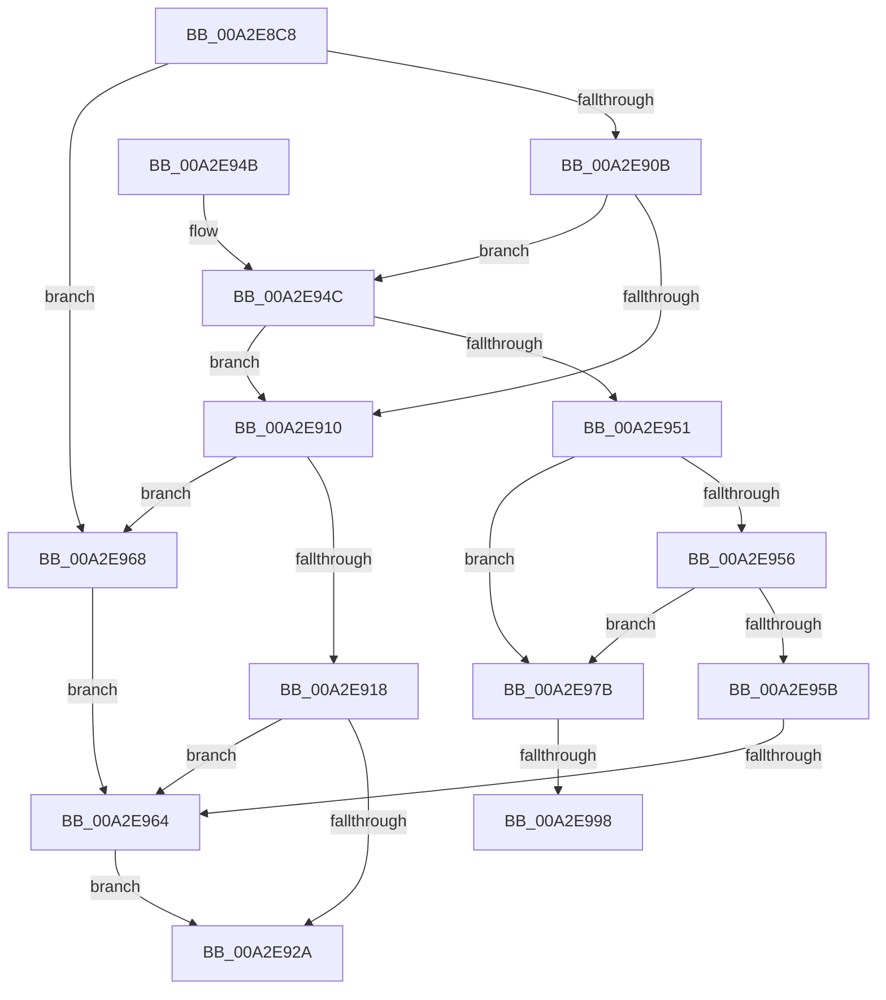

# PopUmpoProcessMessage

- RVA: `0x00A2E8C8`–`0x00A2E9AE` (길이 `230` bytes)
- VA: `0x0000000140A2E8C8`
- 실행 섹션: `PAGE`
- PDB 이름 있음: `예`; PDB Function 태그: `예`
- unwind 정보 RVA: `0x000AC938`
- 디코드: `64`개 명령, `230/230` bytes 표시
- 미해석 바이트: `0` (있으면 어셈블리에 `.byte`로 보존)

> 이 문서는 커널 이미지의 기계어와 PDB 기호를 분석해 생성했습니다. 4번과 5번은 함수 원형과 자료형을 바이너리 사용 방식에서 추정한 C 해석이며 원본 소스 복구 결과는 아닙니다.

## 1. Dependencies

- 직접 호출 지점: **4**; 고유 호출 대상: **4**
- 직접 호출자로 확인된 함수: **2**
- RIP 상대 이미지 참조: **6**

### Outgoing calls
- `0x00A2E91F` → [PopUmpoProcessPowerMessage](PopUmpoProcessPowerMessage_function_00A2E9B4.md) (function, `0x00A2E9B4`)
- `0x00A2E933` → [_security_check_cookie](../../text/6A/_security_check_cookie_function_006AC640.md) (function, `0x006AC640`)
- `0x00A2E974` → [ZwAlpcCancelMessage](../../text/6A/ZwAlpcCancelMessage_function_006AE010.md) (function, `0x006AE010`)
- `0x00A2E99D` → [ObfDereferenceObjectWithTag](../../text/2F/ObfDereferenceObjectWithTag_function_002F78E0.md) (function, `0x002F78E0`)

### Direct callers
- [PopUmpoSendPowerMessage](../../text/23/PopUmpoSendPowerMessage_function_00230730.md) at `0x002308FF`
- [PopUmpoProcessMessages](PopUmpoProcessMessages_function_00A2E790.md) at `0x00A2E81B`

### Static image references
- `0x00A2E8DC` → RVA `0x00E0A740` (`.data`; read)
- `0x00A2E968` → RVA `0x00F084D0` (`.data`; read)
- `0x00A2E97B` → RVA `0x00F084D8` (`.data`; write)
- `0x00A2E982` → RVA `0x00F084C8` (`.data`; write)
- `0x00A2E988` → RVA `0x00F084C0` (`.data`; read)
- `0x00A2E9A2` → RVA `0x00F084C0` (`.data`; write)

## 2. Other-region calls and transfers

- 다른 실행 섹션으로 향하는 call: **3**
  - `0x00A2E933` → [_security_check_cookie](../../text/6A/_security_check_cookie_function_006AC640.md) (`PAGE` → `.text`)
  - `0x00A2E974` → [ZwAlpcCancelMessage](../../text/6A/ZwAlpcCancelMessage_function_006AE010.md) (`PAGE` → `.text`)
  - `0x00A2E99D` → [ObfDereferenceObjectWithTag](../../text/2F/ObfDereferenceObjectWithTag_function_002F78E0.md) (`PAGE` → `.text`)
- call이 아닌 외부 분기/꼬리 이동: **3**
  - `0x00A2E95E` → [sub_00B39570](../B3/Unknown_function_00B39570.md) (`tail-transfer`)
  - `0x00A2E992` → [sub_00B39570 + 0x163](../B3/Unknown_function_00B39570.md) (`tail-transfer`)
  - `0x00A2E9A9` → [sub_00B39570 + 0x163](../B3/Unknown_function_00B39570.md) (`tail-transfer`)

## 3. Assembly (complete function range)

```asm
00A2E8C8  48 89 5C 24 20                  mov qword ptr [rsp + 0x20], rbx
00A2E8CD  55                              push rbp
00A2E8CE  56                              push rsi
00A2E8CF  57                              push rdi
00A2E8D0  48 8D 6C 24 B9                  lea rbp, [rsp - 0x47]
00A2E8D5  48 81 EC F0 00 00 00            sub rsp, 0xf0
00A2E8DC  48 8B 05 5D BE 3D 00            mov rax, qword ptr [rip + 0x3dbe5d]
00A2E8E3  48 33 C4                        xor rax, rsp
00A2E8E6  48 89 45 37                     mov qword ptr [rbp + 0x37], rax
00A2E8EA  48 8B F9                        mov rdi, rcx
00A2E8ED  33 F6                           xor esi, esi
00A2E8EF  4D 8B C8                        mov r9, r8
00A2E8F2  89 75 BB                        mov dword ptr [rbp - 0x45], esi
00A2E8F5  44 0F B7 41 04                  movzx r8d, word ptr [rcx + 4]
00A2E8FA  41 8B C8                        mov ecx, r8d
00A2E8FD  89 75 D3                        mov dword ptr [rbp - 0x2d], esi
00A2E900  81 E1 FF 00 FF FF               and ecx, 0xffff00ff
00A2E906  83 E9 01                        sub ecx, 1
00A2E909  74 5D                           je 0x140a2e968
00A2E90B  83 E9 01                        sub ecx, 1
00A2E90E  75 3C                           jne 0x140a2e94c
00A2E910  66 41 0F BA E0 0D               bt r8w, 0xd
00A2E916  72 50                           jb 0x140a2e968
00A2E918  48 8D 4F 28                     lea rcx, [rdi + 0x28]
00A2E91C  49 8B D1                        mov rdx, r9
00A2E91F  E8 90 00 00 00                  call 0x140a2e9b4
00A2E924  8B D8                           mov ebx, eax
00A2E926  85 C0                           test eax, eax
00A2E928  79 3A                           jns 0x140a2e964
00A2E92A  8B C3                           mov eax, ebx
00A2E92C  48 8B 4D 37                     mov rcx, qword ptr [rbp + 0x37]
00A2E930  48 33 CC                        xor rcx, rsp
00A2E933  E8 08 DD C7 FF                  call 0x1406ac640
00A2E938  48 8B 9C 24 28 01 00 00         mov rbx, qword ptr [rsp + 0x128]
00A2E940  48 81 C4 F0 00 00 00            add rsp, 0xf0
00A2E947  5F                              pop rdi
00A2E948  5E                              pop rsi
00A2E949  5D                              pop rbp
00A2E94A  C3                              ret
00A2E94B  CC                              int3
00A2E94C  83 E9 01                        sub ecx, 1
00A2E94F  74 BF                           je 0x140a2e910
00A2E951  83 E9 02                        sub ecx, 2
00A2E954  74 25                           je 0x140a2e97b
00A2E956  83 E9 01                        sub ecx, 1
00A2E959  74 20                           je 0x140a2e97b
00A2E95B  83 F9 04                        cmp ecx, 4
00A2E95E  0F 84 0C AC 10 00               je 0x140b39570
00A2E964  8B DE                           mov ebx, esi
00A2E966  EB C2                           jmp 0x140a2e92a
00A2E968  48 8B 0D 61 9B 4D 00            mov rcx, qword ptr [rip + 0x4d9b61]
00A2E96F  4C 8B C2                        mov r8, rdx
00A2E972  33 D2                           xor edx, edx
00A2E974  E8 97 F6 C7 FF                  call 0x1406ae010
00A2E979  EB E9                           jmp 0x140a2e964
00A2E97B  40 88 35 56 9B 4D 00            mov byte ptr [rip + 0x4d9b56], sil
00A2E982  89 35 40 9B 4D 00               mov dword ptr [rip + 0x4d9b40], esi
00A2E988  48 8B 0D 31 9B 4D 00            mov rcx, qword ptr [rip + 0x4d9b31]
00A2E98F  48 85 C9                        test rcx, rcx
00A2E992  0F 84 3B AD 10 00               je 0x140b396d3
00A2E998  BA 44 66 6C 74                  mov edx, 0x746c6644
00A2E99D  E8 3E 8F 8C FF                  call 0x1402f78e0
00A2E9A2  48 89 35 17 9B 4D 00            mov qword ptr [rip + 0x4d9b17], rsi
00A2E9A9  E9 25 AD 10 00                  jmp 0x140b396d3
```

## 4. C-style interpretation (structured pseudocode)

```c
__int64 __fastcall PopUmpoProcessMessage(__int64 a1, __int64 a2, __int64 a3)
{
    __int64 result;
    __int64 v_rsi;
    __int64 v_rsp;
    unsigned __int64 v_stack_m28;
    unsigned __int64 v_stack_m5F;
    unsigned int v_stack_m8C;
    unsigned int v_stack_mA4;
    unsigned __int64 v_stack_p20;

    v_stack_p20 = v_rbx;
    v_rsp = (v_rsp) - (240);
    result = (*(unsigned __int64 *)(v_rip + 4046429)) ^ (v_rsp);
    v_stack_m28 = result;
    v_rsi = 0;
    v_stack_mA4 = 0;
    v_stack_m8C = 0;
    a1 = (unsigned int)(((unsigned int)((unsigned int)(*(unsigned __int16 *)(a1 + 4)))) & (0xFFFF00FFULL));
    a1 = (unsigned int)((a1) - (1));
    if (condition_is_equal) goto loc_00A2E968;
    a1 = (unsigned int)((a1) - (1));
    if (condition_is_not_equal) goto loc_00A2E94C;
loc_00A2E910:
    if (condition_is_below) goto loc_00A2E968;
    result = PopUmpoProcessPowerMessage(a1 + 40, a3, *(unsigned __int16 *)(a1 + 4), a3);
    if (!sign_flag) goto loc_00A2E964;
loc_00A2E92A:
    a1 = (v_stack_m28) ^ (v_rsp);
    result = _security_check_cookie(a1, a3, *(unsigned __int16 *)(a1 + 4), a3);
    v_rsp = (v_rsp) + (240);
    return result;
loc_00A2E94C:
    a1 = (unsigned int)((a1) - (1));
    if (condition_is_equal) goto loc_00A2E910;
    a1 = (unsigned int)((a1) - (2));
    if (condition_is_equal) goto loc_00A2E97B;
    a1 = (unsigned int)((a1) - (1));
    if (condition_is_equal) goto loc_00A2E97B;
loc_00A2E964:
    goto loc_00A2E92A;
loc_00A2E968:
    a2 = 0;
    result = ZwAlpcCancelMessage(*(unsigned __int64 *)(v_rip + 5086049), a2, a3, a3);
    goto loc_00A2E964;
loc_00A2E97B:
    *(unsigned __int8 *)(v_rip + 5086038) = 0;
    *(unsigned int *)(v_rip + 5086016) = 0;
    result = ObfDereferenceObjectWithTag(*(unsigned __int64 *)(v_rip + 5086001), (unsigned int)(0x746C6644ULL), a3, a3);
    *(unsigned __int64 *)(v_rip + 5085975) = 0;
}
```

## 5. (Beta) C Style

```c
int64_t PopUmpoProcessMessage(void *Arg1, int64_t Arg2, int64_t Arg3)
{
    uint8_t *arg1 = (uint8_t *)Arg1;

    int64_t result;
    int64_t local_rsi;
    int64_t local_rsp;
    uint64_t v_stack_m28;
    uint64_t v_stack_m5F;
    uint32_t v_stack_m8C;
    uint32_t v_stack_mA4;
    uint64_t v_stack_p20;

    v_stack_p20 = local_rbx;
    local_rsp = (local_rsp) - (240);
    result = (*(uint64_t *)(v_rip + 0x3DBE5D)) ^ (local_rsp);
    v_stack_m28 = result;
    local_rsi = 0;
    v_stack_mA4 = 0;
    v_stack_m8C = 0;
    Arg1 = (uint32_t)(((uint32_t)((uint32_t)(*(uint16_t *)(arg1 + 0x4)))) & (0xFFFF00FFULL));
    Arg1 = (uint32_t)((Arg1) - (1));
    if (condition_is_equal) goto loc_00A2E968;
    Arg1 = (uint32_t)((Arg1) - (1));
    if (condition_is_not_equal) goto loc_00A2E94C;
loc_00A2E910:
    if (condition_is_below) goto loc_00A2E968;
    result = PopUmpoProcessPowerMessage(Arg1 + 40, Arg3, *(uint16_t *)(arg1 + 0x4), Arg3);
    if (!sign_flag) goto loc_00A2E964;
loc_00A2E92A:
    Arg1 = (v_stack_m28) ^ (local_rsp);
    result = _security_check_cookie(Arg1, Arg3, *(uint16_t *)(arg1 + 0x4), Arg3);
    local_rsp = (local_rsp) + (240);
    return result;
loc_00A2E94C:
    Arg1 = (uint32_t)((Arg1) - (1));
    if (condition_is_equal) goto loc_00A2E910;
    Arg1 = (uint32_t)((Arg1) - (2));
    if (condition_is_equal) goto loc_00A2E97B;
    Arg1 = (uint32_t)((Arg1) - (1));
    if (condition_is_equal) goto loc_00A2E97B;
loc_00A2E964:
    goto loc_00A2E92A;
loc_00A2E968:
    Arg2 = 0;
    result = ZwAlpcCancelMessage(*(uint64_t *)(v_rip + 0x4D9B61), Arg2, Arg3, Arg3);
    goto loc_00A2E964;
loc_00A2E97B:
    *(uint8_t *)(v_rip + 0x4D9B56) = 0;
    *(uint32_t *)(v_rip + 0x4D9B40) = 0;
    result = ObfDereferenceObjectWithTag(*(uint64_t *)(v_rip + 0x4D9B31), (uint32_t)(0x746C6644ULL), Arg3, Arg3);
    *(uint64_t *)(v_rip + 0x4D9B17) = 0;
}
```

### 관측된 메모리 오프셋

구조체 형식이 확인되지 않은 접근은 인자 기준의 오프셋으로만 기록했습니다.

| 기준 인자 | 오프셋 표현 | 폭 (bit) | 접근 |
|---|---:|---:|---|
| `Arg1` | `+ 0x4` | `16` | `R` |
| `Arg1` | `+ 0x28` | `64` | `R` |

## 6. Execution-region graph

[열기: 2D/3D 그래프와 함수 탐색 컨트롤 패널](../../../control-panel.html?section=page&rva=0x00A2E8C8&view=graph)

- 2D 그래프는 위에서 아래로 흐르고, 3D 그래프는 빈 공간을 드래그해 회전합니다. Shift+드래그는 이동, 휠은 확대·축소, 함수 노드 선택은 대상 보고서 이동입니다.

### Static fallback


