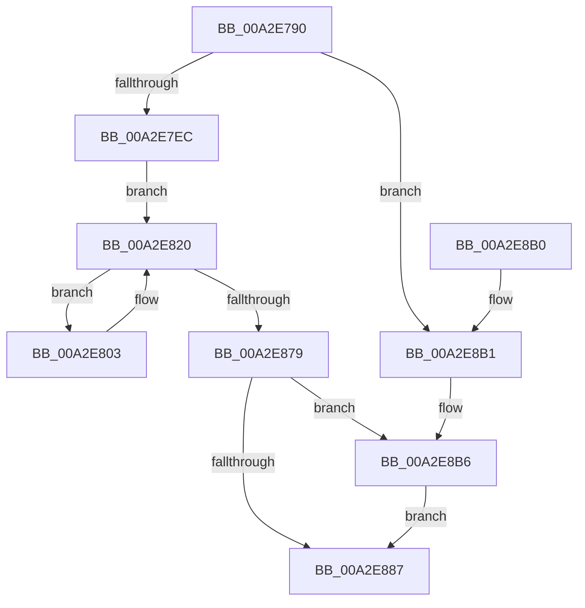

# PopUmpoProcessMessages

- RVA: `0x00A2E790`–`0x00A2E8BF` (길이 `303` bytes)
- VA: `0x0000000140A2E790`
- 실행 섹션: `PAGE`
- PDB 이름 있음: `예`; PDB Function 태그: `아니요`
- unwind 정보 RVA: `0x000AC910`
- 디코드: `76`개 명령, `303/303` bytes 표시
- 미해석 바이트: `0` (있으면 어셈블리에 `.byte`로 보존)

> 이 문서는 커널 이미지의 기계어와 PDB 기호를 분석해 생성했습니다. 4번과 5번은 함수 원형과 자료형을 바이너리 사용 방식에서 추정한 C 해석이며 원본 소스 복구 결과는 아닙니다.

## 1. Dependencies

- 직접 호출 지점: **9**; 고유 호출 대상: **9**
- 직접 호출자로 확인된 함수: **2**
- RIP 상대 이미지 참조: **2**

### Outgoing calls
- `0x00A2E7DB` → [ExAllocatePool2](../../poolcode/B8/ExAllocatePool2_function_00B820F0.md) (function, `0x00B820F0`)
- `0x00A2E7FC` → [memset](../../text/6C/memset_function_006C6C40.md) (function, `0x006C6C40`)
- `0x00A2E80D` → [AlpcGetMessageAttribute](../../text/45/AlpcGetMessageAttribute_function_00450010.md) (function, `0x00450010`)
- `0x00A2E81B` → [PopUmpoProcessMessage](PopUmpoProcessMessage_function_00A2E8C8.md) (function, `0x00A2E8C8`)
- `0x00A2E832` → [AlpcInitializeMessageAttribute](../../text/45/AlpcInitializeMessageAttribute_function_00450050.md) (function, `0x00450050`)
- `0x00A2E86E` → [ZwAlpcSendWaitReceivePort](../../text/6A/ZwAlpcSendWaitReceivePort_function_006AE290.md) (function, `0x006AE290`)
- `0x00A2E87E` → [ExFreePoolWithTag](../../poolcode/B8/ExFreePoolWithTag_function_00B82870.md) (function, `0x00B82870`)
- `0x00A2E88E` → [_security_check_cookie](../../text/6A/_security_check_cookie_function_006AC640.md) (function, `0x006AC640`)
- `0x00A2E8B8` → [PopDiagTraceUmpoAlpcProcessingError](../76/PopDiagTraceUmpoAlpcProcessingError_function_0076373C.md) (function, `0x0076373C`)

### Direct callers
- [PopUmpoMessageCallback](../../text/45/PopUmpoMessageCallback_function_00452600.md) at `0x00452604`
- [PopUmpoInitializeChannel](../../init/C4/PopUmpoInitializeChannel_function_00C428F0.md) at `0x00C42B26`

### Static image references
- `0x00A2E7AF` → RVA `0x00E0A740` (`.data`; read)
- `0x00A2E837` → RVA `0x00F084D0` (`.data`; read)

## 2. Other-region calls and transfers

- 다른 실행 섹션으로 향하는 call: **7**
  - `0x00A2E7DB` → [ExAllocatePool2](../../poolcode/B8/ExAllocatePool2_function_00B820F0.md) (`PAGE` → `POOLCODE`)
  - `0x00A2E7FC` → [memset](../../text/6C/memset_function_006C6C40.md) (`PAGE` → `.text`)
  - `0x00A2E80D` → [AlpcGetMessageAttribute](../../text/45/AlpcGetMessageAttribute_function_00450010.md) (`PAGE` → `.text`)
  - `0x00A2E832` → [AlpcInitializeMessageAttribute](../../text/45/AlpcInitializeMessageAttribute_function_00450050.md) (`PAGE` → `.text`)
  - `0x00A2E86E` → [ZwAlpcSendWaitReceivePort](../../text/6A/ZwAlpcSendWaitReceivePort_function_006AE290.md) (`PAGE` → `.text`)
  - `0x00A2E87E` → [ExFreePoolWithTag](../../poolcode/B8/ExFreePoolWithTag_function_00B82870.md) (`PAGE` → `POOLCODE`)
  - `0x00A2E88E` → [_security_check_cookie](../../text/6A/_security_check_cookie_function_006AC640.md) (`PAGE` → `.text`)
- 별도 외부 분기/꼬리 이동을 확인하지 못했습니다.

## 3. Assembly (complete function range)

```asm
00A2E790  48 8B C4                        mov rax, rsp
00A2E793  48 89 58 08                     mov qword ptr [rax + 8], rbx
00A2E797  48 89 70 10                     mov qword ptr [rax + 0x10], rsi
00A2E79B  48 89 78 18                     mov qword ptr [rax + 0x18], rdi
00A2E79F  4C 89 70 20                     mov qword ptr [rax + 0x20], r14
00A2E7A3  55                              push rbp
00A2E7A4  48 8D 68 E8                     lea rbp, [rax - 0x18]
00A2E7A8  48 81 EC 10 01 00 00            sub rsp, 0x110
00A2E7AF  48 8B 05 8A BF 3D 00            mov rax, qword ptr [rip + 0x3dbf8a]
00A2E7B6  48 33 C4                        xor rax, rsp
00A2E7B9  48 89 45 00                     mov qword ptr [rbp], rax
00A2E7BD  48 83 64 24 40 00               and qword ptr [rsp + 0x40], 0
00A2E7C3  BE 00 10 00 00                  mov esi, 0x1000
00A2E7C8  48 83 64 24 48 00               and qword ptr [rsp + 0x48], 0
00A2E7CE  8B D6                           mov edx, esi
00A2E7D0  41 B8 55 6D 70 6F               mov r8d, 0x6f706d55
00A2E7D6  B9 00 01 00 00                  mov ecx, 0x100
00A2E7DB  E8 10 39 15 00                  call 0x140b820f0
00A2E7E0  48 8B F8                        mov rdi, rax
00A2E7E3  48 85 C0                        test rax, rax
00A2E7E6  0F 84 C5 00 00 00               je 0x140a2e8b1
00A2E7EC  41 BE A0 00 00 00               mov r14d, 0xa0
00A2E7F2  48 8D 4C 24 60                  lea rcx, [rsp + 0x60]
00A2E7F7  45 8B C6                        mov r8d, r14d
00A2E7FA  33 D2                           xor edx, edx
00A2E7FC  E8 3F 84 C9 FF                  call 0x1406c6c40
00A2E801  EB 1D                           jmp 0x140a2e820
00A2E803  BA 00 00 00 20                  mov edx, 0x20000000
00A2E808  48 8D 4C 24 60                  lea rcx, [rsp + 0x60]
00A2E80D  E8 FE 17 A2 FF                  call 0x140450010
00A2E812  48 8B D0                        mov rdx, rax
00A2E815  45 33 C0                        xor r8d, r8d
00A2E818  48 8B CF                        mov rcx, rdi
00A2E81B  E8 A8 00 00 00                  call 0x140a2e8c8
00A2E820  4C 8D 4C 24 50                  lea r9, [rsp + 0x50]
00A2E825  4D 8B C6                        mov r8, r14
00A2E828  48 8D 54 24 60                  lea rdx, [rsp + 0x60]
00A2E82D  B9 00 00 00 20                  mov ecx, 0x20000000
00A2E832  E8 19 18 A2 FF                  call 0x140450050
00A2E837  48 8B 0D 92 9C 4D 00            mov rcx, qword ptr [rip + 0x4d9c92]
00A2E83E  48 8D 44 24 48                  lea rax, [rsp + 0x48]
00A2E843  48 89 44 24 38                  mov qword ptr [rsp + 0x38], rax
00A2E848  45 33 C9                        xor r9d, r9d
00A2E84B  48 8D 44 24 60                  lea rax, [rsp + 0x60]
00A2E850  48 89 74 24 40                  mov qword ptr [rsp + 0x40], rsi
00A2E855  48 89 44 24 30                  mov qword ptr [rsp + 0x30], rax
00A2E85A  45 33 C0                        xor r8d, r8d
00A2E85D  48 8D 44 24 40                  lea rax, [rsp + 0x40]
00A2E862  33 D2                           xor edx, edx
00A2E864  48 89 44 24 28                  mov qword ptr [rsp + 0x28], rax
00A2E869  48 89 7C 24 20                  mov qword ptr [rsp + 0x20], rdi
00A2E86E  E8 1D FA C7 FF                  call 0x1406ae290
00A2E873  8B D8                           mov ebx, eax
00A2E875  85 C0                           test eax, eax
00A2E877  74 8A                           je 0x140a2e803
00A2E879  33 D2                           xor edx, edx
00A2E87B  48 8B CF                        mov rcx, rdi
00A2E87E  E8 ED 3F 15 00                  call 0x140b82870
00A2E883  85 DB                           test ebx, ebx
00A2E885  78 2F                           js 0x140a2e8b6
00A2E887  48 8B 4D 00                     mov rcx, qword ptr [rbp]
00A2E88B  48 33 CC                        xor rcx, rsp
00A2E88E  E8 AD DD C7 FF                  call 0x1406ac640
00A2E893  4C 8D 9C 24 10 01 00 00         lea r11, [rsp + 0x110]
00A2E89B  49 8B 5B 10                     mov rbx, qword ptr [r11 + 0x10]
00A2E89F  49 8B 73 18                     mov rsi, qword ptr [r11 + 0x18]
00A2E8A3  49 8B 7B 20                     mov rdi, qword ptr [r11 + 0x20]
00A2E8A7  4D 8B 73 28                     mov r14, qword ptr [r11 + 0x28]
00A2E8AB  49 8B E3                        mov rsp, r11
00A2E8AE  5D                              pop rbp
00A2E8AF  C3                              ret
00A2E8B0  CC                              int3
00A2E8B1  BB 9A 00 00 C0                  mov ebx, 0xc000009a
00A2E8B6  8B CB                           mov ecx, ebx
00A2E8B8  E8 7F 4E D3 FF                  call 0x14076373c
00A2E8BD  EB C8                           jmp 0x140a2e887
```

## 4. C-style interpretation (structured pseudocode)

```c
__int64 __fastcall PopUmpoProcessMessages(void)
{
    __int64 result;
    __int64 v_rsp;
    unsigned __int64 v_stack_m8;
    unsigned __int64 v_stack_mB8;
    unsigned __int64 v_stack_mC8;
    unsigned __int64 v_stack_mD0;
    unsigned __int64 v_stack_mD8;
    unsigned __int64 v_stack_mE0;
    unsigned __int64 v_stack_mE8;
    unsigned __int64 v_stack_mF0;
    unsigned __int64 v_stack_mF8;

    *(unsigned __int64 *)(v_rsp + 8) = v_rbx;
    *(unsigned __int64 *)(v_rsp + 16) = v_rsi;
    *(unsigned __int64 *)(v_rsp + 24) = v_rdi;
    *(unsigned __int64 *)(v_rsp + 32) = v_r14;
    v_rsp = (v_rsp) - (272);
    result = (*(unsigned __int64 *)(v_rip + 4046730)) ^ (v_rsp);
    *(unsigned __int64 *)(v_rsp - 24) = result;
    result = ExAllocatePool2(256, (unsigned int)((unsigned int)((unsigned int)(0x1000ULL))), (unsigned int)(0x6F706D55ULL), a4);
    if (result == 0) goto loc_00A2E8B1;
    a2 = 0;
    result = memset(v_stack_mB8, a2, 160, a4);
    goto loc_00A2E820;
loc_00A2E803:
    result = AlpcGetMessageAttribute(v_stack_mB8, (unsigned int)(0x20000000ULL), 160, a4);
    a3 = 0;
    result = PopUmpoProcessMessage(result, result, a3, a4);
loc_00A2E820:
    result = AlpcInitializeMessageAttribute((unsigned int)(0x20000000ULL), v_stack_mB8, 160, v_stack_mC8);
    v_stack_mE0 = v_stack_mD0;
    a4 = 0;
    v_stack_mD8 = (unsigned int)(0x1000ULL);
    v_stack_mE8 = v_stack_mB8;
    a3 = 0;
    a2 = 0;
    v_stack_mF0 = v_stack_mD8;
    v_stack_mF8 = result;
    result = ZwAlpcSendWaitReceivePort(*(unsigned __int64 *)(v_rip + 5086354), a2, a3, a4);
    if ((unsigned int)(result) == 0) goto loc_00A2E803;
    a2 = 0;
    result = ExFreePoolWithTag(result, a2, a3, a4);
    if (sign_flag) goto loc_00A2E8B6;
loc_00A2E887:
    a1 = (*(unsigned __int64 *)(v_rsp - 24)) ^ (v_rsp);
    result = _security_check_cookie(a1, a2, a3, a4);
    return result;
loc_00A2E8B1:
loc_00A2E8B6:
    result = PopDiagTraceUmpoAlpcProcessingError((unsigned int)((unsigned int)((unsigned int)(0xC000009AULL))), a2, a3, a4);
    goto loc_00A2E887;
}
```

## 5. (Beta) C Style

```c
void PopUmpoProcessMessages(void)
{
    int64_t result;
    int64_t local_rsp;
    uint64_t v_stack_m8;
    uint64_t v_stack_mB8;
    uint64_t v_stack_mC8;
    uint64_t v_stack_mD0;
    uint64_t v_stack_mD8;
    uint64_t v_stack_mE0;
    uint64_t v_stack_mE8;
    uint64_t v_stack_mF0;
    uint64_t v_stack_mF8;

    *(uint64_t *)(local_rsp + 0x8) = local_rbx;
    *(uint64_t *)(local_rsp + 0x10) = local_rsi;
    *(uint64_t *)(local_rsp + 0x18) = local_rdi;
    *(uint64_t *)(local_rsp + 0x20) = local_r14;
    local_rsp = (local_rsp) - (272);
    result = (*(uint64_t *)(v_rip + 0x3DBF8A)) ^ (local_rsp);
    *(uint64_t *)(local_rsp - 0x18) = result;
    result = ExAllocatePool2(256, (uint32_t)((uint32_t)((uint32_t)(0x1000ULL))), (uint32_t)(0x6F706D55ULL), a4);
    if (result == 0) goto loc_00A2E8B1;
    a2 = 0;
    result = memset(v_stack_mB8, a2, 160, a4);
    goto loc_00A2E820;
loc_00A2E803:
    result = AlpcGetMessageAttribute(v_stack_mB8, (uint32_t)(0x20000000ULL), 160, a4);
    a3 = 0;
    result = PopUmpoProcessMessage(result, result, a3, a4);
loc_00A2E820:
    result = AlpcInitializeMessageAttribute((uint32_t)(0x20000000ULL), v_stack_mB8, 160, v_stack_mC8);
    v_stack_mE0 = v_stack_mD0;
    a4 = 0;
    v_stack_mD8 = (uint32_t)(0x1000ULL);
    v_stack_mE8 = v_stack_mB8;
    a3 = 0;
    a2 = 0;
    v_stack_mF0 = v_stack_mD8;
    v_stack_mF8 = result;
    result = ZwAlpcSendWaitReceivePort(*(uint64_t *)(v_rip + 0x4D9C92), a2, a3, a4);
    if ((uint32_t)(result) == 0) goto loc_00A2E803;
    a2 = 0;
    result = ExFreePoolWithTag(result, a2, a3, a4);
    if (sign_flag) goto loc_00A2E8B6;
loc_00A2E887:
    a1 = (*(uint64_t *)(local_rsp - 0x18)) ^ (local_rsp);
    result = _security_check_cookie(a1, a2, a3, a4);
    return result;
loc_00A2E8B1:
loc_00A2E8B6:
    result = PopDiagTraceUmpoAlpcProcessingError((uint32_t)((uint32_t)((uint32_t)(0xC000009AULL))), a2, a3, a4);
    goto loc_00A2E887;
}
```

## 6. Execution-region graph

[열기: 2D/3D 그래프와 함수 탐색 컨트롤 패널](../../../control-panel.html?section=page&rva=0x00A2E790&view=graph)

- 2D 그래프는 위에서 아래로 흐르고, 3D 그래프는 빈 공간을 드래그해 회전합니다. Shift+드래그는 이동, 휠은 확대·축소, 함수 노드 선택은 대상 보고서 이동입니다.

### Static fallback


