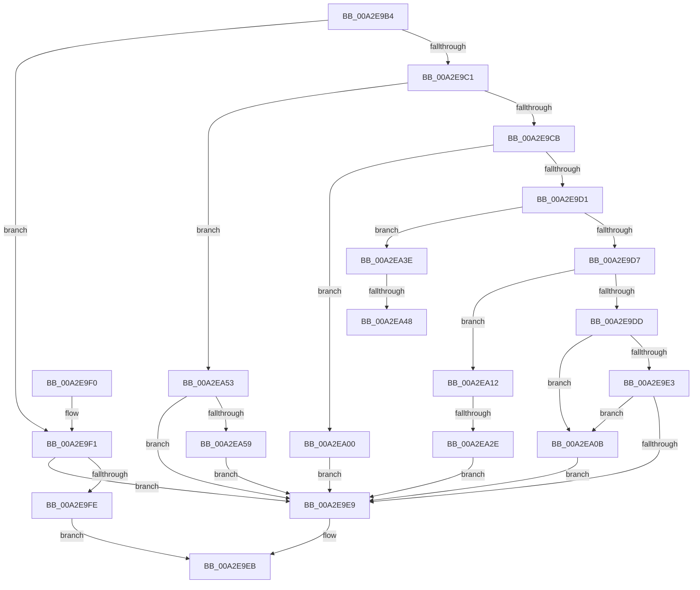

# PopUmpoProcessPowerMessage

- RVA: `0x00A2E9B4`–`0x00A2EA69` (길이 `181` bytes)
- VA: `0x0000000140A2E9B4`
- 실행 섹션: `PAGE`
- PDB 이름 있음: `예`; PDB Function 태그: `예`
- unwind 정보 RVA: `0x000AC968`
- 디코드: `53`개 명령, `181/181` bytes 표시
- 미해석 바이트: `0` (있으면 어셈블리에 `.byte`로 보존)

> 이 문서는 커널 이미지의 기계어와 PDB 기호를 분석해 생성했습니다. 4번과 5번은 함수 원형과 자료형을 바이너리 사용 방식에서 추정한 C 해석이며 원본 소스 복구 결과는 아닙니다.

## 1. Dependencies

- 직접 호출 지점: **5**; 고유 호출 대상: **5**
- 직접 호출자로 확인된 함수: **1**
- RIP 상대 이미지 참조: **0**

### Outgoing calls
- `0x00A2E9F5` → [PopSetNewPolicyValue](../91/PopSetNewPolicyValue_function_00914C6C.md) (function, `0x00914C6C`)
- `0x00A2EA04` → [PopPowerRequestHandleRequestOverrideQueryResponse](../../text/47/PopPowerRequestHandleRequestOverrideQueryResponse_function_004777FC.md) (function, `0x004777FC`)
- `0x00A2EA0B` → [PopAdaptiveStandbyHandlePowerMessage](../76/PopAdaptiveStandbyHandlePowerMessage_function_0076DB70.md) (function, `0x0076DB70`)
- `0x00A2EA48` → [PopPowerRequestNotificationsBegin](../75/PopPowerRequestNotificationsBegin_function_00754B24.md) (function, `0x00754B24`)
- `0x00A2EA62` → [PfIoPowerEventNotify](../75/PfIoPowerEventNotify_function_00750784.md) (function, `0x00750784`)

### Direct callers
- [PopUmpoProcessMessage](PopUmpoProcessMessage_function_00A2E8C8.md) at `0x00A2E91F`

### Static image references
- 디코드된 RIP-relative 메모리 참조가 없습니다.

## 2. Other-region calls and transfers

- 다른 실행 섹션으로 향하는 call: **1**
  - `0x00A2EA04` → [PopPowerRequestHandleRequestOverrideQueryResponse](../../text/47/PopPowerRequestHandleRequestOverrideQueryResponse_function_004777FC.md) (`PAGE` → `.text`)
- call이 아닌 외부 분기/꼬리 이동: **3**
  - `0x00A2EA28` → [sub_00B39700](../B3/Unknown_function_00B39700.md) (`tail-transfer`)
  - `0x00A2EA42` → [sub_00B39700 + 0x1E](../B3/Unknown_function_00B39700.md) (`tail-transfer`)
  - `0x00A2EA4E` → [sub_00B39700 + 0x1E](../B3/Unknown_function_00B39700.md) (`tail-transfer`)

## 3. Assembly (complete function range)

```asm
00A2E9B4  48 83 EC 28                     sub rsp, 0x28
00A2E9B8  44 8B 01                        mov r8d, dword ptr [rcx]
00A2E9BB  41 83 E8 04                     sub r8d, 4
00A2E9BF  74 30                           je 0x140a2e9f1
00A2E9C1  41 83 E8 03                     sub r8d, 3
00A2E9C5  0F 84 88 00 00 00               je 0x140a2ea53
00A2E9CB  41 83 E8 01                     sub r8d, 1
00A2E9CF  74 2F                           je 0x140a2ea00
00A2E9D1  41 83 E8 02                     sub r8d, 2
00A2E9D5  74 67                           je 0x140a2ea3e
00A2E9D7  41 83 E8 08                     sub r8d, 8
00A2E9DB  74 35                           je 0x140a2ea12
00A2E9DD  41 83 E8 01                     sub r8d, 1
00A2E9E1  74 28                           je 0x140a2ea0b
00A2E9E3  41 83 F8 01                     cmp r8d, 1
00A2E9E7  74 22                           je 0x140a2ea0b
00A2E9E9  33 C0                           xor eax, eax
00A2E9EB  48 83 C4 28                     add rsp, 0x28
00A2E9EF  C3                              ret
00A2E9F0  CC                              int3
00A2E9F1  48 83 C1 08                     add rcx, 8
00A2E9F5  E8 72 62 EE FF                  call 0x140914c6c
00A2E9FA  85 C0                           test eax, eax
00A2E9FC  79 EB                           jns 0x140a2e9e9
00A2E9FE  EB EB                           jmp 0x140a2e9eb
00A2EA00  48 83 C1 08                     add rcx, 8
00A2EA04  E8 F3 8D A4 FF                  call 0x1404777fc
00A2EA09  EB DE                           jmp 0x140a2e9e9
00A2EA0B  E8 60 F1 D3 FF                  call 0x14076db70
00A2EA10  EB D7                           jmp 0x140a2e9e9
00A2EA12  44 8B 59 08                     mov r11d, dword ptr [rcx + 8]
00A2EA16  8A 41 0C                        mov al, byte ptr [rcx + 0xc]
00A2EA19  4C 8B 41 18                     mov r8, qword ptr [rcx + 0x18]
00A2EA1D  4C 8B 49 20                     mov r9, qword ptr [rcx + 0x20]
00A2EA21  44 8B 51 10                     mov r10d, dword ptr [rcx + 0x10]
00A2EA25  45 85 DB                        test r11d, r11d
00A2EA28  0F 85 D2 AC 10 00               jne 0x140b39700
00A2EA2E  88 02                           mov byte ptr [rdx], al
00A2EA30  4C 89 42 20                     mov qword ptr [rdx + 0x20], r8
00A2EA34  4C 89 4A 28                     mov qword ptr [rdx + 0x28], r9
00A2EA38  44 89 52 08                     mov dword ptr [rdx + 8], r10d
00A2EA3C  EB AB                           jmp 0x140a2e9e9
00A2EA3E  80 79 08 00                     cmp byte ptr [rcx + 8], 0
00A2EA42  0F 84 D6 AC 10 00               je 0x140b3971e
00A2EA48  E8 D7 60 D2 FF                  call 0x140754b24
00A2EA4D  90                              nop
00A2EA4E  E9 CB AC 10 00                  jmp 0x140b3971e
00A2EA53  80 79 14 00                     cmp byte ptr [rcx + 0x14], 0
00A2EA57  74 90                           je 0x140a2e9e9
00A2EA59  8B 49 0C                        mov ecx, dword ptr [rcx + 0xc]
00A2EA5C  41 B8 01 00 00 00               mov r8d, 1
00A2EA62  E8 1D 1D D2 FF                  call 0x140750784
00A2EA67  EB 80                           jmp 0x140a2e9e9
```

## 4. C-style interpretation (structured pseudocode)

```c
__int64 __fastcall PopUmpoProcessPowerMessage(__int64 a1, __int64 a2)
{
    __int64 result;
    __int64 v_rsp;

    v_rsp = (v_rsp) - (40);
    a3 = (unsigned int)(((unsigned int)(*(unsigned int *)(a1))) - (4));
    if (condition_is_equal) goto loc_00A2E9F1;
    a3 = (unsigned int)((a3) - (3));
    if (condition_is_equal) goto loc_00A2EA53;
    a3 = (unsigned int)((a3) - (1));
    if (condition_is_equal) goto loc_00A2EA00;
    a3 = (unsigned int)((a3) - (2));
    if (condition_is_equal) goto loc_00A2EA3E;
    a3 = (unsigned int)((a3) - (8));
    if (condition_is_equal) goto loc_00A2EA12;
    a3 = (unsigned int)((a3) - (1));
    if (condition_is_equal) goto loc_00A2EA0B;
    if (((unsigned int)(a3)) == 1) goto loc_00A2EA0B;
loc_00A2E9E9:
    result = 0;
loc_00A2E9EB:
    v_rsp = (v_rsp) + (40);
    return result;
loc_00A2E9F1:
    a1 = (a1) + (8);
    result = PopSetNewPolicyValue(a1, a2, a3, a4);
    if (!sign_flag) goto loc_00A2E9E9;
    goto loc_00A2E9EB;
loc_00A2EA00:
    a1 = (a1) + (8);
    result = PopPowerRequestHandleRequestOverrideQueryResponse(a1, a2, a3, a4);
    goto loc_00A2E9E9;
loc_00A2EA0B:
    result = PopAdaptiveStandbyHandlePowerMessage(a1, a2, a3, a4);
    goto loc_00A2E9E9;
loc_00A2EA12:
    *(unsigned __int8 *)(a2) = (unsigned __int8)(*(unsigned __int8 *)(a1 + 12));
    *(unsigned __int64 *)(a2 + 32) = *(unsigned __int64 *)(a1 + 24);
    *(unsigned __int64 *)(a2 + 40) = *(unsigned __int64 *)(a1 + 32);
    *(unsigned int *)(a2 + 8) = (unsigned int)((unsigned int)(*(unsigned int *)(a1 + 16)));
    goto loc_00A2E9E9;
loc_00A2EA3E:
    result = PopPowerRequestNotificationsBegin(a1, a2, *(unsigned __int64 *)(a1 + 24), *(unsigned __int64 *)(a1 + 32));
loc_00A2EA53:
    if ((*(unsigned __int8 *)(a1 + 20)) == 0) goto loc_00A2E9E9;
    result = PfIoPowerEventNotify((unsigned int)(*(unsigned int *)(a1 + 12)), a2, 1, *(unsigned __int64 *)(a1 + 32));
    goto loc_00A2E9E9;
}
```

## 5. (Beta) C Style

```c
int64_t PopUmpoProcessPowerMessage(void *Arg1, void *Arg2)
{
    uint8_t *arg1 = (uint8_t *)Arg1;
    uint8_t *arg2 = (uint8_t *)Arg2;

    int64_t result;
    int64_t local_rsp;

    local_rsp = (local_rsp) - (40);
    a3 = (uint32_t)(((uint32_t)(*(uint32_t *)(arg1))) - (4));
    if (condition_is_equal) goto loc_00A2E9F1;
    a3 = (uint32_t)((a3) - (3));
    if (condition_is_equal) goto loc_00A2EA53;
    a3 = (uint32_t)((a3) - (1));
    if (condition_is_equal) goto loc_00A2EA00;
    a3 = (uint32_t)((a3) - (2));
    if (condition_is_equal) goto loc_00A2EA3E;
    a3 = (uint32_t)((a3) - (8));
    if (condition_is_equal) goto loc_00A2EA12;
    a3 = (uint32_t)((a3) - (1));
    if (condition_is_equal) goto loc_00A2EA0B;
    if (((uint32_t)(a3)) == 1) goto loc_00A2EA0B;
loc_00A2E9E9:
    result = 0;
loc_00A2E9EB:
    local_rsp = (local_rsp) + (40);
    return result;
loc_00A2E9F1:
    Arg1 = (Arg1) + (8);
    result = PopSetNewPolicyValue(Arg1, Arg2, a3, a4);
    if (!sign_flag) goto loc_00A2E9E9;
    goto loc_00A2E9EB;
loc_00A2EA00:
    Arg1 = (Arg1) + (8);
    result = PopPowerRequestHandleRequestOverrideQueryResponse(Arg1, Arg2, a3, a4);
    goto loc_00A2E9E9;
loc_00A2EA0B:
    result = PopAdaptiveStandbyHandlePowerMessage(Arg1, Arg2, a3, a4);
    goto loc_00A2E9E9;
loc_00A2EA12:
    *(uint8_t *)(arg2) = (uint8_t)(*(uint8_t *)(arg1 + 0xC));
    *(uint64_t *)(arg2 + 0x20) = *(uint64_t *)(arg1 + 0x18);
    *(uint64_t *)(arg2 + 0x28) = *(uint64_t *)(arg1 + 0x20);
    *(uint32_t *)(arg2 + 0x8) = (uint32_t)((uint32_t)(*(uint32_t *)(arg1 + 0x10)));
    goto loc_00A2E9E9;
loc_00A2EA3E:
    result = PopPowerRequestNotificationsBegin(Arg1, Arg2, *(uint64_t *)(arg1 + 0x18), *(uint64_t *)(arg1 + 0x20));
loc_00A2EA53:
    if ((*(uint8_t *)(arg1 + 0x14)) == 0) goto loc_00A2E9E9;
    result = PfIoPowerEventNotify((uint32_t)(*(uint32_t *)(arg1 + 0xC)), Arg2, 1, *(uint64_t *)(arg1 + 0x20));
    goto loc_00A2E9E9;
}
```

### 관측된 메모리 오프셋

구조체 형식이 확인되지 않은 접근은 인자 기준의 오프셋으로만 기록했습니다.

| 기준 인자 | 오프셋 표현 | 폭 (bit) | 접근 |
|---|---:|---:|---|
| `Arg1` | `+ 0x0` | `32` | `R` |
| `Arg1` | `+ 0x8` | `8` | `R` |
| `Arg1` | `+ 0x8` | `32` | `R` |
| `Arg1` | `+ 0xC` | `8` | `R` |
| `Arg1` | `+ 0xC` | `32` | `R` |
| `Arg1` | `+ 0x10` | `32` | `R` |
| `Arg1` | `+ 0x14` | `8` | `R` |
| `Arg1` | `+ 0x18` | `64` | `R` |
| `Arg1` | `+ 0x20` | `64` | `R` |
| `Arg2` | `+ 0x0` | `8` | `W` |
| `Arg2` | `+ 0x8` | `32` | `W` |
| `Arg2` | `+ 0x20` | `64` | `W` |
| `Arg2` | `+ 0x28` | `64` | `W` |

## 6. Execution-region graph

[열기: 2D/3D 그래프와 함수 탐색 컨트롤 패널](../../../control-panel.html?section=page&rva=0x00A2E9B4&view=graph)

- 2D 그래프는 위에서 아래로 흐르고, 3D 그래프는 빈 공간을 드래그해 회전합니다. Shift+드래그는 이동, 휠은 확대·축소, 함수 노드 선택은 대상 보고서 이동입니다.

### Static fallback


