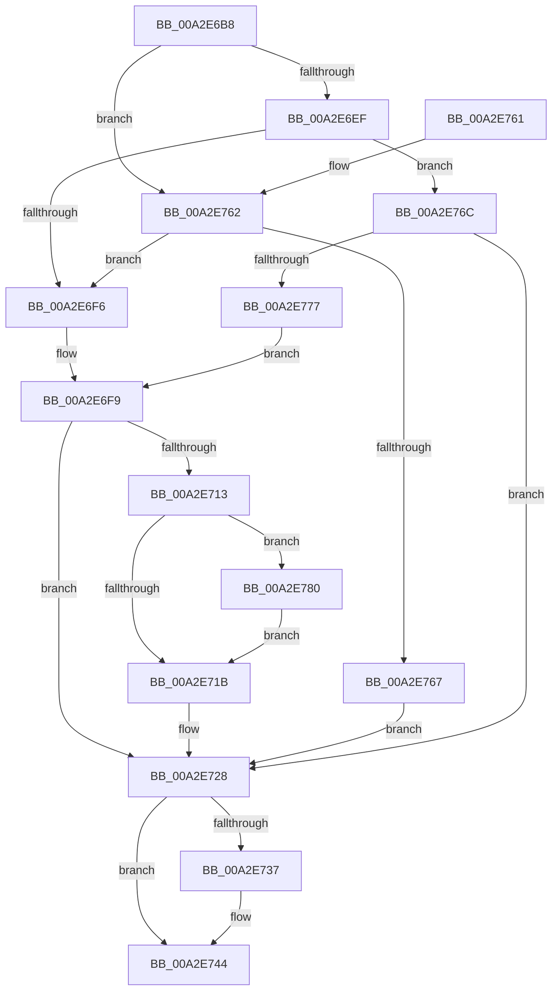

# PopUnicodeStringDeepCopy

- RVA: `0x00A2E6B8`–`0x00A2E789` (길이 `209` bytes)
- VA: `0x0000000140A2E6B8`
- 실행 섹션: `PAGE`
- PDB 이름 있음: `예`; PDB Function 태그: `아니요`
- unwind 정보 RVA: `0x000675D8`
- 디코드: `70`개 명령, `209/209` bytes 표시
- 미해석 바이트: `0` (있으면 어셈블리에 `.byte`로 보존)

> 이 문서는 커널 이미지의 기계어와 PDB 기호를 분석해 생성했습니다. 4번과 5번은 함수 원형과 자료형을 바이너리 사용 방식에서 추정한 C 해석이며 원본 소스 복구 결과는 아닙니다.

## 1. Dependencies

- 직접 호출 지점: **3**; 고유 호출 대상: **3**
- 직접 호출자로 확인된 함수: **2**
- RIP 상대 이미지 참조: **0**

### Outgoing calls
- `0x00A2E703` → [ExAllocatePool2](../../poolcode/B8/ExAllocatePool2_function_00B820F0.md) (function, `0x00B820F0`)
- `0x00A2E72E` → [RtlUnicodeStringCopy](../../text/3D/RtlUnicodeStringCopy_function_003D4130.md) (function, `0x003D4130`)
- `0x00A2E782` → [ExFreePoolWithTag](../../poolcode/B8/ExFreePoolWithTag_function_00B82870.md) (function, `0x00B82870`)

### Direct callers
- [PoGetRequester](../../text/5C/PoGetRequester_function_005CE468.md) at `0x005CE5AA`
- [PopPowerRequestStatsGetIdForRequest](PopPowerRequestStatsGetIdForRequest_function_00A2D784.md) at `0x00A2D8CD`

### Static image references
- 디코드된 RIP-relative 메모리 참조가 없습니다.

## 2. Other-region calls and transfers

- 다른 실행 섹션으로 향하는 call: **3**
  - `0x00A2E703` → [ExAllocatePool2](../../poolcode/B8/ExAllocatePool2_function_00B820F0.md) (`PAGE` → `POOLCODE`)
  - `0x00A2E72E` → [RtlUnicodeStringCopy](../../text/3D/RtlUnicodeStringCopy_function_003D4130.md) (`PAGE` → `.text`)
  - `0x00A2E782` → [ExFreePoolWithTag](../../poolcode/B8/ExFreePoolWithTag_function_00B82870.md) (`PAGE` → `POOLCODE`)
- 별도 외부 분기/꼬리 이동을 확인하지 못했습니다.

## 3. Assembly (complete function range)

```asm
00A2E6B8  48 89 5C 24 08                  mov qword ptr [rsp + 8], rbx
00A2E6BD  48 89 6C 24 10                  mov qword ptr [rsp + 0x10], rbp
00A2E6C2  48 89 74 24 18                  mov qword ptr [rsp + 0x18], rsi
00A2E6C7  57                              push rdi
00A2E6C8  41 54                           push r12
00A2E6CA  41 55                           push r13
00A2E6CC  41 56                           push r14
00A2E6CE  41 57                           push r15
00A2E6D0  48 83 EC 20                     sub rsp, 0x20
00A2E6D4  48 8B F1                        mov rsi, rcx
00A2E6D7  BD FF FF 00 00                  mov ebp, 0xffff
00A2E6DC  0F B7 0A                        movzx ecx, word ptr [rdx]
00A2E6DF  33 FF                           xor edi, edi
00A2E6E1  83 C1 02                        add ecx, 2
00A2E6E4  4C 8B EA                        mov r13, rdx
00A2E6E7  48 8D 5E 08                     lea rbx, [rsi + 8]
00A2E6EB  3B CD                           cmp ecx, ebp
00A2E6ED  77 73                           ja 0x140a2e762
00A2E6EF  8B E9                           mov ebp, ecx
00A2E6F1  48 39 3B                        cmp qword ptr [rbx], rdi
00A2E6F4  75 76                           jne 0x140a2e76c
00A2E6F6  4C 8B FB                        mov r15, rbx
00A2E6F9  8B D5                           mov edx, ebp
00A2E6FB  45 8B C1                        mov r8d, r9d
00A2E6FE  B9 00 01 00 00                  mov ecx, 0x100
00A2E703  E8 E8 39 15 00                  call 0x140b820f0
00A2E708  4C 8B E0                        mov r12, rax
00A2E70B  4C 8B F3                        mov r14, rbx
00A2E70E  48 85 C0                        test rax, rax
00A2E711  74 15                           je 0x140a2e728
00A2E713  48 8B 0B                        mov rcx, qword ptr [rbx]
00A2E716  48 85 C9                        test rcx, rcx
00A2E719  75 65                           jne 0x140a2e780
00A2E71B  4C 89 23                        mov qword ptr [rbx], r12
00A2E71E  4D 8B F7                        mov r14, r15
00A2E721  66 89 3E                        mov word ptr [rsi], di
00A2E724  66 89 6E 02                     mov word ptr [rsi + 2], bp
00A2E728  49 8B D5                        mov rdx, r13
00A2E72B  48 8B CE                        mov rcx, rsi
00A2E72E  E8 FD 59 9A FF                  call 0x1403d4130
00A2E733  85 C0                           test eax, eax
00A2E735  78 0D                           js 0x140a2e744
00A2E737  0F B7 16                        movzx edx, word ptr [rsi]
00A2E73A  49 8B 0E                        mov rcx, qword ptr [r14]
00A2E73D  48 D1 EA                        shr rdx, 1
00A2E740  66 89 3C 51                     mov word ptr [rcx + rdx*2], di
00A2E744  48 8B 5C 24 50                  mov rbx, qword ptr [rsp + 0x50]
00A2E749  48 8B 6C 24 58                  mov rbp, qword ptr [rsp + 0x58]
00A2E74E  48 8B 74 24 60                  mov rsi, qword ptr [rsp + 0x60]
00A2E753  48 83 C4 20                     add rsp, 0x20
00A2E757  41 5F                           pop r15
00A2E759  41 5E                           pop r14
00A2E75B  41 5D                           pop r13
00A2E75D  41 5C                           pop r12
00A2E75F  5F                              pop rdi
00A2E760  C3                              ret
00A2E761  CC                              int3
00A2E762  48 39 3B                        cmp qword ptr [rbx], rdi
00A2E765  74 8F                           je 0x140a2e6f6
00A2E767  4C 8B F3                        mov r14, rbx
00A2E76A  EB BC                           jmp 0x140a2e728
00A2E76C  0F B7 46 02                     movzx eax, word ptr [rsi + 2]
00A2E770  4C 8B F3                        mov r14, rbx
00A2E773  3B C1                           cmp eax, ecx
00A2E775  73 B1                           jae 0x140a2e728
00A2E777  4C 8D 7E 08                     lea r15, [rsi + 8]
00A2E77B  E9 79 FF FF FF                  jmp 0x140a2e6f9
00A2E780  33 D2                           xor edx, edx
00A2E782  E8 E9 40 15 00                  call 0x140b82870
00A2E787  EB 92                           jmp 0x140a2e71b
```

## 4. C-style interpretation (structured pseudocode)

```c
__int64 __fastcall PopUnicodeStringDeepCopy(__int64 a1, __int64 a2, __int64 a3, int a4)
{
    __int64 result;
    __int64 v_rdi;
    __int64 v_rsp;
    unsigned __int64 v_stack_p10;
    unsigned __int64 v_stack_p18;
    unsigned __int64 v_stack_p8;

    v_stack_p8 = v_rbx;
    v_stack_p10 = v_rbp;
    v_stack_p18 = v_rsi;
    v_rsp = (v_rsp) - (32);
    v_rdi = 0;
    a1 = (unsigned int)((*(unsigned __int16 *)(a2)) + (2));
    if (((unsigned int)(a1)) > ((unsigned int)((unsigned int)(0xFFFFULL)))) goto loc_00A2E762;
    if ((*(unsigned __int64 *)(a1 + 8)) != 0) goto loc_00A2E76C;
loc_00A2E6F6:
loc_00A2E6F9:
    result = ExAllocatePool2(256, (unsigned int)((unsigned int)((unsigned int)((unsigned int)(a1)))), (unsigned int)(a4), a4);
    if (result == 0) goto loc_00A2E728;
    if (*(unsigned __int64 *)(a1 + 8) != 0) goto loc_00A2E780;
loc_00A2E71B:
    *(unsigned __int64 *)(a1 + 8) = result;
    *(unsigned __int16 *)(a1) = 0;
    *(unsigned __int16 *)(a1 + 2) = (unsigned __int16)((unsigned int)((unsigned int)(a1)));
loc_00A2E728:
    result = RtlUnicodeStringCopy(a1, a2, (unsigned int)(a4), a4);
    if (!(sign_flag)) {
        a2 = *(unsigned __int16 *)(a1);
        a1 = *(unsigned __int64 *)(a1 + 8);
        a2 = (a2) >> (1);
        *(unsigned __int16 *)(a1 + a2 * 2) = 0;
    }
    v_rsp = (v_rsp) + (32);
    return result;
loc_00A2E762:
    if ((*(unsigned __int64 *)(v_stack_p8)) == 0) goto loc_00A2E6F6;
    goto loc_00A2E728;
loc_00A2E76C:
    if (((unsigned int)(*(unsigned __int16 *)(v_stack_p18 + 2))) >= ((unsigned int)(a1))) goto loc_00A2E728;
    goto loc_00A2E6F9;
loc_00A2E780:
    a2 = 0;
    result = ExFreePoolWithTag(a1, a2, (unsigned int)(a4), a4);
    goto loc_00A2E71B;
}
```

## 5. (Beta) C Style

```c
int64_t PopUnicodeStringDeepCopy(void *Arg1, void *Arg2, int64_t Arg3, int32_t Arg4)
{
    uint8_t *arg1 = (uint8_t *)Arg1;
    uint8_t *arg2 = (uint8_t *)Arg2;

    int64_t result;
    int64_t local_rdi;
    int64_t local_rsp;
    uint64_t v_stack_p10;
    uint64_t v_stack_p18;
    uint64_t v_stack_p8;

    v_stack_p8 = local_rbx;
    v_stack_p10 = local_rbp;
    v_stack_p18 = local_rsi;
    local_rsp = (local_rsp) - (32);
    local_rdi = 0;
    Arg1 = (uint32_t)((*(uint16_t *)(arg2)) + (2));
    if (((uint32_t)(Arg1)) > ((uint32_t)((uint32_t)(0xFFFFULL)))) goto loc_00A2E762;
    if ((*(uint64_t *)(arg1 + 0x8)) != 0) goto loc_00A2E76C;
loc_00A2E6F6:
loc_00A2E6F9:
    result = ExAllocatePool2(256, (uint32_t)((uint32_t)((uint32_t)((uint32_t)(Arg1)))), (uint32_t)(Arg4), Arg4);
    if (result == 0) goto loc_00A2E728;
    if (*(uint64_t *)(arg1 + 0x8) != 0) goto loc_00A2E780;
loc_00A2E71B:
    *(uint64_t *)(arg1 + 0x8) = result;
    *(uint16_t *)(arg1) = 0;
    *(uint16_t *)(arg1 + 0x2) = (uint16_t)((uint32_t)((uint32_t)(Arg1)));
loc_00A2E728:
    result = RtlUnicodeStringCopy(Arg1, Arg2, (uint32_t)(Arg4), Arg4);
    if (!(sign_flag)) {
        Arg2 = *(uint16_t *)(arg1);
        Arg1 = *(uint64_t *)(arg1 + 0x8);
        Arg2 = (Arg2) >> (1);
        *(uint16_t *)(arg1 + arg2 * 2) = 0;
    }
    local_rsp = (local_rsp) + (32);
    return result;
loc_00A2E762:
    if ((*(uint64_t *)(v_stack_p8)) == 0) goto loc_00A2E6F6;
    goto loc_00A2E728;
loc_00A2E76C:
    if (((uint32_t)(*(uint16_t *)(v_stack_p18 + 0x2))) >= ((uint32_t)(Arg1))) goto loc_00A2E728;
    goto loc_00A2E6F9;
loc_00A2E780:
    Arg2 = 0;
    result = ExFreePoolWithTag(Arg1, Arg2, (uint32_t)(Arg4), Arg4);
    goto loc_00A2E71B;
}
```

### 관측된 메모리 오프셋

구조체 형식이 확인되지 않은 접근은 인자 기준의 오프셋으로만 기록했습니다.

| 기준 인자 | 오프셋 표현 | 폭 (bit) | 접근 |
|---|---:|---:|---|
| `Arg1` | `+ 0x0` | `16` | `R` |
| `Arg1` | `+ 0x0` | `16` | `W` |
| `Arg1` | `+ 0x0` | `64` | `R` |
| `Arg1` | `+ 0x0` | `64` | `W` |
| `Arg1` | `+ 0x2` | `16` | `R` |
| `Arg1` | `+ 0x2` | `16` | `W` |
| `Arg1` | `+ 0x8` | `64` | `R` |
| `Arg2` | `+ 0x0` | `16` | `R` |

## 6. Execution-region graph

[열기: 2D/3D 그래프와 함수 탐색 컨트롤 패널](../../../control-panel.html?section=page&rva=0x00A2E6B8&view=graph)

- 2D 그래프는 위에서 아래로 흐르고, 3D 그래프는 빈 공간을 드래그해 회전합니다. Shift+드래그는 이동, 휠은 확대·축소, 함수 노드 선택은 대상 보고서 이동입니다.

### Static fallback


