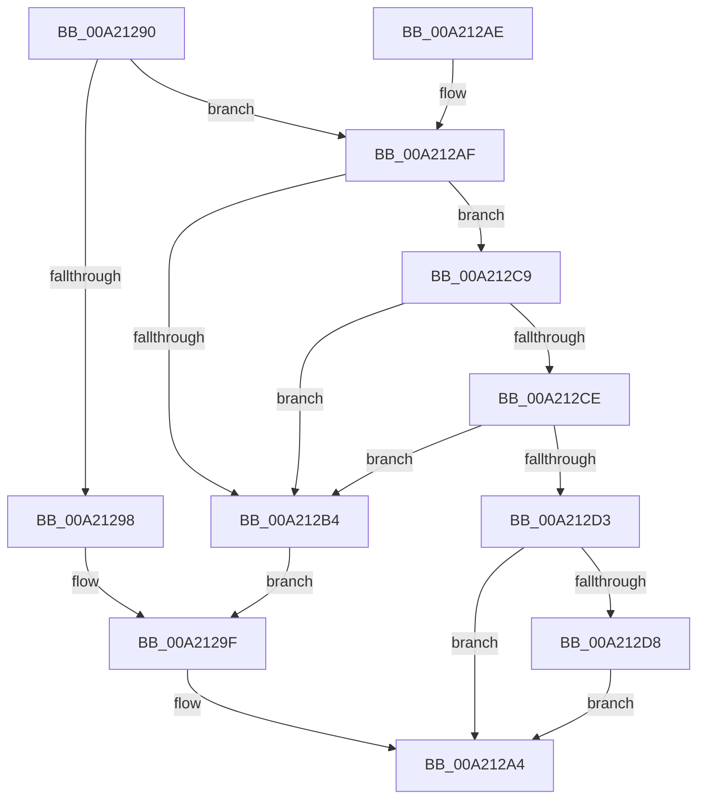

# PpDevNodeUnlockTree

- RVA: `0x00A21290`–`0x00A212E6` (길이 `86` bytes)
- VA: `0x0000000140A21290`
- 실행 섹션: `PAGE`
- PDB 이름 있음: `예`; PDB Function 태그: `아니요`
- unwind 정보 RVA: `0x0008FD0C`
- 디코드: `24`개 명령, `86/86` bytes 표시
- 미해석 바이트: `0` (있으면 어셈블리에 `.byte`로 보존)

> 이 문서는 커널 이미지의 기계어와 PDB 기호를 분석해 생성했습니다. 4번과 5번은 함수 원형과 자료형을 바이너리 사용 방식에서 추정한 C 해석이며 원본 소스 복구 결과는 아닙니다.

## 1. Dependencies

- 직접 호출 지점: **4**; 고유 호출 대상: **3**
- 직접 호출자로 확인된 함수: **21**
- RIP 상대 이미지 참조: **2**

### Outgoing calls
- `0x00A2129F` → [ExReleaseResourceLite](../../text/25/ExReleaseResourceLite_function_0025FA10.md) (function, `0x0025FA10`)
- `0x00A212A4` → [KeLeaveCriticalRegion](../../text/25/KeLeaveCriticalRegion_function_0025D8B0.md) (function, `0x0025D8B0`)
- `0x00A212BB` → [ExReleaseResourceLite](../../text/25/ExReleaseResourceLite_function_0025FA10.md) (function, `0x0025FA10`)
- `0x00A212DF` → [ExConvertExclusiveToSharedLite](../../text/34/ExConvertExclusiveToSharedLite_function_0034F700.md) (function, `0x0034F700`)

### Direct callers
- [PnpDeviceActionWorker](../../text/47/PnpDeviceActionWorker_function_00478400.md) at `0x004788C8`
- [PnpUnlockDeviceActionQueue](../../text/4A/PnpUnlockDeviceActionQueue_function_004A42F4.md) at `0x004A435A`
- [PnpLockDeviceActionQueue](../../text/4A/PnpLockDeviceActionQueue_function_004A4388.md) at `0x004A43EA`
- [IoTranslateBusAddress](../../text/5A/IoTranslateBusAddress_function_005A5F60.md) at `0x005A60D0`
- [IoTranslateBusAddress](../../text/5A/IoTranslateBusAddress_function_005A5F60.md) at `0x005A60DB`
- [IoReportDetectedDevice](../72/IoReportDetectedDevice_function_00725CD0.md) at `0x0072607E`
- [IoReportRootDevice](../72/IoReportRootDevice_function_00726780.md) at `0x00726AEF`
- [PiPagePathSetState](../72/PiPagePathSetState_function_0072BDE0.md) at `0x0072BF03`
- [PpSystemHiveLimitCallback](../72/PpSystemHiveLimitCallback_function_0072C310.md) at `0x0072C376`
- [PnpRestartDeviceNode](../72/PnpRestartDeviceNode_function_0072CD60.md) at `0x0072CE4A`
- [PnpProcessCompletedEject](../72/PnpProcessCompletedEject_function_0072D090.md) at `0x0072D1AE`
- [PnpQueuePendingEject](../72/PnpQueuePendingEject_function_0072D334.md) at `0x0072D377`
- [PipSetDevNodeStateFlags](../72/PipSetDevNodeStateFlags_function_0072DB98.md) at `0x0072DC19`
- [PpDevCfgProcessDevices](../73/PpDevCfgProcessDevices_function_007373C0.md) at `0x00737500`
- [PiProfileUpdateDeviceTreeWorker](../73/PiProfileUpdateDeviceTreeWorker_function_007376F0.md) at `0x0073771E`
- [PiCMDeleteDeviceWorker](../73/PiCMDeleteDeviceWorker_function_0073B420.md) at `0x0073B560`
- [PiCMDeleteDeviceWorker](../73/PiCMDeleteDeviceWorker_function_0073B420.md) at `0x0073B621`
- [PiInitializeDevice](../73/PiInitializeDevice_function_0073EC5C.md) at `0x0073EDA9`
- [PnpIommuBlockUnblockDevice](../74/PnpIommuBlockUnblockDevice_function_00740408.md) at `0x0074049A`
- [IopWarmEjectDevice](../74/IopWarmEjectDevice_function_007405EC.md) at `0x0074062B`
- [IopWarmEjectDevice](../74/IopWarmEjectDevice_function_007405EC.md) at `0x00740691`
- [PnpDiagRundownRegisterCallback](../A5/PnpDiagRundownRegisterCallback_function_00A516A0.md) at `0x00A51805`
- [PiCMCreateDevice](../AC/PiCMCreateDevice_function_00ACB824.md) at `0x00ACBBA1`
- [sub_00B33FE8](../B3/Unknown_function_00B33FE8.md) at `0x00B34438`

### Static image references
- `0x00A21298` → RVA `0x00F8C560` (`.data`; read)
- `0x00A212C0` → RVA `0x00F8C4E0` (`.data`; read)

## 2. Other-region calls and transfers

- 다른 실행 섹션으로 향하는 call: **4**
  - `0x00A2129F` → [ExReleaseResourceLite](../../text/25/ExReleaseResourceLite_function_0025FA10.md) (`PAGE` → `.text`)
  - `0x00A212A4` → [KeLeaveCriticalRegion](../../text/25/KeLeaveCriticalRegion_function_0025D8B0.md) (`PAGE` → `.text`)
  - `0x00A212BB` → [ExReleaseResourceLite](../../text/25/ExReleaseResourceLite_function_0025FA10.md) (`PAGE` → `.text`)
  - `0x00A212DF` → [ExConvertExclusiveToSharedLite](../../text/34/ExConvertExclusiveToSharedLite_function_0034F700.md) (`PAGE` → `.text`)
- 별도 외부 분기/꼬리 이동을 확인하지 못했습니다.

## 3. Assembly (complete function range)

```asm
00A21290  48 83 EC 28                     sub rsp, 0x28
00A21294  85 C9                           test ecx, ecx
00A21296  75 17                           jne 0x140a212af
00A21298  48 8D 0D C1 B2 56 00            lea rcx, [rip + 0x56b2c1]
00A2129F  E8 6C E7 83 FF                  call 0x14025fa10
00A212A4  E8 07 C6 83 FF                  call 0x14025d8b0
00A212A9  48 83 C4 28                     add rsp, 0x28
00A212AD  C3                              ret
00A212AE  CC                              int3
00A212AF  83 E9 01                        sub ecx, 1
00A212B2  75 15                           jne 0x140a212c9
00A212B4  48 8D 0D A5 B2 56 00            lea rcx, [rip + 0x56b2a5]
00A212BB  E8 50 E7 83 FF                  call 0x14025fa10
00A212C0  48 8D 0D 19 B2 56 00            lea rcx, [rip + 0x56b219]
00A212C7  EB D6                           jmp 0x140a2129f
00A212C9  83 E9 01                        sub ecx, 1
00A212CC  74 E6                           je 0x140a212b4
00A212CE  83 E9 01                        sub ecx, 1
00A212D1  74 E1                           je 0x140a212b4
00A212D3  83 F9 01                        cmp ecx, 1
00A212D6  75 CC                           jne 0x140a212a4
00A212D8  48 8D 0D 81 B2 56 00            lea rcx, [rip + 0x56b281]
00A212DF  E8 1C E4 92 FF                  call 0x14034f700
00A212E4  EB BE                           jmp 0x140a212a4
```

## 4. C-style interpretation (structured pseudocode)

```c
__int64 __fastcall PpDevNodeUnlockTree(int a1)
{
    __int64 result;
    __int64 v_rsp;

    v_rsp = (v_rsp) - (40);
    if (a1 != 0) goto loc_00A212AF;
loc_00A2129F:
    result = ExReleaseResourceLite(v_rip + 5681857, a2, a3, a4);
loc_00A212A4:
    result = KeLeaveCriticalRegion(v_rip + 5681857, a2, a3, a4);
    v_rsp = (v_rsp) + (40);
    return result;
loc_00A212AF:
    a1 = (unsigned int)((v_rip + 5681857) - (1));
    if (condition_is_not_equal) goto loc_00A212C9;
loc_00A212B4:
    result = ExReleaseResourceLite(v_rip + 5681829, a2, a3, a4);
    goto loc_00A2129F;
loc_00A212C9:
    a1 = (unsigned int)((v_rip + 5681689) - (1));
    if (condition_is_equal) goto loc_00A212B4;
    a1 = (unsigned int)((a1) - (1));
    if (condition_is_equal) goto loc_00A212B4;
    if (a1 != 1) goto loc_00A212A4;
    result = ExConvertExclusiveToSharedLite(v_rip + 5681793, a2, a3, a4);
    goto loc_00A212A4;
}
```

## 5. (Beta) C Style

```c
int64_t PpDevNodeUnlockTree(int32_t Arg1)
{
    int64_t result;
    int64_t local_rsp;

    local_rsp = (local_rsp) - (40);
    if (Arg1 != 0) goto loc_00A212AF;
loc_00A2129F:
    result = ExReleaseResourceLite(v_rip + 5681857, a2, a3, a4);
loc_00A212A4:
    result = KeLeaveCriticalRegion(v_rip + 5681857, a2, a3, a4);
    local_rsp = (local_rsp) + (40);
    return result;
loc_00A212AF:
    Arg1 = (uint32_t)((v_rip + 5681857) - (1));
    if (condition_is_not_equal) goto loc_00A212C9;
loc_00A212B4:
    result = ExReleaseResourceLite(v_rip + 5681829, a2, a3, a4);
    goto loc_00A2129F;
loc_00A212C9:
    Arg1 = (uint32_t)((v_rip + 5681689) - (1));
    if (condition_is_equal) goto loc_00A212B4;
    Arg1 = (uint32_t)((Arg1) - (1));
    if (condition_is_equal) goto loc_00A212B4;
    if (Arg1 != 1) goto loc_00A212A4;
    result = ExConvertExclusiveToSharedLite(v_rip + 5681793, a2, a3, a4);
    goto loc_00A212A4;
}
```

## 6. Execution-region graph

[열기: 2D/3D 그래프와 함수 탐색 컨트롤 패널](../../../control-panel.html?section=page&rva=0x00A21290&view=graph)

- 2D 그래프는 위에서 아래로 흐르고, 3D 그래프는 빈 공간을 드래그해 회전합니다. Shift+드래그는 이동, 휠은 확대·축소, 함수 노드 선택은 대상 보고서 이동입니다.

### Static fallback


