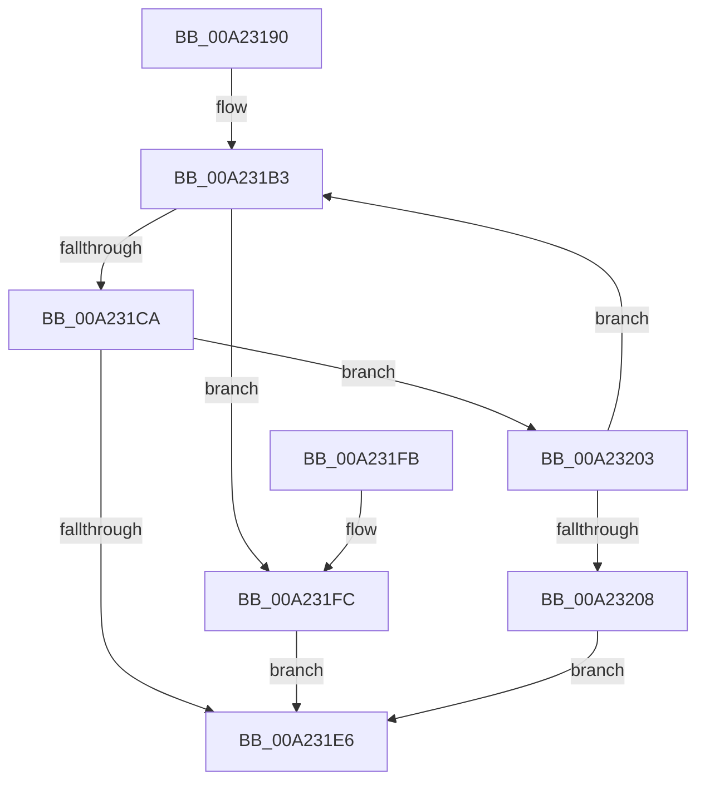

# PsAssignProcessToJobObject

- RVA: `0x00A23190`–`0x00A2320F` (길이 `127` bytes)
- VA: `0x0000000140A23190`
- 실행 섹션: `PAGE`
- PDB 이름 있음: `예`; PDB Function 태그: `아니요`
- unwind 정보 RVA: `0x000AB684`
- 디코드: `39`개 명령, `127/127` bytes 표시
- 미해석 바이트: `0` (있으면 어셈블리에 `.byte`로 보존)

> 이 문서는 커널 이미지의 기계어와 PDB 기호를 분석해 생성했습니다. 4번과 5번은 함수 원형과 자료형을 바이너리 사용 방식에서 추정한 C 해석이며 원본 소스 복구 결과는 아닙니다.

## 1. Dependencies

- 직접 호출 지점: **2**; 고유 호출 대상: **2**
- 직접 호출자로 확인된 함수: **4**
- RIP 상대 이미지 참조: **0**

### Outgoing calls
- `0x00A231C1` → [PspGetJobAssignmentDisposition](PspGetJobAssignmentDisposition_function_00A23218.md) (function, `0x00A23218`)
- `0x00A231D8` → [PspAssignProcessToJob](PspAssignProcessToJob_function_00A23370.md) (function, `0x00A23370`)

### Direct callers
- [PspSetJobMemoryPartition](../78/PspSetJobMemoryPartition_function_00785574.md) at `0x00785661`
- [PsCreateMinimalProcess](../78/PsCreateMinimalProcess_function_00786D14.md) at `0x00787028`
- [PspAssignProcessToJobList](PspAssignProcessToJobList_function_00A22F14.md) at `0x00A22F62`
- [NtAssignProcessToJobObject](NtAssignProcessToJobObject_function_00A22FC0.md) at `0x00A2306A`

### Static image references
- 디코드된 RIP-relative 메모리 참조가 없습니다.

## 2. Other-region calls and transfers

- 다른 실행 섹션으로 향하는 call: **0**
- 별도 외부 분기/꼬리 이동을 확인하지 못했습니다.

## 3. Assembly (complete function range)

```asm
00A23190  48 8B C4                        mov rax, rsp
00A23193  48 89 58 08                     mov qword ptr [rax + 8], rbx
00A23197  48 89 68 10                     mov qword ptr [rax + 0x10], rbp
00A2319B  48 89 70 18                     mov qword ptr [rax + 0x18], rsi
00A2319F  57                              push rdi
00A231A0  48 83 EC 20                     sub rsp, 0x20
00A231A4  83 60 20 00                     and dword ptr [rax + 0x20], 0
00A231A8  49 8B F8                        mov rdi, r8
00A231AB  33 DB                           xor ebx, ebx
00A231AD  48 8B F2                        mov rsi, rdx
00A231B0  48 8B E9                        mov rbp, rcx
00A231B3  4C 8D 4C 24 48                  lea r9, [rsp + 0x48]
00A231B8  4C 8B C7                        mov r8, rdi
00A231BB  48 8B D6                        mov rdx, rsi
00A231BE  48 8B CD                        mov rcx, rbp
00A231C1  E8 52 00 00 00                  call 0x140a23218
00A231C6  85 C0                           test eax, eax
00A231C8  78 32                           js 0x140a231fc
00A231CA  44 8B 4C 24 48                  mov r9d, dword ptr [rsp + 0x48]
00A231CF  4C 8B C7                        mov r8, rdi
00A231D2  48 8B D6                        mov rdx, rsi
00A231D5  48 8B CD                        mov rcx, rbp
00A231D8  E8 93 01 00 00                  call 0x140a23370
00A231DD  FF C3                           inc ebx
00A231DF  3D 2D 02 00 C0                  cmp eax, 0xc000022d
00A231E4  74 1D                           je 0x140a23203
00A231E6  48 8B 5C 24 30                  mov rbx, qword ptr [rsp + 0x30]
00A231EB  48 8B 6C 24 38                  mov rbp, qword ptr [rsp + 0x38]
00A231F0  48 8B 74 24 40                  mov rsi, qword ptr [rsp + 0x40]
00A231F5  48 83 C4 20                     add rsp, 0x20
00A231F9  5F                              pop rdi
00A231FA  C3                              ret
00A231FB  CC                              int3
00A231FC  B8 22 00 00 C0                  mov eax, 0xc0000022
00A23201  EB E3                           jmp 0x140a231e6
00A23203  83 FB 0A                        cmp ebx, 0xa
00A23206  76 AB                           jbe 0x140a231b3
00A23208  B8 01 00 00 C0                  mov eax, 0xc0000001
00A2320D  EB D7                           jmp 0x140a231e6
```

## 4. C-style interpretation (structured pseudocode)

```c
__int64 __fastcall PsAssignProcessToJobObject(__int64 a1, __int64 a2, __int64 a3)
{
    __int64 result;
    __int64 v_rbx;
    __int64 v_rsp;
    unsigned __int64 v_stack_p10;
    unsigned __int64 v_stack_p18;
    unsigned __int64 v_stack_p20;
    unsigned __int64 v_stack_p8;

    *(unsigned __int64 *)(v_rsp + 8) = v_rbx;
    *(unsigned __int64 *)(v_rsp + 16) = v_rbp;
    *(unsigned __int64 *)(v_rsp + 24) = v_rsi;
    v_rsp = (v_rsp) - (32);
    v_rbx = 0;
loc_00A231B3:
    result = PspGetJobAssignmentDisposition(a1, a2, a3, v_stack_p20);
    if (sign_flag) goto loc_00A231FC;
    result = PspAssignProcessToJob(a1, a2, a3, (unsigned int)(v_stack_p20));
    v_rbx = (unsigned int)((v_rbx) + 1);
    if (((unsigned int)(result)) == 0xC000022DULL) goto loc_00A23203;
loc_00A231E6:
    v_rsp = (v_rsp) + (32);
    return result;
loc_00A231FC:
    goto loc_00A231E6;
loc_00A23203:
    if (((unsigned int)(v_stack_p8)) <= 10) goto loc_00A231B3;
    goto loc_00A231E6;
}
```

## 5. (Beta) C Style

```c
int64_t PsAssignProcessToJobObject(int64_t Arg1, int64_t Arg2, int64_t Arg3)
{
    int64_t result;
    int64_t local_rbx;
    int64_t local_rsp;
    uint64_t v_stack_p10;
    uint64_t v_stack_p18;
    uint64_t v_stack_p20;
    uint64_t v_stack_p8;

    *(uint64_t *)(local_rsp + 0x8) = local_rbx;
    *(uint64_t *)(local_rsp + 0x10) = local_rbp;
    *(uint64_t *)(local_rsp + 0x18) = local_rsi;
    local_rsp = (local_rsp) - (32);
    local_rbx = 0;
loc_00A231B3:
    result = PspGetJobAssignmentDisposition(Arg1, Arg2, Arg3, v_stack_p20);
    if (sign_flag) goto loc_00A231FC;
    result = PspAssignProcessToJob(Arg1, Arg2, Arg3, (uint32_t)(v_stack_p20));
    local_rbx = (uint32_t)((local_rbx) + 1);
    if (((uint32_t)(result)) == 0xC000022DULL) goto loc_00A23203;
loc_00A231E6:
    local_rsp = (local_rsp) + (32);
    return result;
loc_00A231FC:
    goto loc_00A231E6;
loc_00A23203:
    if (((uint32_t)(v_stack_p8)) <= 10) goto loc_00A231B3;
    goto loc_00A231E6;
}
```

## 6. Execution-region graph

[열기: 2D/3D 그래프와 함수 탐색 컨트롤 패널](../../../control-panel.html?section=page&rva=0x00A23190&view=graph)

- 2D 그래프는 위에서 아래로 흐르고, 3D 그래프는 빈 공간을 드래그해 회전합니다. Shift+드래그는 이동, 휠은 확대·축소, 함수 노드 선택은 대상 보고서 이동입니다.

### Static fallback


