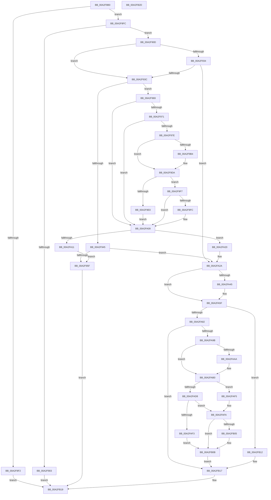

# PsConvertToGuiThread

- RVA: `0x00A2F8B0`–`0x00A2FB2E` (길이 `638` bytes)
- VA: `0x0000000140A2F8B0`
- 실행 섹션: `PAGE`
- PDB 이름 있음: `예`; PDB Function 태그: `아니요`
- unwind 정보 RVA: `0x000ACAE4`
- 디코드: `178`개 명령, `638/638` bytes 표시
- 미해석 바이트: `0` (있으면 어셈블리에 `.byte`로 보존)

> 이 문서는 커널 이미지의 기계어와 PDB 기호를 분석해 생성했습니다. 4번과 5번은 함수 원형과 자료형을 바이너리 사용 방식에서 추정한 C 해석이며 원본 소스 복구 결과는 아닙니다.

## 1. Dependencies

- 직접 호출 지점: **19**; 고유 호출 대상: **14**
- 직접 호출자로 확인된 함수: **2**
- RIP 상대 이미지 참조: **1**

### Outgoing calls
- `0x00A2F93C` → [Feature_LearningModeLoggingPsConvertToGuiThread__private_IsEnabledDeviceUsageNoInline](../../text/5E/Feature_LearningModeLoggingPsConvertToGuiThread__private_IsEnabledDeviceUsageNoInline_function_005E3210.md) (function, `0x005E3210`)
- `0x00A2F952` → [EtwTimLogProhibitWin32kSystemCalls](../A8/EtwTimLogProhibitWin32kSystemCalls_function_00A81DC0.md) (function, `0x00A81DC0`)
- `0x00A2F9A0` → [PsReferenceEffectiveToken](../9A/PsReferenceEffectiveToken_function_009A2B40.md) (function, `0x009A2B40`)
- `0x00A2F9AB` → [SeIsLearningModeLoggingEnabled](../../text/47/SeIsLearningModeLoggingEnabled_function_00475D70.md) (function, `0x00475D70`)
- `0x00A2F9B4` → [SeIsPermissiveLearningModeEnabled](../../text/46/SeIsPermissiveLearningModeEnabled_function_0046A4E0.md) (function, `0x0046A4E0`)
- `0x00A2F9CB` → [SeReportLearningModeViolation](../../text/60/SeReportLearningModeViolation_function_00608B50.md) (function, `0x00608B50`)
- `0x00A2F9F0` → [ObFastDereferenceObject](../../text/3E/ObFastDereferenceObject_function_003ED5F0.md) (function, `0x003ED5F0`)
- `0x00A2FA04` → [ObfDereferenceObjectWithTag](../../text/2F/ObfDereferenceObjectWithTag_function_002F78E0.md) (function, `0x002F78E0`)
- `0x00A2FA16` → [EtwTimLogProhibitWin32kSystemCalls](../A8/EtwTimLogProhibitWin32kSystemCalls_function_00A81DC0.md) (function, `0x00A81DC0`)
- `0x00A2FA25` → [EtwTimLogProhibitWin32kSystemCalls](../A8/EtwTimLogProhibitWin32kSystemCalls_function_00A81DC0.md) (function, `0x00A81DC0`)
- `0x00A2FA3C` → [PsQuerySectionSignatureInformation](PsQuerySectionSignatureInformation_function_00A2FB40.md) (function, `0x00A2FB40`)
- `0x00A2FA4A` → [SeCompareSigningLevels](../A1/SeCompareSigningLevels_function_00A13760.md) (function, `0x00A13760`)
- `0x00A2FA75` → [PspUpdateCalloutParameters](../../text/49/PspUpdateCalloutParameters_function_0049BBA4.md) (function, `0x0049BBA4`)
- `0x00A2FA82` → [PsSessionGetWin32Callouts](../../text/47/PsSessionGetWin32Callouts_function_00474F98.md) (function, `0x00474F98`)
- `0x00A2FA90` → [ExCallCallBack](../90/ExCallCallBack_function_009054B4.md) (function, `0x009054B4`)
- `0x00A2FACF` → [PspUpdateCalloutParameters](../../text/49/PspUpdateCalloutParameters_function_0049BBA4.md) (function, `0x0049BBA4`)
- `0x00A2FAD8` → [PsSessionGetWin32Callouts](../../text/47/PsSessionGetWin32Callouts_function_00474F98.md) (function, `0x00474F98`)
- `0x00A2FAE8` → [ExCallCallBack](../90/ExCallCallBack_function_009054B4.md) (function, `0x009054B4`)
- `0x00A2FB0B` → [SeCaptureAtomTableCallout](../../text/4E/SeCaptureAtomTableCallout_function_004E9BD0.md) (function, `0x004E9BD0`)

### Direct callers
- [KiConvertToGuiThread](../../text/6B/KiConvertToGuiThread_function_006B3290.md) at `0x006B3294`
- [PspEnsureGuiThreadAndBatchFlush](../77/PspEnsureGuiThreadAndBatchFlush_function_0077E528.md) at `0x0077E546`

### Static image references
- `0x00A2F971` → RVA `0x00FD9AD8` (`PAGEDATA`; read)

## 2. Other-region calls and transfers

- 다른 실행 섹션으로 향하는 call: **11**
  - `0x00A2F93C` → [Feature_LearningModeLoggingPsConvertToGuiThread__private_IsEnabledDeviceUsageNoInline](../../text/5E/Feature_LearningModeLoggingPsConvertToGuiThread__private_IsEnabledDeviceUsageNoInline_function_005E3210.md) (`PAGE` → `.text`)
  - `0x00A2F9AB` → [SeIsLearningModeLoggingEnabled](../../text/47/SeIsLearningModeLoggingEnabled_function_00475D70.md) (`PAGE` → `.text`)
  - `0x00A2F9B4` → [SeIsPermissiveLearningModeEnabled](../../text/46/SeIsPermissiveLearningModeEnabled_function_0046A4E0.md) (`PAGE` → `.text`)
  - `0x00A2F9CB` → [SeReportLearningModeViolation](../../text/60/SeReportLearningModeViolation_function_00608B50.md) (`PAGE` → `.text`)
  - `0x00A2F9F0` → [ObFastDereferenceObject](../../text/3E/ObFastDereferenceObject_function_003ED5F0.md) (`PAGE` → `.text`)
  - `0x00A2FA04` → [ObfDereferenceObjectWithTag](../../text/2F/ObfDereferenceObjectWithTag_function_002F78E0.md) (`PAGE` → `.text`)
  - `0x00A2FA75` → [PspUpdateCalloutParameters](../../text/49/PspUpdateCalloutParameters_function_0049BBA4.md) (`PAGE` → `.text`)
  - `0x00A2FA82` → [PsSessionGetWin32Callouts](../../text/47/PsSessionGetWin32Callouts_function_00474F98.md) (`PAGE` → `.text`)
  - `0x00A2FACF` → [PspUpdateCalloutParameters](../../text/49/PspUpdateCalloutParameters_function_0049BBA4.md) (`PAGE` → `.text`)
  - `0x00A2FAD8` → [PsSessionGetWin32Callouts](../../text/47/PsSessionGetWin32Callouts_function_00474F98.md) (`PAGE` → `.text`)
  - `0x00A2FB0B` → [SeCaptureAtomTableCallout](../../text/4E/SeCaptureAtomTableCallout_function_004E9BD0.md) (`PAGE` → `.text`)
- 별도 외부 분기/꼬리 이동을 확인하지 못했습니다.

## 3. Assembly (complete function range)

```asm
00A2F8B0  40 55                           push rbp
00A2F8B2  53                              push rbx
00A2F8B3  56                              push rsi
00A2F8B4  57                              push rdi
00A2F8B5  41 54                           push r12
00A2F8B7  41 55                           push r13
00A2F8B9  41 56                           push r14
00A2F8BB  41 57                           push r15
00A2F8BD  48 8D 6C 24 E1                  lea rbp, [rsp - 0x1f]
00A2F8C2  48 81 EC A8 00 00 00            sub rsp, 0xa8
00A2F8C9  45 33 ED                        xor r13d, r13d
00A2F8CC  4C 89 6D CF                     mov qword ptr [rbp - 0x31], r13
00A2F8D0  4C 89 6D D7                     mov qword ptr [rbp - 0x29], r13
00A2F8D4  4C 89 6D EF                     mov qword ptr [rbp - 0x11], r13
00A2F8D8  4C 89 6D F7                     mov qword ptr [rbp - 9], r13
00A2F8DC  65 48 8B 3C 25 88 01 00 00      mov rdi, qword ptr gs:[0x188]
00A2F8E5  44 88 6D 67                     mov byte ptr [rbp + 0x67], r13b
00A2F8E9  44 38 AF 32 02 00 00            cmp byte ptr [rdi + 0x232], r13b
00A2F8F0  75 0A                           jne 0x140a2f8fc
00A2F8F2  B8 0D 00 00 C0                  mov eax, 0xc000000d
00A2F8F7  E9 1D 02 00 00                  jmp 0x140a2fb19
00A2F8FC  8B 47 78                        mov eax, dword ptr [rdi + 0x78]
00A2F8FF  84 C0                           test al, al
00A2F901  79 0A                           jns 0x140a2f90d
00A2F903  B8 1B 00 00 40                  mov eax, 0x4000001b
00A2F908  E9 0C 02 00 00                  jmp 0x140a2fb19
00A2F90D  48 8B B7 B8 00 00 00            mov rsi, qword ptr [rdi + 0xb8]
00A2F914  44 8B BE 50 07 00 00            mov r15d, dword ptr [rsi + 0x750]
00A2F91B  41 8B DF                        mov ebx, r15d
00A2F91E  81 E3 00 10 00 00               and ebx, 0x1000
00A2F924  41 8B C7                        mov eax, r15d
00A2F927  41 0F 95 C4                     setne r12b
00A2F92B  25 00 20 00 00                  and eax, 0x2000
00A2F930  85 DB                           test ebx, ebx
00A2F932  75 08                           jne 0x140a2f93c
00A2F934  85 C0                           test eax, eax
00A2F936  0F 84 EE 00 00 00               je 0x140a2fa2a
00A2F93C  E8 CF 38 BB FF                  call 0x1405e3210
00A2F941  85 C0                           test eax, eax
00A2F943  75 24                           jne 0x140a2f969
00A2F945  41 8B CD                        mov ecx, r13d
00A2F948  85 DB                           test ebx, ebx
00A2F94A  48 8B D6                        mov rdx, rsi
00A2F94D  0F 95 C1                        setne cl
00A2F950  FF C1                           inc ecx
00A2F952  E8 69 24 05 00                  call 0x140a81dc0
00A2F957  85 DB                           test ebx, ebx
00A2F959  0F 84 CB 00 00 00               je 0x140a2fa2a
00A2F95F  B8 22 00 00 C0                  mov eax, 0xc0000022
00A2F964  E9 B0 01 00 00                  jmp 0x140a2fb19
00A2F969  85 DB                           test ebx, ebx
00A2F96B  0F 84 98 00 00 00               je 0x140a2fa09
00A2F971  44 39 2D 60 A1 5A 00            cmp dword ptr [rip + 0x5aa160], r13d
00A2F978  0F 84 8B 00 00 00               je 0x140a2fa09
00A2F97E  48 8D 45 7F                     lea rax, [rbp + 0x7f]
00A2F982  4C 89 6C 24 28                  mov qword ptr [rsp + 0x28], r13
00A2F987  4C 8D 4D 6F                     lea r9, [rbp + 0x6f]
00A2F98B  48 89 44 24 20                  mov qword ptr [rsp + 0x20], rax
00A2F990  4C 8D 45 77                     lea r8, [rbp + 0x77]
00A2F994  44 89 6D 77                     mov dword ptr [rbp + 0x77], r13d
00A2F998  BA 53 68 72 74                  mov edx, 0x74726853
00A2F99D  48 8B CF                        mov rcx, rdi
00A2F9A0  E8 9B 31 F7 FF                  call 0x1409a2b40
00A2F9A5  48 8B C8                        mov rcx, rax
00A2F9A8  4C 8B F0                        mov r14, rax
00A2F9AB  E8 C0 63 A4 FF                  call 0x140475d70
00A2F9B0  84 C0                           test al, al
00A2F9B2  74 26                           je 0x140a2f9da
00A2F9B4  E8 27 AB A3 FF                  call 0x14046a4e0
00A2F9B9  84 C0                           test al, al
00A2F9BB  48 8B CE                        mov rcx, rsi
00A2F9BE  8A D8                           mov bl, al
00A2F9C0  41 0F 94 C1                     sete r9b
00A2F9C4  45 33 C0                        xor r8d, r8d
00A2F9C7  41 8D 50 01                     lea edx, [r8 + 1]
00A2F9CB  E8 80 91 BD FF                  call 0x140608b50
00A2F9D0  84 DB                           test bl, bl
00A2F9D2  45 0F B6 E4                     movzx r12d, r12b
00A2F9D6  45 0F 45 E5                     cmovne r12d, r13d
00A2F9DA  83 7D 77 01                     cmp dword ptr [rbp + 0x77], 1
00A2F9DE  75 17                           jne 0x140a2f9f7
00A2F9E0  48 8D 8E 48 02 00 00            lea rcx, [rsi + 0x248]
00A2F9E7  41 B8 53 68 72 74               mov r8d, 0x74726853
00A2F9ED  49 8B D6                        mov rdx, r14
00A2F9F0  E8 FB DB 9B FF                  call 0x1403ed5f0
00A2F9F5  EB 12                           jmp 0x140a2fa09
00A2F9F7  4D 85 F6                        test r14, r14
00A2F9FA  74 0D                           je 0x140a2fa09
00A2F9FC  BA 53 68 72 74                  mov edx, 0x74726853
00A2FA01  49 8B CE                        mov rcx, r14
00A2FA04  E8 D7 7E 8C FF                  call 0x1402f78e0
00A2FA09  48 8B D6                        mov rdx, rsi
00A2FA0C  45 84 E4                        test r12b, r12b
00A2FA0F  74 0F                           je 0x140a2fa20
00A2FA11  B9 02 00 00 00                  mov ecx, 2
00A2FA16  E8 A5 23 05 00                  call 0x140a81dc0
00A2FA1B  E9 3F FF FF FF                  jmp 0x140a2f95f
00A2FA20  B9 01 00 00 00                  mov ecx, 1
00A2FA25  E8 96 23 05 00                  call 0x140a81dc0
00A2FA2A  48 8D 55 67                     lea rdx, [rbp + 0x67]
00A2FA2E  48 89 75 DF                     mov qword ptr [rbp - 0x21], rsi
00A2FA32  48 8B CE                        mov rcx, rsi
00A2FA35  C7 45 E7 01 00 00 00            mov dword ptr [rbp - 0x19], 1
00A2FA3C  E8 FF 00 00 00                  call 0x140a2fb40
00A2FA41  85 C0                           test eax, eax
00A2FA43  78 1A                           js 0x140a2fa5f
00A2FA45  8A 4D 67                        mov cl, byte ptr [rbp + 0x67]
00A2FA48  B2 0C                           mov dl, 0xc
00A2FA4A  E8 11 3D FE FF                  call 0x140a13760
00A2FA4F  8B 4D E7                        mov ecx, dword ptr [rbp - 0x19]
00A2FA52  83 E0 01                        and eax, 1
00A2FA55  03 C0                           add eax, eax
00A2FA57  83 E1 FD                        and ecx, 0xfffffffd
00A2FA5A  0B C1                           or eax, ecx
00A2FA5C  89 45 E7                        mov dword ptr [rbp - 0x19], eax
00A2FA5F  33 C0                           xor eax, eax
00A2FA61  48 8D 55 CF                     lea rdx, [rbp - 0x31]
00A2FA65  48 89 45 B3                     mov qword ptr [rbp - 0x4d], rax
00A2FA69  45 33 C9                        xor r9d, r9d
00A2FA6C  45 33 C0                        xor r8d, r8d
00A2FA6F  48 89 45 AF                     mov qword ptr [rbp - 0x51], rax
00A2FA73  33 C9                           xor ecx, ecx
00A2FA75  E8 2A C1 A6 FF                  call 0x14049bba4
00A2FA7A  85 C0                           test eax, eax
00A2FA7C  0F 84 90 00 00 00               je 0x140a2fb12
00A2FA82  E8 11 55 A4 FF                  call 0x140474f98
00A2FA87  48 8B C8                        mov rcx, rax
00A2FA8A  4C 8D 45 CF                     lea r8, [rbp - 0x31]
00A2FA8E  33 D2                           xor edx, edx
00A2FA90  E8 1F 5A ED FF                  call 0x1409054b4
00A2FA95  8B D8                           mov ebx, eax
00A2FA97  85 C0                           test eax, eax
00A2FA99  78 7C                           js 0x140a2fb17
00A2FA9B  F0 0F BA 6F 78 07               lock bts dword ptr [rdi + 0x78], 7
00A2FAA1  41 81 E7 00 C0 00 00            and r15d, 0xc000
00A2FAA8  74 06                           je 0x140a2fab0
00A2FAAA  F0 0F BA 6F 78 15               lock bts dword ptr [rdi + 0x78], 0x15
00A2FAB0  33 C0                           xor eax, eax
00A2FAB2  48 89 7D FF                     mov qword ptr [rbp - 1], rdi
00A2FAB6  48 89 45 C3                     mov qword ptr [rbp - 0x3d], rax
00A2FABA  48 8D 55 EF                     lea rdx, [rbp - 0x11]
00A2FABE  45 33 C9                        xor r9d, r9d
00A2FAC1  44 89 6D 07                     mov dword ptr [rbp + 7], r13d
00A2FAC5  45 33 C0                        xor r8d, r8d
00A2FAC8  48 89 45 BF                     mov qword ptr [rbp - 0x41], rax
00A2FACC  8D 48 01                        lea ecx, [rax + 1]
00A2FACF  E8 D0 C0 A6 FF                  call 0x14049bba4
00A2FAD4  85 C0                           test eax, eax
00A2FAD6  74 1D                           je 0x140a2faf5
00A2FAD8  E8 BB 54 A4 FF                  call 0x140474f98
00A2FADD  48 8B C8                        mov rcx, rax
00A2FAE0  41 8D 51 01                     lea edx, [r9 + 1]
00A2FAE4  4C 8D 45 EF                     lea r8, [rbp - 0x11]
00A2FAE8  E8 C7 59 ED FF                  call 0x1409054b4
00A2FAED  8B D8                           mov ebx, eax
00A2FAEF  85 C0                           test eax, eax
00A2FAF1  78 07                           js 0x140a2fafa
00A2FAF3  EB 16                           jmp 0x140a2fb0b
00A2FAF5  BB 0D 00 00 C0                  mov ebx, 0xc000000d
00A2FAFA  F0 0F BA 77 78 07               lock btr dword ptr [rdi + 0x78], 7
00A2FB00  45 85 FF                        test r15d, r15d
00A2FB03  74 06                           je 0x140a2fb0b
00A2FB05  F0 0F BA 77 78 15               lock btr dword ptr [rdi + 0x78], 0x15
00A2FB0B  E8 C0 A0 AB FF                  call 0x1404e9bd0
00A2FB10  EB 05                           jmp 0x140a2fb17
00A2FB12  BB 0D 00 00 C0                  mov ebx, 0xc000000d
00A2FB17  8B C3                           mov eax, ebx
00A2FB19  48 81 C4 A8 00 00 00            add rsp, 0xa8
00A2FB20  41 5F                           pop r15
00A2FB22  41 5E                           pop r14
00A2FB24  41 5D                           pop r13
00A2FB26  41 5C                           pop r12
00A2FB28  5F                              pop rdi
00A2FB29  5E                              pop rsi
00A2FB2A  5B                              pop rbx
00A2FB2B  5D                              pop rbp
00A2FB2C  C3                              ret
00A2FB2D  CC                              int3
```

## 4. C-style interpretation (structured pseudocode)

```c
__int64 __fastcall PsConvertToGuiThread(void)
{
    __int64 result;
    __int64 v_r12;
    __int64 v_r13;
    __int64 v_r15;
    __int64 v_rbx;
    __int64 v_rsp;
    unsigned int v_stack_m58;
    unsigned __int64 v_stack_m5F;
    unsigned __int64 v_stack_m60;
    unsigned __int64 v_stack_m68;
    unsigned __int64 v_stack_m70;
    unsigned int v_stack_m78;
    unsigned __int64 v_stack_m80;
    unsigned __int64 v_stack_m88;
    unsigned __int64 v_stack_m90;
    unsigned __int64 v_stack_m9C;
    unsigned __int64 v_stack_mA0;
    unsigned __int64 v_stack_mAC;
    unsigned __int64 v_stack_mB0;
    unsigned __int64 v_stack_mC0;
    unsigned __int64 v_stack_mC8;
    unsigned __int64 v_stack_p10;
    unsigned __int64 v_stack_p18;
    unsigned __int64 v_stack_p20;
    unsigned __int8 v_stack_p8;

    v_rsp = (v_rsp) - (168);
    v_r13 = 0;
    v_stack_m90 = 0;
    v_stack_m88 = 0;
    v_stack_m70 = 0;
    v_stack_m68 = 0;
    v_stack_p8 = 0;
    if ((*(unsigned __int8 *)(*(unsigned __int64 *)(gs_base + (0 + 392)) + 562)) != 0) goto loc_00A2F8FC;
    goto loc_00A2FB19;
loc_00A2F8FC:
    if (!sign_flag) goto loc_00A2F90D;
    goto loc_00A2FB19;
loc_00A2F90D:
    v_rbx = (unsigned int)(((unsigned int)((unsigned int)((unsigned int)(*(unsigned int *)(*(unsigned __int64 *)(*(unsigned __int64 *)(gs_base + (0 + 392)) + 184) + 1872))))) & (0x1000ULL));
    v_r12 = (condition_is_not_equal) ? 1 : 0;
    result = (unsigned int)(((unsigned int)((unsigned int)((unsigned int)(*(unsigned int *)(*(unsigned __int64 *)(*(unsigned __int64 *)(gs_base + (0 + 392)) + 184) + 1872))))) & (0x2000ULL));
    if ((unsigned int)(v_rbx) != 0) goto loc_00A2F93C;
    if ((unsigned int)(result) == 0) goto loc_00A2FA2A;
loc_00A2F93C:
    result = Feature_LearningModeLoggingPsConvertToGuiThread__private_IsEnabledDeviceUsageNoInline(a1, a2, a3, a4);
    if ((unsigned int)(result) != 0) goto loc_00A2F969;
    a1 = ((unsigned int)(v_rbx) != 0) ? 1 : 0;
    a1 = (unsigned int)((a1) + 1);
    result = EtwTimLogProhibitWin32kSystemCalls(a1, *(unsigned __int64 *)(*(unsigned __int64 *)(gs_base + (0 + 392)) + 184), a3, a4);
    if ((unsigned int)(v_rbx) == 0) goto loc_00A2FA2A;
loc_00A2F95F:
    goto loc_00A2FB19;
loc_00A2F969:
    if ((unsigned int)(v_rbx) == 0) goto loc_00A2FA09;
    if ((*(unsigned int *)(v_rip + 5939552)) == 0) goto loc_00A2FA09;
    v_stack_mC0 = 0;
    v_stack_mC8 = v_stack_p20;
    v_stack_p18 = 0;
    result = PsReferenceEffectiveToken(*(unsigned __int64 *)(gs_base + (0 + 392)), (unsigned int)(0x74726853ULL), v_stack_p18, v_stack_p10);
    result = SeIsLearningModeLoggingEnabled(result, (unsigned int)(0x74726853ULL), v_stack_p18, v_stack_p10);
    if ((unsigned __int8)(result) != 0) {
        result = SeIsPermissiveLearningModeEnabled(result, (unsigned int)(0x74726853ULL), v_stack_p18, v_stack_p10);
        a1 = *(unsigned __int64 *)(*(unsigned __int64 *)(gs_base + (0 + 392)) + 184);
        v_rbx = (unsigned __int8)(result);
        a4 = ((unsigned __int8)(result) == 0) ? 1 : 0;
        a3 = 0;
        a2 = a3 + 1;
        result = SeReportLearningModeViolation(a1, a2, a3, a4);
        v_r12 = (unsigned __int8)(v_r12);
        if ((unsigned __int8)(v_rbx) != 0) { v_r12 = 0; }
    }
    if (v_stack_p18 != 1) goto loc_00A2F9F7;
    result = ObFastDereferenceObject(*(unsigned __int64 *)(*(unsigned __int64 *)(gs_base + (0 + 392)) + 184) + 584, result, (unsigned int)(0x74726853ULL), a4);
    goto loc_00A2FA09;
loc_00A2F9F7:
    if (result != 0) {
        a2 = 0x74726853ULL;
        a1 = result;
        result = ObfDereferenceObjectWithTag(a1, a2, (unsigned int)(0x74726853ULL), a4);
    }
    if ((unsigned __int8)(v_r12) == 0) goto loc_00A2FA20;
    result = EtwTimLogProhibitWin32kSystemCalls(2, *(unsigned __int64 *)(*(unsigned __int64 *)(gs_base + (0 + 392)) + 184), (unsigned int)(0x74726853ULL), a4);
    goto loc_00A2F95F;
loc_00A2FA20:
    result = EtwTimLogProhibitWin32kSystemCalls(1, *(unsigned __int64 *)(*(unsigned __int64 *)(gs_base + (0 + 392)) + 184), (unsigned int)(0x74726853ULL), a4);
loc_00A2FA2A:
    v_stack_m80 = *(unsigned __int64 *)(*(unsigned __int64 *)(gs_base + (0 + 392)) + 184);
    v_stack_m78 = 1;
    result = PsQuerySectionSignatureInformation(*(unsigned __int64 *)(*(unsigned __int64 *)(gs_base + (0 + 392)) + 184), v_stack_p8, (unsigned int)(0x74726853ULL), a4);
    if (!(sign_flag)) {
        a1 = v_stack_p8;
        a2 = 12;
        result = SeCompareSigningLevels(a1, a2, (unsigned int)(0x74726853ULL), a4);
        a1 = v_stack_m78;
        result = (unsigned int)((result) & (1));
        result = (unsigned int)((result) + ((unsigned int)(result)));
        a1 = (unsigned int)((a1) & (0xFFFFFFFDULL));
        result = (unsigned int)((result) | ((unsigned int)(a1)));
        v_stack_m78 = (unsigned int)(result);
    }
    result = 0;
    v_stack_mAC = 0;
    a4 = 0;
    a3 = 0;
    v_stack_mB0 = 0;
    a1 = 0;
    result = PspUpdateCalloutParameters(a1, v_stack_m90, a3, a4);
    if ((unsigned int)(result) == 0) goto loc_00A2FB12;
    result = PsSessionGetWin32Callouts(a1, v_stack_m90, a3, a4);
    a2 = 0;
    result = ExCallCallBack(result, a2, v_stack_m90, a4);
    if (sign_flag) goto loc_00A2FB17;
    v_r15 = (unsigned int)(((unsigned int)(*(unsigned int *)(*(unsigned __int64 *)(*(unsigned __int64 *)(gs_base + (0 + 392)) + 184) + 1872))) & (0xC000ULL));
    if (!(condition_is_equal)) {
    }
    result = 0;
    v_stack_m60 = *(unsigned __int64 *)(gs_base + (0 + 392));
    v_stack_m9C = 0;
    a4 = 0;
    v_stack_m58 = 0;
    a3 = 0;
    v_stack_mA0 = 0;
    result = PspUpdateCalloutParameters(result + 1, v_stack_m70, a3, a4);
    if ((unsigned int)(result) == 0) goto loc_00A2FAF5;
    result = PsSessionGetWin32Callouts(result + 1, v_stack_m70, a3, a4);
    result = ExCallCallBack(result, a4 + 1, v_stack_m70, a4);
    if (sign_flag) goto loc_00A2FAFA;
    goto loc_00A2FB0B;
loc_00A2FAF5:
loc_00A2FAFA:
    if ((unsigned int)(v_r15) != 0) {
    }
    result = SeCaptureAtomTableCallout(result, a4 + 1, v_stack_m70, a4);
    goto loc_00A2FB17;
loc_00A2FB12:
loc_00A2FB17:
loc_00A2FB19:
    v_rsp = (v_rsp) + (168);
    return (unsigned int)((unsigned int)((unsigned int)(0xC000000DULL)));
}
```

## 5. (Beta) C Style

```c
void PsConvertToGuiThread(void)
{
    int64_t result;
    int64_t local_r12;
    int64_t local_r13;
    int64_t local_r15;
    int64_t local_rbx;
    int64_t local_rsp;
    uint32_t v_stack_m58;
    uint64_t v_stack_m5F;
    uint64_t v_stack_m60;
    uint64_t v_stack_m68;
    uint64_t v_stack_m70;
    uint32_t v_stack_m78;
    uint64_t v_stack_m80;
    uint64_t v_stack_m88;
    uint64_t v_stack_m90;
    uint64_t v_stack_m9C;
    uint64_t v_stack_mA0;
    uint64_t v_stack_mAC;
    uint64_t v_stack_mB0;
    uint64_t v_stack_mC0;
    uint64_t v_stack_mC8;
    uint64_t v_stack_p10;
    uint64_t v_stack_p18;
    uint64_t v_stack_p20;
    uint8_t v_stack_p8;

    local_rsp = (local_rsp) - (168);
    local_r13 = 0;
    v_stack_m90 = 0;
    v_stack_m88 = 0;
    v_stack_m70 = 0;
    v_stack_m68 = 0;
    v_stack_p8 = 0;
    if ((*(uint8_t *)(*(uint64_t *)(gs_base + (0 + 0x188)) + 0x232)) != 0) goto loc_00A2F8FC;
    goto loc_00A2FB19;
loc_00A2F8FC:
    if (!sign_flag) goto loc_00A2F90D;
    goto loc_00A2FB19;
loc_00A2F90D:
    local_rbx = (uint32_t)(((uint32_t)((uint32_t)((uint32_t)(*(uint32_t *)(*(uint64_t *)(*(uint64_t *)(gs_base + (0 + 0x188)) + 0xB8) + 0x750))))) & (0x1000ULL));
    local_r12 = (condition_is_not_equal) ? 1 : 0;
    result = (uint32_t)(((uint32_t)((uint32_t)((uint32_t)(*(uint32_t *)(*(uint64_t *)(*(uint64_t *)(gs_base + (0 + 0x188)) + 0xB8) + 0x750))))) & (0x2000ULL));
    if ((uint32_t)(local_rbx) != 0) goto loc_00A2F93C;
    if ((uint32_t)(result) == 0) goto loc_00A2FA2A;
loc_00A2F93C:
    result = Feature_LearningModeLoggingPsConvertToGuiThread__private_IsEnabledDeviceUsageNoInline(a1, a2, a3, a4);
    if ((uint32_t)(result) != 0) goto loc_00A2F969;
    a1 = ((uint32_t)(local_rbx) != 0) ? 1 : 0;
    a1 = (uint32_t)((a1) + 1);
    result = EtwTimLogProhibitWin32kSystemCalls(a1, *(uint64_t *)(*(uint64_t *)(gs_base + (0 + 0x188)) + 0xB8), a3, a4);
    if ((uint32_t)(local_rbx) == 0) goto loc_00A2FA2A;
loc_00A2F95F:
    goto loc_00A2FB19;
loc_00A2F969:
    if ((uint32_t)(local_rbx) == 0) goto loc_00A2FA09;
    if ((*(uint32_t *)(v_rip + 0x5AA160)) == 0) goto loc_00A2FA09;
    v_stack_mC0 = 0;
    v_stack_mC8 = v_stack_p20;
    v_stack_p18 = 0;
    result = PsReferenceEffectiveToken(*(uint64_t *)(gs_base + (0 + 0x188)), (uint32_t)(0x74726853ULL), v_stack_p18, v_stack_p10);
    result = SeIsLearningModeLoggingEnabled(result, (uint32_t)(0x74726853ULL), v_stack_p18, v_stack_p10);
    if ((uint8_t)(result) != 0) {
        result = SeIsPermissiveLearningModeEnabled(result, (uint32_t)(0x74726853ULL), v_stack_p18, v_stack_p10);
        a1 = *(uint64_t *)(*(uint64_t *)(gs_base + (0 + 0x188)) + 0xB8);
        local_rbx = (uint8_t)(result);
        a4 = ((uint8_t)(result) == 0) ? 1 : 0;
        a3 = 0;
        a2 = a3 + 1;
        result = SeReportLearningModeViolation(a1, a2, a3, a4);
        local_r12 = (uint8_t)(local_r12);
        if ((uint8_t)(local_rbx) != 0) { local_r12 = 0; }
    }
    if (v_stack_p18 != 1) goto loc_00A2F9F7;
    result = ObFastDereferenceObject(*(uint64_t *)(*(uint64_t *)(gs_base + (0 + 0x188)) + 0xB8) + 584, result, (uint32_t)(0x74726853ULL), a4);
    goto loc_00A2FA09;
loc_00A2F9F7:
    if (result != 0) {
        a2 = 0x74726853ULL;
        a1 = result;
        result = ObfDereferenceObjectWithTag(a1, a2, (uint32_t)(0x74726853ULL), a4);
    }
    if ((uint8_t)(local_r12) == 0) goto loc_00A2FA20;
    result = EtwTimLogProhibitWin32kSystemCalls(2, *(uint64_t *)(*(uint64_t *)(gs_base + (0 + 0x188)) + 0xB8), (uint32_t)(0x74726853ULL), a4);
    goto loc_00A2F95F;
loc_00A2FA20:
    result = EtwTimLogProhibitWin32kSystemCalls(1, *(uint64_t *)(*(uint64_t *)(gs_base + (0 + 0x188)) + 0xB8), (uint32_t)(0x74726853ULL), a4);
loc_00A2FA2A:
    v_stack_m80 = *(uint64_t *)(*(uint64_t *)(gs_base + (0 + 0x188)) + 0xB8);
    v_stack_m78 = 1;
    result = PsQuerySectionSignatureInformation(*(uint64_t *)(*(uint64_t *)(gs_base + (0 + 0x188)) + 0xB8), v_stack_p8, (uint32_t)(0x74726853ULL), a4);
    if (!(sign_flag)) {
        a1 = v_stack_p8;
        a2 = 12;
        result = SeCompareSigningLevels(a1, a2, (uint32_t)(0x74726853ULL), a4);
        a1 = v_stack_m78;
        result = (uint32_t)((result) & (1));
        result = (uint32_t)((result) + ((uint32_t)(result)));
        a1 = (uint32_t)((a1) & (0xFFFFFFFDULL));
        result = (uint32_t)((result) | ((uint32_t)(a1)));
        v_stack_m78 = (uint32_t)(result);
    }
    result = 0;
    v_stack_mAC = 0;
    a4 = 0;
    a3 = 0;
    v_stack_mB0 = 0;
    a1 = 0;
    result = PspUpdateCalloutParameters(a1, v_stack_m90, a3, a4);
    if ((uint32_t)(result) == 0) goto loc_00A2FB12;
    result = PsSessionGetWin32Callouts(a1, v_stack_m90, a3, a4);
    a2 = 0;
    result = ExCallCallBack(result, a2, v_stack_m90, a4);
    if (sign_flag) goto loc_00A2FB17;
    local_r15 = (uint32_t)(((uint32_t)(*(uint32_t *)(*(uint64_t *)(*(uint64_t *)(gs_base + (0 + 0x188)) + 0xB8) + 0x750))) & (0xC000ULL));
    if (!(condition_is_equal)) {
    }
    result = 0;
    v_stack_m60 = *(uint64_t *)(gs_base + (0 + 0x188));
    v_stack_m9C = 0;
    a4 = 0;
    v_stack_m58 = 0;
    a3 = 0;
    v_stack_mA0 = 0;
    result = PspUpdateCalloutParameters(result + 1, v_stack_m70, a3, a4);
    if ((uint32_t)(result) == 0) goto loc_00A2FAF5;
    result = PsSessionGetWin32Callouts(result + 1, v_stack_m70, a3, a4);
    result = ExCallCallBack(result, a4 + 1, v_stack_m70, a4);
    if (sign_flag) goto loc_00A2FAFA;
    goto loc_00A2FB0B;
loc_00A2FAF5:
loc_00A2FAFA:
    if ((uint32_t)(local_r15) != 0) {
    }
    result = SeCaptureAtomTableCallout(result, a4 + 1, v_stack_m70, a4);
    goto loc_00A2FB17;
loc_00A2FB12:
loc_00A2FB17:
loc_00A2FB19:
    local_rsp = (local_rsp) + (168);
    return (uint32_t)((uint32_t)((uint32_t)(0xC000000DULL)));
}
```

## 6. Execution-region graph

[열기: 2D/3D 그래프와 함수 탐색 컨트롤 패널](../../../control-panel.html?section=page&rva=0x00A2F8B0&view=graph)

- 2D 그래프는 위에서 아래로 흐르고, 3D 그래프는 빈 공간을 드래그해 회전합니다. Shift+드래그는 이동, 휠은 확대·축소, 함수 노드 선택은 대상 보고서 이동입니다.

### Static fallback


