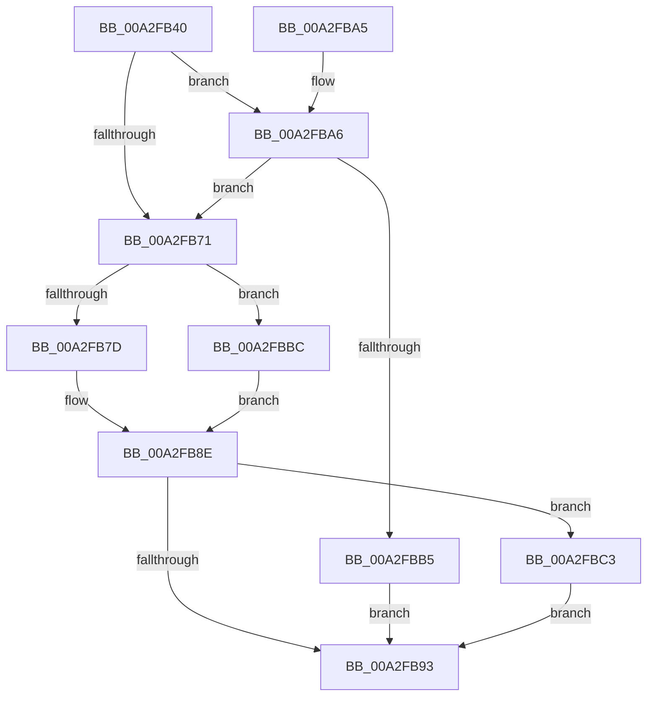

# PsQuerySectionSignatureInformation

- RVA: `0x00A2FB40`–`0x00A2FBCD` (길이 `141` bytes)
- VA: `0x0000000140A2FB40`
- 실행 섹션: `PAGE`
- PDB 이름 있음: `예`; PDB Function 태그: `아니요`
- unwind 정보 RVA: `0x0009A534`
- 디코드: `41`개 명령, `141/141` bytes 표시
- 미해석 바이트: `0` (있으면 어셈블리에 `.byte`로 보존)

> 이 문서는 커널 이미지의 기계어와 PDB 기호를 분석해 생성했습니다. 4번과 5번은 함수 원형과 자료형을 바이너리 사용 방식에서 추정한 C 해석이며 원본 소스 복구 결과는 아닙니다.

## 1. Dependencies

- 직접 호출 지점: **3**; 고유 호출 대상: **3**
- 직접 호출자로 확인된 함수: **2**
- RIP 상대 이미지 참조: **0**

### Outgoing calls
- `0x00A2FB7D` → [MiSectionControlArea](../../text/29/MiSectionControlArea_function_00294CB0.md) (function, `0x00294CB0`)
- `0x00A2FBA9` → [ExAcquireRundownProtection](../../text/21/ExAcquireRundownProtection_function_00216620.md) (function, `0x00216620`)
- `0x00A2FBC6` → [ExReleaseRundownProtection](../../text/34/ExReleaseRundownProtection_function_00349E80.md) (function, `0x00349E80`)

### Direct callers
- [PsCheckProcessFileSigningLevel](../78/PsCheckProcessFileSigningLevel_function_00783800.md) at `0x00783853`
- [PsCheckProcessFileSigningLevel](../78/PsCheckProcessFileSigningLevel_function_00783800.md) at `0x007839E7`
- [PsConvertToGuiThread](PsConvertToGuiThread_function_00A2F8B0.md) at `0x00A2FA3C`

### Static image references
- 디코드된 RIP-relative 메모리 참조가 없습니다.

## 2. Other-region calls and transfers

- 다른 실행 섹션으로 향하는 call: **3**
  - `0x00A2FB7D` → [MiSectionControlArea](../../text/29/MiSectionControlArea_function_00294CB0.md) (`PAGE` → `.text`)
  - `0x00A2FBA9` → [ExAcquireRundownProtection](../../text/21/ExAcquireRundownProtection_function_00216620.md) (`PAGE` → `.text`)
  - `0x00A2FBC6` → [ExReleaseRundownProtection](../../text/34/ExReleaseRundownProtection_function_00349E80.md) (`PAGE` → `.text`)
- 별도 외부 분기/꼬리 이동을 확인하지 못했습니다.

## 3. Assembly (complete function range)

```asm
00A2FB40  48 89 5C 24 08                  mov qword ptr [rsp + 8], rbx
00A2FB45  48 89 74 24 10                  mov qword ptr [rsp + 0x10], rsi
00A2FB4A  57                              push rdi
00A2FB4B  48 83 EC 20                     sub rsp, 0x20
00A2FB4F  65 48 8B 04 25 88 01 00 00      mov rax, qword ptr gs:[0x188]
00A2FB58  48 8D B9 E8 01 00 00            lea rdi, [rcx + 0x1e8]
00A2FB5F  45 32 C0                        xor r8b, r8b
00A2FB62  48 8B F2                        mov rsi, rdx
00A2FB65  48 8B D9                        mov rbx, rcx
00A2FB68  48 3B 88 20 02 00 00            cmp rcx, qword ptr [rax + 0x220]
00A2FB6F  75 35                           jne 0x140a2fba6
00A2FB71  48 8B 8B A8 02 00 00            mov rcx, qword ptr [rbx + 0x2a8]
00A2FB78  48 85 C9                        test rcx, rcx
00A2FB7B  74 3F                           je 0x140a2fbbc
00A2FB7D  E8 2E 51 86 FF                  call 0x140294cb0
00A2FB82  48 8B 00                        mov rax, qword ptr [rax]
00A2FB85  8A 40 0F                        mov al, byte ptr [rax + 0xf]
00A2FB88  24 0F                           and al, 0xf
00A2FB8A  88 06                           mov byte ptr [rsi], al
00A2FB8C  33 DB                           xor ebx, ebx
00A2FB8E  45 84 C0                        test r8b, r8b
00A2FB91  75 30                           jne 0x140a2fbc3
00A2FB93  48 8B 74 24 38                  mov rsi, qword ptr [rsp + 0x38]
00A2FB98  8B C3                           mov eax, ebx
00A2FB9A  48 8B 5C 24 30                  mov rbx, qword ptr [rsp + 0x30]
00A2FB9F  48 83 C4 20                     add rsp, 0x20
00A2FBA3  5F                              pop rdi
00A2FBA4  C3                              ret
00A2FBA5  CC                              int3
00A2FBA6  48 8B CF                        mov rcx, rdi
00A2FBA9  E8 72 6A 7E FF                  call 0x140216620
00A2FBAE  44 8A C0                        mov r8b, al
00A2FBB1  84 C0                           test al, al
00A2FBB3  75 BC                           jne 0x140a2fb71
00A2FBB5  BB 0A 01 00 C0                  mov ebx, 0xc000010a
00A2FBBA  EB D7                           jmp 0x140a2fb93
00A2FBBC  BB 01 00 00 C0                  mov ebx, 0xc0000001
00A2FBC1  EB CB                           jmp 0x140a2fb8e
00A2FBC3  48 8B CF                        mov rcx, rdi
00A2FBC6  E8 B5 A2 91 FF                  call 0x140349e80
00A2FBCB  EB C6                           jmp 0x140a2fb93
```

## 4. C-style interpretation (structured pseudocode)

```c
__int64 __fastcall PsQuerySectionSignatureInformation(__int64 a1, __int64 a2, unsigned __int8 a3)
{
    __int64 result;
    __int64 v_rbx;
    __int64 v_rsp;
    unsigned __int64 v_stack_p10;
    unsigned __int64 v_stack_p8;

    v_stack_p8 = v_rbx;
    v_stack_p10 = v_rsi;
    v_rsp = (v_rsp) - (32);
    a3 = 0;
    if (a1 != (*(unsigned __int64 *)(*(unsigned __int64 *)(gs_base + (0 + 392)) + 544))) goto loc_00A2FBA6;
loc_00A2FB71:
    if (*(unsigned __int64 *)(a1 + 680) == 0) goto loc_00A2FBBC;
    result = MiSectionControlArea(*(unsigned __int64 *)(a1 + 680), a2, a3, a4);
    result = (unsigned __int8)((*(unsigned __int8 *)(*(unsigned __int64 *)(result) + 15)) & (15));
    *(unsigned __int8 *)(a2) = (unsigned __int8)(result);
    v_rbx = 0;
loc_00A2FB8E:
    if (0 != 0) goto loc_00A2FBC3;
loc_00A2FB93:
    v_rsp = (v_rsp) + (32);
    return 0;
loc_00A2FBA6:
    result = ExAcquireRundownProtection(a1 + 488, a2, a3, a4);
    if ((unsigned __int8)(result) != 0) goto loc_00A2FB71;
    goto loc_00A2FB93;
loc_00A2FBBC:
    goto loc_00A2FB8E;
loc_00A2FBC3:
    result = ExReleaseRundownProtection(a1 + 488, a2, (unsigned __int8)(result), a4);
    goto loc_00A2FB93;
}
```

## 5. (Beta) C Style

```c
int64_t PsQuerySectionSignatureInformation(void *Arg1, void *Arg2, uint8_t Arg3)
{
    uint8_t *arg1 = (uint8_t *)Arg1;
    uint8_t *arg2 = (uint8_t *)Arg2;

    int64_t result;
    int64_t local_rbx;
    int64_t local_rsp;
    uint64_t v_stack_p10;
    uint64_t v_stack_p8;

    v_stack_p8 = local_rbx;
    v_stack_p10 = local_rsi;
    local_rsp = (local_rsp) - (32);
    Arg3 = 0;
    if (Arg1 != (*(uint64_t *)(*(uint64_t *)(gs_base + (0 + 0x188)) + 0x220))) goto loc_00A2FBA6;
loc_00A2FB71:
    if (*(uint64_t *)(arg1 + 0x2A8) == 0) goto loc_00A2FBBC;
    result = MiSectionControlArea(*(uint64_t *)(arg1 + 0x2A8), Arg2, Arg3, a4);
    result = (uint8_t)((*(uint8_t *)(*(uint64_t *)(result) + 0xF)) & (15));
    *(uint8_t *)(arg2) = (uint8_t)(result);
    local_rbx = 0;
loc_00A2FB8E:
    if (0 != 0) goto loc_00A2FBC3;
loc_00A2FB93:
    local_rsp = (local_rsp) + (32);
    return 0;
loc_00A2FBA6:
    result = ExAcquireRundownProtection(Arg1 + 488, Arg2, Arg3, a4);
    if ((uint8_t)(result) != 0) goto loc_00A2FB71;
    goto loc_00A2FB93;
loc_00A2FBBC:
    goto loc_00A2FB8E;
loc_00A2FBC3:
    result = ExReleaseRundownProtection(Arg1 + 488, Arg2, (uint8_t)(result), a4);
    goto loc_00A2FB93;
}
```

### 관측된 메모리 오프셋

구조체 형식이 확인되지 않은 접근은 인자 기준의 오프셋으로만 기록했습니다.

| 기준 인자 | 오프셋 표현 | 폭 (bit) | 접근 |
|---|---:|---:|---|
| `Arg1` | `+ 0x1E8` | `64` | `R` |
| `Arg1` | `+ 0x2A8` | `64` | `R` |
| `Arg2` | `+ 0x0` | `8` | `W` |

## 6. Execution-region graph

[열기: 2D/3D 그래프와 함수 탐색 컨트롤 패널](../../../control-panel.html?section=page&rva=0x00A2FB40&view=graph)

- 2D 그래프는 위에서 아래로 흐르고, 3D 그래프는 빈 공간을 드래그해 회전합니다. Shift+드래그는 이동, 휠은 확대·축소, 함수 노드 선택은 대상 보고서 이동입니다.

### Static fallback


