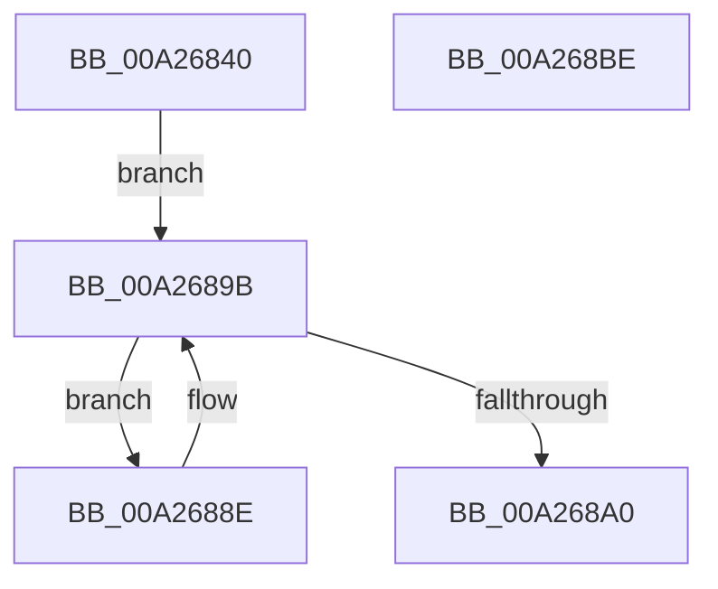

# PsQueryTotalCycleTimeProcess

- RVA: `0x00A26840`–`0x00A268BF` (길이 `127` bytes)
- VA: `0x0000000140A26840`
- 실행 섹션: `PAGE`
- PDB 이름 있음: `예`; PDB Function 태그: `아니요`
- unwind 정보 RVA: `0x00060BC4`
- 디코드: `34`개 명령, `127/127` bytes 표시
- 미해석 바이트: `0` (있으면 어셈블리에 `.byte`로 보존)

> 이 문서는 커널 이미지의 기계어와 PDB 기호를 분석해 생성했습니다. 4번과 5번은 함수 원형과 자료형을 바이너리 사용 방식에서 추정한 C 해석이며 원본 소스 복구 결과는 아닙니다.

## 1. Dependencies

- 직접 호출 지점: **4**; 고유 호출 대상: **4**
- 직접 호출자로 확인된 함수: **1**
- RIP 상대 이미지 참조: **0**

### Outgoing calls
- `0x00A26860` → [KeFlushProcessWriteBuffers](../../text/2C/KeFlushProcessWriteBuffers_function_002CE4FC.md) (function, `0x002CE4FC`)
- `0x00A2686B` → [KeUpdateTotalCyclesCurrentThread](../../text/3F/KeUpdateTotalCyclesCurrentThread_function_003FA2B0.md) (function, `0x003FA2B0`)
- `0x00A26876` → [PspLockProcessThreadListShared](../../text/3E/PspLockProcessThreadListShared_function_003ECBA0.md) (function, `0x003ECBA0`)
- `0x00A268A6` → [PspUnlockProcessThreadListShared](../../text/3E/PspUnlockProcessThreadListShared_function_003ECC10.md) (function, `0x003ECC10`)

### Direct callers
- [NtQueryInformationProcess](../9A/NtQueryInformationProcess_function_009AA250.md) at `0x009AC3F7`

### Static image references
- 디코드된 RIP-relative 메모리 참조가 없습니다.

## 2. Other-region calls and transfers

- 다른 실행 섹션으로 향하는 call: **4**
  - `0x00A26860` → [KeFlushProcessWriteBuffers](../../text/2C/KeFlushProcessWriteBuffers_function_002CE4FC.md) (`PAGE` → `.text`)
  - `0x00A2686B` → [KeUpdateTotalCyclesCurrentThread](../../text/3F/KeUpdateTotalCyclesCurrentThread_function_003FA2B0.md) (`PAGE` → `.text`)
  - `0x00A26876` → [PspLockProcessThreadListShared](../../text/3E/PspLockProcessThreadListShared_function_003ECBA0.md) (`PAGE` → `.text`)
  - `0x00A268A6` → [PspUnlockProcessThreadListShared](../../text/3E/PspUnlockProcessThreadListShared_function_003ECC10.md) (`PAGE` → `.text`)
- 별도 외부 분기/꼬리 이동을 확인하지 못했습니다.

## 3. Assembly (complete function range)

```asm
00A26840  48 89 5C 24 08                  mov qword ptr [rsp + 8], rbx
00A26845  48 89 74 24 10                  mov qword ptr [rsp + 0x10], rsi
00A2684A  57                              push rdi
00A2684B  48 83 EC 20                     sub rsp, 0x20
00A2684F  65 48 8B 34 25 88 01 00 00      mov rsi, qword ptr gs:[0x188]
00A26858  48 8B F9                        mov rdi, rcx
00A2685B  B1 01                           mov cl, 1
00A2685D  48 8B DA                        mov rbx, rdx
00A26860  E8 97 7C 8A FF                  call 0x1402ce4fc
00A26865  48 8B D3                        mov rdx, rbx
00A26868  48 8B CE                        mov rcx, rsi
00A2686B  E8 40 3A 9D FF                  call 0x1403fa2b0
00A26870  48 8B D6                        mov rdx, rsi
00A26873  48 8B CF                        mov rcx, rdi
00A26876  E8 25 63 9C FF                  call 0x1403ecba0
00A2687B  48 8B 9F 20 01 00 00            mov rbx, qword ptr [rdi + 0x120]
00A26882  48 8D 87 70 03 00 00            lea rax, [rdi + 0x370]
00A26889  4C 8B 00                        mov r8, qword ptr [rax]
00A2688C  EB 0D                           jmp 0x140a2689b
00A2688E  49 8B 88 D0 FA FF FF            mov rcx, qword ptr [r8 - 0x530]
00A26895  4D 8B 00                        mov r8, qword ptr [r8]
00A26898  48 03 D9                        add rbx, rcx
00A2689B  4C 3B C0                        cmp r8, rax
00A2689E  75 EE                           jne 0x140a2688e
00A268A0  48 8B D6                        mov rdx, rsi
00A268A3  48 8B CF                        mov rcx, rdi
00A268A6  E8 65 63 9C FF                  call 0x1403ecc10
00A268AB  48 8B 74 24 38                  mov rsi, qword ptr [rsp + 0x38]
00A268B0  48 8B C3                        mov rax, rbx
00A268B3  48 8B 5C 24 30                  mov rbx, qword ptr [rsp + 0x30]
00A268B8  48 83 C4 20                     add rsp, 0x20
00A268BC  5F                              pop rdi
00A268BD  C3                              ret
00A268BE  CC                              int3
```

## 4. C-style interpretation (structured pseudocode)

```c
__int64 __fastcall PsQueryTotalCycleTimeProcess(__int64 a1, __int64 a2)
{
    __int64 result;
    __int64 v_rbx;
    __int64 v_rsp;
    unsigned __int64 v_stack_p10;
    unsigned __int64 v_stack_p8;

    v_stack_p8 = v_rbx;
    v_stack_p10 = v_rsi;
    v_rsp = (v_rsp) - (32);
    result = KeFlushProcessWriteBuffers(1, a2, a3, a4);
    result = KeUpdateTotalCyclesCurrentThread(*(unsigned __int64 *)(gs_base + (0 + 392)), a2, a3, a4);
    result = PspLockProcessThreadListShared(a1, *(unsigned __int64 *)(gs_base + (0 + 392)), a3, a4);
    goto loc_00A2689B;
loc_00A2688E:
    v_rbx = (*(unsigned __int64 *)(a1 + 288)) + (*(unsigned __int64 *)(*(unsigned __int64 *)(a1 + 880) - 1328));
loc_00A2689B:
    if ((*(unsigned __int64 *)(*(unsigned __int64 *)(a1 + 880))) != (a1 + 880)) goto loc_00A2688E;
    result = PspUnlockProcessThreadListShared(a1, *(unsigned __int64 *)(gs_base + (0 + 392)), *(unsigned __int64 *)(*(unsigned __int64 *)(a1 + 880)), a4);
    v_rsp = (v_rsp) + (32);
    return v_rbx;
}
```

## 5. (Beta) C Style

```c
int64_t PsQueryTotalCycleTimeProcess(void *Arg1, int64_t Arg2)
{
    uint8_t *arg1 = (uint8_t *)Arg1;

    int64_t result;
    int64_t local_rbx;
    int64_t local_rsp;
    uint64_t v_stack_p10;
    uint64_t v_stack_p8;

    v_stack_p8 = local_rbx;
    v_stack_p10 = local_rsi;
    local_rsp = (local_rsp) - (32);
    result = KeFlushProcessWriteBuffers(1, Arg2, a3, a4);
    result = KeUpdateTotalCyclesCurrentThread(*(uint64_t *)(gs_base + (0 + 0x188)), Arg2, a3, a4);
    result = PspLockProcessThreadListShared(Arg1, *(uint64_t *)(gs_base + (0 + 0x188)), a3, a4);
    goto loc_00A2689B;
loc_00A2688E:
    local_rbx = (*(uint64_t *)(arg1 + 0x120)) + (*(uint64_t *)(*(uint64_t *)(arg1 + 0x370) - 0x530));
loc_00A2689B:
    if ((*(uint64_t *)(*(uint64_t *)(arg1 + 0x370))) != (Arg1 + 880)) goto loc_00A2688E;
    result = PspUnlockProcessThreadListShared(Arg1, *(uint64_t *)(gs_base + (0 + 0x188)), *(uint64_t *)(*(uint64_t *)(arg1 + 0x370)), a4);
    local_rsp = (local_rsp) + (32);
    return local_rbx;
}
```

### 관측된 메모리 오프셋

구조체 형식이 확인되지 않은 접근은 인자 기준의 오프셋으로만 기록했습니다.

| 기준 인자 | 오프셋 표현 | 폭 (bit) | 접근 |
|---|---:|---:|---|
| `Arg1` | `+ 0x0` | `64` | `R` |
| `Arg1` | `+ 0x120` | `64` | `R` |
| `Arg1` | `+ 0x370` | `64` | `R` |

## 6. Execution-region graph

[열기: 2D/3D 그래프와 함수 탐색 컨트롤 패널](../../../control-panel.html?section=page&rva=0x00A26840&view=graph)

- 2D 그래프는 위에서 아래로 흐르고, 3D 그래프는 빈 공간을 드래그해 회전합니다. Shift+드래그는 이동, 휠은 확대·축소, 함수 노드 선택은 대상 보고서 이동입니다.

### Static fallback


