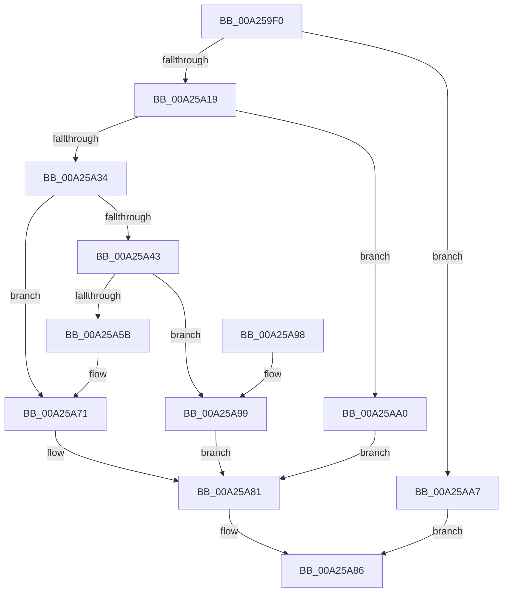

# PsTlsSetValue

- RVA: `0x00A259F0`–`0x00A25AAE` (길이 `190` bytes)
- VA: `0x0000000140A259F0`
- 실행 섹션: `PAGE`
- PDB 이름 있음: `예`; PDB Function 태그: `아니요`
- unwind 정보 RVA: `0x0009E850`
- 디코드: `49`개 명령, `190/190` bytes 표시
- 미해석 바이트: `0` (있으면 어셈블리에 `.byte`로 보존)

> 이 문서는 커널 이미지의 기계어와 PDB 기호를 분석해 생성했습니다. 4번과 5번은 함수 원형과 자료형을 바이너리 사용 방식에서 추정한 C 해석이며 원본 소스 복구 결과는 아닙니다.

## 1. Dependencies

- 직접 호출 지점: **3**; 고유 호출 대상: **3**
- 직접 호출자로 확인된 함수: **0**
- RIP 상대 이미지 참조: **0**

### Outgoing calls
- `0x00A25A51` → [ExAllocatePool2](../../poolcode/B8/ExAllocatePool2_function_00B820F0.md) (function, `0x00B820F0`)
- `0x00A25A7A` → [RtlpFlsSetValueSlot](RtlpFlsSetValueSlot_function_00A25AB4.md) (function, `0x00A25AB4`)
- `0x00A25A81` → [KeLeaveGuardedRegion](../../text/2E/KeLeaveGuardedRegion_function_002E2C40.md) (function, `0x002E2C40`)

### Direct callers
- 이 함수 시작 RVA로 연결되는 직접 call은 확인되지 않았습니다. 간접 호출은 완전히 역산할 수 없습니다.

### Static image references
- 디코드된 RIP-relative 메모리 참조가 없습니다.

## 2. Other-region calls and transfers

- 다른 실행 섹션으로 향하는 call: **2**
  - `0x00A25A51` → [ExAllocatePool2](../../poolcode/B8/ExAllocatePool2_function_00B820F0.md) (`PAGE` → `POOLCODE`)
  - `0x00A25A81` → [KeLeaveGuardedRegion](../../text/2E/KeLeaveGuardedRegion_function_002E2C40.md) (`PAGE` → `.text`)
- 별도 외부 분기/꼬리 이동을 확인하지 못했습니다.

## 3. Assembly (complete function range)

```asm
00A259F0  48 89 5C 24 08                  mov qword ptr [rsp + 8], rbx
00A259F5  48 89 74 24 10                  mov qword ptr [rsp + 0x10], rsi
00A259FA  57                              push rdi
00A259FB  48 83 EC 20                     sub rsp, 0x20
00A259FF  65 48 8B 1C 25 88 01 00 00      mov rbx, qword ptr gs:[0x188]
00A25A08  48 8B F2                        mov rsi, rdx
00A25A0B  8B 83 F0 06 00 00               mov eax, dword ptr [rbx + 0x6f0]
00A25A11  A8 03                           test al, 3
00A25A13  0F 85 8E 00 00 00               jne 0x140a25aa7
00A25A19  65 48 8B 04 25 88 01 00 00      mov rax, qword ptr gs:[0x188]
00A25A22  66 FF 88 E6 01 00 00            dec word ptr [rax + 0x1e6]
00A25A29  8D 41 FF                        lea eax, [rcx - 1]
00A25A2C  90                              nop
00A25A2D  3D EE 00 00 00                  cmp eax, 0xee
00A25A32  77 6C                           ja 0x140a25aa0
00A25A34  48 8B 83 F0 06 00 00            mov rax, qword ptr [rbx + 0x6f0]
00A25A3B  8D 79 10                        lea edi, [rcx + 0x10]
00A25A3E  48 85 C0                        test rax, rax
00A25A41  75 2E                           jne 0x140a25a71
00A25A43  8D 50 28                        lea edx, [rax + 0x28]
00A25A46  B9 00 01 00 00                  mov ecx, 0x100
00A25A4B  41 B8 46 4C 53 6B               mov r8d, 0x6b534c46
00A25A51  E8 9A C6 15 00                  call 0x140b820f0
00A25A56  48 85 C0                        test rax, rax
00A25A59  74 3E                           je 0x140a25a99
00A25A5B  48 83 60 20 00                  and qword ptr [rax + 0x20], 0
00A25A60  0F 57 C0                        xorps xmm0, xmm0
00A25A63  0F 11 00                        movups xmmword ptr [rax], xmm0
00A25A66  0F 11 40 10                     movups xmmword ptr [rax + 0x10], xmm0
00A25A6A  48 89 83 F0 06 00 00            mov qword ptr [rbx + 0x6f0], rax
00A25A71  4C 8B CE                        mov r9, rsi
00A25A74  44 8B C7                        mov r8d, edi
00A25A77  48 8B D0                        mov rdx, rax
00A25A7A  E8 35 00 00 00                  call 0x140a25ab4
00A25A7F  8B D8                           mov ebx, eax
00A25A81  E8 BA D1 8B FF                  call 0x1402e2c40
00A25A86  48 8B 74 24 38                  mov rsi, qword ptr [rsp + 0x38]
00A25A8B  8B C3                           mov eax, ebx
00A25A8D  48 8B 5C 24 30                  mov rbx, qword ptr [rsp + 0x30]
00A25A92  48 83 C4 20                     add rsp, 0x20
00A25A96  5F                              pop rdi
00A25A97  C3                              ret
00A25A98  CC                              int3
00A25A99  BB 17 00 00 C0                  mov ebx, 0xc0000017
00A25A9E  EB E1                           jmp 0x140a25a81
00A25AA0  BB 0D 00 00 C0                  mov ebx, 0xc000000d
00A25AA5  EB DA                           jmp 0x140a25a81
00A25AA7  BB 4B 00 00 C0                  mov ebx, 0xc000004b
00A25AAC  EB D8                           jmp 0x140a25a86
```

## 4. C-style interpretation (structured pseudocode)

```c
__int64 __fastcall PsTlsSetValue(__int64 a1, __int64 a2)
{
    __int64 result;
    __int64 v_rsp;
    unsigned __int64 v_stack_p10;
    unsigned __int64 v_stack_p8;

    v_stack_p8 = v_rbx;
    v_stack_p10 = v_rsi;
    v_rsp = (v_rsp) - (32);
    if ((((unsigned __int8)((unsigned int)(*(unsigned int *)(*(unsigned __int64 *)(gs_base + (0 + 392)) + 1776)))) & (3)) != 0) goto loc_00A25AA7;
    if (((unsigned int)(a1 - 1)) > 238) goto loc_00A25AA0;
    if (*(unsigned __int64 *)(*(unsigned __int64 *)(gs_base + (0 + 392)) + 1776) != 0) goto loc_00A25A71;
    result = ExAllocatePool2(256, *(unsigned __int64 *)(*(unsigned __int64 *)(gs_base + (0 + 392)) + 1776) + 40, (unsigned int)(0x6B534C46ULL), a4);
    if (result == 0) goto loc_00A25A99;
    *(unsigned __int64 *)(result) = v_xmm0;
    *(unsigned __int64 *)(result + 16) = v_xmm0;
    *(unsigned __int64 *)(*(unsigned __int64 *)(gs_base + (0 + 392)) + 1776) = result;
loc_00A25A71:
    result = RtlpFlsSetValueSlot(256, result, (unsigned int)((unsigned int)(a1 + 16)), a2);
loc_00A25A81:
    result = KeLeaveGuardedRegion(256, result, (unsigned int)((unsigned int)(a1 + 16)), a2);
loc_00A25A86:
    v_rsp = (v_rsp) + (32);
    return (unsigned int)((unsigned int)((unsigned int)((unsigned int)(result))));
loc_00A25A99:
    goto loc_00A25A81;
loc_00A25AA0:
    goto loc_00A25A81;
loc_00A25AA7:
    goto loc_00A25A86;
}
```

## 5. (Beta) C Style

```c
int64_t PsTlsSetValue(void *Arg1, int64_t Arg2)
{
    uint8_t *arg1 = (uint8_t *)Arg1;

    int64_t result;
    int64_t local_rsp;
    uint64_t v_stack_p10;
    uint64_t v_stack_p8;

    v_stack_p8 = local_rbx;
    v_stack_p10 = local_rsi;
    local_rsp = (local_rsp) - (32);
    if ((((uint8_t)((uint32_t)(*(uint32_t *)(*(uint64_t *)(gs_base + (0 + 0x188)) + 0x6F0)))) & (3)) != 0) goto loc_00A25AA7;
    if (((uint32_t)(Arg1 - 1)) > 238) goto loc_00A25AA0;
    if (*(uint64_t *)(*(uint64_t *)(gs_base + (0 + 0x188)) + 0x6F0) != 0) goto loc_00A25A71;
    result = ExAllocatePool2(256, *(uint64_t *)(*(uint64_t *)(gs_base + (0 + 0x188)) + 0x6F0) + 40, (uint32_t)(0x6B534C46ULL), a4);
    if (result == 0) goto loc_00A25A99;
    *(uint64_t *)(result) = v_xmm0;
    *(uint64_t *)(result + 0x10) = v_xmm0;
    *(uint64_t *)(*(uint64_t *)(gs_base + (0 + 0x188)) + 0x6F0) = result;
loc_00A25A71:
    result = RtlpFlsSetValueSlot(256, result, (uint32_t)((uint32_t)(Arg1 + 16)), Arg2);
loc_00A25A81:
    result = KeLeaveGuardedRegion(256, result, (uint32_t)((uint32_t)(Arg1 + 16)), Arg2);
loc_00A25A86:
    local_rsp = (local_rsp) + (32);
    return (uint32_t)((uint32_t)((uint32_t)((uint32_t)(result))));
loc_00A25A99:
    goto loc_00A25A81;
loc_00A25AA0:
    goto loc_00A25A81;
loc_00A25AA7:
    goto loc_00A25A86;
}
```

### 관측된 메모리 오프셋

구조체 형식이 확인되지 않은 접근은 인자 기준의 오프셋으로만 기록했습니다.

| 기준 인자 | 오프셋 표현 | 폭 (bit) | 접근 |
|---|---:|---:|---|
| `Arg1` | `- 0x1` | `32` | `R` |
| `Arg1` | `+ 0x10` | `32` | `R` |

## 6. Execution-region graph

[열기: 2D/3D 그래프와 함수 탐색 컨트롤 패널](../../../control-panel.html?section=page&rva=0x00A259F0&view=graph)

- 2D 그래프는 위에서 아래로 흐르고, 3D 그래프는 빈 공간을 드래그해 회전합니다. Shift+드래그는 이동, 휠은 확대·축소, 함수 노드 선택은 대상 보고서 이동입니다.

### Static fallback


