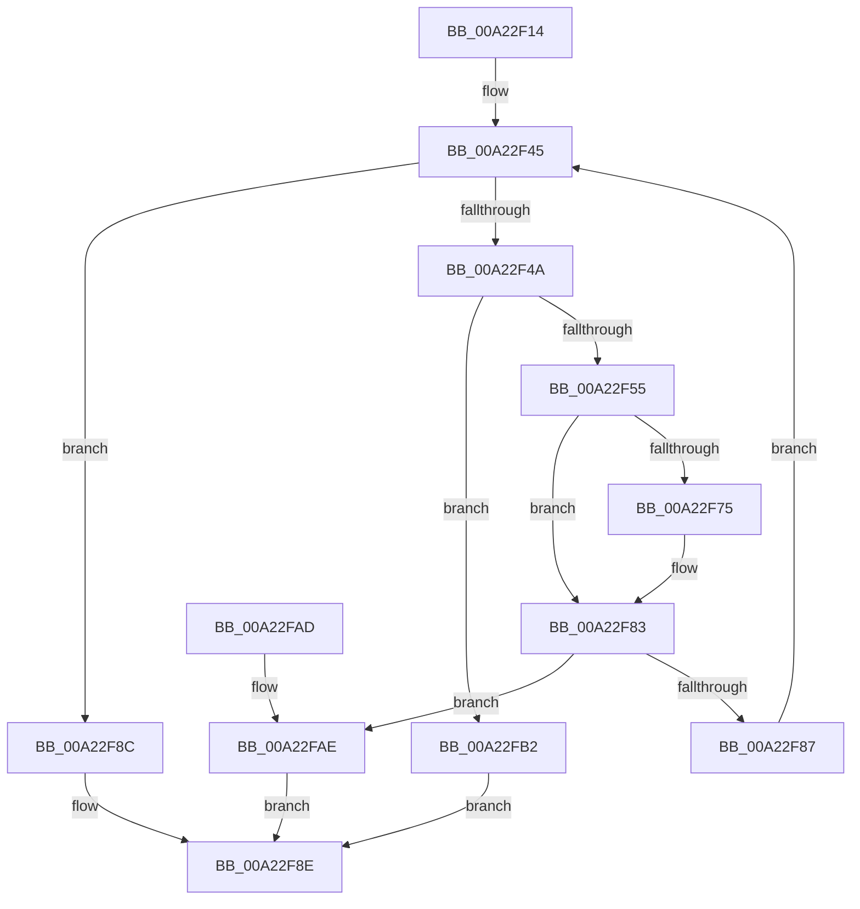

# PspAssignProcessToJobList

- RVA: `0x00A22F14`–`0x00A22FB9` (길이 `165` bytes)
- VA: `0x0000000140A22F14`
- 실행 섹션: `PAGE`
- PDB 이름 있음: `예`; PDB Function 태그: `아니요`
- unwind 정보 RVA: `0x0009080C`
- 디코드: `50`개 명령, `165/165` bytes 표시
- 미해석 바이트: `0` (있으면 어셈블리에 `.byte`로 보존)

> 이 문서는 커널 이미지의 기계어와 PDB 기호를 분석해 생성했습니다. 4번과 5번은 함수 원형과 자료형을 바이너리 사용 방식에서 추정한 C 해석이며 원본 소스 복구 결과는 아닙니다.

## 1. Dependencies

- 직접 호출 지점: **2**; 고유 호출 대상: **2**
- 직접 호출자로 확인된 함수: **1**
- RIP 상대 이미지 참조: **1**

### Outgoing calls
- `0x00A22F62` → [PsAssignProcessToJobObject](PsAssignProcessToJobObject_function_00A23190.md) (function, `0x00A23190`)
- `0x00A22F7E` → [EtwTraceJobAssignProcess](EtwTraceJobAssignProcess_function_00A230E8.md) (function, `0x00A230E8`)

### Direct callers
- [PspInsertThread](../9F/PspInsertThread_function_009F0314.md) at `0x009F0BFD`

### Static image references
- `0x00A22F67` → RVA `0x00FC6B00` (`ALMOSTRO`; read)

## 2. Other-region calls and transfers

- 다른 실행 섹션으로 향하는 call: **0**
- 별도 외부 분기/꼬리 이동을 확인하지 못했습니다.

## 3. Assembly (complete function range)

```asm
00A22F14  48 8B C4                        mov rax, rsp
00A22F17  48 89 58 08                     mov qword ptr [rax + 8], rbx
00A22F1B  48 89 68 10                     mov qword ptr [rax + 0x10], rbp
00A22F1F  48 89 70 18                     mov qword ptr [rax + 0x18], rsi
00A22F23  48 89 78 20                     mov qword ptr [rax + 0x20], rdi
00A22F27  41 54                           push r12
00A22F29  41 56                           push r14
00A22F2B  41 57                           push r15
00A22F2D  48 83 EC 20                     sub rsp, 0x20
00A22F31  65 4C 8B 3C 25 88 01 00 00      mov r15, qword ptr gs:[0x188]
00A22F3A  4D 8B F0                        mov r14, r8
00A22F3D  4C 8B E2                        mov r12, rdx
00A22F40  48 8B E9                        mov rbp, rcx
00A22F43  33 DB                           xor ebx, ebx
00A22F45  49 3B DE                        cmp rbx, r14
00A22F48  73 42                           jae 0x140a22f8c
00A22F4A  41 8B 87 A0 05 00 00            mov eax, dword ptr [r15 + 0x5a0]
00A22F51  A8 01                           test al, 1
00A22F53  75 5D                           jne 0x140a22fb2
00A22F55  49 8B 34 DC                     mov rsi, qword ptr [r12 + rbx*8]
00A22F59  45 33 C0                        xor r8d, r8d
00A22F5C  48 8B CE                        mov rcx, rsi
00A22F5F  48 8B D5                        mov rdx, rbp
00A22F62  E8 29 02 00 00                  call 0x140a23190
00A22F67  F7 05 8F 3B 5A 00 00 00 08 00   test dword ptr [rip + 0x5a3b8f], 0x80000
00A22F71  8B F8                           mov edi, eax
00A22F73  74 0E                           je 0x140a22f83
00A22F75  44 8B C0                        mov r8d, eax
00A22F78  48 8B D5                        mov rdx, rbp
00A22F7B  48 8B CE                        mov rcx, rsi
00A22F7E  E8 65 01 00 00                  call 0x140a230e8
00A22F83  85 FF                           test edi, edi
00A22F85  78 27                           js 0x140a22fae
00A22F87  48 FF C3                        inc rbx
00A22F8A  EB B9                           jmp 0x140a22f45
00A22F8C  33 C0                           xor eax, eax
00A22F8E  48 8B 5C 24 40                  mov rbx, qword ptr [rsp + 0x40]
00A22F93  48 8B 6C 24 48                  mov rbp, qword ptr [rsp + 0x48]
00A22F98  48 8B 74 24 50                  mov rsi, qword ptr [rsp + 0x50]
00A22F9D  48 8B 7C 24 58                  mov rdi, qword ptr [rsp + 0x58]
00A22FA2  48 83 C4 20                     add rsp, 0x20
00A22FA6  41 5F                           pop r15
00A22FA8  41 5E                           pop r14
00A22FAA  41 5C                           pop r12
00A22FAC  C3                              ret
00A22FAD  CC                              int3
00A22FAE  8B C7                           mov eax, edi
00A22FB0  EB DC                           jmp 0x140a22f8e
00A22FB2  B8 4B 00 00 C0                  mov eax, 0xc000004b
00A22FB7  EB D5                           jmp 0x140a22f8e
```

## 4. C-style interpretation (structured pseudocode)

```c
__int64 __fastcall PspAssignProcessToJobList(__int64 a1, __int64 a2, __int64 a3)
{
    __int64 result;
    __int64 v_rbx;
    __int64 v_rsp;
    unsigned __int64 v_stack_p10;
    unsigned __int64 v_stack_p18;
    unsigned __int64 v_stack_p20;
    unsigned __int64 v_stack_p8;

    *(unsigned __int64 *)(v_rsp + 8) = v_rbx;
    *(unsigned __int64 *)(v_rsp + 16) = v_rbp;
    *(unsigned __int64 *)(v_rsp + 24) = v_rsi;
    *(unsigned __int64 *)(v_rsp + 32) = v_rdi;
    v_rsp = (v_rsp) - (32);
    v_rbx = 0;
loc_00A22F45:
    if (0 >= a3) goto loc_00A22F8C;
    if ((((unsigned __int8)((unsigned int)(*(unsigned int *)(*(unsigned __int64 *)(gs_base + (0 + 392)) + 1440)))) & (1)) != 0) goto loc_00A22FB2;
    a3 = 0;
    result = PsAssignProcessToJobObject(*(unsigned __int64 *)(a2 + v_rbx * 8), a1, a3, a4);
    if (((*(unsigned int *)(v_rip + 5913487)) & (0x80000ULL)) != 0) {
        a3 = (unsigned int)(result);
        a2 = a1;
        a1 = *(unsigned __int64 *)(a2 + v_rbx * 8);
        result = EtwTraceJobAssignProcess(a1, a2, a3, a4);
    }
    if (sign_flag) goto loc_00A22FAE;
    v_rbx = (v_rbx) + 1;
    goto loc_00A22F45;
loc_00A22F8C:
    result = 0;
loc_00A22F8E:
    v_rsp = (v_rsp) + (32);
    return result;
loc_00A22FAE:
    goto loc_00A22F8E;
loc_00A22FB2:
    goto loc_00A22F8E;
}
```

## 5. (Beta) C Style

```c
int64_t PspAssignProcessToJobList(int64_t Arg1, void *Arg2, int64_t Arg3)
{
    uint8_t *arg2 = (uint8_t *)Arg2;

    int64_t result;
    int64_t local_rbx;
    int64_t local_rsp;
    uint64_t v_stack_p10;
    uint64_t v_stack_p18;
    uint64_t v_stack_p20;
    uint64_t v_stack_p8;

    *(uint64_t *)(local_rsp + 0x8) = local_rbx;
    *(uint64_t *)(local_rsp + 0x10) = local_rbp;
    *(uint64_t *)(local_rsp + 0x18) = local_rsi;
    *(uint64_t *)(local_rsp + 0x20) = local_rdi;
    local_rsp = (local_rsp) - (32);
    local_rbx = 0;
loc_00A22F45:
    if (0 >= Arg3) goto loc_00A22F8C;
    if ((((uint8_t)((uint32_t)(*(uint32_t *)(*(uint64_t *)(gs_base + (0 + 0x188)) + 0x5A0)))) & (1)) != 0) goto loc_00A22FB2;
    Arg3 = 0;
    result = PsAssignProcessToJobObject(*(uint64_t *)(arg2 + local_rbx * 8), Arg1, Arg3, a4);
    if (((*(uint32_t *)(v_rip + 0x5A3B8F)) & (0x80000ULL)) != 0) {
        Arg3 = (uint32_t)(result);
        Arg2 = Arg1;
        Arg1 = *(uint64_t *)(arg2 + local_rbx * 8);
        result = EtwTraceJobAssignProcess(Arg1, Arg2, Arg3, a4);
    }
    if (sign_flag) goto loc_00A22FAE;
    local_rbx = (local_rbx) + 1;
    goto loc_00A22F45;
loc_00A22F8C:
    result = 0;
loc_00A22F8E:
    local_rsp = (local_rsp) + (32);
    return result;
loc_00A22FAE:
    goto loc_00A22F8E;
loc_00A22FB2:
    goto loc_00A22F8E;
}
```

### 관측된 메모리 오프셋

구조체 형식이 확인되지 않은 접근은 인자 기준의 오프셋으로만 기록했습니다.

| 기준 인자 | 오프셋 표현 | 폭 (bit) | 접근 |
|---|---:|---:|---|
| `Arg2` | `+ 0x0 + rbx*8` | `64` | `R` |

## 6. Execution-region graph

[열기: 2D/3D 그래프와 함수 탐색 컨트롤 패널](../../../control-panel.html?section=page&rva=0x00A22F14&view=graph)

- 2D 그래프는 위에서 아래로 흐르고, 3D 그래프는 빈 공간을 드래그해 회전합니다. Shift+드래그는 이동, 휠은 확대·축소, 함수 노드 선택은 대상 보고서 이동입니다.

### Static fallback


