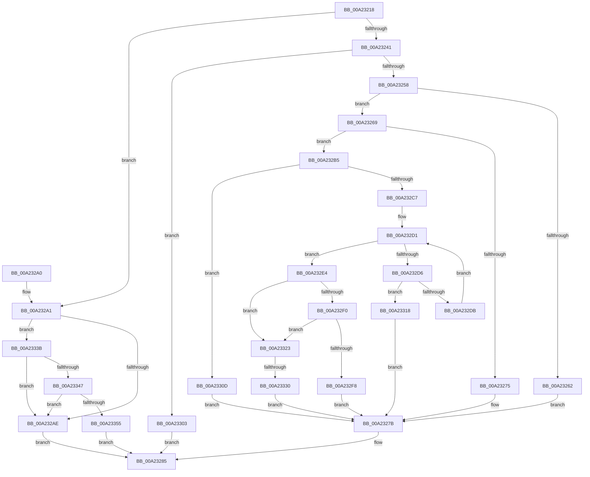

# PspGetJobAssignmentDisposition

- RVA: `0x00A23218`–`0x00A23369` (길이 `337` bytes)
- VA: `0x0000000140A23218`
- 실행 섹션: `PAGE`
- PDB 이름 있음: `예`; PDB Function 태그: `예`
- unwind 정보 RVA: `0x000AB69C`
- 디코드: `86`개 명령, `337/337` bytes 표시
- 미해석 바이트: `0` (있으면 어셈블리에 `.byte`로 보존)

> 이 문서는 커널 이미지의 기계어와 PDB 기호를 분석해 생성했습니다. 4번과 5번은 함수 원형과 자료형을 바이너리 사용 방식에서 추정한 C 해석이며 원본 소스 복구 결과는 아닙니다.

## 1. Dependencies

- 직접 호출 지점: **6**; 고유 호출 대상: **5**
- 직접 호출자로 확인된 함수: **2**
- RIP 상대 이미지 참조: **0**

### Outgoing calls
- `0x00A2324B` → [ExAcquireRundownProtection](../../text/21/ExAcquireRundownProtection_function_00216620.md) (function, `0x00216620`)
- `0x00A2327E` → [ExReleaseRundownProtection](../../text/34/ExReleaseRundownProtection_function_00349E80.md) (function, `0x00349E80`)
- `0x00A232A1` → [PsIsJobParentImmutable](PsIsJobParentImmutable_function_00A23A88.md) (function, `0x00A23A88`)
- `0x00A232BB` → [PspIsProcessInJob](PspIsProcessInJob_function_00A23A58.md) (function, `0x00A23A58`)
- `0x00A232E7` → [PsIsJobParentImmutable](PsIsJobParentImmutable_function_00A23A88.md) (function, `0x00A23A88`)
- `0x00A23323` → [PspIsJobMovable](../78/PspIsJobMovable_function_00785044.md) (function, `0x00785044`)

### Direct callers
- [PsAssignProcessToJobObject](PsAssignProcessToJobObject_function_00A23190.md) at `0x00A231C1`
- [PspAssignProcessToJob](PspAssignProcessToJob_function_00A23370.md) at `0x00A234CF`

### Static image references
- 디코드된 RIP-relative 메모리 참조가 없습니다.

## 2. Other-region calls and transfers

- 다른 실행 섹션으로 향하는 call: **2**
  - `0x00A2324B` → [ExAcquireRundownProtection](../../text/21/ExAcquireRundownProtection_function_00216620.md) (`PAGE` → `.text`)
  - `0x00A2327E` → [ExReleaseRundownProtection](../../text/34/ExReleaseRundownProtection_function_00349E80.md) (`PAGE` → `.text`)
- call이 아닌 외부 분기/꼬리 이동: **1**
  - `0x00A2332A` → [sub_00B37A82](../B3/Unknown_function_00B37A82.md) (`tail-transfer`)

## 3. Assembly (complete function range)

```asm
00A23218  48 8B C4                        mov rax, rsp
00A2321B  48 89 58 08                     mov qword ptr [rax + 8], rbx
00A2321F  48 89 68 10                     mov qword ptr [rax + 0x10], rbp
00A23223  48 89 70 18                     mov qword ptr [rax + 0x18], rsi
00A23227  48 89 78 20                     mov qword ptr [rax + 0x20], rdi
00A2322B  41 56                           push r14
00A2322D  48 83 EC 20                     sub rsp, 0x20
00A23231  33 DB                           xor ebx, ebx
00A23233  49 8B F1                        mov rsi, r9
00A23236  48 8B EA                        mov rbp, rdx
00A23239  48 8B F9                        mov rdi, rcx
00A2323C  48 85 D2                        test rdx, rdx
00A2323F  74 60                           je 0x140a232a1
00A23241  4C 8D B2 E8 01 00 00            lea r14, [rdx + 0x1e8]
00A23248  49 8B CE                        mov rcx, r14
00A2324B  E8 D0 33 7F FF                  call 0x140216620
00A23250  84 C0                           test al, al
00A23252  0F 84 AB 00 00 00               je 0x140a23303
00A23258  8B 85 F4 01 00 00               mov eax, dword ptr [rbp + 0x1f4]
00A2325E  A8 08                           test al, 8
00A23260  74 07                           je 0x140a23269
00A23262  BB 0A 01 00 C0                  mov ebx, 0xc000010a
00A23267  EB 12                           jmp 0x140a2327b
00A23269  48 8B 85 A0 02 00 00            mov rax, qword ptr [rbp + 0x2a0]
00A23270  48 85 C0                        test rax, rax
00A23273  75 40                           jne 0x140a232b5
00A23275  C7 06 01 00 00 00               mov dword ptr [rsi], 1
00A2327B  49 8B CE                        mov rcx, r14
00A2327E  E8 FD 6B 92 FF                  call 0x140349e80
00A23283  8B C3                           mov eax, ebx
00A23285  48 8B 5C 24 30                  mov rbx, qword ptr [rsp + 0x30]
00A2328A  48 8B 6C 24 38                  mov rbp, qword ptr [rsp + 0x38]
00A2328F  48 8B 74 24 40                  mov rsi, qword ptr [rsp + 0x40]
00A23294  48 8B 7C 24 48                  mov rdi, qword ptr [rsp + 0x48]
00A23299  48 83 C4 20                     add rsp, 0x20
00A2329D  41 5E                           pop r14
00A2329F  C3                              ret
00A232A0  CC                              int3
00A232A1  E8 E2 07 00 00                  call 0x140a23a88
00A232A6  84 C0                           test al, al
00A232A8  0F 84 8D 00 00 00               je 0x140a2333b
00A232AE  B8 BB 00 00 C0                  mov eax, 0xc00000bb
00A232B3  EB D0                           jmp 0x140a23285
00A232B5  48 8B D7                        mov rdx, rdi
00A232B8  48 8B CD                        mov rcx, rbp
00A232BB  E8 98 07 00 00                  call 0x140a23a58
00A232C0  3D 24 01 00 00                  cmp eax, 0x124
00A232C5  74 46                           je 0x140a2330d
00A232C7  48 8B 8D A0 02 00 00            mov rcx, qword ptr [rbp + 0x2a0]
00A232CE  48 8B C7                        mov rax, rdi
00A232D1  48 85 C0                        test rax, rax
00A232D4  74 0E                           je 0x140a232e4
00A232D6  48 3B C1                        cmp rax, rcx
00A232D9  74 3D                           je 0x140a23318
00A232DB  48 8B 80 18 05 00 00            mov rax, qword ptr [rax + 0x518]
00A232E2  EB ED                           jmp 0x140a232d1
00A232E4  48 8B CF                        mov rcx, rdi
00A232E7  E8 9C 07 00 00                  call 0x140a23a88
00A232EC  84 C0                           test al, al
00A232EE  75 33                           jne 0x140a23323
00A232F0  39 9F D4 00 00 00               cmp dword ptr [rdi + 0xd4], ebx
00A232F6  75 2B                           jne 0x140a23323
00A232F8  C7 06 04 00 00 00               mov dword ptr [rsi], 4
00A232FE  E9 78 FF FF FF                  jmp 0x140a2327b
00A23303  B8 0A 01 00 C0                  mov eax, 0xc000010a
00A23308  E9 78 FF FF FF                  jmp 0x140a23285
00A2330D  C7 06 02 00 00 00               mov dword ptr [rsi], 2
00A23313  E9 63 FF FF FF                  jmp 0x140a2327b
00A23318  C7 06 03 00 00 00               mov dword ptr [rsi], 3
00A2331E  E9 58 FF FF FF                  jmp 0x140a2327b
00A23323  E8 1C 1D D6 FF                  call 0x140785044
00A23328  84 C0                           test al, al
00A2332A  0F 84 52 47 11 00               je 0x140b37a82
00A23330  C7 06 05 00 00 00               mov dword ptr [rsi], 5
00A23336  E9 40 FF FF FF                  jmp 0x140a2327b
00A2333B  39 99 D4 00 00 00               cmp dword ptr [rcx + 0xd4], ebx
00A23341  0F 85 67 FF FF FF               jne 0x140a232ae
00A23347  48 83 B9 00 07 00 00 FF         cmp qword ptr [rcx + 0x700], -1
00A2334F  0F 84 59 FF FF FF               je 0x140a232ae
00A23355  49 F7 D8                        neg r8
00A23358  1B C0                           sbb eax, eax
00A2335A  F7 D8                           neg eax
00A2335C  83 C0 06                        add eax, 6
00A2335F  41 89 01                        mov dword ptr [r9], eax
00A23362  33 C0                           xor eax, eax
00A23364  E9 1C FF FF FF                  jmp 0x140a23285
```

## 4. C-style interpretation (structured pseudocode)

```c
__int64 __fastcall PspGetJobAssignmentDisposition(__int64 a1, __int64 a2, __int64 a3, __int64 a4)
{
    __int64 result;
    __int64 v_rbx;
    __int64 v_rsp;
    unsigned __int64 v_stack_p10;
    unsigned __int64 v_stack_p18;
    unsigned __int64 v_stack_p20;
    unsigned __int64 v_stack_p8;

    *(unsigned __int64 *)(v_rsp + 8) = v_rbx;
    *(unsigned __int64 *)(v_rsp + 16) = v_rbp;
    *(unsigned __int64 *)(v_rsp + 24) = v_rsi;
    *(unsigned __int64 *)(v_rsp + 32) = v_rdi;
    v_rsp = (v_rsp) - (32);
    v_rbx = 0;
    if (a2 == 0) goto loc_00A232A1;
    result = ExAcquireRundownProtection(a2 + 488, a2, a3, a4);
    if ((unsigned __int8)(result) == 0) goto loc_00A23303;
    if ((((unsigned __int8)((unsigned int)(*(unsigned int *)(a2 + 500)))) & (8)) == 0) goto loc_00A23269;
    goto loc_00A2327B;
loc_00A23269:
    if (*(unsigned __int64 *)(a2 + 672) != 0) goto loc_00A232B5;
    *(unsigned int *)(a4) = 1;
loc_00A2327B:
    result = ExReleaseRundownProtection(a2 + 488, a2, a3, a4);
loc_00A23285:
    v_rsp = (v_rsp) + (32);
    return (unsigned int)((unsigned int)((unsigned int)(0xC000010AULL)));
loc_00A232A1:
    result = PsIsJobParentImmutable(a2 + 488, a2, a3, a4);
    if ((unsigned __int8)(result) == 0) goto loc_00A2333B;
loc_00A232AE:
    goto loc_00A23285;
loc_00A232B5:
    result = PspIsProcessInJob(v_stack_p10, v_stack_p20, a3, a4);
    if (((unsigned int)(result)) == 292) goto loc_00A2330D;
loc_00A232D1:
    if (v_stack_p20 == 0) goto loc_00A232E4;
    if (v_stack_p20 == (*(unsigned __int64 *)(v_stack_p10 + 672))) goto loc_00A23318;
    goto loc_00A232D1;
loc_00A232E4:
    result = PsIsJobParentImmutable(v_stack_p20, v_stack_p20, a3, a4);
    if ((unsigned __int8)(result) != 0) goto loc_00A23323;
    if ((*(unsigned int *)(v_stack_p20 + 212)) != ((unsigned int)(v_stack_p8))) goto loc_00A23323;
    *(unsigned int *)(v_stack_p18) = 4;
    goto loc_00A2327B;
loc_00A23303:
    goto loc_00A23285;
loc_00A2330D:
    *(unsigned int *)(v_stack_p18) = 2;
    goto loc_00A2327B;
loc_00A23318:
    *(unsigned int *)(v_stack_p18) = 3;
    goto loc_00A2327B;
loc_00A23323:
    result = PspIsJobMovable(v_stack_p20, v_stack_p20, a3, a4);
    *(unsigned int *)(v_stack_p18) = 5;
    goto loc_00A2327B;
loc_00A2333B:
    if ((*(unsigned int *)(v_stack_p20 + 212)) != ((unsigned int)(v_stack_p8))) goto loc_00A232AE;
    if ((*(unsigned __int64 *)(v_stack_p20 + 1792)) == -1) goto loc_00A232AE;
    a3 = -(a3);
    result = (unsigned int)(-(result));
    result = (unsigned int)((result) + (6));
    *(unsigned int *)(a4) = (unsigned int)(result);
    result = 0;
    goto loc_00A23285;
}
```

## 5. (Beta) C Style

```c
int64_t PspGetJobAssignmentDisposition(void *Arg1, void *Arg2, int64_t Arg3, void *Arg4)
{
    uint8_t *arg1 = (uint8_t *)Arg1;
    uint8_t *arg2 = (uint8_t *)Arg2;
    uint8_t *arg4 = (uint8_t *)Arg4;

    int64_t result;
    int64_t local_rbx;
    int64_t local_rsp;
    uint64_t v_stack_p10;
    uint64_t v_stack_p18;
    uint64_t v_stack_p20;
    uint64_t v_stack_p8;

    *(uint64_t *)(local_rsp + 0x8) = local_rbx;
    *(uint64_t *)(local_rsp + 0x10) = local_rbp;
    *(uint64_t *)(local_rsp + 0x18) = local_rsi;
    *(uint64_t *)(local_rsp + 0x20) = local_rdi;
    local_rsp = (local_rsp) - (32);
    local_rbx = 0;
    if (Arg2 == NULL) goto loc_00A232A1;
    result = ExAcquireRundownProtection(Arg2 + 488, Arg2, Arg3, Arg4);
    if ((uint8_t)(result) == 0) goto loc_00A23303;
    if ((((uint8_t)((uint32_t)(*(uint32_t *)(arg2 + 0x1F4)))) & (8)) == 0) goto loc_00A23269;
    goto loc_00A2327B;
loc_00A23269:
    if (*(uint64_t *)(arg2 + 0x2A0) != 0) goto loc_00A232B5;
    *(uint32_t *)(arg4) = 1;
loc_00A2327B:
    result = ExReleaseRundownProtection(Arg2 + 488, Arg2, Arg3, Arg4);
loc_00A23285:
    local_rsp = (local_rsp) + (32);
    return (uint32_t)((uint32_t)((uint32_t)(0xC000010AULL)));
loc_00A232A1:
    result = PsIsJobParentImmutable(Arg2 + 488, Arg2, Arg3, Arg4);
    if ((uint8_t)(result) == 0) goto loc_00A2333B;
loc_00A232AE:
    goto loc_00A23285;
loc_00A232B5:
    result = PspIsProcessInJob(v_stack_p10, v_stack_p20, Arg3, Arg4);
    if (((uint32_t)(result)) == 292) goto loc_00A2330D;
loc_00A232D1:
    if (v_stack_p20 == 0) goto loc_00A232E4;
    if (v_stack_p20 == (*(uint64_t *)(v_stack_p10 + 0x2A0))) goto loc_00A23318;
    goto loc_00A232D1;
loc_00A232E4:
    result = PsIsJobParentImmutable(v_stack_p20, v_stack_p20, Arg3, Arg4);
    if ((uint8_t)(result) != 0) goto loc_00A23323;
    if ((*(uint32_t *)(v_stack_p20 + 0xD4)) != ((uint32_t)(v_stack_p8))) goto loc_00A23323;
    *(uint32_t *)(v_stack_p18) = 4;
    goto loc_00A2327B;
loc_00A23303:
    goto loc_00A23285;
loc_00A2330D:
    *(uint32_t *)(v_stack_p18) = 2;
    goto loc_00A2327B;
loc_00A23318:
    *(uint32_t *)(v_stack_p18) = 3;
    goto loc_00A2327B;
loc_00A23323:
    result = PspIsJobMovable(v_stack_p20, v_stack_p20, Arg3, Arg4);
    *(uint32_t *)(v_stack_p18) = 5;
    goto loc_00A2327B;
loc_00A2333B:
    if ((*(uint32_t *)(v_stack_p20 + 0xD4)) != ((uint32_t)(v_stack_p8))) goto loc_00A232AE;
    if ((*(uint64_t *)(v_stack_p20 + 0x700)) == -1) goto loc_00A232AE;
    Arg3 = -(Arg3);
    result = (uint32_t)(-(result));
    result = (uint32_t)((result) + (6));
    *(uint32_t *)(arg4) = (uint32_t)(result);
    result = 0;
    goto loc_00A23285;
}
```

### 관측된 메모리 오프셋

구조체 형식이 확인되지 않은 접근은 인자 기준의 오프셋으로만 기록했습니다.

| 기준 인자 | 오프셋 표현 | 폭 (bit) | 접근 |
|---|---:|---:|---|
| `Arg1` | `+ 0xD4` | `32` | `R` |
| `Arg2` | `+ 0x1F4` | `32` | `R` |
| `Arg2` | `+ 0x2A0` | `64` | `R` |
| `Arg4` | `+ 0x0` | `32` | `W` |

## 6. Execution-region graph

[열기: 2D/3D 그래프와 함수 탐색 컨트롤 패널](../../../control-panel.html?section=page&rva=0x00A23218&view=graph)

- 2D 그래프는 위에서 아래로 흐르고, 3D 그래프는 빈 공간을 드래그해 회전합니다. Shift+드래그는 이동, 휠은 확대·축소, 함수 노드 선택은 대상 보고서 이동입니다.

### Static fallback


