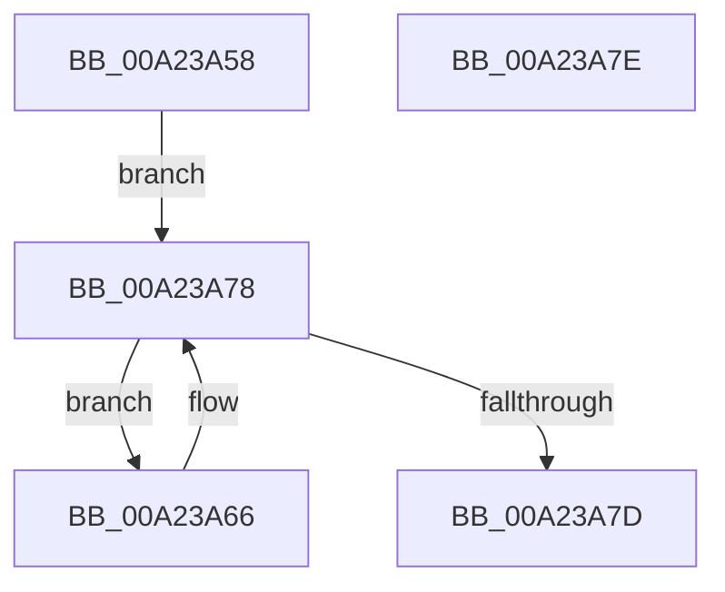

# PspIsProcessInJob

- RVA: `0x00A23A58`–`0x00A23A7F` (길이 `39` bytes)
- VA: `0x0000000140A23A58`
- 실행 섹션: `PAGE`
- PDB 이름 있음: `예`; PDB Function 태그: `아니요`
- unwind 정보 RVA: `0x000DB714`
- 디코드: `11`개 명령, `39/39` bytes 표시
- 미해석 바이트: `0` (있으면 어셈블리에 `.byte`로 보존)

> 이 문서는 커널 이미지의 기계어와 PDB 기호를 분석해 생성했습니다. 4번과 5번은 함수 원형과 자료형을 바이너리 사용 방식에서 추정한 C 해석이며 원본 소스 복구 결과는 아닙니다.

## 1. Dependencies

- 직접 호출 지점: **0**; 고유 호출 대상: **0**
- 직접 호출자로 확인된 함수: **3**
- RIP 상대 이미지 참조: **0**

### Outgoing calls
- 직접 디코드된 call 명령이 없습니다.

### Direct callers
- [PspChargeProcessWakeCounter](../88/PspChargeProcessWakeCounter_function_0088D2A0.md) at `0x0088D5B7`
- [PspGetJobAssignmentDisposition](PspGetJobAssignmentDisposition_function_00A23218.md) at `0x00A232BB`
- [NtIsProcessInJob](NtIsProcessInJob_function_00A23940.md) at `0x00A239F4`

### Static image references
- 디코드된 RIP-relative 메모리 참조가 없습니다.

## 2. Other-region calls and transfers

- 다른 실행 섹션으로 향하는 call: **0**
- 별도 외부 분기/꼬리 이동을 확인하지 못했습니다.

## 3. Assembly (complete function range)

```asm
00A23A58  4C 8B 81 A0 02 00 00            mov r8, qword ptr [rcx + 0x2a0]
00A23A5F  B8 23 01 00 00                  mov eax, 0x123
00A23A64  EB 12                           jmp 0x140a23a78
00A23A66  4C 3B C2                        cmp r8, rdx
00A23A69  B9 24 01 00 00                  mov ecx, 0x124
00A23A6E  4D 8B 80 18 05 00 00            mov r8, qword ptr [r8 + 0x518]
00A23A75  0F 44 C1                        cmove eax, ecx
00A23A78  4D 85 C0                        test r8, r8
00A23A7B  75 E9                           jne 0x140a23a66
00A23A7D  C3                              ret
00A23A7E  CC                              int3
```

## 4. C-style interpretation (structured pseudocode)

```c
__int64 __fastcall PspIsProcessInJob(__int64 a1, __int64 a2)
{
    __int64 result;

    goto loc_00A23A78;
loc_00A23A66:
    result = 291;
    if ((*(unsigned __int64 *)(a1 + 672)) == a2) { result = 292; }
loc_00A23A78:
    if (*(unsigned __int64 *)(*(unsigned __int64 *)(a1 + 672) + 1304) != 0) goto loc_00A23A66;
    return result;
}
```

## 5. (Beta) C Style

```c
int64_t PspIsProcessInJob(void *Arg1, int64_t Arg2)
{
    uint8_t *arg1 = (uint8_t *)Arg1;

    int64_t result;

    goto loc_00A23A78;
loc_00A23A66:
    result = 291;
    if ((*(uint64_t *)(arg1 + 0x2A0)) == Arg2) { result = 292; }
loc_00A23A78:
    if (*(uint64_t *)(*(uint64_t *)(arg1 + 0x2A0) + 0x518) != 0) goto loc_00A23A66;
    return result;
}
```

### 관측된 메모리 오프셋

구조체 형식이 확인되지 않은 접근은 인자 기준의 오프셋으로만 기록했습니다.

| 기준 인자 | 오프셋 표현 | 폭 (bit) | 접근 |
|---|---:|---:|---|
| `Arg1` | `+ 0x2A0` | `64` | `R` |

## 6. Execution-region graph

[열기: 2D/3D 그래프와 함수 탐색 컨트롤 패널](../../../control-panel.html?section=page&rva=0x00A23A58&view=graph)

- 2D 그래프는 위에서 아래로 흐르고, 3D 그래프는 빈 공간을 드래그해 회전합니다. Shift+드래그는 이동, 휠은 확대·축소, 함수 노드 선택은 대상 보고서 이동입니다.

### Static fallback


