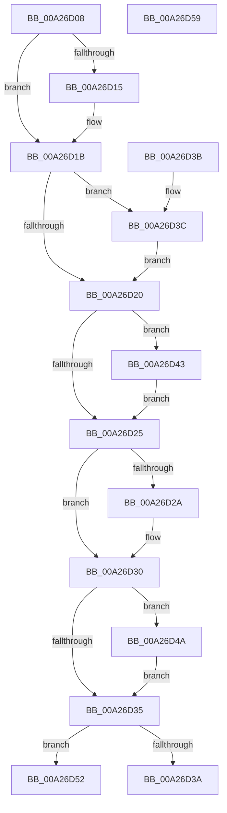

# PspMapThreadCreationFlags

- RVA: `0x00A26D08`–`0x00A26D5A` (길이 `82` bytes)
- VA: `0x0000000140A26D08`
- 실행 섹션: `PAGE`
- PDB 이름 있음: `예`; PDB Function 태그: `아니요`
- unwind 정보 RVA: `0x000DB714`
- 디코드: `34`개 명령, `82/82` bytes 표시
- 미해석 바이트: `0` (있으면 어셈블리에 `.byte`로 보존)

> 이 문서는 커널 이미지의 기계어와 PDB 기호를 분석해 생성했습니다. 4번과 5번은 함수 원형과 자료형을 바이너리 사용 방식에서 추정한 C 해석이며 원본 소스 복구 결과는 아닙니다.

## 1. Dependencies

- 직접 호출 지점: **0**; 고유 호출 대상: **0**
- 직접 호출자로 확인된 함수: **1**
- RIP 상대 이미지 참조: **0**

### Outgoing calls
- 직접 디코드된 call 명령이 없습니다.

### Direct callers
- [NtCreateUserProcess](../AE/NtCreateUserProcess_function_00AEA680.md) at `0x00AEB3F5`

### Static image references
- 디코드된 RIP-relative 메모리 참조가 없습니다.

## 2. Other-region calls and transfers

- 다른 실행 섹션으로 향하는 call: **0**
- 별도 외부 분기/꼬리 이동을 확인하지 못했습니다.

## 3. Assembly (complete function range)

```asm
00A26D08  33 C0                           xor eax, eax
00A26D0A  89 02                           mov dword ptr [rdx], eax
00A26D0C  44 8D 40 01                     lea r8d, [rax + 1]
00A26D10  41 84 C8                        test r8b, cl
00A26D13  74 06                           je 0x140a26d1b
00A26D15  44 89 02                        mov dword ptr [rdx], r8d
00A26D18  41 8B C0                        mov eax, r8d
00A26D1B  F6 C1 02                        test cl, 2
00A26D1E  75 1C                           jne 0x140a26d3c
00A26D20  F6 C1 04                        test cl, 4
00A26D23  75 1E                           jne 0x140a26d43
00A26D25  F6 C1 10                        test cl, 0x10
00A26D28  74 06                           je 0x140a26d30
00A26D2A  0F BA E8 07                     bts eax, 7
00A26D2E  89 02                           mov dword ptr [rdx], eax
00A26D30  F6 C1 20                        test cl, 0x20
00A26D33  75 15                           jne 0x140a26d4a
00A26D35  F6 C1 40                        test cl, 0x40
00A26D38  75 18                           jne 0x140a26d52
00A26D3A  C3                              ret
00A26D3B  CC                              int3
00A26D3C  83 C8 02                        or eax, 2
00A26D3F  89 02                           mov dword ptr [rdx], eax
00A26D41  EB DD                           jmp 0x140a26d20
00A26D43  83 C8 04                        or eax, 4
00A26D46  89 02                           mov dword ptr [rdx], eax
00A26D48  EB DB                           jmp 0x140a26d25
00A26D4A  0F BA E8 08                     bts eax, 8
00A26D4E  89 02                           mov dword ptr [rdx], eax
00A26D50  EB E3                           jmp 0x140a26d35
00A26D52  0F BA E8 09                     bts eax, 9
00A26D56  89 02                           mov dword ptr [rdx], eax
00A26D58  C3                              ret
00A26D59  CC                              int3
```

## 4. C-style interpretation (structured pseudocode)

```c
__int64 __fastcall PspMapThreadCreationFlags(unsigned __int8 a1, __int64 a2)
{
    __int64 result;

    result = 0;
    *(unsigned int *)(a2) = 0;
    if ((((unsigned __int8)(result + 1)) & (a1)) != 0) {
        *(unsigned int *)(a2) = (unsigned int)(result + 1);
        result = (unsigned int)(result + 1);
    }
    if (((a1) & (2)) != 0) goto loc_00A26D3C;
loc_00A26D20:
    if (((a1) & (4)) != 0) goto loc_00A26D43;
loc_00A26D25:
    if (((a1) & (16)) != 0) {
        *(unsigned int *)(a2) = (unsigned int)(result);
    }
    if (((a1) & (32)) != 0) goto loc_00A26D4A;
loc_00A26D35:
    if (((a1) & (64)) != 0) goto loc_00A26D52;
    return result;
loc_00A26D3C:
    result = (unsigned int)((result) | (2));
    *(unsigned int *)(a2) = (unsigned int)(result);
    goto loc_00A26D20;
loc_00A26D43:
    result = (unsigned int)((result) | (4));
    *(unsigned int *)(a2) = (unsigned int)(result);
    goto loc_00A26D25;
loc_00A26D4A:
    *(unsigned int *)(a2) = (unsigned int)(result);
    goto loc_00A26D35;
loc_00A26D52:
    *(unsigned int *)(a2) = (unsigned int)(result);
    return result;
}
```

## 5. (Beta) C Style

```c
int64_t PspMapThreadCreationFlags(uint8_t Arg1, void *Arg2)
{
    uint8_t *arg2 = (uint8_t *)Arg2;

    int64_t result;

    result = 0;
    *(uint32_t *)(arg2) = 0;
    if ((((uint8_t)(result + 1)) & (Arg1)) != 0) {
        *(uint32_t *)(arg2) = (uint32_t)(result + 1);
        result = (uint32_t)(result + 1);
    }
    if (((Arg1) & (2)) != 0) goto loc_00A26D3C;
loc_00A26D20:
    if (((Arg1) & (4)) != 0) goto loc_00A26D43;
loc_00A26D25:
    if (((Arg1) & (16)) != 0) {
        *(uint32_t *)(arg2) = (uint32_t)(result);
    }
    if (((Arg1) & (32)) != 0) goto loc_00A26D4A;
loc_00A26D35:
    if (((Arg1) & (64)) != 0) goto loc_00A26D52;
    return result;
loc_00A26D3C:
    result = (uint32_t)((result) | (2));
    *(uint32_t *)(arg2) = (uint32_t)(result);
    goto loc_00A26D20;
loc_00A26D43:
    result = (uint32_t)((result) | (4));
    *(uint32_t *)(arg2) = (uint32_t)(result);
    goto loc_00A26D25;
loc_00A26D4A:
    *(uint32_t *)(arg2) = (uint32_t)(result);
    goto loc_00A26D35;
loc_00A26D52:
    *(uint32_t *)(arg2) = (uint32_t)(result);
    return result;
}
```

### 관측된 메모리 오프셋

구조체 형식이 확인되지 않은 접근은 인자 기준의 오프셋으로만 기록했습니다.

| 기준 인자 | 오프셋 표현 | 폭 (bit) | 접근 |
|---|---:|---:|---|
| `Arg2` | `+ 0x0` | `32` | `W` |

## 6. Execution-region graph

[열기: 2D/3D 그래프와 함수 탐색 컨트롤 패널](../../../control-panel.html?section=page&rva=0x00A26D08&view=graph)

- 2D 그래프는 위에서 아래로 흐르고, 3D 그래프는 빈 공간을 드래그해 회전합니다. Shift+드래그는 이동, 휠은 확대·축소, 함수 노드 선택은 대상 보고서 이동입니다.

### Static fallback


