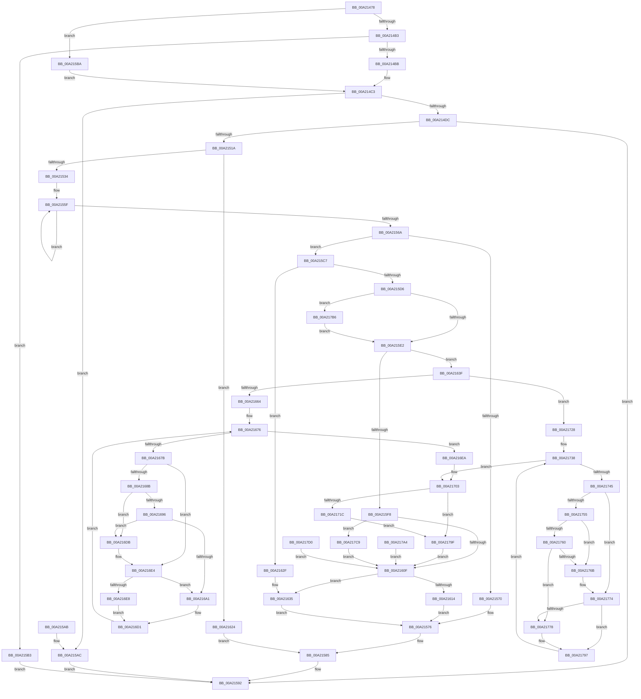

# PspQueryWorkingSetWatch

- RVA: `0x00A21478`–`0x00A217E2` (길이 `874` bytes)
- VA: `0x0000000140A21478`
- 실행 섹션: `PAGE`
- PDB 이름 있음: `예`; PDB Function 태그: `아니요`
- unwind 정보 RVA: `0x000AB0B0`
- 디코드: `210`개 명령, `874/874` bytes 표시
- 미해석 바이트: `0` (있으면 어셈블리에 `.byte`로 보존)

> 이 문서는 커널 이미지의 기계어와 PDB 기호를 분석해 생성했습니다. 4번과 5번은 함수 원형과 자료형을 바이너리 사용 방식에서 추정한 C 해석이며 원본 소스 복구 결과는 아닙니다.

## 1. Dependencies

- 직접 호출 지점: **5**; 고유 호출 대상: **5**
- 직접 호출자로 확인된 함수: **1**
- RIP 상대 이미지 참조: **1**

### Outgoing calls
- `0x00A214CF` → [ExIsRestrictedCaller](ExIsRestrictedCaller_function_00A217E8.md) (function, `0x00A217E8`)
- `0x00A21511` → [ObpReferenceObjectByHandleWithTag](../86/ObpReferenceObjectByHandleWithTag_function_00869650.md) (function, `0x00869650`)
- `0x00A2157B` → [KiLeaveCriticalRegionUnsafe](../../text/25/KiLeaveCriticalRegionUnsafe_function_0025F010.md) (function, `0x0025F010`)
- `0x00A2158A` → [ObfDereferenceObjectWithTag](../../text/2F/ObfDereferenceObjectWithTag_function_002F78E0.md) (function, `0x002F78E0`)
- `0x00A217BF` → [KeWaitForGate](../../text/2C/KeWaitForGate_function_002CA794.md) (function, `0x002CA794`)

### Direct callers
- [NtQueryInformationProcess](../9A/NtQueryInformationProcess_function_009AA250.md) at `0x009AC43B`

### Static image references
- `0x00A214DC` → RVA `0x00FC6A98` (`ALMOSTRO`; read)

## 2. Other-region calls and transfers

- 다른 실행 섹션으로 향하는 call: **3**
  - `0x00A2157B` → [KiLeaveCriticalRegionUnsafe](../../text/25/KiLeaveCriticalRegionUnsafe_function_0025F010.md) (`PAGE` → `.text`)
  - `0x00A2158A` → [ObfDereferenceObjectWithTag](../../text/2F/ObfDereferenceObjectWithTag_function_002F78E0.md) (`PAGE` → `.text`)
  - `0x00A217BF` → [KeWaitForGate](../../text/2C/KeWaitForGate_function_002CA794.md) (`PAGE` → `.text`)
- 별도 외부 분기/꼬리 이동을 확인하지 못했습니다.

## 3. Assembly (complete function range)

```asm
00A21478  48 89 5C 24 08                  mov qword ptr [rsp + 8], rbx
00A2147D  44 89 4C 24 20                  mov dword ptr [rsp + 0x20], r9d
00A21482  89 54 24 10                     mov dword ptr [rsp + 0x10], edx
00A21486  56                              push rsi
00A21487  41 54                           push r12
00A21489  41 55                           push r13
00A2148B  41 56                           push r14
00A2148D  41 57                           push r15
00A2148F  48 81 EC 80 00 00 00            sub rsp, 0x80
00A21496  41 8B C1                        mov eax, r9d
00A21499  4D 8B F8                        mov r15, r8
00A2149C  48 8B D9                        mov rbx, rcx
00A2149F  48 83 64 24 60 00               and qword ptr [rsp + 0x60], 0
00A214A5  83 64 24 44 00                  and dword ptr [rsp + 0x44], 0
00A214AA  83 FA 2A                        cmp edx, 0x2a
00A214AD  0F 85 07 01 00 00               jne 0x140a215ba
00A214B3  A8 1F                           test al, 0x1f
00A214B5  0F 85 F8 00 00 00               jne 0x140a215b3
00A214BB  C7 44 24 50 20 00 00 00         mov dword ptr [rsp + 0x50], 0x20
00A214C3  48 8D 54 24 44                  lea rdx, [rsp + 0x44]
00A214C8  8A 8C 24 D8 00 00 00            mov cl, byte ptr [rsp + 0xd8]
00A214CF  E8 14 03 00 00                  call 0x140a217e8
00A214D4  85 C0                           test eax, eax
00A214D6  0F 85 D0 00 00 00               jne 0x140a215ac
00A214DC  4C 8B 05 B5 55 5A 00            mov r8, qword ptr [rip + 0x5a55b5]
00A214E3  48 83 64 24 38 00               and qword ptr [rsp + 0x38], 0
00A214E9  48 83 64 24 30 00               and qword ptr [rsp + 0x30], 0
00A214EF  48 8D 44 24 60                  lea rax, [rsp + 0x60]
00A214F4  48 89 44 24 28                  mov qword ptr [rsp + 0x28], rax
00A214F9  C7 44 24 20 50 73 51 79         mov dword ptr [rsp + 0x20], 0x79517350
00A21501  44 8A 8C 24 D8 00 00 00         mov r9b, byte ptr [rsp + 0xd8]
00A21509  BA 00 04 00 00                  mov edx, 0x400
00A2150E  48 8B CB                        mov rcx, rbx
00A21511  E8 3A 81 E4 FF                  call 0x140869650
00A21516  85 C0                           test eax, eax
00A21518  78 78                           js 0x140a21592
00A2151A  48 8B 4C 24 60                  mov rcx, qword ptr [rsp + 0x60]
00A2151F  48 8B B1 C0 02 00 00            mov rsi, qword ptr [rcx + 0x2c0]
00A21526  48 89 74 24 70                  mov qword ptr [rsp + 0x70], rsi
00A2152B  48 85 F6                        test rsi, rsi
00A2152E  0F 84 F0 00 00 00               je 0x140a21624
00A21534  65 48 8B 04 25 88 01 00 00      mov rax, qword ptr gs:[0x188]
00A2153D  48 89 44 24 78                  mov qword ptr [rsp + 0x78], rax
00A21542  45 33 F6                        xor r14d, r14d
00A21545  45 33 E4                        xor r12d, r12d
00A21548  4C 89 64 24 58                  mov qword ptr [rsp + 0x58], r12
00A2154D  44 21 64 24 40                  and dword ptr [rsp + 0x40], r12d
00A21552  66 FF 88 E4 01 00 00            dec word ptr [rax + 0x1e4]
00A21559  90                              nop
00A2155A  0F 0D 0E                        prefetchw byte ptr [rsi]
00A2155D  8B 06                           mov eax, dword ptr [rsi]
00A2155F  8B C8                           mov ecx, eax
00A21561  83 C9 01                        or ecx, 1
00A21564  F0 0F B1 0E                     lock cmpxchg dword ptr [rsi], ecx
00A21568  75 F5                           jne 0x140a2155f
00A2156A  8B D8                           mov ebx, eax
00A2156C  A8 01                           test al, 1
00A2156E  74 57                           je 0x140a215c7
00A21570  41 BE 1A 00 00 80               mov r14d, 0x8000001a
00A21576  48 8B 4C 24 78                  mov rcx, qword ptr [rsp + 0x78]
00A2157B  E8 90 DA 83 FF                  call 0x14025f010
00A21580  48 8B 4C 24 60                  mov rcx, qword ptr [rsp + 0x60]
00A21585  BA 50 73 51 79                  mov edx, 0x79517350
00A2158A  E8 51 63 8D FF                  call 0x1402f78e0
00A2158F  41 8B C6                        mov eax, r14d
00A21592  48 8B 9C 24 B0 00 00 00         mov rbx, qword ptr [rsp + 0xb0]
00A2159A  48 81 C4 80 00 00 00            add rsp, 0x80
00A215A1  41 5F                           pop r15
00A215A3  41 5E                           pop r14
00A215A5  41 5D                           pop r13
00A215A7  41 5C                           pop r12
00A215A9  5E                              pop rsi
00A215AA  C3                              ret
00A215AB  CC                              int3
00A215AC  B8 22 00 00 C0                  mov eax, 0xc0000022
00A215B1  EB DF                           jmp 0x140a21592
00A215B3  B8 04 00 00 C0                  mov eax, 0xc0000004
00A215B8  EB D8                           jmp 0x140a21592
00A215BA  C7 44 24 50 10 00 00 00         mov dword ptr [rsp + 0x50], 0x10
00A215C2  E9 FC FE FF FF                  jmp 0x140a214c3
00A215C7  44 8B EB                        mov r13d, ebx
00A215CA  41 D1 ED                        shr r13d, 1
00A215CD  41 81 E5 FF 7F 00 00            and r13d, 0x7fff
00A215D4  74 59                           je 0x140a2162f
00A215D6  F7 C3 00 00 FF 7F               test ebx, 0x7fff0000
00A215DC  0F 87 D4 01 00 00               ja 0x140a217b6
00A215E2  41 8D 4D 01                     lea ecx, [r13 + 1]
00A215E6  44 8B 5C 24 50                  mov r11d, dword ptr [rsp + 0x50]
00A215EB  41 0F AF CB                     imul ecx, r11d
00A215EF  39 8C 24 C8 00 00 00            cmp dword ptr [rsp + 0xc8], ecx
00A215F6  73 47                           jae 0x140a2163f
00A215F8  41 BE 23 00 00 C0               mov r14d, 0xc0000023
00A215FE  48 8B 84 24 D0 00 00 00         mov rax, qword ptr [rsp + 0xd0]
00A21606  48 85 C0                        test rax, rax
00A21609  0F 85 BA 01 00 00               jne 0x140a217c9
00A2160F  45 85 F6                        test r14d, r14d
00A21612  78 21                           js 0x140a21635
00A21614  49 F7 DC                        neg r12
00A21617  F0 4C 01 66 08                  lock add qword ptr [rsi + 8], r12
00A2161C  83 26 00                        and dword ptr [rsi], 0
00A2161F  E9 52 FF FF FF                  jmp 0x140a21576
00A21624  41 BE 01 00 00 C0               mov r14d, 0xc0000001
00A2162A  E9 56 FF FF FF                  jmp 0x140a21585
00A2162F  41 BE 1A 00 00 80               mov r14d, 0x8000001a
00A21635  F0 0F BA 36 00                  lock btr dword ptr [rsi], 0
00A2163A  E9 37 FF FF FF                  jmp 0x140a21576
00A2163F  0F 0D 4E 08                     prefetchw byte ptr [rsi + 8]
00A21643  4C 8B 66 08                     mov r12, qword ptr [rsi + 8]
00A21647  4C 89 64 24 58                  mov qword ptr [rsp + 0x58], r12
00A2164C  49 BA FF FF FE FF FF 7F 00 00   movabs r10, 0x7ffffffeffff
00A21656  83 BC 24 B8 00 00 00 2A         cmp dword ptr [rsp + 0xb8], 0x2a
00A2165E  0F 85 C4 00 00 00               jne 0x140a21728
00A21664  4C 89 7C 24 50                  mov qword ptr [rsp + 0x50], r15
00A21669  45 33 C0                        xor r8d, r8d
00A2166C  44 89 44 24 48                  mov dword ptr [rsp + 0x48], r8d
00A21671  44 8B 4C 24 40                  mov r9d, dword ptr [rsp + 0x40]
00A21676  45 3B C5                        cmp r8d, r13d
00A21679  73 6F                           jae 0x140a216ea
00A2167B  B0 01                           mov al, 1
00A2167D  88 84 24 B8 00 00 00            mov byte ptr [rsp + 0xb8], al
00A21684  83 7C 24 44 00                  cmp dword ptr [rsp + 0x44], 0
00A21689  74 59                           je 0x140a216e4
00A2168B  4B 8D 04 40                     lea rax, [r8 + r8*2]
00A2168F  4C 39 54 C6 28                  cmp qword ptr [rsi + rax*8 + 0x28], r10
00A21694  77 45                           ja 0x140a216db
00A21696  4B 8D 04 40                     lea rax, [r8 + r8*2]
00A2169A  4C 39 54 C6 30                  cmp qword ptr [rsi + rax*8 + 0x30], r10
00A2169F  77 3A                           ja 0x140a216db
00A216A1  41 8B C9                        mov ecx, r9d
00A216A4  48 C1 E1 05                     shl rcx, 5
00A216A8  4B 8D 04 40                     lea rax, [r8 + r8*2]
00A216AC  0F 10 44 C6 28                  movups xmm0, xmmword ptr [rsi + rax*8 + 0x28]
00A216B1  42 0F 11 04 39                  movups xmmword ptr [rcx + r15], xmm0
00A216B6  F2 0F 10 4C C6 38               movsd xmm1, qword ptr [rsi + rax*8 + 0x38]
00A216BC  F2 42 0F 11 4C 39 10            movsd qword ptr [rcx + r15 + 0x10], xmm1
00A216C3  4A 83 64 39 18 00               and qword ptr [rcx + r15 + 0x18], 0
00A216C9  41 FF C1                        inc r9d
00A216CC  44 89 4C 24 40                  mov dword ptr [rsp + 0x40], r9d
00A216D1  41 FF C0                        inc r8d
00A216D4  44 89 44 24 48                  mov dword ptr [rsp + 0x48], r8d
00A216D9  EB 9B                           jmp 0x140a21676
00A216DB  32 C0                           xor al, al
00A216DD  88 84 24 B8 00 00 00            mov byte ptr [rsp + 0xb8], al
00A216E4  84 C0                           test al, al
00A216E6  75 B9                           jne 0x140a216a1
00A216E8  EB E7                           jmp 0x140a216d1
00A216EA  41 8B C1                        mov eax, r9d
00A216ED  48 C1 E0 05                     shl rax, 5
00A216F1  4C 03 F8                        add r15, rax
00A216F4  4C 89 7C 24 68                  mov qword ptr [rsp + 0x68], r15
00A216F9  49 83 67 10 00                  and qword ptr [r15 + 0x10], 0
00A216FE  49 83 67 18 00                  and qword ptr [r15 + 0x18], 0
00A21703  49 83 27 00                     and qword ptr [r15], 0
00A21707  4D 89 67 08                     mov qword ptr [r15 + 8], r12
00A2170B  48 8B 8C 24 D0 00 00 00         mov rcx, qword ptr [rsp + 0xd0]
00A21713  48 85 C9                        test rcx, rcx
00A21716  0F 84 83 00 00 00               je 0x140a2179f
00A2171C  41 8D 41 01                     lea eax, [r9 + 1]
00A21720  41 0F AF C3                     imul eax, r11d
00A21724  89 01                           mov dword ptr [rcx], eax
00A21726  EB 77                           jmp 0x140a2179f
00A21728  4C 89 7C 24 68                  mov qword ptr [rsp + 0x68], r15
00A2172D  33 D2                           xor edx, edx
00A2172F  89 54 24 48                     mov dword ptr [rsp + 0x48], edx
00A21733  44 8B 4C 24 40                  mov r9d, dword ptr [rsp + 0x40]
00A21738  8B C3                           mov eax, ebx
00A2173A  D1 E8                           shr eax, 1
00A2173C  25 FF 7F 00 00                  and eax, 0x7fff
00A21741  3B D0                           cmp edx, eax
00A21743  73 BE                           jae 0x140a21703
00A21745  B0 01                           mov al, 1
00A21747  88 84 24 B8 00 00 00            mov byte ptr [rsp + 0xb8], al
00A2174E  83 7C 24 44 00                  cmp dword ptr [rsp + 0x44], 0
00A21753  74 1F                           je 0x140a21774
00A21755  48 8D 04 52                     lea rax, [rdx + rdx*2]
00A21759  4C 39 54 C6 28                  cmp qword ptr [rsi + rax*8 + 0x28], r10
00A2175E  77 0B                           ja 0x140a2176b
00A21760  48 8D 04 52                     lea rax, [rdx + rdx*2]
00A21764  4C 39 54 C6 30                  cmp qword ptr [rsi + rax*8 + 0x30], r10
00A21769  76 0D                           jbe 0x140a21778
00A2176B  32 C0                           xor al, al
00A2176D  88 84 24 B8 00 00 00            mov byte ptr [rsp + 0xb8], al
00A21774  84 C0                           test al, al
00A21776  74 1F                           je 0x140a21797
00A21778  48 8D 04 52                     lea rax, [rdx + rdx*2]
00A2177C  0F 10 44 C6 28                  movups xmm0, xmmword ptr [rsi + rax*8 + 0x28]
00A21781  F3 41 0F 7F 07                  movdqu xmmword ptr [r15], xmm0
00A21786  49 83 C7 10                     add r15, 0x10
00A2178A  4C 89 7C 24 68                  mov qword ptr [rsp + 0x68], r15
00A2178F  41 FF C1                        inc r9d
00A21792  44 89 4C 24 40                  mov dword ptr [rsp + 0x40], r9d
00A21797  FF C2                           inc edx
00A21799  89 54 24 48                     mov dword ptr [rsp + 0x48], edx
00A2179D  EB 99                           jmp 0x140a21738
00A2179F  E9 6B FE FF FF                  jmp 0x140a2160f
00A217A4  44 8B F0                        mov r14d, eax
00A217A7  4C 8B 64 24 58                  mov r12, qword ptr [rsp + 0x58]
00A217AC  48 8B 74 24 70                  mov rsi, qword ptr [rsp + 0x70]
00A217B1  E9 59 FE FF FF                  jmp 0x140a2160f
00A217B6  48 8D 4E 10                     lea rcx, [rsi + 0x10]
00A217BA  45 33 C0                        xor r8d, r8d
00A217BD  33 D2                           xor edx, edx
00A217BF  E8 D0 8F 8A FF                  call 0x1402ca794
00A217C4  E9 19 FE FF FF                  jmp 0x140a215e2
00A217C9  89 08                           mov dword ptr [rax], ecx
00A217CB  E9 3F FE FF FF                  jmp 0x140a2160f
00A217D0  44 8B F0                        mov r14d, eax
00A217D3  4C 8B 64 24 58                  mov r12, qword ptr [rsp + 0x58]
00A217D8  48 8B 74 24 70                  mov rsi, qword ptr [rsp + 0x70]
00A217DD  E9 2D FE FF FF                  jmp 0x140a2160f
```

## 4. C-style interpretation (structured pseudocode)

```c
__int64 __fastcall PspQueryWorkingSetWatch(__int64 a1, int a2, __int64 a3, int a4, __int64 a5, unsigned __int8 a6)
{
    __int64 result;
    __int64 v_r12;
    __int64 v_r13;
    __int64 v_r14;
    __int64 v_r15;
    __int64 v_rsp;
    unsigned __int64 v_stack_m30;
    unsigned __int64 v_stack_m38;
    unsigned __int64 v_stack_m48;
    unsigned __int64 v_stack_m50;
    unsigned int v_stack_m58;
    unsigned int v_stack_m64;
    unsigned int v_stack_m68;
    unsigned __int64 v_stack_m70;
    unsigned __int64 v_stack_m78;
    unsigned __int64 v_stack_m80;
    unsigned int v_stack_m88;
    unsigned int v_stack_p10;
    unsigned int v_stack_p20;
    unsigned int v_stack_p40;
    unsigned int v_stack_p44;
    unsigned int v_stack_p48;
    unsigned int v_stack_p50;
    unsigned __int64 v_stack_p58;
    unsigned __int64 v_stack_p68;
    unsigned __int64 v_stack_p70;
    unsigned __int64 v_stack_p8;
    unsigned int v_stack_pB8;
    unsigned int v_stack_pC8;

    v_stack_p8 = v_rbx;
    v_stack_p20 = a4;
    v_stack_p10 = a2;
    v_rsp = (v_rsp) - (128);
    if (a2 != 42) goto loc_00A215BA;
    if ((((unsigned __int8)((unsigned int)(a4))) & (31)) != 0) goto loc_00A215B3;
    v_stack_m58 = 32;
loc_00A214C3:
    result = ExIsRestrictedCaller(a6, v_stack_m64, a3, a4);
    if ((unsigned int)(result) != 0) goto loc_00A215AC;
    v_stack_m80 = v_stack_m48;
    v_stack_m88 = 0x79517350ULL;
    result = ObpReferenceObjectByHandleWithTag(a1, (unsigned int)(0x400ULL), *(unsigned __int64 *)(v_rip + 5920181), a6);
    if (sign_flag) goto loc_00A21592;
    v_stack_m38 = *(unsigned __int64 *)(v_stack_m48 + 704);
    if (*(unsigned __int64 *)(v_stack_m48 + 704) == 0) goto loc_00A21624;
    v_stack_m30 = *(unsigned __int64 *)(gs_base + (0 + 392));
    v_r14 = 0;
    v_r12 = 0;
    v_stack_m50 = 0;
loc_00A2155F:
    a1 = (unsigned int)(((unsigned int)((unsigned int)((unsigned int)(*(unsigned int *)(*(unsigned __int64 *)(v_stack_m48 + 704)))))) | (1));
    if (condition_is_not_equal) goto loc_00A2155F;
    if ((((unsigned __int8)((unsigned int)(*(unsigned int *)(*(unsigned __int64 *)(v_stack_m48 + 704))))) & (1)) == 0) goto loc_00A215C7;
loc_00A21576:
    result = KiLeaveCriticalRegionUnsafe(v_stack_m30, (unsigned int)(0x400ULL), *(unsigned __int64 *)(v_rip + 5920181), a6);
loc_00A21585:
    result = ObfDereferenceObjectWithTag(v_stack_m48, (unsigned int)(0x79517350ULL), *(unsigned __int64 *)(v_rip + 5920181), a6);
loc_00A21592:
    v_rsp = (v_rsp) + (128);
    return (unsigned int)((unsigned int)((unsigned int)(0x8000001AULL)));
loc_00A215AC:
    goto loc_00A21592;
loc_00A215B3:
    goto loc_00A21592;
loc_00A215BA:
    v_stack_p50 = 16;
    goto loc_00A214C3;
loc_00A215C7:
    v_r13 = (unsigned int)(((unsigned int)((unsigned int)(v_stack_p8))) >> (1));
    v_r13 = (unsigned int)((v_r13) & (0x7FFFULL));
    if (condition_is_equal) goto loc_00A2162F;
    if (condition_is_above) goto loc_00A217B6;
loc_00A215E2:
    a1 = (unsigned int)((v_r13 + 1) * ((unsigned int)((unsigned int)(v_stack_p50))));
    if (v_stack_pC8 >= ((unsigned int)(a1))) goto loc_00A2163F;
    if (a5 != 0) goto loc_00A217C9;
loc_00A2160F:
    if (sign_flag) goto loc_00A21635;
    v_r12 = -(v_r12);
    goto loc_00A21576;
loc_00A21624:
    goto loc_00A21585;
loc_00A2162F:
loc_00A21635:
    goto loc_00A21576;
loc_00A2163F:
    v_stack_p58 = *(unsigned __int64 *)(*(unsigned __int64 *)(v_stack_m48 + 704) + 8);
    if (v_stack_pB8 != 42) goto loc_00A21728;
    v_stack_p50 = a3;
    a3 = 0;
    v_stack_p48 = 0;
loc_00A21676:
    if (0 >= ((unsigned int)(v_r13))) goto loc_00A216EA;
    v_stack_pB8 = 1;
    if (v_stack_p44 == 0) goto loc_00A216E4;
    if ((*(unsigned __int64 *)(*(unsigned __int64 *)(v_stack_m48 + 704) + a3 + a3 * 2 * 8 + 40)) > v_r10) goto loc_00A216DB;
    if ((*(unsigned __int64 *)(*(unsigned __int64 *)(v_stack_m48 + 704) + a3 + a3 * 2 * 8 + 48)) > v_r10) goto loc_00A216DB;
loc_00A216A1:
    a1 = ((unsigned int)((unsigned int)((unsigned int)(v_stack_p40)))) << (5);
    *(unsigned __int64 *)(a1 + a3 * 1) = v_xmm0;
    *(unsigned __int64 *)(a1 + a3 * 1 + 16) = v_xmm1;
    a4 = (unsigned int)(((unsigned int)(v_stack_p40)) + 1);
    v_stack_p40 = a4;
loc_00A216D1:
    a3 = (unsigned int)((a3) + 1);
    v_stack_p48 = (unsigned int)(a3);
    goto loc_00A21676;
loc_00A216DB:
    result = 0;
    v_stack_pB8 = 0;
loc_00A216E4:
    if (0 != 0) goto loc_00A216A1;
    goto loc_00A216D1;
loc_00A216EA:
    result = ((unsigned int)(a4)) << (5);
    v_r15 = (a3) + (result);
    v_stack_p68 = v_r15;
loc_00A21703:
    *(unsigned __int64 *)(v_r15 + 8) = *(unsigned __int64 *)(*(unsigned __int64 *)(v_stack_m48 + 704) + 8);
    if (a5 == 0) goto loc_00A2179F;
    result = (unsigned int)((a4 + 1) * ((unsigned int)((unsigned int)(v_stack_p50))));
    *(unsigned int *)(a5) = (unsigned int)(result);
    goto loc_00A2179F;
loc_00A21728:
    v_stack_p68 = v_r15;
    a2 = 0;
    v_stack_p48 = 0;
loc_00A21738:
    result = (unsigned int)(((unsigned int)((unsigned int)(v_stack_p8))) >> (1));
    result = (unsigned int)((result) & (0x7FFFULL));
    if (0 >= ((unsigned int)(result))) goto loc_00A21703;
    v_stack_pB8 = 1;
    if (v_stack_p44 == 0) goto loc_00A21774;
    if ((*(unsigned __int64 *)(*(unsigned __int64 *)(v_stack_m48 + 704) + a2 + a2 * 2 * 8 + 40)) > v_r10) goto loc_00A2176B;
    if ((*(unsigned __int64 *)(*(unsigned __int64 *)(v_stack_m48 + 704) + a2 + a2 * 2 * 8 + 48)) <= v_r10) goto loc_00A21778;
loc_00A2176B:
    result = 0;
    v_stack_pB8 = 0;
loc_00A21774:
    if (0 != 0) {
        result = a2 + a2 * 2;
        *(unsigned __int64 *)(v_r15) = v_xmm0;
        v_r15 = (v_r15) + (16);
        v_stack_p68 = v_r15;
        a4 = (unsigned int)(((unsigned int)(v_stack_p40)) + 1);
        v_stack_p40 = a4;
    }
    a2 = (unsigned int)((a2) + 1);
    v_stack_p48 = a2;
    goto loc_00A21738;
loc_00A2179F:
    goto loc_00A2160F;
loc_00A217B6:
    a3 = 0;
    a2 = 0;
    result = KeWaitForGate(*(unsigned __int64 *)(v_stack_m48 + 704) + 16, a2, a3, a4);
    goto loc_00A215E2;
loc_00A217C9:
    *(unsigned int *)(result) = (unsigned int)(*(unsigned __int64 *)(v_stack_m48 + 704) + 16);
    goto loc_00A2160F;
}
```

## 5. (Beta) C Style

```c
int64_t PspQueryWorkingSetWatch(int64_t Arg1, int32_t Arg2, void *Arg3, int32_t Arg4, int64_t Arg5, uint8_t Arg6)
{
    uint8_t *arg3 = (uint8_t *)Arg3;

    int64_t result;
    int64_t local_r12;
    int64_t local_r13;
    int64_t local_r14;
    int64_t local_r15;
    int64_t local_rsp;
    uint64_t v_stack_m30;
    uint64_t v_stack_m38;
    uint64_t v_stack_m48;
    uint64_t v_stack_m50;
    uint32_t v_stack_m58;
    uint32_t v_stack_m64;
    uint32_t v_stack_m68;
    uint64_t v_stack_m70;
    uint64_t v_stack_m78;
    uint64_t v_stack_m80;
    uint32_t v_stack_m88;
    uint32_t v_stack_p10;
    uint32_t v_stack_p20;
    uint32_t v_stack_p40;
    uint32_t v_stack_p44;
    uint32_t v_stack_p48;
    uint32_t v_stack_p50;
    uint64_t v_stack_p58;
    uint64_t v_stack_p68;
    uint64_t v_stack_p70;
    uint64_t v_stack_p8;
    uint32_t v_stack_pB8;
    uint32_t v_stack_pC8;

    v_stack_p8 = local_rbx;
    v_stack_p20 = Arg4;
    v_stack_p10 = Arg2;
    local_rsp = (local_rsp) - (128);
    if (Arg2 != 42) goto loc_00A215BA;
    if ((((uint8_t)((uint32_t)(Arg4))) & (31)) != 0) goto loc_00A215B3;
    v_stack_m58 = 32;
loc_00A214C3:
    result = ExIsRestrictedCaller(Arg6, v_stack_m64, Arg3, Arg4);
    if ((uint32_t)(result) != 0) goto loc_00A215AC;
    v_stack_m80 = v_stack_m48;
    v_stack_m88 = 0x79517350ULL;
    result = ObpReferenceObjectByHandleWithTag(Arg1, (uint32_t)(0x400ULL), *(uint64_t *)(v_rip + 0x5A55B5), Arg6);
    if (sign_flag) goto loc_00A21592;
    v_stack_m38 = *(uint64_t *)(v_stack_m48 + 0x2C0);
    if (*(uint64_t *)(v_stack_m48 + 0x2C0) == 0) goto loc_00A21624;
    v_stack_m30 = *(uint64_t *)(gs_base + (0 + 0x188));
    local_r14 = 0;
    local_r12 = 0;
    v_stack_m50 = 0;
loc_00A2155F:
    Arg1 = (uint32_t)(((uint32_t)((uint32_t)((uint32_t)(*(uint32_t *)(*(uint64_t *)(v_stack_m48 + 0x2C0)))))) | (1));
    if (condition_is_not_equal) goto loc_00A2155F;
    if ((((uint8_t)((uint32_t)(*(uint32_t *)(*(uint64_t *)(v_stack_m48 + 0x2C0))))) & (1)) == 0) goto loc_00A215C7;
loc_00A21576:
    result = KiLeaveCriticalRegionUnsafe(v_stack_m30, (uint32_t)(0x400ULL), *(uint64_t *)(v_rip + 0x5A55B5), Arg6);
loc_00A21585:
    result = ObfDereferenceObjectWithTag(v_stack_m48, (uint32_t)(0x79517350ULL), *(uint64_t *)(v_rip + 0x5A55B5), Arg6);
loc_00A21592:
    local_rsp = (local_rsp) + (128);
    return (uint32_t)((uint32_t)((uint32_t)(0x8000001AULL)));
loc_00A215AC:
    goto loc_00A21592;
loc_00A215B3:
    goto loc_00A21592;
loc_00A215BA:
    v_stack_p50 = 16;
    goto loc_00A214C3;
loc_00A215C7:
    local_r13 = (uint32_t)(((uint32_t)((uint32_t)(v_stack_p8))) >> (1));
    local_r13 = (uint32_t)((local_r13) & (0x7FFFULL));
    if (condition_is_equal) goto loc_00A2162F;
    if (condition_is_above) goto loc_00A217B6;
loc_00A215E2:
    Arg1 = (uint32_t)((local_r13 + 1) * ((uint32_t)((uint32_t)(v_stack_p50))));
    if (v_stack_pC8 >= ((uint32_t)(Arg1))) goto loc_00A2163F;
    if (Arg5 != 0) goto loc_00A217C9;
loc_00A2160F:
    if (sign_flag) goto loc_00A21635;
    local_r12 = -(local_r12);
    goto loc_00A21576;
loc_00A21624:
    goto loc_00A21585;
loc_00A2162F:
loc_00A21635:
    goto loc_00A21576;
loc_00A2163F:
    v_stack_p58 = *(uint64_t *)(*(uint64_t *)(v_stack_m48 + 0x2C0) + 0x8);
    if (v_stack_pB8 != 42) goto loc_00A21728;
    v_stack_p50 = Arg3;
    Arg3 = 0;
    v_stack_p48 = 0;
loc_00A21676:
    if (0 >= ((uint32_t)(local_r13))) goto loc_00A216EA;
    v_stack_pB8 = 1;
    if (v_stack_p44 == 0) goto loc_00A216E4;
    if ((*(uint64_t *)(*(uint64_t *)(v_stack_m48 + 0x2C0) + arg3 + arg3 * 2 * 8 + 0x28)) > local_r10) goto loc_00A216DB;
    if ((*(uint64_t *)(*(uint64_t *)(v_stack_m48 + 0x2C0) + arg3 + arg3 * 2 * 8 + 0x30)) > local_r10) goto loc_00A216DB;
loc_00A216A1:
    Arg1 = ((uint32_t)((uint32_t)((uint32_t)(v_stack_p40)))) << (5);
    *(uint64_t *)(Arg1 + arg3 * 1) = v_xmm0;
    *(uint64_t *)(Arg1 + arg3 * 1 + 0x10) = v_xmm1;
    Arg4 = (uint32_t)(((uint32_t)(v_stack_p40)) + 1);
    v_stack_p40 = Arg4;
loc_00A216D1:
    Arg3 = (uint32_t)((Arg3) + 1);
    v_stack_p48 = (uint32_t)(Arg3);
    goto loc_00A21676;
loc_00A216DB:
    result = 0;
    v_stack_pB8 = 0;
loc_00A216E4:
    if (0 != 0) goto loc_00A216A1;
    goto loc_00A216D1;
loc_00A216EA:
    result = ((uint32_t)(Arg4)) << (5);
    local_r15 = (Arg3) + (result);
    v_stack_p68 = local_r15;
loc_00A21703:
    *(uint64_t *)(local_r15 + 0x8) = *(uint64_t *)(*(uint64_t *)(v_stack_m48 + 0x2C0) + 0x8);
    if (Arg5 == 0) goto loc_00A2179F;
    result = (uint32_t)((Arg4 + 1) * ((uint32_t)((uint32_t)(v_stack_p50))));
    *(uint32_t *)(Arg5) = (uint32_t)(result);
    goto loc_00A2179F;
loc_00A21728:
    v_stack_p68 = local_r15;
    Arg2 = 0;
    v_stack_p48 = 0;
loc_00A21738:
    result = (uint32_t)(((uint32_t)((uint32_t)(v_stack_p8))) >> (1));
    result = (uint32_t)((result) & (0x7FFFULL));
    if (0 >= ((uint32_t)(result))) goto loc_00A21703;
    v_stack_pB8 = 1;
    if (v_stack_p44 == 0) goto loc_00A21774;
    if ((*(uint64_t *)(*(uint64_t *)(v_stack_m48 + 0x2C0) + Arg2 + Arg2 * 2 * 8 + 0x28)) > local_r10) goto loc_00A2176B;
    if ((*(uint64_t *)(*(uint64_t *)(v_stack_m48 + 0x2C0) + Arg2 + Arg2 * 2 * 8 + 0x30)) <= local_r10) goto loc_00A21778;
loc_00A2176B:
    result = 0;
    v_stack_pB8 = 0;
loc_00A21774:
    if (0 != 0) {
        result = Arg2 + Arg2 * 2;
        *(uint64_t *)(local_r15) = v_xmm0;
        local_r15 = (local_r15) + (16);
        v_stack_p68 = local_r15;
        Arg4 = (uint32_t)(((uint32_t)(v_stack_p40)) + 1);
        v_stack_p40 = Arg4;
    }
    Arg2 = (uint32_t)((Arg2) + 1);
    v_stack_p48 = Arg2;
    goto loc_00A21738;
loc_00A2179F:
    goto loc_00A2160F;
loc_00A217B6:
    Arg3 = 0;
    Arg2 = 0;
    result = KeWaitForGate(*(uint64_t *)(v_stack_m48 + 0x2C0) + 16, Arg2, Arg3, Arg4);
    goto loc_00A215E2;
loc_00A217C9:
    *(uint32_t *)(result) = (uint32_t)(*(uint64_t *)(v_stack_m48 + 0x2C0) + 16);
    goto loc_00A2160F;
}
```

### 관측된 메모리 오프셋

구조체 형식이 확인되지 않은 접근은 인자 기준의 오프셋으로만 기록했습니다.

| 기준 인자 | 오프셋 표현 | 폭 (bit) | 접근 |
|---|---:|---:|---|
| `Arg3` | `+ 0x0` | `64` | `R/W` |
| `Arg3` | `+ 0x0` | `128` | `W` |
| `Arg3` | `+ 0x8` | `64` | `W` |
| `Arg3` | `+ 0x10` | `64` | `R/W` |
| `Arg3` | `+ 0x18` | `64` | `R/W` |

## 6. Execution-region graph

[열기: 2D/3D 그래프와 함수 탐색 컨트롤 패널](../../../control-panel.html?section=page&rva=0x00A21478&view=graph)

- 2D 그래프는 위에서 아래로 흐르고, 3D 그래프는 빈 공간을 드래그해 회전합니다. Shift+드래그는 이동, 휠은 확대·축소, 함수 노드 선택은 대상 보고서 이동입니다.

### Static fallback


