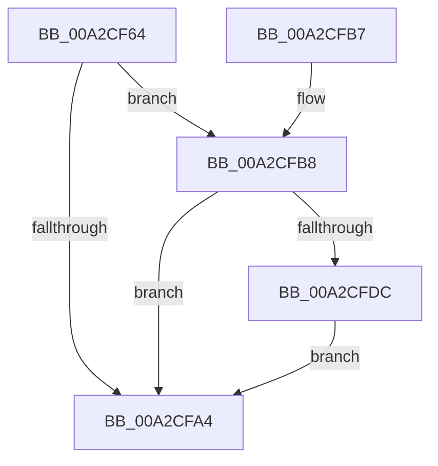

# PspReadIFEOMitigationAuditOptions

- RVA: `0x00A2CF64`–`0x00A2CFE6` (길이 `130` bytes)
- VA: `0x0000000140A2CF64`
- 실행 섹션: `PAGE`
- PDB 이름 있음: `예`; PDB Function 태그: `아니요`
- unwind 정보 RVA: `0x000AC70C`
- 디코드: `34`개 명령, `130/130` bytes 표시
- 미해석 바이트: `0` (있으면 어셈블리에 `.byte`로 보존)

> 이 문서는 커널 이미지의 기계어와 PDB 기호를 분석해 생성했습니다. 4번과 5번은 함수 원형과 자료형을 바이너리 사용 방식에서 추정한 C 해석이며 원본 소스 복구 결과는 아닙니다.

## 1. Dependencies

- 직접 호출 지점: **3**; 고유 호출 대상: **3**
- 직접 호출자로 확인된 함수: **1**
- RIP 상대 이미지 참조: **2**

### Outgoing calls
- `0x00A2CF9B` → [PspReadOptionsMapFromIFEO](PspReadOptionsMapFromIFEO_function_00A2D078.md) (function, `0x00A2D078`)
- `0x00A2CFAC` → [_security_check_cookie](../../text/6A/_security_check_cookie_function_006AC640.md) (function, `0x006AC640`)
- `0x00A2CFD3` → [PspValidateMitigationAuditOptions](../AB/PspValidateMitigationAuditOptions_function_00AB2694.md) (function, `0x00AB2694`)

### Direct callers
- [PspAllocateProcess](../A1/PspAllocateProcess_function_00A13B3C.md) at `0x00A15641`

### Static image references
- `0x00A2CF6A` → RVA `0x00E0A740` (`.data`; read)
- `0x00A2CF8B` → RVA `0x00B04F30` (` ?? ::NNGAKEGL::`string'`; read)

## 2. Other-region calls and transfers

- 다른 실행 섹션으로 향하는 call: **1**
  - `0x00A2CFAC` → [_security_check_cookie](../../text/6A/_security_check_cookie_function_006AC640.md) (`PAGE` → `.text`)
- 별도 외부 분기/꼬리 이동을 확인하지 못했습니다.

## 3. Assembly (complete function range)

```asm
00A2CF64  40 53                           push rbx
00A2CF66  48 83 EC 60                     sub rsp, 0x60
00A2CF6A  48 8B 05 CF D7 3D 00            mov rax, qword ptr [rip + 0x3dd7cf]
00A2CF71  48 33 C4                        xor rax, rsp
00A2CF74  48 89 44 24 58                  mov qword ptr [rsp + 0x58], rax
00A2CF79  33 C0                           xor eax, eax
00A2CF7B  4C 8D 44 24 40                  lea r8, [rsp + 0x40]
00A2CF80  48 8B DA                        mov rbx, rdx
00A2CF83  48 89 44 24 50                  mov qword ptr [rsp + 0x50], rax
00A2CF88  0F 57 C0                        xorps xmm0, xmm0
00A2CF8B  48 8D 15 9E 7F 0D 00            lea rdx, [rip + 0xd7f9e]
00A2CF92  0F 11 44 24 40                  movups xmmword ptr [rsp + 0x40], xmm0
00A2CF97  44 8D 48 18                     lea r9d, [rax + 0x18]
00A2CF9B  E8 D8 00 00 00                  call 0x140a2d078
00A2CFA0  85 C0                           test eax, eax
00A2CFA2  79 14                           jns 0x140a2cfb8
00A2CFA4  48 8B 4C 24 58                  mov rcx, qword ptr [rsp + 0x58]
00A2CFA9  48 33 CC                        xor rcx, rsp
00A2CFAC  E8 8F F6 C7 FF                  call 0x1406ac640
00A2CFB1  48 83 C4 60                     add rsp, 0x60
00A2CFB5  5B                              pop rbx
00A2CFB6  C3                              ret
00A2CFB7  CC                              int3
00A2CFB8  0F 10 54 24 40                  movups xmm2, xmmword ptr [rsp + 0x40]
00A2CFBD  48 8D 4C 24 20                  lea rcx, [rsp + 0x20]
00A2CFC2  F2 0F 10 5C 24 50               movsd xmm3, qword ptr [rsp + 0x50]
00A2CFC8  0F 29 54 24 20                  movaps xmmword ptr [rsp + 0x20], xmm2
00A2CFCD  F2 0F 11 5C 24 30               movsd qword ptr [rsp + 0x30], xmm3
00A2CFD3  E8 BC 56 08 00                  call 0x140ab2694
00A2CFD8  85 C0                           test eax, eax
00A2CFDA  78 C8                           js 0x140a2cfa4
00A2CFDC  0F 11 13                        movups xmmword ptr [rbx], xmm2
00A2CFDF  F2 0F 11 5B 10                  movsd qword ptr [rbx + 0x10], xmm3
00A2CFE4  EB BE                           jmp 0x140a2cfa4
```

## 4. C-style interpretation (structured pseudocode)

```c
__int64 __fastcall PspReadIFEOMitigationAuditOptions(__int64 a1, __int64 a2)
{
    __int64 result;
    __int64 v_rsp;
    unsigned __int64 v_stack_m10;
    unsigned __int64 v_stack_m18;
    unsigned __int64 v_stack_m28;
    unsigned __int64 v_stack_p20;
    unsigned __int64 v_stack_p30;
    unsigned __int64 v_stack_p40;
    unsigned __int64 v_stack_p50;

    v_rsp = (v_rsp) - (96);
    result = (*(unsigned __int64 *)(v_rip + 4052943)) ^ (v_rsp);
    v_stack_m10 = result;
    result = 0;
    v_stack_m18 = 0;
    v_stack_m28 = v_xmm0;
    result = PspReadOptionsMapFromIFEO(a1, v_rip + 884638, v_stack_m28, result + 24);
    if (!sign_flag) goto loc_00A2CFB8;
loc_00A2CFA4:
    a1 = (v_stack_m10) ^ (v_rsp);
    result = _security_check_cookie(a1, v_rip + 884638, v_stack_m28, result + 24);
    v_rsp = (v_rsp) + (96);
    return result;
loc_00A2CFB8:
    v_stack_p20 = v_xmm2;
    v_stack_p30 = v_xmm3;
    result = PspValidateMitigationAuditOptions(v_stack_p20, v_rip + 884638, v_stack_m28, result + 24);
    if (sign_flag) goto loc_00A2CFA4;
    *(unsigned __int64 *)(a2) = v_xmm2;
    *(unsigned __int64 *)(a2 + 16) = v_xmm3;
    goto loc_00A2CFA4;
}
```

## 5. (Beta) C Style

```c
int64_t PspReadIFEOMitigationAuditOptions(int64_t Arg1, void *Arg2)
{
    uint8_t *arg2 = (uint8_t *)Arg2;

    int64_t result;
    int64_t local_rsp;
    uint64_t v_stack_m10;
    uint64_t v_stack_m18;
    uint64_t v_stack_m28;
    uint64_t v_stack_p20;
    uint64_t v_stack_p30;
    uint64_t v_stack_p40;
    uint64_t v_stack_p50;

    local_rsp = (local_rsp) - (96);
    result = (*(uint64_t *)(v_rip + 0x3DD7CF)) ^ (local_rsp);
    v_stack_m10 = result;
    result = 0;
    v_stack_m18 = 0;
    v_stack_m28 = v_xmm0;
    result = PspReadOptionsMapFromIFEO(Arg1, v_rip + 884638, v_stack_m28, result + 24);
    if (!sign_flag) goto loc_00A2CFB8;
loc_00A2CFA4:
    Arg1 = (v_stack_m10) ^ (local_rsp);
    result = _security_check_cookie(Arg1, v_rip + 884638, v_stack_m28, result + 24);
    local_rsp = (local_rsp) + (96);
    return result;
loc_00A2CFB8:
    v_stack_p20 = v_xmm2;
    v_stack_p30 = v_xmm3;
    result = PspValidateMitigationAuditOptions(v_stack_p20, v_rip + 884638, v_stack_m28, result + 24);
    if (sign_flag) goto loc_00A2CFA4;
    *(uint64_t *)(arg2) = v_xmm2;
    *(uint64_t *)(arg2 + 0x10) = v_xmm3;
    goto loc_00A2CFA4;
}
```

### 관측된 메모리 오프셋

구조체 형식이 확인되지 않은 접근은 인자 기준의 오프셋으로만 기록했습니다.

| 기준 인자 | 오프셋 표현 | 폭 (bit) | 접근 |
|---|---:|---:|---|
| `Arg2` | `+ 0x0` | `128` | `R` |
| `Arg2` | `+ 0x10` | `64` | `W` |

## 6. Execution-region graph

[열기: 2D/3D 그래프와 함수 탐색 컨트롤 패널](../../../control-panel.html?section=page&rva=0x00A2CF64&view=graph)

- 2D 그래프는 위에서 아래로 흐르고, 3D 그래프는 빈 공간을 드래그해 회전합니다. Shift+드래그는 이동, 휠은 확대·축소, 함수 노드 선택은 대상 보고서 이동입니다.

### Static fallback


