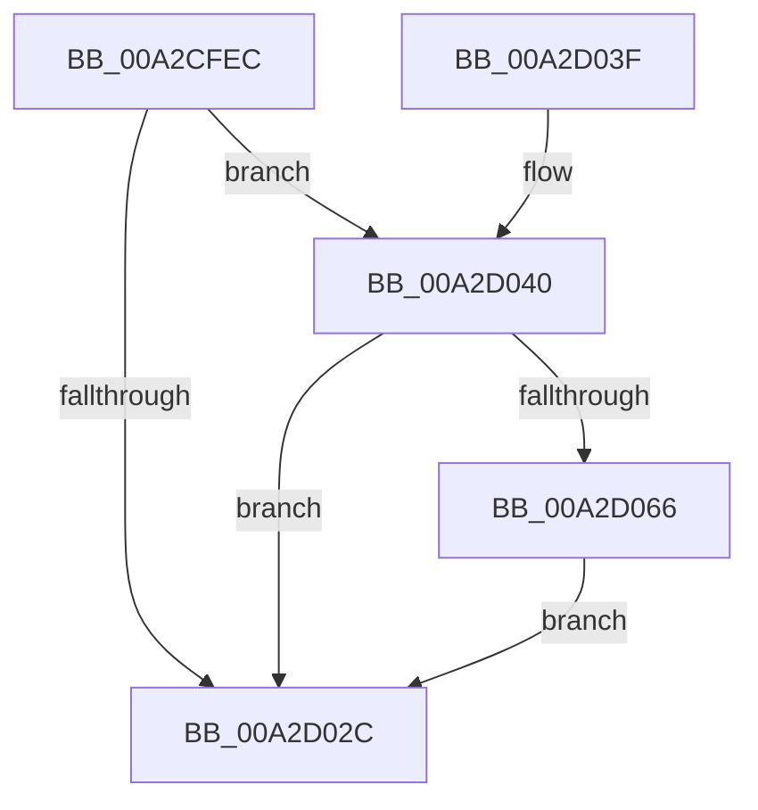

# PspReadIFEOMitigationOptions

- RVA: `0x00A2CFEC`–`0x00A2D070` (길이 `132` bytes)
- VA: `0x0000000140A2CFEC`
- 실행 섹션: `PAGE`
- PDB 이름 있음: `예`; PDB Function 태그: `아니요`
- unwind 정보 RVA: `0x000AC720`
- 디코드: `35`개 명령, `132/132` bytes 표시
- 미해석 바이트: `0` (있으면 어셈블리에 `.byte`로 보존)

> 이 문서는 커널 이미지의 기계어와 PDB 기호를 분석해 생성했습니다. 4번과 5번은 함수 원형과 자료형을 바이너리 사용 방식에서 추정한 C 해석이며 원본 소스 복구 결과는 아닙니다.

## 1. Dependencies

- 직접 호출 지점: **3**; 고유 호출 대상: **3**
- 직접 호출자로 확인된 함수: **1**
- RIP 상대 이미지 참조: **2**

### Outgoing calls
- `0x00A2D023` → [PspReadOptionsMapFromIFEO](PspReadOptionsMapFromIFEO_function_00A2D078.md) (function, `0x00A2D078`)
- `0x00A2D034` → [_security_check_cookie](../../text/6A/_security_check_cookie_function_006AC640.md) (function, `0x006AC640`)
- `0x00A2D05D` → [PspValidateMitigationOptions](PspValidateMitigationOptions_function_00A2D34C.md) (function, `0x00A2D34C`)

### Direct callers
- [PspAllocateProcess](../A1/PspAllocateProcess_function_00A13B3C.md) at `0x00A155D2`

### Static image references
- `0x00A2CFF2` → RVA `0x00E0A740` (`.data`; read)
- `0x00A2D013` → RVA `0x00B04D70` (` ?? ::NNGAKEGL::`string'`; read)

## 2. Other-region calls and transfers

- 다른 실행 섹션으로 향하는 call: **1**
  - `0x00A2D034` → [_security_check_cookie](../../text/6A/_security_check_cookie_function_006AC640.md) (`PAGE` → `.text`)
- 별도 외부 분기/꼬리 이동을 확인하지 못했습니다.

## 3. Assembly (complete function range)

```asm
00A2CFEC  40 53                           push rbx
00A2CFEE  48 83 EC 60                     sub rsp, 0x60
00A2CFF2  48 8B 05 47 D7 3D 00            mov rax, qword ptr [rip + 0x3dd747]
00A2CFF9  48 33 C4                        xor rax, rsp
00A2CFFC  48 89 44 24 58                  mov qword ptr [rsp + 0x58], rax
00A2D001  33 C0                           xor eax, eax
00A2D003  4C 8D 44 24 40                  lea r8, [rsp + 0x40]
00A2D008  48 8B DA                        mov rbx, rdx
00A2D00B  48 89 44 24 50                  mov qword ptr [rsp + 0x50], rax
00A2D010  0F 57 C0                        xorps xmm0, xmm0
00A2D013  48 8D 15 56 7D 0D 00            lea rdx, [rip + 0xd7d56]
00A2D01A  0F 11 44 24 40                  movups xmmword ptr [rsp + 0x40], xmm0
00A2D01F  44 8D 48 18                     lea r9d, [rax + 0x18]
00A2D023  E8 50 00 00 00                  call 0x140a2d078
00A2D028  85 C0                           test eax, eax
00A2D02A  79 14                           jns 0x140a2d040
00A2D02C  48 8B 4C 24 58                  mov rcx, qword ptr [rsp + 0x58]
00A2D031  48 33 CC                        xor rcx, rsp
00A2D034  E8 07 F6 C7 FF                  call 0x1406ac640
00A2D039  48 83 C4 60                     add rsp, 0x60
00A2D03D  5B                              pop rbx
00A2D03E  C3                              ret
00A2D03F  CC                              int3
00A2D040  0F 10 54 24 40                  movups xmm2, xmmword ptr [rsp + 0x40]
00A2D045  48 8D 4C 24 20                  lea rcx, [rsp + 0x20]
00A2D04A  B2 01                           mov dl, 1
00A2D04C  F2 0F 10 5C 24 50               movsd xmm3, qword ptr [rsp + 0x50]
00A2D052  0F 29 54 24 20                  movaps xmmword ptr [rsp + 0x20], xmm2
00A2D057  F2 0F 11 5C 24 30               movsd qword ptr [rsp + 0x30], xmm3
00A2D05D  E8 EA 02 00 00                  call 0x140a2d34c
00A2D062  85 C0                           test eax, eax
00A2D064  78 C6                           js 0x140a2d02c
00A2D066  0F 11 13                        movups xmmword ptr [rbx], xmm2
00A2D069  F2 0F 11 5B 10                  movsd qword ptr [rbx + 0x10], xmm3
00A2D06E  EB BC                           jmp 0x140a2d02c
```

## 4. C-style interpretation (structured pseudocode)

```c
__int64 __fastcall PspReadIFEOMitigationOptions(__int64 a1, __int64 a2)
{
    __int64 result;
    __int64 v_rsp;
    unsigned __int64 v_stack_m10;
    unsigned __int64 v_stack_m18;
    unsigned __int64 v_stack_m28;
    unsigned __int64 v_stack_p20;
    unsigned __int64 v_stack_p30;
    unsigned __int64 v_stack_p40;
    unsigned __int64 v_stack_p50;

    v_rsp = (v_rsp) - (96);
    result = (*(unsigned __int64 *)(v_rip + 4052807)) ^ (v_rsp);
    v_stack_m10 = result;
    result = 0;
    v_stack_m18 = 0;
    v_stack_m28 = v_xmm0;
    result = PspReadOptionsMapFromIFEO(a1, v_rip + 884054, v_stack_m28, result + 24);
    if (!sign_flag) goto loc_00A2D040;
loc_00A2D02C:
    a1 = (v_stack_m10) ^ (v_rsp);
    result = _security_check_cookie(a1, v_rip + 884054, v_stack_m28, result + 24);
    v_rsp = (v_rsp) + (96);
    return result;
loc_00A2D040:
    v_stack_p20 = v_xmm2;
    v_stack_p30 = v_xmm3;
    result = PspValidateMitigationOptions(v_stack_p20, 1, v_stack_m28, result + 24);
    if (sign_flag) goto loc_00A2D02C;
    *(unsigned __int64 *)(a2) = v_xmm2;
    *(unsigned __int64 *)(a2 + 16) = v_xmm3;
    goto loc_00A2D02C;
}
```

## 5. (Beta) C Style

```c
int64_t PspReadIFEOMitigationOptions(int64_t Arg1, void *Arg2)
{
    uint8_t *arg2 = (uint8_t *)Arg2;

    int64_t result;
    int64_t local_rsp;
    uint64_t v_stack_m10;
    uint64_t v_stack_m18;
    uint64_t v_stack_m28;
    uint64_t v_stack_p20;
    uint64_t v_stack_p30;
    uint64_t v_stack_p40;
    uint64_t v_stack_p50;

    local_rsp = (local_rsp) - (96);
    result = (*(uint64_t *)(v_rip + 0x3DD747)) ^ (local_rsp);
    v_stack_m10 = result;
    result = 0;
    v_stack_m18 = 0;
    v_stack_m28 = v_xmm0;
    result = PspReadOptionsMapFromIFEO(Arg1, v_rip + 884054, v_stack_m28, result + 24);
    if (!sign_flag) goto loc_00A2D040;
loc_00A2D02C:
    Arg1 = (v_stack_m10) ^ (local_rsp);
    result = _security_check_cookie(Arg1, v_rip + 884054, v_stack_m28, result + 24);
    local_rsp = (local_rsp) + (96);
    return result;
loc_00A2D040:
    v_stack_p20 = v_xmm2;
    v_stack_p30 = v_xmm3;
    result = PspValidateMitigationOptions(v_stack_p20, 1, v_stack_m28, result + 24);
    if (sign_flag) goto loc_00A2D02C;
    *(uint64_t *)(arg2) = v_xmm2;
    *(uint64_t *)(arg2 + 0x10) = v_xmm3;
    goto loc_00A2D02C;
}
```

### 관측된 메모리 오프셋

구조체 형식이 확인되지 않은 접근은 인자 기준의 오프셋으로만 기록했습니다.

| 기준 인자 | 오프셋 표현 | 폭 (bit) | 접근 |
|---|---:|---:|---|
| `Arg2` | `+ 0x0` | `128` | `R` |
| `Arg2` | `+ 0x10` | `64` | `W` |

## 6. Execution-region graph

[열기: 2D/3D 그래프와 함수 탐색 컨트롤 패널](../../../control-panel.html?section=page&rva=0x00A2CFEC&view=graph)

- 2D 그래프는 위에서 아래로 흐르고, 3D 그래프는 빈 공간을 드래그해 회전합니다. Shift+드래그는 이동, 휠은 확대·축소, 함수 노드 선택은 대상 보고서 이동입니다.

### Static fallback


