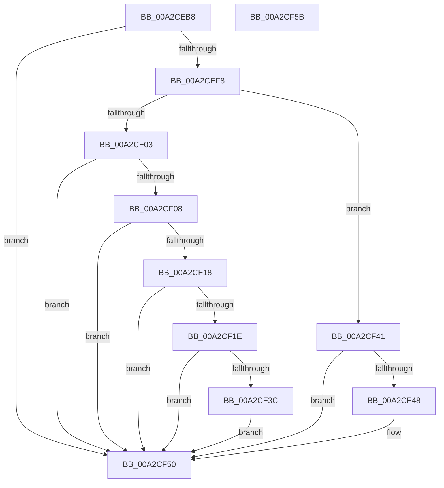

# PspReadIFEONodeOptions

- RVA: `0x00A2CEB8`–`0x00A2CF5C` (길이 `164` bytes)
- VA: `0x0000000140A2CEB8`
- 실행 섹션: `PAGE`
- PDB 이름 있음: `예`; PDB Function 태그: `아니요`
- unwind 정보 RVA: `0x00084AC0`
- 디코드: `48`개 명령, `164/164` bytes 표시
- 미해석 바이트: `0` (있으면 어셈블리에 `.byte`로 보존)

> 이 문서는 커널 이미지의 기계어와 PDB 기호를 분석해 생성했습니다. 4번과 5번은 함수 원형과 자료형을 바이너리 사용 방식에서 추정한 C 해석이며 원본 소스 복구 결과는 아닙니다.

## 1. Dependencies

- 직접 호출 지점: **2**; 고유 호출 대상: **2**
- 직접 호출자로 확인된 함수: **1**
- RIP 상대 이미지 참조: **3**

### Outgoing calls
- `0x00A2CEEF` → [RtlQueryImageFileKeyOption](RtlQueryImageFileKeyOption_function_00A2D110.md) (function, `0x00A2D110`)
- `0x00A2CF33` → [KeIsEmptyGroupMask](../../text/25/KeIsEmptyGroupMask_function_002553B0.md) (function, `0x002553B0`)

### Direct callers
- [PspAllocateProcess](../A1/PspAllocateProcess_function_00A13B3C.md) at `0x00A14814`

### Static image references
- `0x00A2CED8` → RVA `0x00B04D10` (` ?? ::NNGAKEGL::`string'`; read)
- `0x00A2CF08` → RVA `0x00FC5000` (`ALMOSTRO`; read)
- `0x00A2CF20` → RVA `0x00FCF6C0` (`CACHEALI`; read)

## 2. Other-region calls and transfers

- 다른 실행 섹션으로 향하는 call: **1**
  - `0x00A2CF33` → [KeIsEmptyGroupMask](../../text/25/KeIsEmptyGroupMask_function_002553B0.md) (`PAGE` → `.text`)
- 별도 외부 분기/꼬리 이동을 확인하지 못했습니다.

## 3. Assembly (complete function range)

```asm
00A2CEB8  4C 8B DC                        mov r11, rsp
00A2CEBB  49 89 5B 08                     mov qword ptr [r11 + 8], rbx
00A2CEBF  57                              push rdi
00A2CEC0  48 83 EC 30                     sub rsp, 0x30
00A2CEC4  49 83 63 F0 00                  and qword ptr [r11 - 0x10], 0
00A2CEC9  4D 8D 4B 20                     lea r9, [r11 + 0x20]
00A2CECD  83 64 24 58 00                  and dword ptr [rsp + 0x58], 0
00A2CED2  48 8B C2                        mov rax, rdx
00A2CED5  49 8B F8                        mov rdi, r8
00A2CED8  48 8D 15 31 7E 0D 00            lea rdx, [rip + 0xd7e31]
00A2CEDF  41 B8 04 00 00 00               mov r8d, 4
00A2CEE5  48 8B D9                        mov rbx, rcx
00A2CEE8  48 8B C8                        mov rcx, rax
00A2CEEB  45 89 43 E8                     mov dword ptr [r11 - 0x18], r8d
00A2CEEF  E8 1C 02 00 00                  call 0x140a2d110
00A2CEF4  85 C0                           test eax, eax
00A2CEF6  78 58                           js 0x140a2cf50
00A2CEF8  8B 44 24 58                     mov eax, dword ptr [rsp + 0x58]
00A2CEFC  0F B6 C8                        movzx ecx, al
00A2CEFF  84 C0                           test al, al
00A2CF01  74 3E                           je 0x140a2cf41
00A2CF03  83 F9 01                        cmp ecx, 1
00A2CF06  75 48                           jne 0x140a2cf50
00A2CF08  0F B7 0D F1 80 59 00            movzx ecx, word ptr [rip + 0x5980f1]
00A2CF0F  8B D0                           mov edx, eax
00A2CF11  C1 EA 08                        shr edx, 8
00A2CF14  3B D1                           cmp edx, ecx
00A2CF16  73 38                           jae 0x140a2cf50
00A2CF18  48 83 3F 00                     cmp qword ptr [rdi], 0
00A2CF1C  75 32                           jne 0x140a2cf50
00A2CF1E  8B C8                           mov ecx, eax
00A2CF20  48 8D 1D 99 27 5A 00            lea rbx, [rip + 0x5a2799]
00A2CF27  48 C1 E9 08                     shr rcx, 8
00A2CF2B  48 8B 1C CB                     mov rbx, qword ptr [rbx + rcx*8]
00A2CF2F  48 8D 4B 10                     lea rcx, [rbx + 0x10]
00A2CF33  E8 78 84 82 FF                  call 0x1402553b0
00A2CF38  85 C0                           test eax, eax
00A2CF3A  75 14                           jne 0x140a2cf50
00A2CF3C  48 89 1F                        mov qword ptr [rdi], rbx
00A2CF3F  EB 0F                           jmp 0x140a2cf50
00A2CF41  A9 00 FF FF FF                  test eax, 0xffffff00
00A2CF46  74 08                           je 0x140a2cf50
00A2CF48  0F BA AB F0 01 00 00 14         bts dword ptr [rbx + 0x1f0], 0x14
00A2CF50  48 8B 5C 24 40                  mov rbx, qword ptr [rsp + 0x40]
00A2CF55  48 83 C4 30                     add rsp, 0x30
00A2CF59  5F                              pop rdi
00A2CF5A  C3                              ret
00A2CF5B  CC                              int3
```

## 4. C-style interpretation (structured pseudocode)

```c
__int64 __fastcall PspReadIFEONodeOptions(__int64 a1, __int64 a2, __int64 a3)
{
    __int64 result;
    __int64 v_rsp;
    unsigned int v_stack_p20;
    unsigned __int64 v_stack_p8;

    *(unsigned __int64 *)(v_rsp + 8) = v_rbx;
    v_rsp = (v_rsp) - (48);
    *(unsigned int *)(v_rsp - 24) = 4;
    result = RtlQueryImageFileKeyOption(a2, v_rip + 884273, 4, v_rsp + 32);
    if (sign_flag) goto loc_00A2CF50;
    if ((unsigned __int8)((unsigned int)(v_stack_p20)) == 0) goto loc_00A2CF41;
    if (((unsigned int)((unsigned __int8)((unsigned int)(v_stack_p20)))) != 1) goto loc_00A2CF50;
    a2 = (unsigned int)(((unsigned int)((unsigned int)((unsigned int)(v_stack_p20)))) >> (8));
    if (((unsigned int)(a2)) >= ((unsigned int)(*(unsigned __int16 *)(v_rip + 5865713)))) goto loc_00A2CF50;
    if ((*(unsigned __int64 *)(a3)) != 0) goto loc_00A2CF50;
    a1 = ((unsigned int)((unsigned int)((unsigned int)(v_stack_p20)))) >> (8);
    result = KeIsEmptyGroupMask(*(unsigned __int64 *)(v_rip + 5908377 + a1 * 8) + 16, a2, 4, v_rsp + 32);
    if ((unsigned int)(result) != 0) goto loc_00A2CF50;
    *(unsigned __int64 *)(a3) = *(unsigned __int64 *)(v_rip + 5908377 + a1 * 8);
    goto loc_00A2CF50;
loc_00A2CF41:
    if ((((unsigned int)(result)) & (0xFFFFFF00ULL)) != 0) {
    }
    v_rsp = (v_rsp) + (48);
    return result;
}
```

## 5. (Beta) C Style

```c
int64_t PspReadIFEONodeOptions(void *Arg1, int64_t Arg2, void *Arg3)
{
    uint8_t *arg1 = (uint8_t *)Arg1;
    uint8_t *arg3 = (uint8_t *)Arg3;

    int64_t result;
    int64_t local_rsp;
    uint32_t v_stack_p20;
    uint64_t v_stack_p8;

    *(uint64_t *)(local_rsp + 0x8) = local_rbx;
    local_rsp = (local_rsp) - (48);
    *(uint32_t *)(local_rsp - 0x18) = 4;
    result = RtlQueryImageFileKeyOption(Arg2, v_rip + 884273, 4, local_rsp + 32);
    if (sign_flag) goto loc_00A2CF50;
    if ((uint8_t)((uint32_t)(v_stack_p20)) == 0) goto loc_00A2CF41;
    if (((uint32_t)((uint8_t)((uint32_t)(v_stack_p20)))) != 1) goto loc_00A2CF50;
    Arg2 = (uint32_t)(((uint32_t)((uint32_t)((uint32_t)(v_stack_p20)))) >> (8));
    if (((uint32_t)(Arg2)) >= ((uint32_t)(*(uint16_t *)(v_rip + 0x5980F1)))) goto loc_00A2CF50;
    if ((*(uint64_t *)(arg3)) != 0) goto loc_00A2CF50;
    Arg1 = ((uint32_t)((uint32_t)((uint32_t)(v_stack_p20)))) >> (8);
    result = KeIsEmptyGroupMask(*(uint64_t *)(v_rip + 0x5A2799 + arg1 * 8) + 16, Arg2, 4, local_rsp + 32);
    if ((uint32_t)(result) != 0) goto loc_00A2CF50;
    *(uint64_t *)(arg3) = *(uint64_t *)(v_rip + 0x5A2799 + arg1 * 8);
    goto loc_00A2CF50;
loc_00A2CF41:
    if ((((uint32_t)(result)) & (0xFFFFFF00ULL)) != 0) {
    }
    local_rsp = (local_rsp) + (48);
    return result;
}
```

### 관측된 메모리 오프셋

구조체 형식이 확인되지 않은 접근은 인자 기준의 오프셋으로만 기록했습니다.

| 기준 인자 | 오프셋 표현 | 폭 (bit) | 접근 |
|---|---:|---:|---|
| `Arg1` | `+ 0x1F0` | `32` | `R/W` |
| `Arg3` | `+ 0x0` | `64` | `R` |
| `Arg3` | `+ 0x0` | `64` | `W` |

## 6. Execution-region graph

[열기: 2D/3D 그래프와 함수 탐색 컨트롤 패널](../../../control-panel.html?section=page&rva=0x00A2CEB8&view=graph)

- 2D 그래프는 위에서 아래로 흐르고, 3D 그래프는 빈 공간을 드래그해 회전합니다. Shift+드래그는 이동, 휠은 확대·축소, 함수 노드 선택은 대상 보고서 이동입니다.

### Static fallback


