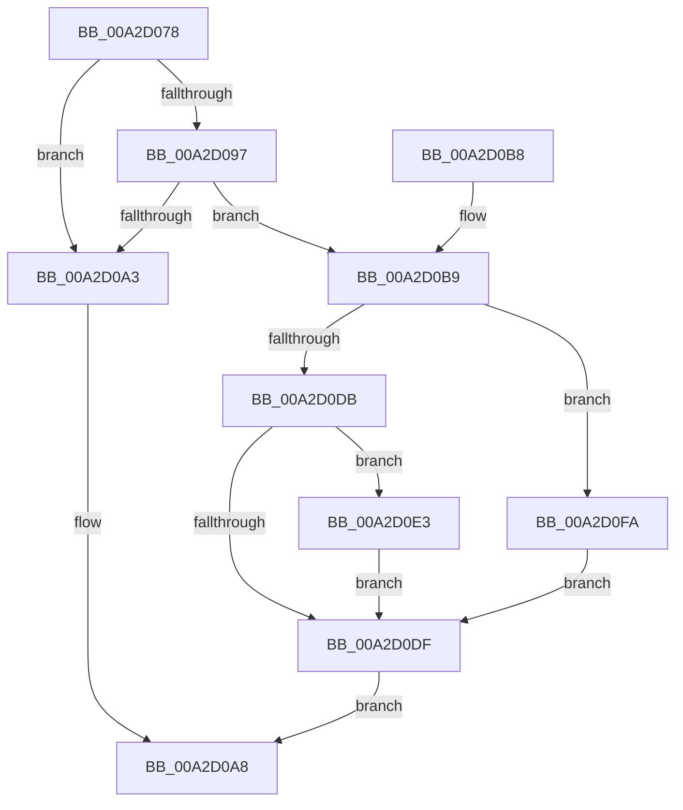

# PspReadOptionsMapFromIFEO

- RVA: `0x00A2D078`–`0x00A2D101` (길이 `137` bytes)
- VA: `0x0000000140A2D078`
- 실행 섹션: `PAGE`
- PDB 이름 있음: `예`; PDB Function 태그: `아니요`
- unwind 정보 RVA: `0x000AC734`
- 디코드: `41`개 명령, `137/137` bytes 표시
- 미해석 바이트: `0` (있으면 어셈블리에 `.byte`로 보존)

> 이 문서는 커널 이미지의 기계어와 PDB 기호를 분석해 생성했습니다. 4번과 5번은 함수 원형과 자료형을 바이너리 사용 방식에서 추정한 C 해석이며 원본 소스 복구 결과는 아닙니다.

## 1. Dependencies

- 직접 호출 지점: **2**; 고유 호출 대상: **2**
- 직접 호출자로 확인된 함수: **3**
- RIP 상대 이미지 참조: **0**

### Outgoing calls
- `0x00A2D0CD` → [RtlQueryImageFileKeyOption](RtlQueryImageFileKeyOption_function_00A2D110.md) (function, `0x00A2D110`)
- `0x00A2D0F3` → [memset](../../text/6C/memset_function_006C6C40.md) (function, `0x006C6C40`)

### Direct callers
- [PspReadIFEOAntiTamperOptions](../78/PspReadIFEOAntiTamperOptions_function_0078453C.md) at `0x0078456E`
- [PspReadIFEOMitigationAuditOptions](PspReadIFEOMitigationAuditOptions_function_00A2CF64.md) at `0x00A2CF9B`
- [PspReadIFEOMitigationOptions](PspReadIFEOMitigationOptions_function_00A2CFEC.md) at `0x00A2D023`

### Static image references
- 디코드된 RIP-relative 메모리 참조가 없습니다.

## 2. Other-region calls and transfers

- 다른 실행 섹션으로 향하는 call: **1**
  - `0x00A2D0F3` → [memset](../../text/6C/memset_function_006C6C40.md) (`PAGE` → `.text`)
- 별도 외부 분기/꼬리 이동을 확인하지 못했습니다.

## 3. Assembly (complete function range)

```asm
00A2D078  48 89 5C 24 10                  mov qword ptr [rsp + 0x10], rbx
00A2D07D  48 89 74 24 18                  mov qword ptr [rsp + 0x18], rsi
00A2D082  57                              push rdi
00A2D083  48 83 EC 30                     sub rsp, 0x30
00A2D087  83 64 24 40 00                  and dword ptr [rsp + 0x40], 0
00A2D08C  41 8B F9                        mov edi, r9d
00A2D08F  49 8B F0                        mov rsi, r8
00A2D092  48 85 C9                        test rcx, rcx
00A2D095  74 0C                           je 0x140a2d0a3
00A2D097  48 8B 89 C8 00 00 00            mov rcx, qword ptr [rcx + 0xc8]
00A2D09E  48 85 C9                        test rcx, rcx
00A2D0A1  75 16                           jne 0x140a2d0b9
00A2D0A3  B8 0D 00 00 C0                  mov eax, 0xc000000d
00A2D0A8  48 8B 5C 24 48                  mov rbx, qword ptr [rsp + 0x48]
00A2D0AD  48 8B 74 24 50                  mov rsi, qword ptr [rsp + 0x50]
00A2D0B2  48 83 C4 30                     add rsp, 0x30
00A2D0B6  5F                              pop rdi
00A2D0B7  C3                              ret
00A2D0B8  CC                              int3
00A2D0B9  48 8D 44 24 40                  lea rax, [rsp + 0x40]
00A2D0BE  4C 8B CE                        mov r9, rsi
00A2D0C1  48 89 44 24 28                  mov qword ptr [rsp + 0x28], rax
00A2D0C6  45 33 C0                        xor r8d, r8d
00A2D0C9  89 7C 24 20                     mov dword ptr [rsp + 0x20], edi
00A2D0CD  E8 3E 00 00 00                  call 0x140a2d110
00A2D0D2  8B D8                           mov ebx, eax
00A2D0D4  3D 05 00 00 80                  cmp eax, 0x80000005
00A2D0D9  74 1F                           je 0x140a2d0fa
00A2D0DB  85 C0                           test eax, eax
00A2D0DD  79 04                           jns 0x140a2d0e3
00A2D0DF  8B C3                           mov eax, ebx
00A2D0E1  EB C5                           jmp 0x140a2d0a8
00A2D0E3  2B 7C 24 40                     sub edi, dword ptr [rsp + 0x40]
00A2D0E7  33 D2                           xor edx, edx
00A2D0E9  8B 4C 24 40                     mov ecx, dword ptr [rsp + 0x40]
00A2D0ED  44 8B C7                        mov r8d, edi
00A2D0F0  48 03 CE                        add rcx, rsi
00A2D0F3  E8 48 9B C9 FF                  call 0x1406c6c40
00A2D0F8  EB E5                           jmp 0x140a2d0df
00A2D0FA  BB 04 00 00 C0                  mov ebx, 0xc0000004
00A2D0FF  EB DE                           jmp 0x140a2d0df
```

## 4. C-style interpretation (structured pseudocode)

```c
__int64 __fastcall PspReadOptionsMapFromIFEO(__int64 a1, int a2, __int64 a3, int a4)
{
    __int64 result;
    __int64 v_rdi;
    __int64 v_rsp;
    unsigned __int64 v_stack_p10;
    unsigned __int64 v_stack_p18;
    unsigned int v_stack_p20;
    unsigned __int64 v_stack_p28;
    unsigned __int64 v_stack_p40;
    unsigned int v_stack_p8;

    v_stack_p10 = v_rbx;
    v_stack_p18 = v_rsi;
    v_rsp = (v_rsp) - (48);
    if (a1 == 0) goto loc_00A2D0A3;
    if (*(unsigned __int64 *)(a1 + 200) != 0) goto loc_00A2D0B9;
loc_00A2D0A3:
loc_00A2D0A8:
    v_rsp = (v_rsp) + (48);
    return (unsigned int)(0xC000000DULL);
loc_00A2D0B9:
    v_stack_p28 = v_stack_p40;
    a3 = 0;
    v_stack_p20 = (unsigned int)((unsigned int)(a4));
    result = RtlQueryImageFileKeyOption(*(unsigned __int64 *)(a1 + 200), a2, a3, v_stack_p18);
    if (((unsigned int)(result)) == 0x80000005ULL) goto loc_00A2D0FA;
    if (!sign_flag) goto loc_00A2D0E3;
loc_00A2D0DF:
    goto loc_00A2D0A8;
loc_00A2D0E3:
    v_rdi = (unsigned int)(((unsigned int)(a4)) - (v_stack_p40));
    a2 = 0;
    a1 = ((unsigned int)(v_stack_p40)) + (v_stack_p18);
    result = memset(a1, a2, (unsigned int)((unsigned int)(v_rdi)), v_stack_p18);
    goto loc_00A2D0DF;
loc_00A2D0FA:
    goto loc_00A2D0DF;
}
```

## 5. (Beta) C Style

```c
int64_t PspReadOptionsMapFromIFEO(int64_t Arg1, int32_t Arg2, int64_t Arg3, int32_t Arg4)
{
    int64_t result;
    int64_t local_rdi;
    int64_t local_rsp;
    uint64_t v_stack_p10;
    uint64_t v_stack_p18;
    uint32_t v_stack_p20;
    uint64_t v_stack_p28;
    uint64_t v_stack_p40;
    uint32_t v_stack_p8;

    v_stack_p10 = local_rbx;
    v_stack_p18 = local_rsi;
    local_rsp = (local_rsp) - (48);
    if (Arg1 == 0) goto loc_00A2D0A3;
    if (*(uint64_t *)(Arg1 + 0xC8) != 0) goto loc_00A2D0B9;
loc_00A2D0A3:
loc_00A2D0A8:
    local_rsp = (local_rsp) + (48);
    return (uint32_t)(0xC000000DULL);
loc_00A2D0B9:
    v_stack_p28 = v_stack_p40;
    Arg3 = 0;
    v_stack_p20 = (uint32_t)((uint32_t)(Arg4));
    result = RtlQueryImageFileKeyOption(*(uint64_t *)(Arg1 + 0xC8), Arg2, Arg3, v_stack_p18);
    if (((uint32_t)(result)) == 0x80000005ULL) goto loc_00A2D0FA;
    if (!sign_flag) goto loc_00A2D0E3;
loc_00A2D0DF:
    goto loc_00A2D0A8;
loc_00A2D0E3:
    local_rdi = (uint32_t)(((uint32_t)(Arg4)) - (v_stack_p40));
    Arg2 = 0;
    Arg1 = ((uint32_t)(v_stack_p40)) + (v_stack_p18);
    result = memset(Arg1, Arg2, (uint32_t)((uint32_t)(local_rdi)), v_stack_p18);
    goto loc_00A2D0DF;
loc_00A2D0FA:
    goto loc_00A2D0DF;
}
```

## 6. Execution-region graph

[열기: 2D/3D 그래프와 함수 탐색 컨트롤 패널](../../../control-panel.html?section=page&rva=0x00A2D078&view=graph)

- 2D 그래프는 위에서 아래로 흐르고, 3D 그래프는 빈 공간을 드래그해 회전합니다. Shift+드래그는 이동, 휠은 확대·축소, 함수 노드 선택은 대상 보고서 이동입니다.

### Static fallback


