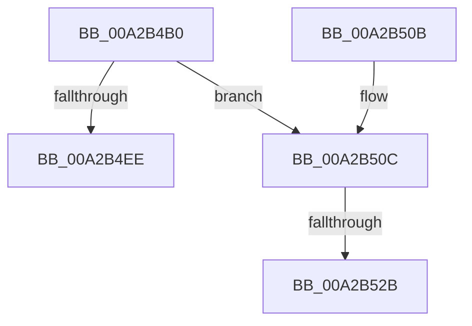

# PspRecheckThreadOptionalXStateFeatures

- RVA: `0x00A2B4B0`–`0x00A2B535` (길이 `133` bytes)
- VA: `0x0000000140A2B4B0`
- 실행 섹션: `PAGE`
- PDB 이름 있음: `예`; PDB Function 태그: `예`
- unwind 정보 RVA: `0x000AC2C8`
- 디코드: `35`개 명령, `133/133` bytes 표시
- 미해석 바이트: `0` (있으면 어셈블리에 `.byte`로 보존)

> 이 문서는 커널 이미지의 기계어와 PDB 기호를 분석해 생성했습니다. 4번과 5번은 함수 원형과 자료형을 바이너리 사용 방식에서 추정한 C 해석이며 원본 소스 복구 결과는 아닙니다.

## 1. Dependencies

- 직접 호출 지점: **1**; 고유 호출 대상: **1**
- 직접 호출자로 확인된 함수: **1**
- RIP 상대 이미지 참조: **0**

### Outgoing calls
- `0x00A2B51A` → [ExAllocatePool2](../../poolcode/B8/ExAllocatePool2_function_00B820F0.md) (function, `0x00B820F0`)

### Direct callers
- [PspInsertThread](../9F/PspInsertThread_function_009F0314.md) at `0x009F0902`

### Static image references
- 디코드된 RIP-relative 메모리 참조가 없습니다.

## 2. Other-region calls and transfers

- 다른 실행 섹션으로 향하는 call: **1**
  - `0x00A2B51A` → [ExAllocatePool2](../../poolcode/B8/ExAllocatePool2_function_00B820F0.md) (`PAGE` → `POOLCODE`)
- call이 아닌 외부 분기/꼬리 이동: **2**
  - `0x00A2B525` → [sub_00B39158](../B3/Unknown_function_00B39158.md) (`tail-transfer`)
  - `0x00A2B530` → [sub_00B39158 + 0xB0](../B3/Unknown_function_00B39158.md) (`tail-transfer`)

## 3. Assembly (complete function range)

```asm
00A2B4B0  48 8B C4                        mov rax, rsp
00A2B4B3  48 89 58 08                     mov qword ptr [rax + 8], rbx
00A2B4B7  48 89 68 10                     mov qword ptr [rax + 0x10], rbp
00A2B4BB  48 89 70 18                     mov qword ptr [rax + 0x18], rsi
00A2B4BF  48 89 78 20                     mov qword ptr [rax + 0x20], rdi
00A2B4C3  41 56                           push r14
00A2B4C5  48 83 EC 70                     sub rsp, 0x70
00A2B4C9  48 8B 99 98 01 00 00            mov rbx, qword ptr [rcx + 0x198]
00A2B4D0  0F 57 C0                        xorps xmm0, xmm0
00A2B4D3  48 F7 D3                        not rbx
00A2B4D6  4C 8B F2                        mov r14, rdx
00A2B4D9  0F 11 40 C8                     movups xmmword ptr [rax - 0x38], xmm0
00A2B4DD  0F 11 40 D8                     movups xmmword ptr [rax - 0x28], xmm0
00A2B4E1  0F 11 40 E8                     movups xmmword ptr [rax - 0x18], xmm0
00A2B4E5  48 23 9A 28 04 00 00            and rbx, qword ptr [rdx + 0x428]
00A2B4EC  75 1E                           jne 0x140a2b50c
00A2B4EE  33 C0                           xor eax, eax
00A2B4F0  4C 8D 5C 24 70                  lea r11, [rsp + 0x70]
00A2B4F5  49 8B 5B 10                     mov rbx, qword ptr [r11 + 0x10]
00A2B4F9  49 8B 6B 18                     mov rbp, qword ptr [r11 + 0x18]
00A2B4FD  49 8B 73 20                     mov rsi, qword ptr [r11 + 0x20]
00A2B501  49 8B 7B 28                     mov rdi, qword ptr [r11 + 0x28]
00A2B505  49 8B E3                        mov rsp, r11
00A2B508  41 5E                           pop r14
00A2B50A  C3                              ret
00A2B50B  CC                              int3
00A2B50C  BA 88 00 00 00                  mov edx, 0x88
00A2B511  41 B8 50 73 45 58               mov r8d, 0x58457350
00A2B517  8D 4A B8                        lea ecx, [rdx - 0x48]
00A2B51A  E8 D1 6B 15 00                  call 0x140b820f0
00A2B51F  48 8B F0                        mov rsi, rax
00A2B522  48 85 C0                        test rax, rax
00A2B525  0F 85 2D DC 10 00               jne 0x140b39158
00A2B52B  BD 17 00 00 C0                  mov ebp, 0xc0000017
00A2B530  E9 D3 DC 10 00                  jmp 0x140b39208
```

## 4. C-style interpretation (structured pseudocode)

```c
__int64 __fastcall PspRecheckThreadOptionalXStateFeatures(__int64 a1, __int64 a2)
{
    __int64 result;
    __int64 v_rbx;
    __int64 v_rsp;
    unsigned __int64 v_stack_m8;

    *(unsigned __int64 *)(v_rsp + 8) = v_rbx;
    *(unsigned __int64 *)(v_rsp + 16) = v_rbp;
    *(unsigned __int64 *)(v_rsp + 24) = v_rsi;
    *(unsigned __int64 *)(v_rsp + 32) = v_rdi;
    v_rsp = (v_rsp) - (112);
    v_rbx = ~(*(unsigned __int64 *)(a1 + 408));
    *(unsigned __int64 *)(v_rsp - 56) = v_xmm0;
    *(unsigned __int64 *)(v_rsp - 40) = v_xmm0;
    *(unsigned __int64 *)(v_rsp - 24) = v_xmm0;
    v_rbx = (v_rbx) & (*(unsigned __int64 *)(a2 + 1064));
    if (condition_is_not_equal) goto loc_00A2B50C;
    result = 0;
    return result;
loc_00A2B50C:
    result = ExAllocatePool2(136 - 72, 136, (unsigned int)(0x58457350ULL), a4);
}
```

## 5. (Beta) C Style

```c
int64_t PspRecheckThreadOptionalXStateFeatures(void *Arg1, void *Arg2)
{
    uint8_t *arg1 = (uint8_t *)Arg1;
    uint8_t *arg2 = (uint8_t *)Arg2;

    int64_t result;
    int64_t local_rbx;
    int64_t local_rsp;
    uint64_t v_stack_m8;

    *(uint64_t *)(local_rsp + 0x8) = local_rbx;
    *(uint64_t *)(local_rsp + 0x10) = local_rbp;
    *(uint64_t *)(local_rsp + 0x18) = local_rsi;
    *(uint64_t *)(local_rsp + 0x20) = local_rdi;
    local_rsp = (local_rsp) - (112);
    local_rbx = ~(*(uint64_t *)(arg1 + 0x198));
    *(uint64_t *)(local_rsp - 0x38) = v_xmm0;
    *(uint64_t *)(local_rsp - 0x28) = v_xmm0;
    *(uint64_t *)(local_rsp - 0x18) = v_xmm0;
    local_rbx = (local_rbx) & (*(uint64_t *)(arg2 + 0x428));
    if (condition_is_not_equal) goto loc_00A2B50C;
    result = 0;
    return result;
loc_00A2B50C:
    result = ExAllocatePool2(136 - 72, 136, (uint32_t)(0x58457350ULL), a4);
}
```

### 관측된 메모리 오프셋

구조체 형식이 확인되지 않은 접근은 인자 기준의 오프셋으로만 기록했습니다.

| 기준 인자 | 오프셋 표현 | 폭 (bit) | 접근 |
|---|---:|---:|---|
| `Arg1` | `+ 0x198` | `64` | `R` |
| `Arg2` | `+ 0x428` | `64` | `R` |

## 6. Execution-region graph

[열기: 2D/3D 그래프와 함수 탐색 컨트롤 패널](../../../control-panel.html?section=page&rva=0x00A2B4B0&view=graph)

- 2D 그래프는 위에서 아래로 흐르고, 3D 그래프는 빈 공간을 드래그해 회전합니다. Shift+드래그는 이동, 휠은 확대·축소, 함수 노드 선택은 대상 보고서 이동입니다.

### Static fallback


