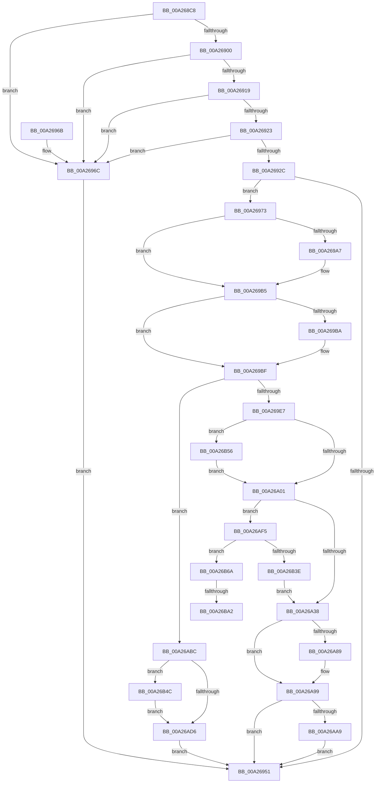

# PspSchedulerSharedDataRegionSlotAllocate

- RVA: `0x00A268C8`–`0x00A26BBC` (길이 `756` bytes)
- VA: `0x0000000140A268C8`
- 실행 섹션: `PAGE`
- PDB 이름 있음: `예`; PDB Function 태그: `예`
- unwind 정보 RVA: `0x000ABE48`
- 디코드: `182`개 명령, `756/756` bytes 표시
- 미해석 바이트: `0` (있으면 어셈블리에 `.byte`로 보존)

> 이 문서는 커널 이미지의 기계어와 PDB 기호를 분석해 생성했습니다. 4번과 5번은 함수 원형과 자료형을 바이너리 사용 방식에서 추정한 C 해석이며 원본 소스 복구 결과는 아닙니다.

## 1. Dependencies

- 직접 호출 지점: **18**; 고유 호출 대상: **13**
- 직접 호출자로 확인된 함수: **1**
- RIP 상대 이미지 참조: **1**

### Outgoing calls
- `0x00A26919` → [PsGetCurrentThreadProcess](../../text/47/PsGetCurrentThreadProcess_function_0047C7E0.md) (function, `0x0047C7E0`)
- `0x00A26946` → [ObReferenceObjectByPointerWithTag](../../text/41/ObReferenceObjectByPointerWithTag_function_00419870.md) (function, `0x00419870`)
- `0x00A26997` → [KeAbPreAcquire](../../text/21/KeAbPreAcquire_function_00210230.md) (function, `0x00210230`)
- `0x00A269B0` → [ExfAcquirePushLockExclusiveEx](../../text/20/ExfAcquirePushLockExclusiveEx_function_0020FC90.md) (function, `0x0020FC90`)
- `0x00A269D6` → [RtlFindClearBitsAndSet](../../text/3E/RtlFindClearBitsAndSet_function_003E0CD0.md) (function, `0x003E0CD0`)
- `0x00A26A04` → [KeAbPostRelease](../../text/2E/KeAbPostRelease_function_002E1600.md) (function, `0x002E1600`)
- `0x00A26A09` → [KeLeaveCriticalRegion](../../text/25/KeLeaveCriticalRegion_function_0025D8B0.md) (function, `0x0025D8B0`)
- `0x00A26A4F` → [memset](../../text/6C/memset_function_006C6C40.md) (function, `0x006C6C40`)
- `0x00A26A73` → [KeSwappablePageReference](../../text/36/KeSwappablePageReference_function_0036A864.md) (function, `0x0036A864`)
- `0x00A26A7F` → [KeSwappablePageGetLockedAddress](../../text/36/KeSwappablePageGetLockedAddress_function_0036A84C.md) (function, `0x0036A84C`)
- `0x00A26AD9` → [KeAbPostRelease](../../text/2E/KeAbPostRelease_function_002E1600.md) (function, `0x002E1600`)
- `0x00A26ADE` → [KeLeaveCriticalRegion](../../text/25/KeLeaveCriticalRegion_function_0025D8B0.md) (function, `0x0025D8B0`)
- `0x00A26AEB` → [ObfDereferenceObjectWithTag](../../text/2F/ObfDereferenceObjectWithTag_function_002F78E0.md) (function, `0x002F78E0`)
- `0x00A26B33` → [ZwAllocateVirtualMemory](../../text/6A/ZwAllocateVirtualMemory_function_006AD3D0.md) (function, `0x006AD3D0`)
- `0x00A26B4F` → [ExfTryToWakePushLock](../../text/26/ExfTryToWakePushLock_function_00265DD0.md) (function, `0x00265DD0`)
- `0x00A26B59` → [ExfTryToWakePushLock](../../text/26/ExfTryToWakePushLock_function_00265DD0.md) (function, `0x00265DD0`)
- `0x00A26B8A` → [KeAbPreAcquire](../../text/21/KeAbPreAcquire_function_00210230.md) (function, `0x00210230`)
- `0x00A26BAB` → [ExfAcquirePushLockExclusiveEx](../../text/20/ExfAcquirePushLockExclusiveEx_function_0020FC90.md) (function, `0x0020FC90`)

### Direct callers
- [NtSetInformationThread](../8C/NtSetInformationThread_function_008C9F60.md) at `0x008CAB8C`

### Static image references
- `0x00A2692C` → RVA `0x00FC7030` (`ALMOSTRO`; read)

## 2. Other-region calls and transfers

- 다른 실행 섹션으로 향하는 call: **18**
  - `0x00A26919` → [PsGetCurrentThreadProcess](../../text/47/PsGetCurrentThreadProcess_function_0047C7E0.md) (`PAGE` → `.text`)
  - `0x00A26946` → [ObReferenceObjectByPointerWithTag](../../text/41/ObReferenceObjectByPointerWithTag_function_00419870.md) (`PAGE` → `.text`)
  - `0x00A26997` → [KeAbPreAcquire](../../text/21/KeAbPreAcquire_function_00210230.md) (`PAGE` → `.text`)
  - `0x00A269B0` → [ExfAcquirePushLockExclusiveEx](../../text/20/ExfAcquirePushLockExclusiveEx_function_0020FC90.md) (`PAGE` → `.text`)
  - `0x00A269D6` → [RtlFindClearBitsAndSet](../../text/3E/RtlFindClearBitsAndSet_function_003E0CD0.md) (`PAGE` → `.text`)
  - `0x00A26A04` → [KeAbPostRelease](../../text/2E/KeAbPostRelease_function_002E1600.md) (`PAGE` → `.text`)
  - `0x00A26A09` → [KeLeaveCriticalRegion](../../text/25/KeLeaveCriticalRegion_function_0025D8B0.md) (`PAGE` → `.text`)
  - `0x00A26A4F` → [memset](../../text/6C/memset_function_006C6C40.md) (`PAGE` → `.text`)
  - `0x00A26A73` → [KeSwappablePageReference](../../text/36/KeSwappablePageReference_function_0036A864.md) (`PAGE` → `.text`)
  - `0x00A26A7F` → [KeSwappablePageGetLockedAddress](../../text/36/KeSwappablePageGetLockedAddress_function_0036A84C.md) (`PAGE` → `.text`)
  - `0x00A26AD9` → [KeAbPostRelease](../../text/2E/KeAbPostRelease_function_002E1600.md) (`PAGE` → `.text`)
  - `0x00A26ADE` → [KeLeaveCriticalRegion](../../text/25/KeLeaveCriticalRegion_function_0025D8B0.md) (`PAGE` → `.text`)
  - `0x00A26AEB` → [ObfDereferenceObjectWithTag](../../text/2F/ObfDereferenceObjectWithTag_function_002F78E0.md) (`PAGE` → `.text`)
  - `0x00A26B33` → [ZwAllocateVirtualMemory](../../text/6A/ZwAllocateVirtualMemory_function_006AD3D0.md) (`PAGE` → `.text`)
  - `0x00A26B4F` → [ExfTryToWakePushLock](../../text/26/ExfTryToWakePushLock_function_00265DD0.md) (`PAGE` → `.text`)
  - `0x00A26B59` → [ExfTryToWakePushLock](../../text/26/ExfTryToWakePushLock_function_00265DD0.md) (`PAGE` → `.text`)
  - `0x00A26B8A` → [KeAbPreAcquire](../../text/21/KeAbPreAcquire_function_00210230.md) (`PAGE` → `.text`)
  - `0x00A26BAB` → [ExfAcquirePushLockExclusiveEx](../../text/20/ExfAcquirePushLockExclusiveEx_function_0020FC90.md) (`PAGE` → `.text`)
- call이 아닌 외부 분기/꼬리 이동: **2**
  - `0x00A26B9C` → [sub_00B37E7A](../B3/Unknown_function_00B37E7A.md) (`tail-transfer`)
  - `0x00A26BB7` → [sub_00B37E7A](../B3/Unknown_function_00B37E7A.md) (`tail-transfer`)

## 3. Assembly (complete function range)

```asm
00A268C8  48 8B C4                        mov rax, rsp
00A268CB  48 89 58 10                     mov qword ptr [rax + 0x10], rbx
00A268CF  55                              push rbp
00A268D0  56                              push rsi
00A268D1  57                              push rdi
00A268D2  41 54                           push r12
00A268D4  41 55                           push r13
00A268D6  41 56                           push r14
00A268D8  41 57                           push r15
00A268DA  48 83 EC 40                     sub rsp, 0x40
00A268DE  45 33 E4                        xor r12d, r12d
00A268E1  4D 8B E8                        mov r13, r8
00A268E4  4C 89 60 B8                     mov qword ptr [rax - 0x48], r12
00A268E8  48 8B FA                        mov rdi, rdx
00A268EB  4C 89 60 20                     mov qword ptr [rax + 0x20], r12
00A268EF  48 8B E9                        mov rbp, rcx
00A268F2  65 48 8B 04 25 88 01 00 00      mov rax, qword ptr gs:[0x188]
00A268FB  48 3B C8                        cmp rcx, rax
00A268FE  75 6C                           jne 0x140a2696c
00A26900  65 48 8B 04 25 88 01 00 00      mov rax, qword ptr gs:[0x188]
00A26909  48 8B 9A A0 00 00 00            mov rbx, qword ptr [rdx + 0xa0]
00A26910  48 3B 98 B8 00 00 00            cmp rbx, qword ptr [rax + 0xb8]
00A26917  75 53                           jne 0x140a2696c
00A26919  E8 C2 5E A5 FF                  call 0x14047c7e0
00A2691E  48 3B D8                        cmp rbx, rax
00A26921  75 49                           jne 0x140a2696c
00A26923  4C 39 A5 E0 06 00 00            cmp qword ptr [rbp + 0x6e0], r12
00A2692A  75 40                           jne 0x140a2696c
00A2692C  4C 8B 05 FD 06 5A 00            mov r8, qword ptr [rip + 0x5a06fd]
00A26933  41 8D 54 24 01                  lea edx, [r12 + 1]
00A26938  45 33 C9                        xor r9d, r9d
00A2693B  C7 44 24 20 50 73 53 61         mov dword ptr [rsp + 0x20], 0x61537350
00A26943  48 8B CF                        mov rcx, rdi
00A26946  E8 25 2F 9F FF                  call 0x140419870
00A2694B  8B F0                           mov esi, eax
00A2694D  85 C0                           test eax, eax
00A2694F  79 22                           jns 0x140a26973
00A26951  48 8B 9C 24 88 00 00 00         mov rbx, qword ptr [rsp + 0x88]
00A26959  8B C6                           mov eax, esi
00A2695B  48 83 C4 40                     add rsp, 0x40
00A2695F  41 5F                           pop r15
00A26961  41 5E                           pop r14
00A26963  41 5D                           pop r13
00A26965  41 5C                           pop r12
00A26967  5F                              pop rdi
00A26968  5E                              pop rsi
00A26969  5D                              pop rbp
00A2696A  C3                              ret
00A2696B  CC                              int3
00A2696C  BE BB 00 00 C0                  mov esi, 0xc00000bb
00A26971  EB DE                           jmp 0x140a26951
00A26973  65 48 8B 0C 25 88 01 00 00      mov rcx, qword ptr gs:[0x188]
00A2697C  4C 8D B7 C8 00 00 00            lea r14, [rdi + 0xc8]
00A26983  48 83 CB FF                     or rbx, 0xffffffffffffffff
00A26987  45 33 C0                        xor r8d, r8d
00A2698A  33 D2                           xor edx, edx
00A2698C  66 01 99 E4 01 00 00            add word ptr [rcx + 0x1e4], bx
00A26993  49 8B CE                        mov rcx, r14
00A26996  90                              nop
00A26997  E8 94 98 7E FF                  call 0x140210230
00A2699C  F0 49 0F BA 2E 00               lock bts qword ptr [r14], 0
00A269A2  4C 8B F8                        mov r15, rax
00A269A5  73 0E                           jae 0x140a269b5
00A269A7  4D 8B C6                        mov r8, r14
00A269AA  48 8B D0                        mov rdx, rax
00A269AD  49 8B CE                        mov rcx, r14
00A269B0  E8 DB 92 7E FF                  call 0x14020fc90
00A269B5  4D 85 FF                        test r15, r15
00A269B8  74 05                           je 0x140a269bf
00A269BA  41 C6 47 0A 01                  mov byte ptr [r15 + 0xa], 1
00A269BF  4C 8D A7 E0 00 00 00            lea r12, [rdi + 0xe0]
00A269C6  BA 01 00 00 00                  mov edx, 1
00A269CB  45 8B 04 24                     mov r8d, dword ptr [r12]
00A269CF  48 8D 8F D0 00 00 00            lea rcx, [rdi + 0xd0]
00A269D6  E8 F5 A2 9B FF                  call 0x1403e0cd0
00A269DB  44 8B F8                        mov r15d, eax
00A269DE  83 F8 FF                        cmp eax, -1
00A269E1  0F 84 D5 00 00 00               je 0x140a26abc
00A269E7  41 8D 47 01                     lea eax, [r15 + 1]
00A269EB  41 89 04 24                     mov dword ptr [r12], eax
00A269EF  48 8B C3                        mov rax, rbx
00A269F2  F0 49 0F C1 06                  lock xadd qword ptr [r14], rax
00A269F7  24 06                           and al, 6
00A269F9  3C 02                           cmp al, 2
00A269FB  0F 84 55 01 00 00               je 0x140a26b56
00A26A01  49 8B CE                        mov rcx, r14
00A26A04  E8 F7 AB 8B FF                  call 0x1402e1600
00A26A09  E8 A2 6E 83 FF                  call 0x14025d8b0
00A26A0E  41 8B C7                        mov eax, r15d
00A26A11  45 8B F7                        mov r14d, r15d
00A26A14  83 E0 3F                        and eax, 0x3f
00A26A17  41 C1 EE 06                     shr r14d, 6
00A26A1B  C1 E0 06                        shl eax, 6
00A26A1E  89 84 24 80 00 00 00            mov dword ptr [rsp + 0x80], eax
00A26A25  8B 87 C0 00 00 00               mov eax, dword ptr [rdi + 0xc0]
00A26A2B  41 8B CE                        mov ecx, r14d
00A26A2E  48 0F A3 C8                     bt rax, rcx
00A26A32  0F 83 BD 00 00 00               jae 0x140a26af5
00A26A38  48 8B 8F B0 00 00 00            mov rcx, qword ptr [rdi + 0xb0]
00A26A3F  33 D2                           xor edx, edx
00A26A41  49 8B DF                        mov rbx, r15
00A26A44  48 C1 E3 06                     shl rbx, 6
00A26A48  48 03 CB                        add rcx, rbx
00A26A4B  44 8D 42 40                     lea r8d, [rdx + 0x40]
00A26A4F  E8 EC 01 CA FF                  call 0x1406c6c40
00A26A54  8B 84 24 80 00 00 00            mov eax, dword ptr [rsp + 0x80]
00A26A5B  4B 8D 0C B6                     lea rcx, [r14 + r14*4]
00A26A5F  48 C1 E1 04                     shl rcx, 4
00A26A63  48 03 CF                        add rcx, rdi
00A26A66  89 85 64 04 00 00               mov dword ptr [rbp + 0x464], eax
00A26A6C  48 89 8D 68 04 00 00            mov qword ptr [rbp + 0x468], rcx
00A26A73  E8 EC 3D 94 FF                  call 0x14036a864
00A26A78  48 8B 8D 68 04 00 00            mov rcx, qword ptr [rbp + 0x468]
00A26A7F  E8 C8 3D 94 FF                  call 0x14036a84c
00A26A84  48 85 C0                        test rax, rax
00A26A87  74 10                           je 0x140a26a99
00A26A89  8B 8D 64 04 00 00               mov ecx, dword ptr [rbp + 0x464]
00A26A8F  48 03 C8                        add rcx, rax
00A26A92  48 89 8D 20 03 00 00            mov qword ptr [rbp + 0x320], rcx
00A26A99  48 89 BD E0 06 00 00            mov qword ptr [rbp + 0x6e0], rdi
00A26AA0  4D 85 ED                        test r13, r13
00A26AA3  0F 84 A8 FE FF FF               je 0x140a26951
00A26AA9  48 8B 8F B8 00 00 00            mov rcx, qword ptr [rdi + 0xb8]
00A26AB0  48 03 CB                        add rcx, rbx
00A26AB3  49 89 4D 00                     mov qword ptr [r13], rcx
00A26AB7  E9 95 FE FF FF                  jmp 0x140a26951
00A26ABC  BE 9A 00 00 C0                  mov esi, 0xc000009a
00A26AC1  48 8D AF C8 00 00 00            lea rbp, [rdi + 0xc8]
00A26AC8  F0 48 0F C1 5D 00               lock xadd qword ptr [rbp], rbx
00A26ACE  80 E3 06                        and bl, 6
00A26AD1  80 FB 02                        cmp bl, 2
00A26AD4  74 76                           je 0x140a26b4c
00A26AD6  48 8B CD                        mov rcx, rbp
00A26AD9  E8 22 AB 8B FF                  call 0x1402e1600
00A26ADE  E8 CD 6D 83 FF                  call 0x14025d8b0
00A26AE3  BA 50 73 53 61                  mov edx, 0x61537350
00A26AE8  48 8B CF                        mov rcx, rdi
00A26AEB  E8 F0 0D 8D FF                  call 0x1402f78e0
00A26AF0  E9 5C FE FF FF                  jmp 0x140a26951
00A26AF5  B8 00 10 00 00                  mov eax, 0x1000
00A26AFA  C7 44 24 28 04 00 00 00         mov dword ptr [rsp + 0x28], 4
00A26B02  41 8B CE                        mov ecx, r14d
00A26B05  48 89 84 24 98 00 00 00         mov qword ptr [rsp + 0x98], rax
00A26B0D  C1 E1 0C                        shl ecx, 0xc
00A26B10  4C 8D 8C 24 98 00 00 00         lea r9, [rsp + 0x98]
00A26B18  48 03 8F B8 00 00 00            add rcx, qword ptr [rdi + 0xb8]
00A26B1F  48 8D 54 24 30                  lea rdx, [rsp + 0x30]
00A26B24  48 89 4C 24 30                  mov qword ptr [rsp + 0x30], rcx
00A26B29  45 33 C0                        xor r8d, r8d
00A26B2C  48 8B CB                        mov rcx, rbx
00A26B2F  89 44 24 20                     mov dword ptr [rsp + 0x20], eax
00A26B33  E8 98 68 C8 FF                  call 0x1406ad3d0
00A26B38  8B F0                           mov esi, eax
00A26B3A  85 C0                           test eax, eax
00A26B3C  78 2C                           js 0x140a26b6a
00A26B3E  F0 44 0F AB B7 C0 00 00 00      lock bts dword ptr [rdi + 0xc0], r14d
00A26B47  E9 EC FE FF FF                  jmp 0x140a26a38
00A26B4C  48 8B CD                        mov rcx, rbp
00A26B4F  E8 7C F2 83 FF                  call 0x140265dd0
00A26B54  EB 80                           jmp 0x140a26ad6
00A26B56  49 8B CE                        mov rcx, r14
00A26B59  E8 72 F2 83 FF                  call 0x140265dd0
00A26B5E  4C 8D A7 E0 00 00 00            lea r12, [rdi + 0xe0]
00A26B65  E9 97 FE FF FF                  jmp 0x140a26a01
00A26B6A  65 48 8B 04 25 88 01 00 00      mov rax, qword ptr gs:[0x188]
00A26B73  48 8D AF C8 00 00 00            lea rbp, [rdi + 0xc8]
00A26B7A  45 33 C0                        xor r8d, r8d
00A26B7D  33 D2                           xor edx, edx
00A26B7F  48 8B CD                        mov rcx, rbp
00A26B82  66 01 98 E4 01 00 00            add word ptr [rax + 0x1e4], bx
00A26B89  90                              nop
00A26B8A  E8 A1 96 7E FF                  call 0x140210230
00A26B8F  F0 48 0F BA 6D 00 00            lock bts qword ptr [rbp], 0
00A26B96  4C 8B F0                        mov r14, rax
00A26B99  49 8B C4                        mov rax, r12
00A26B9C  0F 83 D8 12 11 00               jae 0x140b37e7a
00A26BA2  4C 8B C5                        mov r8, rbp
00A26BA5  49 8B D6                        mov rdx, r14
00A26BA8  48 8B CD                        mov rcx, rbp
00A26BAB  E8 E0 90 7E FF                  call 0x14020fc90
00A26BB0  48 8D 87 E0 00 00 00            lea rax, [rdi + 0xe0]
00A26BB7  E9 BE 12 11 00                  jmp 0x140b37e7a
```

## 4. C-style interpretation (structured pseudocode)

```c
__int64 __fastcall PspSchedulerSharedDataRegionSlotAllocate(__int64 a1, __int64 a2, __int64 a3, int a4)
{
    __int64 result;
    __int64 v_r12;
    __int64 v_r14;
    __int64 v_rbx;
    __int64 v_rsp;
    unsigned int v_stack_m58;
    unsigned __int64 v_stack_p10;
    unsigned int v_stack_p20;
    unsigned int v_stack_p28;
    unsigned __int64 v_stack_p30;
    unsigned int v_stack_p80;
    unsigned __int64 v_stack_p98;

    *(unsigned __int64 *)(v_rsp + 16) = v_rbx;
    v_rsp = (v_rsp) - (64);
    v_r12 = 0;
    *(unsigned __int64 *)(v_rsp - 72) = 0;
    *(unsigned __int64 *)(v_rsp + 32) = 0;
    if (a1 != (*(unsigned __int64 *)(gs_base + (0 + 392)))) goto loc_00A2696C;
    if ((*(unsigned __int64 *)(a2 + 160)) != (*(unsigned __int64 *)(*(unsigned __int64 *)(gs_base + (0 + 392)) + 184))) goto loc_00A2696C;
    result = PsGetCurrentThreadProcess(a1, a2, a3, a4);
    if ((*(unsigned __int64 *)(a2 + 160)) != result) goto loc_00A2696C;
    if ((*(unsigned __int64 *)(a1 + 1760)) != 0) goto loc_00A2696C;
    a4 = 0;
    v_stack_m58 = 0x61537350ULL;
    result = ObReferenceObjectByPointerWithTag(a2, v_r12 + 1, *(unsigned __int64 *)(v_rip + 5900029), a4);
    if (!sign_flag) goto loc_00A26973;
loc_00A26951:
    v_rsp = (v_rsp) + (64);
    return (unsigned int)((unsigned int)((unsigned int)((unsigned int)(result))));
loc_00A2696C:
    goto loc_00A26951;
loc_00A26973:
    v_rbx = (v_stack_p10) | (-1);
    a3 = 0;
    a2 = 0;
    result = KeAbPreAcquire(a2 + 200, a2, a3, a4);
    if (!(condition_is_above_or_equal)) {
        a3 = a2 + 200;
        a2 = result;
        a1 = a2 + 200;
        result = ExfAcquirePushLockExclusiveEx(a1, a2, a3, a4);
    }
    if (result != 0) {
        *(unsigned __int8 *)(result + 10) = 1;
    }
    result = RtlFindClearBitsAndSet(a2 + 208, 1, (unsigned int)(*(unsigned int *)(a2 + 224)), a4);
    if (((unsigned int)(result)) == -1) goto loc_00A26ABC;
    *(unsigned int *)(a2 + 224) = (unsigned int)((unsigned int)((unsigned int)(result)) + 1);
    result = (unsigned __int8)((v_rbx) & (6));
    if (((unsigned __int8)(result)) == 2) goto loc_00A26B56;
loc_00A26A01:
    result = KeAbPostRelease(a2 + 200, 1, (unsigned int)(*(unsigned int *)(a2 + 224)), a4);
    result = KeLeaveCriticalRegion(a2 + 200, 1, (unsigned int)(*(unsigned int *)(a2 + 224)), a4);
    result = (unsigned int)(((unsigned int)((unsigned int)((unsigned int)((unsigned int)(result))))) & (63));
    v_r14 = (unsigned int)(((unsigned int)((unsigned int)((unsigned int)((unsigned int)(result))))) >> (6));
    result = (unsigned int)((result) << (6));
    v_stack_p80 = (unsigned int)(result);
    if (condition_is_above_or_equal) goto loc_00A26AF5;
loc_00A26A38:
    a2 = 0;
    v_rbx = ((unsigned int)((unsigned int)(result))) << (6);
    a1 = (*(unsigned __int64 *)(a2 + 176)) + (v_rbx);
    result = memset(a1, a2, a2 + 64, a4);
    a1 = (v_r14 + v_r14 * 4) << (4);
    a1 = (a1) + (0);
    *(unsigned int *)(a1 + 1124) = (unsigned int)((unsigned int)(v_stack_p80));
    *(unsigned __int64 *)(a1 + 1128) = a1;
    result = KeSwappablePageReference(a1, a2, a2 + 64, a4);
    result = KeSwappablePageGetLockedAddress(*(unsigned __int64 *)(a1 + 1128), a2, a2 + 64, a4);
    if (result != 0) {
        a1 = *(unsigned int *)(a1 + 1124);
        a1 = (a1) + (result);
        *(unsigned __int64 *)(a1 + 800) = a1;
    }
    *(unsigned __int64 *)(a1 + 1760) = 0;
    if (a3 == 0) goto loc_00A26951;
    a1 = (*(unsigned __int64 *)(a2 + 184)) + (v_rbx);
    *(unsigned __int64 *)(a3) = a1;
    goto loc_00A26951;
loc_00A26ABC:
    v_rbx = (unsigned __int8)((v_rbx) & (6));
    if (((unsigned __int8)(v_rbx)) == 2) goto loc_00A26B4C;
loc_00A26AD6:
    result = KeAbPostRelease(a2 + 200, a2, a2 + 64, a4);
    result = KeLeaveCriticalRegion(a2 + 200, a2, a2 + 64, a4);
    result = ObfDereferenceObjectWithTag(0, (unsigned int)(0x61537350ULL), a2 + 64, a4);
    goto loc_00A26951;
loc_00A26AF5:
    v_stack_p28 = 4;
    v_stack_p98 = (unsigned int)(0x1000ULL);
    a1 = (unsigned int)(((unsigned int)((unsigned int)(v_r14))) << (12));
    a1 = (a1) + (*(unsigned __int64 *)(a2 + 184));
    v_stack_p30 = a1;
    a3 = 0;
    v_stack_p20 = (unsigned int)((unsigned int)(0x1000ULL));
    result = ZwAllocateVirtualMemory(v_rbx, v_stack_p30, a3, v_stack_p98);
    if (sign_flag) goto loc_00A26B6A;
    goto loc_00A26A38;
loc_00A26B4C:
    result = ExfTryToWakePushLock(a2 + 200, v_stack_p30, a3, v_stack_p98);
    goto loc_00A26AD6;
loc_00A26B56:
    result = ExfTryToWakePushLock(v_r14, v_stack_p30, a3, v_stack_p98);
    goto loc_00A26A01;
loc_00A26B6A:
    a3 = 0;
    a2 = 0;
    result = KeAbPreAcquire(a2 + 200, a2, a3, v_stack_p98);
    result = ExfAcquirePushLockExclusiveEx(a2 + 200, result, a2 + 200, v_stack_p98);
}
```

## 5. (Beta) C Style

```c
int64_t PspSchedulerSharedDataRegionSlotAllocate(void *Arg1, void *Arg2, int64_t Arg3, int32_t Arg4)
{
    uint8_t *arg1 = (uint8_t *)Arg1;
    uint8_t *arg2 = (uint8_t *)Arg2;

    int64_t result;
    int64_t local_r12;
    int64_t local_r14;
    int64_t local_rbx;
    int64_t local_rsp;
    uint32_t v_stack_m58;
    uint64_t v_stack_p10;
    uint32_t v_stack_p20;
    uint32_t v_stack_p28;
    uint64_t v_stack_p30;
    uint32_t v_stack_p80;
    uint64_t v_stack_p98;

    *(uint64_t *)(local_rsp + 0x10) = local_rbx;
    local_rsp = (local_rsp) - (64);
    local_r12 = 0;
    *(uint64_t *)(local_rsp - 0x48) = 0;
    *(uint64_t *)(local_rsp + 0x20) = 0;
    if (Arg1 != (*(uint64_t *)(gs_base + (0 + 0x188)))) goto loc_00A2696C;
    if ((*(uint64_t *)(arg2 + 0xA0)) != (*(uint64_t *)(*(uint64_t *)(gs_base + (0 + 0x188)) + 0xB8))) goto loc_00A2696C;
    result = PsGetCurrentThreadProcess(Arg1, Arg2, Arg3, Arg4);
    if ((*(uint64_t *)(arg2 + 0xA0)) != result) goto loc_00A2696C;
    if ((*(uint64_t *)(arg1 + 0x6E0)) != 0) goto loc_00A2696C;
    Arg4 = 0;
    v_stack_m58 = 0x61537350ULL;
    result = ObReferenceObjectByPointerWithTag(Arg2, local_r12 + 1, *(uint64_t *)(v_rip + 0x5A06FD), Arg4);
    if (!sign_flag) goto loc_00A26973;
loc_00A26951:
    local_rsp = (local_rsp) + (64);
    return (uint32_t)((uint32_t)((uint32_t)((uint32_t)(result))));
loc_00A2696C:
    goto loc_00A26951;
loc_00A26973:
    local_rbx = (v_stack_p10) | (-1);
    Arg3 = 0;
    Arg2 = 0;
    result = KeAbPreAcquire(Arg2 + 200, Arg2, Arg3, Arg4);
    if (!(condition_is_above_or_equal)) {
        Arg3 = Arg2 + 200;
        Arg2 = result;
        Arg1 = Arg2 + 200;
        result = ExfAcquirePushLockExclusiveEx(Arg1, Arg2, Arg3, Arg4);
    }
    if (result != 0) {
        *(uint8_t *)(result + 0xA) = 1;
    }
    result = RtlFindClearBitsAndSet(Arg2 + 208, 1, (uint32_t)(*(uint32_t *)(arg2 + 0xE0)), Arg4);
    if (((uint32_t)(result)) == -1) goto loc_00A26ABC;
    *(uint32_t *)(arg2 + 0xE0) = (uint32_t)((uint32_t)((uint32_t)(result)) + 1);
    result = (uint8_t)((local_rbx) & (6));
    if (((uint8_t)(result)) == 2) goto loc_00A26B56;
loc_00A26A01:
    result = KeAbPostRelease(Arg2 + 200, 1, (uint32_t)(*(uint32_t *)(arg2 + 0xE0)), Arg4);
    result = KeLeaveCriticalRegion(Arg2 + 200, 1, (uint32_t)(*(uint32_t *)(arg2 + 0xE0)), Arg4);
    result = (uint32_t)(((uint32_t)((uint32_t)((uint32_t)((uint32_t)(result))))) & (63));
    local_r14 = (uint32_t)(((uint32_t)((uint32_t)((uint32_t)((uint32_t)(result))))) >> (6));
    result = (uint32_t)((result) << (6));
    v_stack_p80 = (uint32_t)(result);
    if (condition_is_above_or_equal) goto loc_00A26AF5;
loc_00A26A38:
    Arg2 = 0;
    local_rbx = ((uint32_t)((uint32_t)(result))) << (6);
    Arg1 = (*(uint64_t *)(arg2 + 0xB0)) + (local_rbx);
    result = memset(Arg1, Arg2, Arg2 + 64, Arg4);
    Arg1 = (local_r14 + local_r14 * 4) << (4);
    Arg1 = (Arg1) + (0);
    *(uint32_t *)(arg1 + 0x464) = (uint32_t)((uint32_t)(v_stack_p80));
    *(void **)(arg1 + 0x468) = Arg1;
    result = KeSwappablePageReference(Arg1, Arg2, Arg2 + 64, Arg4);
    result = KeSwappablePageGetLockedAddress(*(uint64_t *)(arg1 + 0x468), Arg2, Arg2 + 64, Arg4);
    if (result != 0) {
        Arg1 = *(uint32_t *)(arg1 + 0x464);
        Arg1 = (Arg1) + (result);
        *(void **)(arg1 + 0x320) = Arg1;
    }
    *(uint64_t *)(arg1 + 0x6E0) = 0;
    if (Arg3 == 0) goto loc_00A26951;
    Arg1 = (*(uint64_t *)(arg2 + 0xB8)) + (local_rbx);
    *(void **)(Arg3) = Arg1;
    goto loc_00A26951;
loc_00A26ABC:
    local_rbx = (uint8_t)((local_rbx) & (6));
    if (((uint8_t)(local_rbx)) == 2) goto loc_00A26B4C;
loc_00A26AD6:
    result = KeAbPostRelease(Arg2 + 200, Arg2, Arg2 + 64, Arg4);
    result = KeLeaveCriticalRegion(Arg2 + 200, Arg2, Arg2 + 64, Arg4);
    result = ObfDereferenceObjectWithTag(0, (uint32_t)(0x61537350ULL), Arg2 + 64, Arg4);
    goto loc_00A26951;
loc_00A26AF5:
    v_stack_p28 = 4;
    v_stack_p98 = (uint32_t)(0x1000ULL);
    Arg1 = (uint32_t)(((uint32_t)((uint32_t)(local_r14))) << (12));
    Arg1 = (Arg1) + (*(uint64_t *)(arg2 + 0xB8));
    v_stack_p30 = Arg1;
    Arg3 = 0;
    v_stack_p20 = (uint32_t)((uint32_t)(0x1000ULL));
    result = ZwAllocateVirtualMemory(local_rbx, v_stack_p30, Arg3, v_stack_p98);
    if (sign_flag) goto loc_00A26B6A;
    goto loc_00A26A38;
loc_00A26B4C:
    result = ExfTryToWakePushLock(Arg2 + 200, v_stack_p30, Arg3, v_stack_p98);
    goto loc_00A26AD6;
loc_00A26B56:
    result = ExfTryToWakePushLock(local_r14, v_stack_p30, Arg3, v_stack_p98);
    goto loc_00A26A01;
loc_00A26B6A:
    Arg3 = 0;
    Arg2 = 0;
    result = KeAbPreAcquire(Arg2 + 200, Arg2, Arg3, v_stack_p98);
    result = ExfAcquirePushLockExclusiveEx(Arg2 + 200, result, Arg2 + 200, v_stack_p98);
}
```

### 관측된 메모리 오프셋

구조체 형식이 확인되지 않은 접근은 인자 기준의 오프셋으로만 기록했습니다.

| 기준 인자 | 오프셋 표현 | 폭 (bit) | 접근 |
|---|---:|---:|---|
| `Arg1` | `+ 0x320` | `64` | `W` |
| `Arg1` | `+ 0x464` | `32` | `R` |
| `Arg1` | `+ 0x464` | `32` | `W` |
| `Arg1` | `+ 0x468` | `64` | `R` |
| `Arg1` | `+ 0x468` | `64` | `W` |
| `Arg1` | `+ 0x6E0` | `64` | `R` |
| `Arg1` | `+ 0x6E0` | `64` | `W` |
| `Arg2` | `+ 0x0` | `32` | `R` |
| `Arg2` | `+ 0x0` | `32` | `W` |
| `Arg2` | `+ 0x0` | `64` | `R/W` |
| `Arg2` | `+ 0xA0` | `64` | `R` |
| `Arg2` | `+ 0xB0` | `64` | `R` |
| `Arg2` | `+ 0xB8` | `64` | `R` |
| `Arg2` | `+ 0xC0` | `32` | `R` |
| `Arg2` | `+ 0xC0` | `32` | `R/W` |
| `Arg2` | `+ 0xC8` | `64` | `R` |
| `Arg2` | `+ 0xD0` | `64` | `R` |
| `Arg2` | `+ 0xE0` | `64` | `R` |

## 6. Execution-region graph

[열기: 2D/3D 그래프와 함수 탐색 컨트롤 패널](../../../control-panel.html?section=page&rva=0x00A268C8&view=graph)

- 2D 그래프는 위에서 아래로 흐르고, 3D 그래프는 빈 공간을 드래그해 회전합니다. Shift+드래그는 이동, 휠은 확대·축소, 함수 노드 선택은 대상 보고서 이동입니다.

### Static fallback


