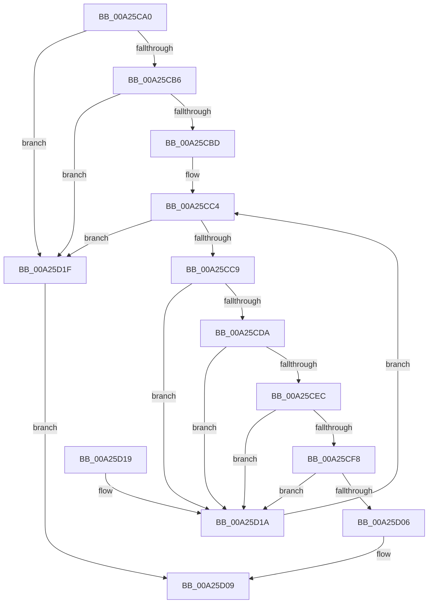

# PspSelectSessionAttachProcess

- RVA: `0x00A25CA0`–`0x00A25D23` (길이 `131` bytes)
- VA: `0x0000000140A25CA0`
- 실행 섹션: `PAGE`
- PDB 이름 있음: `예`; PDB Function 태그: `아니요`
- unwind 정보 RVA: `0x00068908`
- 디코드: `40`개 명령, `131/131` bytes 표시
- 미해석 바이트: `0` (있으면 어셈블리에 `.byte`로 보존)

> 이 문서는 커널 이미지의 기계어와 PDB 기호를 분석해 생성했습니다. 4번과 5번은 함수 원형과 자료형을 바이너리 사용 방식에서 추정한 C 해석이며 원본 소스 복구 결과는 아닙니다.

## 1. Dependencies

- 직접 호출 지점: **2**; 고유 호출 대상: **2**
- 직접 호출자로 확인된 함수: **2**
- RIP 상대 이미지 참조: **0**

### Outgoing calls
- `0x00A25CEF` → [MmProcessAttachAllowed](../../text/45/MmProcessAttachAllowed_function_0045F768.md) (function, `0x0045F768`)
- `0x00A25CFD` → [ObReferenceObjectSafeWithTag](../../text/21/ObReferenceObjectSafeWithTag_function_00210EE0.md) (function, `0x00210EE0`)

### Direct callers
- [PsGetSessionById](../../text/22/PsGetSessionById_function_00225150.md) at `0x002251AC`
- [PsGetNextSession](../91/PsGetNextSession_function_009128C0.md) at `0x00912939`

### Static image references
- 디코드된 RIP-relative 메모리 참조가 없습니다.

## 2. Other-region calls and transfers

- 다른 실행 섹션으로 향하는 call: **2**
  - `0x00A25CEF` → [MmProcessAttachAllowed](../../text/45/MmProcessAttachAllowed_function_0045F768.md) (`PAGE` → `.text`)
  - `0x00A25CFD` → [ObReferenceObjectSafeWithTag](../../text/21/ObReferenceObjectSafeWithTag_function_00210EE0.md) (`PAGE` → `.text`)
- 별도 외부 분기/꼬리 이동을 확인하지 못했습니다.

## 3. Assembly (complete function range)

```asm
00A25CA0  48 89 5C 24 08                  mov qword ptr [rsp + 8], rbx
00A25CA5  48 89 74 24 10                  mov qword ptr [rsp + 0x10], rsi
00A25CAA  57                              push rdi
00A25CAB  48 83 EC 20                     sub rsp, 0x20
00A25CAF  48 83 79 78 00                  cmp qword ptr [rcx + 0x78], 0
00A25CB4  74 69                           je 0x140a25d1f
00A25CB6  8B 41 04                        mov eax, dword ptr [rcx + 4]
00A25CB9  A8 02                           test al, 2
00A25CBB  75 62                           jne 0x140a25d1f
00A25CBD  48 8D 71 10                     lea rsi, [rcx + 0x10]
00A25CC1  48 8B 3E                        mov rdi, qword ptr [rsi]
00A25CC4  48 3B FE                        cmp rdi, rsi
00A25CC7  74 56                           je 0x140a25d1f
00A25CC9  48 8D 9F D0 FD FF FF            lea rbx, [rdi - 0x230]
00A25CD0  8B 83 DC 07 00 00               mov eax, dword ptr [rbx + 0x7dc]
00A25CD6  A8 08                           test al, 8
00A25CD8  75 40                           jne 0x140a25d1a
00A25CDA  8B 83 F4 01 00 00               mov eax, dword ptr [rbx + 0x1f4]
00A25CE0  25 00 0C 00 00                  and eax, 0xc00
00A25CE5  3D 00 0C 00 00                  cmp eax, 0xc00
00A25CEA  72 2E                           jb 0x140a25d1a
00A25CEC  48 8B CB                        mov rcx, rbx
00A25CEF  E8 74 9A A3 FF                  call 0x14045f768
00A25CF4  85 C0                           test eax, eax
00A25CF6  74 22                           je 0x140a25d1a
00A25CF8  BA 50 73 51 79                  mov edx, 0x79517350
00A25CFD  E8 DE B1 7E FF                  call 0x140210ee0
00A25D02  84 C0                           test al, al
00A25D04  74 14                           je 0x140a25d1a
00A25D06  48 8B C3                        mov rax, rbx
00A25D09  48 8B 5C 24 30                  mov rbx, qword ptr [rsp + 0x30]
00A25D0E  48 8B 74 24 38                  mov rsi, qword ptr [rsp + 0x38]
00A25D13  48 83 C4 20                     add rsp, 0x20
00A25D17  5F                              pop rdi
00A25D18  C3                              ret
00A25D19  CC                              int3
00A25D1A  48 8B 3F                        mov rdi, qword ptr [rdi]
00A25D1D  EB A5                           jmp 0x140a25cc4
00A25D1F  33 C0                           xor eax, eax
00A25D21  EB E6                           jmp 0x140a25d09
```

## 4. C-style interpretation (structured pseudocode)

```c
__int64 __fastcall PspSelectSessionAttachProcess(__int64 a1)
{
    __int64 result;
    __int64 v_rsp;
    unsigned __int64 v_stack_p10;
    unsigned __int64 v_stack_p8;

    v_stack_p8 = v_rbx;
    v_stack_p10 = v_rsi;
    v_rsp = (v_rsp) - (32);
    if ((*(unsigned __int64 *)(a1 + 120)) == 0) goto loc_00A25D1F;
    if ((((unsigned __int8)((unsigned int)(*(unsigned int *)(a1 + 4)))) & (2)) != 0) goto loc_00A25D1F;
loc_00A25CC4:
    if ((*(unsigned __int64 *)(a1 + 16)) == (a1 + 16)) goto loc_00A25D1F;
    if ((((unsigned __int8)((unsigned int)(*(unsigned int *)(*(unsigned __int64 *)(a1 + 16) - 560 + 2012)))) & (8)) != 0) goto loc_00A25D1A;
    result = (unsigned int)(((unsigned int)(*(unsigned int *)(*(unsigned __int64 *)(a1 + 16) - 560 + 500))) & (0xC00ULL));
    if (((unsigned int)(result)) < 0xC00ULL) goto loc_00A25D1A;
    result = MmProcessAttachAllowed(*(unsigned __int64 *)(a1 + 16) - 560, a2, a3, a4);
    if ((unsigned int)(result) == 0) goto loc_00A25D1A;
    result = ObReferenceObjectSafeWithTag(*(unsigned __int64 *)(a1 + 16) - 560, (unsigned int)(0x79517350ULL), a3, a4);
    if ((unsigned __int8)(result) == 0) goto loc_00A25D1A;
loc_00A25D09:
    v_rsp = (v_rsp) + (32);
    return *(unsigned __int64 *)(a1 + 16) - 560;
loc_00A25D1A:
    goto loc_00A25CC4;
loc_00A25D1F:
    result = 0;
    goto loc_00A25D09;
}
```

## 5. (Beta) C Style

```c
int64_t PspSelectSessionAttachProcess(void *Arg1)
{
    uint8_t *arg1 = (uint8_t *)Arg1;

    int64_t result;
    int64_t local_rsp;
    uint64_t v_stack_p10;
    uint64_t v_stack_p8;

    v_stack_p8 = local_rbx;
    v_stack_p10 = local_rsi;
    local_rsp = (local_rsp) - (32);
    if ((*(uint64_t *)(arg1 + 0x78)) == 0) goto loc_00A25D1F;
    if ((((uint8_t)((uint32_t)(*(uint32_t *)(arg1 + 0x4)))) & (2)) != 0) goto loc_00A25D1F;
loc_00A25CC4:
    if ((*(uint64_t *)(arg1 + 0x10)) == (Arg1 + 16)) goto loc_00A25D1F;
    if ((((uint8_t)((uint32_t)(*(uint32_t *)(*(uint64_t *)(arg1 + 0x10) - 0x230 + 0x7DC)))) & (8)) != 0) goto loc_00A25D1A;
    result = (uint32_t)(((uint32_t)(*(uint32_t *)(*(uint64_t *)(arg1 + 0x10) - 0x230 + 0x1F4))) & (0xC00ULL));
    if (((uint32_t)(result)) < 0xC00ULL) goto loc_00A25D1A;
    result = MmProcessAttachAllowed(*(uint64_t *)(arg1 + 0x10) - 560, a2, a3, a4);
    if ((uint32_t)(result) == 0) goto loc_00A25D1A;
    result = ObReferenceObjectSafeWithTag(*(uint64_t *)(arg1 + 0x10) - 560, (uint32_t)(0x79517350ULL), a3, a4);
    if ((uint8_t)(result) == 0) goto loc_00A25D1A;
loc_00A25D09:
    local_rsp = (local_rsp) + (32);
    return *(uint64_t *)(arg1 + 0x10) - 560;
loc_00A25D1A:
    goto loc_00A25CC4;
loc_00A25D1F:
    result = 0;
    goto loc_00A25D09;
}
```

### 관측된 메모리 오프셋

구조체 형식이 확인되지 않은 접근은 인자 기준의 오프셋으로만 기록했습니다.

| 기준 인자 | 오프셋 표현 | 폭 (bit) | 접근 |
|---|---:|---:|---|
| `Arg1` | `+ 0x0` | `64` | `R` |
| `Arg1` | `+ 0x4` | `32` | `R` |
| `Arg1` | `+ 0x10` | `64` | `R` |
| `Arg1` | `+ 0x78` | `64` | `R` |

## 6. Execution-region graph

[열기: 2D/3D 그래프와 함수 탐색 컨트롤 패널](../../../control-panel.html?section=page&rva=0x00A25CA0&view=graph)

- 2D 그래프는 위에서 아래로 흐르고, 3D 그래프는 빈 공간을 드래그해 회전합니다. Shift+드래그는 이동, 휠은 확대·축소, 함수 노드 선택은 대상 보고서 이동입니다.

### Static fallback


