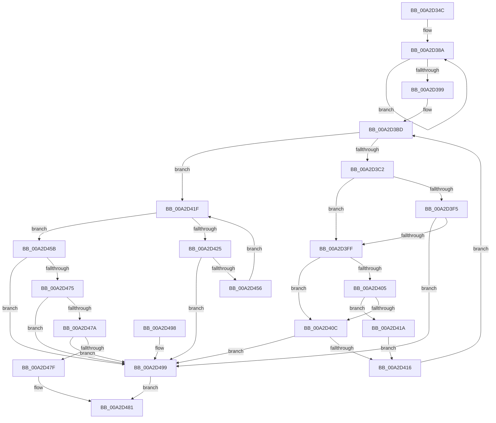

# PspValidateMitigationOptions

- RVA: `0x00A2D34C`–`0x00A2D4A0` (길이 `340` bytes)
- VA: `0x0000000140A2D34C`
- 실행 섹션: `PAGE`
- PDB 이름 있음: `예`; PDB Function 태그: `아니요`
- unwind 정보 RVA: `0x000AC77C`
- 디코드: `92`개 명령, `340/340` bytes 표시
- 미해석 바이트: `0` (있으면 어셈블리에 `.byte`로 보존)

> 이 문서는 커널 이미지의 기계어와 PDB 기호를 분석해 생성했습니다. 4번과 5번은 함수 원형과 자료형을 바이너리 사용 방식에서 추정한 C 해석이며 원본 소스 복구 결과는 아닙니다.

## 1. Dependencies

- 직접 호출 지점: **1**; 고유 호출 대상: **1**
- 직접 호출자로 확인된 함수: **3**
- RIP 상대 이미지 참조: **2**

### Outgoing calls
- `0x00A2D488` → [_security_check_cookie](../../text/6A/_security_check_cookie_function_006AC640.md) (function, `0x006AC640`)

### Direct callers
- [PspBuildCreateProcessContext](../9E/PspBuildCreateProcessContext_function_009ED6E0.md) at `0x009EE235`
- [PspReadIFEOMitigationOptions](PspReadIFEOMitigationOptions_function_00A2CFEC.md) at `0x00A2D05D`
- [PspInitPhase0](../../init/C7/PspInitPhase0_function_00C77E2C.md) at `0x00C77F87`

### Static image references
- `0x00A2D359` → RVA `0x00E0A740` (`.data`; read)
- `0x00A2D399` → RVA `0x0001A1A0` (`.rdata`; read)

## 2. Other-region calls and transfers

- 다른 실행 섹션으로 향하는 call: **1**
  - `0x00A2D488` → [_security_check_cookie](../../text/6A/_security_check_cookie_function_006AC640.md) (`PAGE` → `.text`)
- 별도 외부 분기/꼬리 이동을 확인하지 못했습니다.

## 3. Assembly (complete function range)

```asm
00A2D34C  48 89 5C 24 08                  mov qword ptr [rsp + 8], rbx
00A2D351  55                              push rbp
00A2D352  48 8B EC                        mov rbp, rsp
00A2D355  48 83 EC 60                     sub rsp, 0x60
00A2D359  48 8B 05 E0 D3 3D 00            mov rax, qword ptr [rip + 0x3dd3e0]
00A2D360  48 33 C4                        xor rax, rsp
00A2D363  48 89 45 F8                     mov qword ptr [rbp - 8], rax
00A2D367  83 65 C0 00                     and dword ptr [rbp - 0x40], 0
00A2D36B  4C 8D 45 CC                     lea r8, [rbp - 0x34]
00A2D36F  B8 09 00 00 00                  mov eax, 9
00A2D374  C7 45 C4 01 00 00 00            mov dword ptr [rbp - 0x3c], 1
00A2D37B  4C 8B D1                        mov r10, rcx
00A2D37E  C7 45 C8 02 00 00 00            mov dword ptr [rbp - 0x38], 2
00A2D385  8A DA                           mov bl, dl
00A2D387  8D 48 FB                        lea ecx, [rax - 5]
00A2D38A  41 89 00                        mov dword ptr [r8], eax
00A2D38D  FF C0                           inc eax
00A2D38F  4D 8D 40 04                     lea r8, [r8 + 4]
00A2D393  48 83 E9 01                     sub rcx, 1
00A2D397  75 F1                           jne 0x140a2d38a
00A2D399  66 0F 6F 05 FF CD 5E FF         movdqa xmm0, xmmword ptr [rip - 0xa13201]
00A2D3A1  44 8D 41 28                     lea r8d, [rcx + 0x28]
00A2D3A5  33 D2                           xor edx, edx
00A2D3A7  C7 45 EC 20 00 00 00            mov dword ptr [rbp - 0x14], 0x20
00A2D3AE  F3 0F 7F 45 DC                  movdqu xmmword ptr [rbp - 0x24], xmm0
00A2D3B3  45 33 C9                        xor r9d, r9d
00A2D3B6  C7 45 F0 21 00 00 00            mov dword ptr [rbp - 0x10], 0x21
00A2D3BD  41 3B D0                        cmp edx, r8d
00A2D3C0  73 5D                           jae 0x140a2d41f
00A2D3C2  41 0F 28 02                     movaps xmm0, xmmword ptr [r10]
00A2D3C6  8D 0C 95 00 00 00 00            lea ecx, [rdx*4]
00A2D3CD  F2 41 0F 10 4A 10               movsd xmm1, qword ptr [r10 + 0x10]
00A2D3D3  8B C1                           mov eax, ecx
00A2D3D5  83 E1 3F                        and ecx, 0x3f
00A2D3D8  48 C1 E8 06                     shr rax, 6
00A2D3DC  0F 29 45 A0                     movaps xmmword ptr [rbp - 0x60], xmm0
00A2D3E0  F2 0F 11 4D B0                  movsd qword ptr [rbp - 0x50], xmm1
00A2D3E5  4C 8B 5C C5 A0                  mov r11, qword ptr [rbp + rax*8 - 0x60]
00A2D3EA  49 D3 EB                        shr r11, cl
00A2D3ED  41 80 E3 0F                     and r11b, 0xf
00A2D3F1  84 DB                           test bl, bl
00A2D3F3  75 0A                           jne 0x140a2d3ff
00A2D3F5  41 F6 C3 04                     test r11b, 4
00A2D3F9  0F 85 9A 00 00 00               jne 0x140a2d499
00A2D3FF  41 83 F9 0D                     cmp r9d, 0xd
00A2D403  73 07                           jae 0x140a2d40c
00A2D405  42 39 54 8D C0                  cmp dword ptr [rbp + r9*4 - 0x40], edx
00A2D40A  74 0E                           je 0x140a2d41a
00A2D40C  41 80 FB 03                     cmp r11b, 3
00A2D410  0F 84 83 00 00 00               je 0x140a2d499
00A2D416  FF C2                           inc edx
00A2D418  EB A3                           jmp 0x140a2d3bd
00A2D41A  41 FF C1                        inc r9d
00A2D41D  EB F7                           jmp 0x140a2d416
00A2D41F  41 83 F8 30                     cmp r8d, 0x30
00A2D423  73 36                           jae 0x140a2d45b
00A2D425  41 0F 28 02                     movaps xmm0, xmmword ptr [r10]
00A2D429  42 8D 0C 85 00 00 00 00         lea ecx, [r8*4]
00A2D431  F2 41 0F 10 4A 10               movsd xmm1, qword ptr [r10 + 0x10]
00A2D437  8B C1                           mov eax, ecx
00A2D439  83 E1 3F                        and ecx, 0x3f
00A2D43C  48 C1 E8 06                     shr rax, 6
00A2D440  0F 29 45 A0                     movaps xmmword ptr [rbp - 0x60], xmm0
00A2D444  F2 0F 11 4D B0                  movsd qword ptr [rbp - 0x50], xmm1
00A2D449  48 8B 54 C5 A0                  mov rdx, qword ptr [rbp + rax*8 - 0x60]
00A2D44E  48 D3 EA                        shr rdx, cl
00A2D451  F6 C2 0F                        test dl, 0xf
00A2D454  75 43                           jne 0x140a2d499
00A2D456  41 FF C0                        inc r8d
00A2D459  EB C4                           jmp 0x140a2d41f
00A2D45B  41 0F 28 0A                     movaps xmm1, xmmword ptr [r10]
00A2D45F  66 0F 73 D9 08                  psrldq xmm1, 8
00A2D464  66 48 0F 7E C9                  movq rcx, xmm1
00A2D469  48 C1 E9 0C                     shr rcx, 0xc
00A2D46D  83 E1 03                        and ecx, 3
00A2D470  83 E9 01                        sub ecx, 1
00A2D473  74 24                           je 0x140a2d499
00A2D475  83 E9 01                        sub ecx, 1
00A2D478  74 1F                           je 0x140a2d499
00A2D47A  83 F9 01                        cmp ecx, 1
00A2D47D  74 1A                           je 0x140a2d499
00A2D47F  33 C0                           xor eax, eax
00A2D481  48 8B 4D F8                     mov rcx, qword ptr [rbp - 8]
00A2D485  48 33 CC                        xor rcx, rsp
00A2D488  E8 B3 F1 C7 FF                  call 0x1406ac640
00A2D48D  48 8B 5C 24 70                  mov rbx, qword ptr [rsp + 0x70]
00A2D492  48 83 C4 60                     add rsp, 0x60
00A2D496  5D                              pop rbp
00A2D497  C3                              ret
00A2D498  CC                              int3
00A2D499  B8 0D 00 00 C0                  mov eax, 0xc000000d
00A2D49E  EB E1                           jmp 0x140a2d481
```

## 4. C-style interpretation (structured pseudocode)

```c
__int64 __fastcall PspValidateMitigationOptions(__int64 a1, int a2, __int64 a3, int a4)
{
    __int64 result;
    __int64 v_r11;
    __int64 v_rsp;
    unsigned __int64 v_stack_m10;
    unsigned int v_stack_m18;
    unsigned int v_stack_m1C;
    unsigned __int64 v_stack_m2C;
    unsigned __int64 v_stack_m3C;
    unsigned int v_stack_m40;
    unsigned int v_stack_m44;
    unsigned int v_stack_m48;
    unsigned __int64 v_stack_m58;
    unsigned __int64 v_stack_m68;
    unsigned __int64 v_stack_p8;

    v_stack_p8 = v_rbx;
    v_rsp = (v_rsp) - (96);
    result = (*(unsigned __int64 *)(v_rip + 4051936)) ^ (v_rsp);
    v_stack_m10 = result;
    v_stack_m44 = 1;
    v_stack_m40 = 2;
loc_00A2D38A:
    *(unsigned int *)(v_stack_m3C) = 9;
    result = (unsigned int)((9) + 1);
    a1 = (9 - 5) - (1);
    if (condition_is_not_equal) goto loc_00A2D38A;
    a2 = 0;
    v_stack_m1C = 32;
    v_stack_m2C = v_xmm0;
    a4 = 0;
    v_stack_m18 = 33;
loc_00A2D3BD:
    if (0 >= ((unsigned int)(a1 + 40))) goto loc_00A2D41F;
    a1 = (unsigned int)((a2 * 4) & (63));
    result = ((unsigned int)((unsigned int)(a2 * 4))) >> (6);
    v_stack_m68 = v_xmm0;
    v_stack_m58 = v_xmm1;
    v_r11 = (*(unsigned __int64 *)(v_rsp + result * 8 - 96)) >> ((unsigned __int8)(a1));
    v_r11 = (unsigned __int8)((v_r11) & (15));
    if ((unsigned __int8)((unsigned __int8)(a2)) != 0) goto loc_00A2D3FF;
    if ((((unsigned __int8)(v_r11)) & (4)) != 0) goto loc_00A2D499;
loc_00A2D3FF:
    if (0 >= 13) goto loc_00A2D40C;
    if ((*(unsigned int *)(v_rsp + a4 * 4 - 64)) == 0) goto loc_00A2D41A;
loc_00A2D40C:
    if (((unsigned __int8)(v_r11)) == 3) goto loc_00A2D499;
loc_00A2D416:
    a2 = (unsigned int)((a2) + 1);
    goto loc_00A2D3BD;
loc_00A2D41A:
    a4 = (unsigned int)((a4) + 1);
    goto loc_00A2D416;
loc_00A2D41F:
    if (((unsigned int)(a1 + 40)) >= 48) goto loc_00A2D45B;
    a1 = (unsigned int)((a1 + 40 * 4) & (63));
    result = ((unsigned int)((unsigned int)(a1 + 40 * 4))) >> (6);
    v_stack_m68 = v_xmm0;
    v_stack_m58 = v_xmm1;
    a2 = (*(unsigned __int64 *)(v_rsp + result * 8 - 96)) >> ((unsigned __int8)(a1));
    if ((((unsigned __int8)(a2)) & (15)) != 0) goto loc_00A2D499;
    a3 = (unsigned int)((a1 + 40) + 1);
    goto loc_00A2D41F;
loc_00A2D45B:
    a1 = (a1) >> (12);
    a1 = (unsigned int)((a1) & (3));
    a1 = (unsigned int)((a1) - (1));
    if (condition_is_equal) goto loc_00A2D499;
    a1 = (unsigned int)((a1) - (1));
    if (condition_is_equal) goto loc_00A2D499;
    if (((unsigned int)(a1)) == 1) goto loc_00A2D499;
    result = 0;
loc_00A2D481:
    a1 = (v_stack_m10) ^ (v_rsp);
    result = _security_check_cookie(a1, a2, a3, a4);
    v_rsp = (v_rsp) + (96);
    return result;
loc_00A2D499:
    goto loc_00A2D481;
}
```

## 5. (Beta) C Style

```c
int64_t PspValidateMitigationOptions(void *Arg1, int32_t Arg2, int64_t Arg3, int32_t Arg4)
{
    uint8_t *arg1 = (uint8_t *)Arg1;

    int64_t result;
    int64_t local_r11;
    int64_t local_rsp;
    uint64_t v_stack_m10;
    uint32_t v_stack_m18;
    uint32_t v_stack_m1C;
    uint64_t v_stack_m2C;
    uint64_t v_stack_m3C;
    uint32_t v_stack_m40;
    uint32_t v_stack_m44;
    uint32_t v_stack_m48;
    uint64_t v_stack_m58;
    uint64_t v_stack_m68;
    uint64_t v_stack_p8;

    v_stack_p8 = local_rbx;
    local_rsp = (local_rsp) - (96);
    result = (*(uint64_t *)(v_rip + 0x3DD3E0)) ^ (local_rsp);
    v_stack_m10 = result;
    v_stack_m44 = 1;
    v_stack_m40 = 2;
loc_00A2D38A:
    *(uint32_t *)(v_stack_m3C) = 9;
    result = (uint32_t)((9) + 1);
    Arg1 = (9 - 5) - (1);
    if (condition_is_not_equal) goto loc_00A2D38A;
    Arg2 = 0;
    v_stack_m1C = 32;
    v_stack_m2C = v_xmm0;
    Arg4 = 0;
    v_stack_m18 = 33;
loc_00A2D3BD:
    if (0 >= ((uint32_t)(Arg1 + 40))) goto loc_00A2D41F;
    Arg1 = (uint32_t)((Arg2 * 4) & (63));
    result = ((uint32_t)((uint32_t)(Arg2 * 4))) >> (6);
    v_stack_m68 = v_xmm0;
    v_stack_m58 = v_xmm1;
    local_r11 = (*(uint64_t *)(local_rsp + result * 8 - 0x60)) >> ((uint8_t)(Arg1));
    local_r11 = (uint8_t)((local_r11) & (15));
    if ((uint8_t)((uint8_t)(Arg2)) != 0) goto loc_00A2D3FF;
    if ((((uint8_t)(local_r11)) & (4)) != 0) goto loc_00A2D499;
loc_00A2D3FF:
    if (0 >= 13) goto loc_00A2D40C;
    if ((*(uint32_t *)(local_rsp + Arg4 * 4 - 0x40)) == 0) goto loc_00A2D41A;
loc_00A2D40C:
    if (((uint8_t)(local_r11)) == 3) goto loc_00A2D499;
loc_00A2D416:
    Arg2 = (uint32_t)((Arg2) + 1);
    goto loc_00A2D3BD;
loc_00A2D41A:
    Arg4 = (uint32_t)((Arg4) + 1);
    goto loc_00A2D416;
loc_00A2D41F:
    if (((uint32_t)(Arg1 + 40)) >= 48) goto loc_00A2D45B;
    Arg1 = (uint32_t)((Arg1 + 40 * 4) & (63));
    result = ((uint32_t)((uint32_t)(Arg1 + 40 * 4))) >> (6);
    v_stack_m68 = v_xmm0;
    v_stack_m58 = v_xmm1;
    Arg2 = (*(uint64_t *)(local_rsp + result * 8 - 0x60)) >> ((uint8_t)(Arg1));
    if ((((uint8_t)(Arg2)) & (15)) != 0) goto loc_00A2D499;
    Arg3 = (uint32_t)((Arg1 + 40) + 1);
    goto loc_00A2D41F;
loc_00A2D45B:
    Arg1 = (Arg1) >> (12);
    Arg1 = (uint32_t)((Arg1) & (3));
    Arg1 = (uint32_t)((Arg1) - (1));
    if (condition_is_equal) goto loc_00A2D499;
    Arg1 = (uint32_t)((Arg1) - (1));
    if (condition_is_equal) goto loc_00A2D499;
    if (((uint32_t)(Arg1)) == 1) goto loc_00A2D499;
    result = 0;
loc_00A2D481:
    Arg1 = (v_stack_m10) ^ (local_rsp);
    result = _security_check_cookie(Arg1, Arg2, Arg3, Arg4);
    local_rsp = (local_rsp) + (96);
    return result;
loc_00A2D499:
    goto loc_00A2D481;
}
```

### 관측된 메모리 오프셋

구조체 형식이 확인되지 않은 접근은 인자 기준의 오프셋으로만 기록했습니다.

| 기준 인자 | 오프셋 표현 | 폭 (bit) | 접근 |
|---|---:|---:|---|
| `Arg1` | `+ 0x0` | `128` | `R` |
| `Arg1` | `+ 0x10` | `64` | `R` |

## 6. Execution-region graph

[열기: 2D/3D 그래프와 함수 탐색 컨트롤 패널](../../../control-panel.html?section=page&rva=0x00A2D34C&view=graph)

- 2D 그래프는 위에서 아래로 흐르고, 3D 그래프는 빈 공간을 드래그해 회전합니다. Shift+드래그는 이동, 휠은 확대·축소, 함수 노드 선택은 대상 보고서 이동입니다.

### Static fallback


