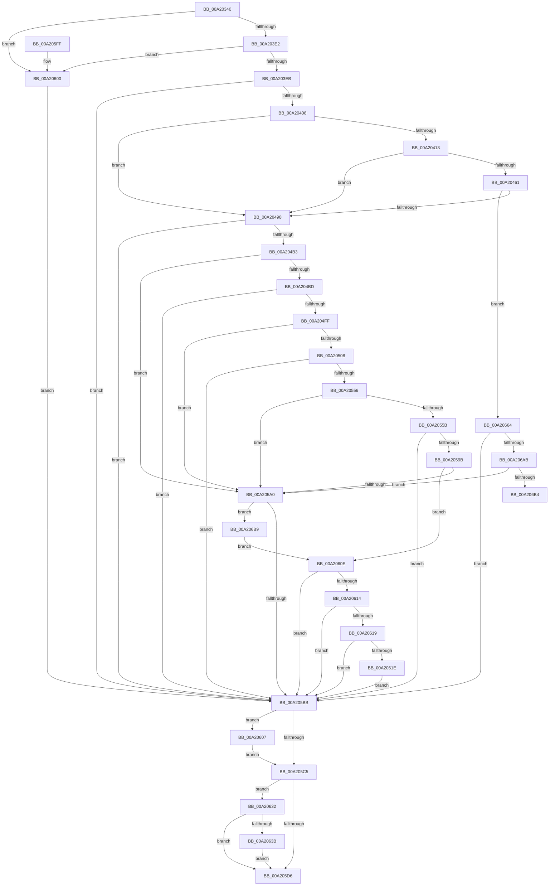

# RtlCapabilityCheck

- RVA: `0x00A20340`–`0x00A206C5` (길이 `901` bytes)
- VA: `0x0000000140A20340`
- 실행 섹션: `PAGE`
- PDB 이름 있음: `예`; PDB Function 태그: `예`
- unwind 정보 RVA: `0x000AAD50`
- 디코드: `230`개 명령, `901/901` bytes 표시
- 미해석 바이트: `0` (있으면 어셈블리에 `.byte`로 보존)

> 이 문서는 커널 이미지의 기계어와 PDB 기호를 분석해 생성했습니다. 4번과 5번은 함수 원형과 자료형을 바이너리 사용 방식에서 추정한 C 해석이며 원본 소스 복구 결과는 아닙니다.

## 1. Dependencies

- 직접 호출 지점: **21**; 고유 호출 대상: **15**
- 직접 호출자로 확인된 함수: **4**
- RIP 상대 이미지 참조: **2**

### Outgoing calls
- `0x00A203CF` → [KeQueryPerformanceCounter](../../text/37/KeQueryPerformanceCounter_function_0037E7E0.md) (function, `0x0037E7E0`)
- `0x00A203F9` → [RtlDeriveCapabilitySidsFromName](../../text/47/RtlDeriveCapabilitySidsFromName_function_00474DC0.md) (function, `0x00474DC0`)
- `0x00A20408` → [RtlIsMultiSessionSku](RtlIsMultiSessionSku_function_00A20730.md) (function, `0x00A20730`)
- `0x00A2041E` → [RtlInitUnicodeString](../../text/42/RtlInitUnicodeString_function_0042A780.md) (function, `0x0042A780`)
- `0x00A20458` → [ZwOpenKey](../../text/6A/ZwOpenKey_function_006AD310.md) (function, `0x006AD310`)
- `0x00A20483` → [ZwQueryValueKey](../../text/6A/ZwQueryValueKey_function_006AD3B0.md) (function, `0x006AD3B0`)
- `0x00A204A2` → [RtlCheckTokenMembershipEx](../../text/3A/RtlCheckTokenMembershipEx_function_003A5A30.md) (function, `0x003A5A30`)
- `0x00A204D1` → [RtlSubAuthoritySid](../../text/45/RtlSubAuthoritySid_function_00456D10.md) (function, `0x00456D10`)
- `0x00A204EB` → [RtlCheckTokenMembership](../../text/3A/RtlCheckTokenMembership_function_003A5A10.md) (function, `0x003A5A10`)
- `0x00A2052F` → [RtlSubAuthoritySid](../../text/45/RtlSubAuthoritySid_function_00456D10.md) (function, `0x00456D10`)
- `0x00A20546` → [RtlCheckTokenMembership](../../text/3A/RtlCheckTokenMembership_function_003A5A10.md) (function, `0x003A5A10`)
- `0x00A2058B` → [RtlCheckTokenMembershipEx](../../text/3A/RtlCheckTokenMembershipEx_function_003A5A30.md) (function, `0x003A5A30`)
- `0x00A205AC` → [RtlCheckTokenCapability](../../text/3A/RtlCheckTokenCapability_function_003A5520.md) (function, `0x003A5520`)
- `0x00A205C7` → [KeQueryPerformanceCounter](../../text/37/KeQueryPerformanceCounter_function_0037E7E0.md) (function, `0x0037E7E0`)
- `0x00A205DF` → [_security_check_cookie](../../text/6A/_security_check_cookie_function_006AC640.md) (function, `0x006AC640`)
- `0x00A20607` → [ZwClose](../../text/6A/ZwClose_function_006AD2B0.md) (function, `0x006AD2B0`)
- `0x00A20629` → [RtlpCapabilityCheckSystemCapability](RtlpCapabilityCheckSystemCapability_function_00A20768.md) (function, `0x00A20768`)
- `0x00A20632` → [PsIsCurrentThreadInServerSilo](../../text/43/PsIsCurrentThreadInServerSilo_function_004362E0.md) (function, `0x004362E0`)
- `0x00A2065A` → [RtlpLogCapabilityCheckLatency](../A9/RtlpLogCapabilityCheckLatency_function_00A9D678.md) (function, `0x00A9D678`)
- `0x00A2067D` → [RtlSubAuthoritySid](../../text/45/RtlSubAuthoritySid_function_00456D10.md) (function, `0x00456D10`)
- `0x00A20697` → [RtlCheckTokenMembership](../../text/3A/RtlCheckTokenMembership_function_003A5A10.md) (function, `0x003A5A10`)

### Direct callers
- [PopCapabilityCheck](../../text/4D/PopCapabilityCheck_function_004DFF10.md) at `0x004DFF8B`
- [RtlCapabilityCheckForSingleSessionSku](../78/RtlCapabilityCheckForSingleSessionSku_function_0078E410.md) at `0x0078E451`
- [NtSetSystemTime](../7C/NtSetSystemTime_function_007C65F0.md) at `0x007C6693`
- [ExpCapabilityCheck](ExpCapabilityCheck_function_00A20300.md) at `0x00A20313`

### Static image references
- `0x00A2035C` → RVA `0x00E0A740` (`.data`; read)
- `0x00A20413` → RVA `0x00B05860` (` ?? ::NNGAKEGL::`string'`; read)

## 2. Other-region calls and transfers

- 다른 실행 섹션으로 향하는 call: **18**
  - `0x00A203CF` → [KeQueryPerformanceCounter](../../text/37/KeQueryPerformanceCounter_function_0037E7E0.md) (`PAGE` → `.text`)
  - `0x00A203F9` → [RtlDeriveCapabilitySidsFromName](../../text/47/RtlDeriveCapabilitySidsFromName_function_00474DC0.md) (`PAGE` → `.text`)
  - `0x00A2041E` → [RtlInitUnicodeString](../../text/42/RtlInitUnicodeString_function_0042A780.md) (`PAGE` → `.text`)
  - `0x00A20458` → [ZwOpenKey](../../text/6A/ZwOpenKey_function_006AD310.md) (`PAGE` → `.text`)
  - `0x00A20483` → [ZwQueryValueKey](../../text/6A/ZwQueryValueKey_function_006AD3B0.md) (`PAGE` → `.text`)
  - `0x00A204A2` → [RtlCheckTokenMembershipEx](../../text/3A/RtlCheckTokenMembershipEx_function_003A5A30.md) (`PAGE` → `.text`)
  - `0x00A204D1` → [RtlSubAuthoritySid](../../text/45/RtlSubAuthoritySid_function_00456D10.md) (`PAGE` → `.text`)
  - `0x00A204EB` → [RtlCheckTokenMembership](../../text/3A/RtlCheckTokenMembership_function_003A5A10.md) (`PAGE` → `.text`)
  - `0x00A2052F` → [RtlSubAuthoritySid](../../text/45/RtlSubAuthoritySid_function_00456D10.md) (`PAGE` → `.text`)
  - `0x00A20546` → [RtlCheckTokenMembership](../../text/3A/RtlCheckTokenMembership_function_003A5A10.md) (`PAGE` → `.text`)
  - `0x00A2058B` → [RtlCheckTokenMembershipEx](../../text/3A/RtlCheckTokenMembershipEx_function_003A5A30.md) (`PAGE` → `.text`)
  - `0x00A205AC` → [RtlCheckTokenCapability](../../text/3A/RtlCheckTokenCapability_function_003A5520.md) (`PAGE` → `.text`)
  - `0x00A205C7` → [KeQueryPerformanceCounter](../../text/37/KeQueryPerformanceCounter_function_0037E7E0.md) (`PAGE` → `.text`)
  - `0x00A205DF` → [_security_check_cookie](../../text/6A/_security_check_cookie_function_006AC640.md) (`PAGE` → `.text`)
  - `0x00A20607` → [ZwClose](../../text/6A/ZwClose_function_006AD2B0.md) (`PAGE` → `.text`)
  - `0x00A20632` → [PsIsCurrentThreadInServerSilo](../../text/43/PsIsCurrentThreadInServerSilo_function_004362E0.md) (`PAGE` → `.text`)
  - `0x00A2067D` → [RtlSubAuthoritySid](../../text/45/RtlSubAuthoritySid_function_00456D10.md) (`PAGE` → `.text`)
  - `0x00A20697` → [RtlCheckTokenMembership](../../text/3A/RtlCheckTokenMembership_function_003A5A10.md) (`PAGE` → `.text`)
- call이 아닌 외부 분기/꼬리 이동: **1**
  - `0x00A206B4` → [sub_00B37578](../B3/Unknown_function_00B37578.md) (`tail-transfer`)

## 3. Assembly (complete function range)

```asm
00A20340  48 89 5C 24 20                  mov qword ptr [rsp + 0x20], rbx
00A20345  55                              push rbp
00A20346  56                              push rsi
00A20347  57                              push rdi
00A20348  41 54                           push r12
00A2034A  41 55                           push r13
00A2034C  41 56                           push r14
00A2034E  41 57                           push r15
00A20350  48 8D 6C 24 D0                  lea rbp, [rsp - 0x30]
00A20355  48 81 EC 30 01 00 00            sub rsp, 0x130
00A2035C  48 8B 05 DD A3 3E 00            mov rax, qword ptr [rip + 0x3ea3dd]
00A20363  48 33 C4                        xor rax, rsp
00A20366  48 89 45 20                     mov qword ptr [rbp + 0x20], rax
00A2036A  33 DB                           xor ebx, ebx
00A2036C  48 89 54 24 50                  mov qword ptr [rsp + 0x50], rdx
00A20371  0F 57 C0                        xorps xmm0, xmm0
00A20374  89 5C 24 40                     mov dword ptr [rsp + 0x40], ebx
00A20378  33 C0                           xor eax, eax
00A2037A  48 89 5C 24 48                  mov qword ptr [rsp + 0x48], rbx
00A2037F  4C 8B F9                        mov r15, rcx
00A20382  48 89 45 80                     mov qword ptr [rbp - 0x80], rax
00A20386  33 C9                           xor ecx, ecx
00A20388  89 45 88                        mov dword ptr [rbp - 0x78], eax
00A2038B  0F 11 45 90                     movups xmmword ptr [rbp - 0x70], xmm0
00A2038F  88 5C 24 35                     mov byte ptr [rsp + 0x35], bl
00A20393  40 8A F3                        mov sil, bl
00A20396  0F 11 44 24 60                  movups xmmword ptr [rsp + 0x60], xmm0
00A2039B  89 5C 24 38                     mov dword ptr [rsp + 0x38], ebx
00A2039F  40 8A FB                        mov dil, bl
00A203A2  0F 11 44 24 70                  movups xmmword ptr [rsp + 0x70], xmm0
00A203A7  88 5C 24 34                     mov byte ptr [rsp + 0x34], bl
00A203AB  44 8A E3                        mov r12b, bl
00A203AE  0F 11 45 A0                     movups xmmword ptr [rbp - 0x60], xmm0
00A203B2  88 5C 24 30                     mov byte ptr [rsp + 0x30], bl
00A203B6  4D 8B F0                        mov r14, r8
00A203B9  88 5C 24 31                     mov byte ptr [rsp + 0x31], bl
00A203BD  4C 8B EA                        mov r13, rdx
00A203C0  88 5C 24 32                     mov byte ptr [rsp + 0x32], bl
00A203C4  88 5C 24 33                     mov byte ptr [rsp + 0x33], bl
00A203C8  66 C7 44 24 3C 00 05            mov word ptr [rsp + 0x3c], 0x500
00A203CF  E8 0C E4 95 FF                  call 0x14037e7e0
00A203D4  48 89 44 24 58                  mov qword ptr [rsp + 0x58], rax
00A203D9  4D 85 ED                        test r13, r13
00A203DC  0F 84 1E 02 00 00               je 0x140a20600
00A203E2  4D 85 F6                        test r14, r14
00A203E5  0F 84 15 02 00 00               je 0x140a20600
00A203EB  4C 8D 45 F0                     lea r8, [rbp - 0x10]
00A203EF  41 88 1E                        mov byte ptr [r14], bl
00A203F2  48 8D 55 C0                     lea rdx, [rbp - 0x40]
00A203F6  49 8B CD                        mov rcx, r13
00A203F9  E8 C2 49 A5 FF                  call 0x140474dc0
00A203FE  8B D8                           mov ebx, eax
00A20400  85 C0                           test eax, eax
00A20402  0F 88 B3 01 00 00               js 0x140a205bb
00A20408  E8 23 03 00 00                  call 0x140a20730
00A2040D  33 DB                           xor ebx, ebx
00A2040F  84 C0                           test al, al
00A20411  74 7D                           je 0x140a20490
00A20413  48 8D 15 46 54 0E 00            lea rdx, [rip + 0xe5446]
00A2041A  48 8D 4D 90                     lea rcx, [rbp - 0x70]
00A2041E  E8 5D A3 A0 FF                  call 0x14042a780
00A20423  48 8D 45 90                     lea rax, [rbp - 0x70]
00A20427  C7 44 24 60 30 00 00 00         mov dword ptr [rsp + 0x60], 0x30
00A2042F  0F 57 C0                        xorps xmm0, xmm0
00A20432  48 89 44 24 70                  mov qword ptr [rsp + 0x70], rax
00A20437  4C 8D 44 24 60                  lea r8, [rsp + 0x60]
00A2043C  48 89 5C 24 68                  mov qword ptr [rsp + 0x68], rbx
00A20441  BA 00 00 00 80                  mov edx, 0x80000000
00A20446  C7 44 24 78 40 02 00 00         mov dword ptr [rsp + 0x78], 0x240
00A2044E  48 8D 4C 24 48                  lea rcx, [rsp + 0x48]
00A20453  F3 0F 7F 45 80                  movdqu xmmword ptr [rbp - 0x80], xmm0
00A20458  E8 B3 CE C8 FF                  call 0x1406ad310
00A2045D  85 C0                           test eax, eax
00A2045F  78 2F                           js 0x140a20490
00A20461  48 8B 4C 24 48                  mov rcx, qword ptr [rsp + 0x48]
00A20466  48 8D 44 24 40                  lea rax, [rsp + 0x40]
00A2046B  48 89 44 24 28                  mov qword ptr [rsp + 0x28], rax
00A20470  4C 8D 4D A0                     lea r9, [rbp - 0x60]
00A20474  44 8D 43 02                     lea r8d, [rbx + 2]
00A20478  C7 44 24 20 10 00 00 00         mov dword ptr [rsp + 0x20], 0x10
00A20480  49 8B D5                        mov rdx, r13
00A20483  E8 28 CF C8 FF                  call 0x1406ad3b0
00A20488  85 C0                           test eax, eax
00A2048A  0F 89 D4 01 00 00               jns 0x140a20664
00A20490  4C 8D 4C 24 33                  lea r9, [rsp + 0x33]
00A20495  41 B8 02 00 00 00               mov r8d, 2
00A2049B  48 8D 55 C0                     lea rdx, [rbp - 0x40]
00A2049F  49 8B CF                        mov rcx, r15
00A204A2  E8 89 55 98 FF                  call 0x1403a5a30
00A204A7  33 C9                           xor ecx, ecx
00A204A9  8B D8                           mov ebx, eax
00A204AB  85 C0                           test eax, eax
00A204AD  0F 88 08 01 00 00               js 0x140a205bb
00A204B3  38 4C 24 33                     cmp byte ptr [rsp + 0x33], cl
00A204B7  0F 85 E3 00 00 00               jne 0x140a205a0
00A204BD  33 D2                           xor edx, edx
00A204BF  C7 45 B0 01 01 00 00            mov dword ptr [rbp - 0x50], 0x101
00A204C6  48 8D 4D B0                     lea rcx, [rbp - 0x50]
00A204CA  C7 45 B4 00 00 00 05            mov dword ptr [rbp - 0x4c], 0x5000000
00A204D1  E8 3A 68 A3 FF                  call 0x140456d10
00A204D6  4C 8D 44 24 31                  lea r8, [rsp + 0x31]
00A204DB  49 8B CF                        mov rcx, r15
00A204DE  48 8D 55 B0                     lea rdx, [rbp - 0x50]
00A204E2  4C 8B E8                        mov r13, rax
00A204E5  C7 00 12 00 00 00               mov dword ptr [rax], 0x12
00A204EB  E8 20 55 98 FF                  call 0x1403a5a10
00A204F0  40 8A 7C 24 31                  mov dil, byte ptr [rsp + 0x31]
00A204F5  8B D8                           mov ebx, eax
00A204F7  85 C0                           test eax, eax
00A204F9  0F 88 BC 00 00 00               js 0x140a205bb
00A204FF  40 84 FF                        test dil, dil
00A20502  0F 85 98 00 00 00               jne 0x140a205a0
00A20508  8B 44 24 38                     mov eax, dword ptr [rsp + 0x38]
00A2050C  48 8D 4D B0                     lea rcx, [rbp - 0x50]
00A20510  89 45 B2                        mov dword ptr [rbp - 0x4e], eax
00A20513  BA 01 00 00 00                  mov edx, 1
00A20518  0F B7 44 24 3C                  movzx eax, word ptr [rsp + 0x3c]
00A2051D  66 89 45 B6                     mov word ptr [rbp - 0x4a], ax
00A20521  66 C7 45 B0 01 02               mov word ptr [rbp - 0x50], 0x201
00A20527  41 C7 45 00 20 00 00 00         mov dword ptr [r13], 0x20
00A2052F  E8 DC 67 A3 FF                  call 0x140456d10
00A20534  4C 8D 44 24 30                  lea r8, [rsp + 0x30]
00A20539  49 8B CF                        mov rcx, r15
00A2053C  48 8D 55 B0                     lea rdx, [rbp - 0x50]
00A20540  C7 00 20 02 00 00               mov dword ptr [rax], 0x220
00A20546  E8 C5 54 98 FF                  call 0x1403a5a10
00A2054B  40 8A 74 24 30                  mov sil, byte ptr [rsp + 0x30]
00A20550  8B D8                           mov ebx, eax
00A20552  85 C0                           test eax, eax
00A20554  78 65                           js 0x140a205bb
00A20556  40 84 F6                        test sil, sil
00A20559  75 45                           jne 0x140a205a0
00A2055B  8B 44 24 38                     mov eax, dword ptr [rsp + 0x38]
00A2055F  4C 8D 4C 24 32                  lea r9, [rsp + 0x32]
00A20564  89 45 B2                        mov dword ptr [rbp - 0x4e], eax
00A20567  48 8D 55 B0                     lea rdx, [rbp - 0x50]
00A2056B  0F B7 44 24 3C                  movzx eax, word ptr [rsp + 0x3c]
00A20570  41 B8 02 00 00 00               mov r8d, 2
00A20576  66 89 45 B6                     mov word ptr [rbp - 0x4a], ax
00A2057A  49 8B CF                        mov rcx, r15
00A2057D  66 C7 45 B0 01 01               mov word ptr [rbp - 0x50], 0x101
00A20583  41 C7 45 00 04 00 00 00         mov dword ptr [r13], 4
00A2058B  E8 A0 54 98 FF                  call 0x1403a5a30
00A20590  44 8A 64 24 32                  mov r12b, byte ptr [rsp + 0x32]
00A20595  8B D8                           mov ebx, eax
00A20597  85 C0                           test eax, eax
00A20599  78 20                           js 0x140a205bb
00A2059B  45 84 E4                        test r12b, r12b
00A2059E  74 6E                           je 0x140a2060e
00A205A0  4C 8D 44 24 34                  lea r8, [rsp + 0x34]
00A205A5  49 8B CF                        mov rcx, r15
00A205A8  48 8D 55 F0                     lea rdx, [rbp - 0x10]
00A205AC  E8 6F 4F 98 FF                  call 0x1403a5520
00A205B1  8B D8                           mov ebx, eax
00A205B3  85 C0                           test eax, eax
00A205B5  0F 89 FE 00 00 00               jns 0x140a206b9
00A205BB  48 8B 4C 24 48                  mov rcx, qword ptr [rsp + 0x48]
00A205C0  48 85 C9                        test rcx, rcx
00A205C3  75 42                           jne 0x140a20607
00A205C5  33 C9                           xor ecx, ecx
00A205C7  E8 14 E2 95 FF                  call 0x14037e7e0
00A205CC  48 89 44 24 50                  mov qword ptr [rsp + 0x50], rax
00A205D1  40 84 FF                        test dil, dil
00A205D4  74 5C                           je 0x140a20632
00A205D6  8B C3                           mov eax, ebx
00A205D8  48 8B 4D 20                     mov rcx, qword ptr [rbp + 0x20]
00A205DC  48 33 CC                        xor rcx, rsp
00A205DF  E8 5C C0 C8 FF                  call 0x1406ac640
00A205E4  48 8B 9C 24 88 01 00 00         mov rbx, qword ptr [rsp + 0x188]
00A205EC  48 81 C4 30 01 00 00            add rsp, 0x130
00A205F3  41 5F                           pop r15
00A205F5  41 5E                           pop r14
00A205F7  41 5D                           pop r13
00A205F9  41 5C                           pop r12
00A205FB  5F                              pop rdi
00A205FC  5E                              pop rsi
00A205FD  5D                              pop rbp
00A205FE  C3                              ret
00A205FF  CC                              int3
00A20600  BB 0D 00 00 C0                  mov ebx, 0xc000000d
00A20605  EB B4                           jmp 0x140a205bb
00A20607  E8 A4 CC C8 FF                  call 0x1406ad2b0
00A2060C  EB B7                           jmp 0x140a205c5
00A2060E  41 80 3E 00                     cmp byte ptr [r14], 0
00A20612  74 A7                           je 0x140a205bb
00A20614  40 84 F6                        test sil, sil
00A20617  75 A2                           jne 0x140a205bb
00A20619  40 84 FF                        test dil, dil
00A2061C  75 9D                           jne 0x140a205bb
00A2061E  48 8B 54 24 50                  mov rdx, qword ptr [rsp + 0x50]
00A20623  4D 8B C6                        mov r8, r14
00A20626  49 8B CF                        mov rcx, r15
00A20629  E8 3A 01 00 00                  call 0x140a20768
00A2062E  8B D8                           mov ebx, eax
00A20630  EB 89                           jmp 0x140a205bb
00A20632  E8 A9 5C A1 FF                  call 0x1404362e0
00A20637  84 C0                           test al, al
00A20639  75 9B                           jne 0x140a205d6
00A2063B  41 8A 06                        mov al, byte ptr [r14]
00A2063E  48 8D 54 24 50                  lea rdx, [rsp + 0x50]
00A20643  88 44 24 28                     mov byte ptr [rsp + 0x28], al
00A20647  48 8D 4C 24 58                  lea rcx, [rsp + 0x58]
00A2064C  8A 44 24 35                     mov al, byte ptr [rsp + 0x35]
00A20650  45 8A CC                        mov r9b, r12b
00A20653  44 8A C6                        mov r8b, sil
00A20656  88 44 24 20                     mov byte ptr [rsp + 0x20], al
00A2065A  E8 19 D0 07 00                  call 0x140a9d678
00A2065F  E9 72 FF FF FF                  jmp 0x140a205d6
00A20664  33 D2                           xor edx, edx
00A20666  C6 44 24 35 01                  mov byte ptr [rsp + 0x35], 1
00A2066B  48 8D 4D B0                     lea rcx, [rbp - 0x50]
00A2066F  C7 45 B0 01 01 00 00            mov dword ptr [rbp - 0x50], 0x101
00A20676  C7 45 B4 00 00 00 05            mov dword ptr [rbp - 0x4c], 0x5000000
00A2067D  E8 8E 66 A3 FF                  call 0x140456d10
00A20682  4C 8D 44 24 31                  lea r8, [rsp + 0x31]
00A20687  49 8B CF                        mov rcx, r15
00A2068A  48 8D 55 B0                     lea rdx, [rbp - 0x50]
00A2068E  4C 8B E8                        mov r13, rax
00A20691  C7 00 12 00 00 00               mov dword ptr [rax], 0x12
00A20697  E8 74 53 98 FF                  call 0x1403a5a10
00A2069C  40 8A 7C 24 31                  mov dil, byte ptr [rsp + 0x31]
00A206A1  8B D8                           mov ebx, eax
00A206A3  85 C0                           test eax, eax
00A206A5  0F 88 10 FF FF FF               js 0x140a205bb
00A206AB  40 84 FF                        test dil, dil
00A206AE  0F 85 EC FE FF FF               jne 0x140a205a0
00A206B4  E9 BF 6E 11 00                  jmp 0x140b37578
00A206B9  8A 44 24 34                     mov al, byte ptr [rsp + 0x34]
00A206BD  41 88 06                        mov byte ptr [r14], al
00A206C0  E9 49 FF FF FF                  jmp 0x140a2060e
```

## 4. C-style interpretation (structured pseudocode)

```c
__int64 __fastcall RtlCapabilityCheck(__int64 a1, __int64 a2, __int64 a3)
{
    __int64 result;
    __int64 v_rbx;
    __int64 v_rsp;
    unsigned __int64 v_stack_m100;
    unsigned __int64 v_stack_m108;
    unsigned __int64 v_stack_m110;
    unsigned __int64 v_stack_m118;
    unsigned __int64 v_stack_m120;
    unsigned int v_stack_m128;
    unsigned __int16 v_stack_m12C;
    unsigned int v_stack_m130;
    unsigned __int8 v_stack_m133;
    unsigned __int8 v_stack_m134;
    unsigned __int8 v_stack_m135;
    unsigned __int8 v_stack_m136;
    unsigned __int8 v_stack_m137;
    unsigned __int8 v_stack_m138;
    unsigned __int64 v_stack_m140;
    unsigned int v_stack_m148;
    unsigned __int64 v_stack_m48;
    unsigned __int64 v_stack_m68;
    unsigned __int64 v_stack_m78;
    unsigned __int64 v_stack_mA8;
    unsigned __int16 v_stack_mB2;
    unsigned int v_stack_mB4;
    unsigned int v_stack_mB6;
    unsigned int v_stack_mB8;
    unsigned __int64 v_stack_mC8;
    unsigned __int64 v_stack_mD8;
    unsigned int v_stack_mE0;
    unsigned __int64 v_stack_mE8;
    unsigned int v_stack_mF0;
    unsigned __int64 v_stack_mF8;
    unsigned __int64 v_stack_p20;
    unsigned __int8 v_stack_p28;
    unsigned __int64 v_stack_p31;
    unsigned __int8 v_stack_p34;
    unsigned __int8 v_stack_p35;
    unsigned __int64 v_stack_p50;
    unsigned __int64 v_stack_p58;

    v_stack_p20 = v_rbx;
    v_rsp = (v_rsp) - (304);
    result = (*(unsigned __int64 *)(v_rip + 4105181)) ^ (v_rsp);
    v_stack_m48 = result;
    v_rbx = 0;
    v_stack_m118 = a2;
    v_stack_m128 = 0;
    result = 0;
    v_stack_m120 = 0;
    v_stack_mE8 = 0;
    a1 = 0;
    v_stack_mE0 = 0;
    v_stack_mD8 = v_xmm0;
    v_stack_m133 = 0;
    v_stack_m108 = v_xmm0;
    v_stack_m130 = 0;
    v_stack_mF8 = v_xmm0;
    v_stack_m134 = 0;
    v_stack_mC8 = v_xmm0;
    v_stack_m138 = 0;
    v_stack_m137 = 0;
    v_stack_m136 = 0;
    v_stack_m135 = 0;
    v_stack_m12C = 0x500ULL;
    result = KeQueryPerformanceCounter(a1, a2, a3, a4);
    v_stack_m110 = result;
    if (a2 == 0) goto loc_00A20600;
    if (a3 == 0) goto loc_00A20600;
    *(unsigned __int8 *)(a3) = 0;
    result = RtlDeriveCapabilitySidsFromName(a2, v_stack_mA8, v_stack_m78, a4);
    if (sign_flag) goto loc_00A205BB;
    result = RtlIsMultiSessionSku(a2, v_stack_mA8, v_stack_m78, a4);
    v_rbx = 0;
    if ((unsigned __int8)(result) == 0) goto loc_00A20490;
    result = RtlInitUnicodeString(v_stack_mD8, v_rip + 939078, v_stack_m78, a4);
    v_stack_m108 = 48;
    v_stack_mF8 = v_stack_mD8;
    v_stack_m100 = 0;
    v_stack_mF0 = 576;
    v_stack_mE8 = v_xmm0;
    result = ZwOpenKey(v_stack_m120, (unsigned int)(0x80000000ULL), v_stack_m108, a4);
    if (sign_flag) goto loc_00A20490;
    v_stack_m140 = v_stack_m128;
    v_stack_m148 = 16;
    result = ZwQueryValueKey(v_stack_m120, a2, v_rbx + 2, v_stack_mC8);
    if (!sign_flag) goto loc_00A20664;
loc_00A20490:
    result = RtlCheckTokenMembershipEx(0, v_stack_mA8, 2, v_stack_m135);
    a1 = 0;
    if (sign_flag) goto loc_00A205BB;
    if (v_stack_m135 != 0) goto loc_00A205A0;
    a2 = 0;
    v_stack_mB8 = 257;
    v_stack_mB4 = 0x5000000ULL;
    result = RtlSubAuthoritySid(v_stack_mB8, a2, 2, v_stack_m135);
    *(unsigned int *)(result) = 18;
    result = RtlCheckTokenMembership(0, v_stack_mB8, v_stack_m137, v_stack_m135);
    if (sign_flag) goto loc_00A205BB;
    if ((unsigned __int8)(v_stack_m137) != 0) goto loc_00A205A0;
    v_stack_mB6 = (unsigned int)((unsigned int)(v_stack_m130));
    v_stack_mB2 = (unsigned __int16)(v_stack_m12C);
    v_stack_mB8 = 513;
    *(unsigned int *)(result) = 32;
    result = RtlSubAuthoritySid(v_stack_mB8, 1, v_stack_m137, v_stack_m135);
    *(unsigned int *)(result) = 544;
    result = RtlCheckTokenMembership(0, v_stack_mB8, v_stack_m138, v_stack_m135);
    if (sign_flag) goto loc_00A205BB;
    if ((unsigned __int8)(v_stack_m138) != 0) goto loc_00A205A0;
    v_stack_mB6 = (unsigned int)((unsigned int)(v_stack_m130));
    v_stack_mB2 = (unsigned __int16)(v_stack_m12C);
    v_stack_mB8 = 257;
    *(unsigned int *)(result) = 4;
    result = RtlCheckTokenMembershipEx(0, v_stack_mB8, 2, v_stack_m136);
    if (sign_flag) goto loc_00A205BB;
    if ((unsigned __int8)(v_stack_m136) == 0) goto loc_00A2060E;
loc_00A205A0:
    result = RtlCheckTokenCapability(0, v_stack_m78, v_stack_m134, v_stack_m136);
    if (!sign_flag) goto loc_00A206B9;
loc_00A205BB:
    if (v_stack_m120 != 0) goto loc_00A20607;
loc_00A205C5:
    a1 = 0;
    result = KeQueryPerformanceCounter(a1, v_stack_m78, v_stack_m134, v_stack_m136);
    v_stack_m118 = result;
    if ((unsigned __int8)(v_stack_m137) == 0) goto loc_00A20632;
loc_00A205D6:
    a1 = (v_stack_m48) ^ (v_rsp);
    result = _security_check_cookie(a1, v_stack_m78, v_stack_m134, v_stack_m136);
    v_rsp = (v_rsp) + (304);
    return result;
loc_00A20600:
    goto loc_00A205BB;
loc_00A20607:
    result = ZwClose(a1, v_stack_m78, v_stack_m134, v_stack_m136);
    goto loc_00A205C5;
loc_00A2060E:
    if ((*(unsigned __int8 *)(a3)) == 0) goto loc_00A205BB;
    if ((unsigned __int8)(v_stack_m138) != 0) goto loc_00A205BB;
    if ((unsigned __int8)(v_stack_m137) != 0) goto loc_00A205BB;
    result = RtlpCapabilityCheckSystemCapability(a1, v_stack_p50, a3, v_stack_m136);
    goto loc_00A205BB;
loc_00A20632:
    result = PsIsCurrentThreadInServerSilo(a1, v_stack_p50, a3, v_stack_m136);
    if ((unsigned __int8)(result) != 0) goto loc_00A205D6;
    v_stack_p28 = (unsigned __int8)(*(unsigned __int8 *)(a3));
    v_stack_p20 = (unsigned __int8)(v_stack_p35);
    result = RtlpLogCapabilityCheckLatency(v_stack_p58, v_stack_p50, (unsigned __int8)(v_stack_m138), (unsigned __int8)(v_stack_m136));
    goto loc_00A205D6;
loc_00A20664:
    a2 = 0;
    v_stack_p35 = 1;
    v_stack_mB8 = 257;
    v_stack_mB4 = 0x5000000ULL;
    result = RtlSubAuthoritySid(v_stack_mB8, a2, (unsigned __int8)(v_stack_m138), (unsigned __int8)(v_stack_m136));
    *(unsigned int *)(result) = 18;
    result = RtlCheckTokenMembership(a1, v_stack_mB8, v_stack_p31, (unsigned __int8)(v_stack_m136));
    if (sign_flag) goto loc_00A205BB;
    if ((unsigned __int8)(v_stack_p31) != 0) goto loc_00A205A0;
loc_00A206B9:
    *(unsigned __int8 *)(a3) = (unsigned __int8)(v_stack_p34);
    goto loc_00A2060E;
}
```

## 5. (Beta) C Style

```c
int64_t RtlCapabilityCheck(int64_t Arg1, int64_t Arg2, int64_t Arg3)
{
    int64_t result;
    int64_t local_rbx;
    int64_t local_rsp;
    uint64_t v_stack_m100;
    uint64_t v_stack_m108;
    uint64_t v_stack_m110;
    uint64_t v_stack_m118;
    uint64_t v_stack_m120;
    uint32_t v_stack_m128;
    uint16_t v_stack_m12C;
    uint32_t v_stack_m130;
    uint8_t v_stack_m133;
    uint8_t v_stack_m134;
    uint8_t v_stack_m135;
    uint8_t v_stack_m136;
    uint8_t v_stack_m137;
    uint8_t v_stack_m138;
    uint64_t v_stack_m140;
    uint32_t v_stack_m148;
    uint64_t v_stack_m48;
    uint64_t v_stack_m68;
    uint64_t v_stack_m78;
    uint64_t v_stack_mA8;
    uint16_t v_stack_mB2;
    uint32_t v_stack_mB4;
    uint32_t v_stack_mB6;
    uint32_t v_stack_mB8;
    uint64_t v_stack_mC8;
    uint64_t v_stack_mD8;
    uint32_t v_stack_mE0;
    uint64_t v_stack_mE8;
    uint32_t v_stack_mF0;
    uint64_t v_stack_mF8;
    uint64_t v_stack_p20;
    uint8_t v_stack_p28;
    uint64_t v_stack_p31;
    uint8_t v_stack_p34;
    uint8_t v_stack_p35;
    uint64_t v_stack_p50;
    uint64_t v_stack_p58;

    v_stack_p20 = local_rbx;
    local_rsp = (local_rsp) - (304);
    result = (*(uint64_t *)(v_rip + 0x3EA3DD)) ^ (local_rsp);
    v_stack_m48 = result;
    local_rbx = 0;
    v_stack_m118 = Arg2;
    v_stack_m128 = 0;
    result = 0;
    v_stack_m120 = 0;
    v_stack_mE8 = 0;
    Arg1 = 0;
    v_stack_mE0 = 0;
    v_stack_mD8 = v_xmm0;
    v_stack_m133 = 0;
    v_stack_m108 = v_xmm0;
    v_stack_m130 = 0;
    v_stack_mF8 = v_xmm0;
    v_stack_m134 = 0;
    v_stack_mC8 = v_xmm0;
    v_stack_m138 = 0;
    v_stack_m137 = 0;
    v_stack_m136 = 0;
    v_stack_m135 = 0;
    v_stack_m12C = 0x500ULL;
    result = KeQueryPerformanceCounter(Arg1, Arg2, Arg3, a4);
    v_stack_m110 = result;
    if (Arg2 == 0) goto loc_00A20600;
    if (Arg3 == 0) goto loc_00A20600;
    *(uint8_t *)(Arg3) = 0;
    result = RtlDeriveCapabilitySidsFromName(Arg2, v_stack_mA8, v_stack_m78, a4);
    if (sign_flag) goto loc_00A205BB;
    result = RtlIsMultiSessionSku(Arg2, v_stack_mA8, v_stack_m78, a4);
    local_rbx = 0;
    if ((uint8_t)(result) == 0) goto loc_00A20490;
    result = RtlInitUnicodeString(v_stack_mD8, v_rip + 939078, v_stack_m78, a4);
    v_stack_m108 = 48;
    v_stack_mF8 = v_stack_mD8;
    v_stack_m100 = 0;
    v_stack_mF0 = 576;
    v_stack_mE8 = v_xmm0;
    result = ZwOpenKey(v_stack_m120, (uint32_t)(0x80000000ULL), v_stack_m108, a4);
    if (sign_flag) goto loc_00A20490;
    v_stack_m140 = v_stack_m128;
    v_stack_m148 = 16;
    result = ZwQueryValueKey(v_stack_m120, Arg2, local_rbx + 2, v_stack_mC8);
    if (!sign_flag) goto loc_00A20664;
loc_00A20490:
    result = RtlCheckTokenMembershipEx(0, v_stack_mA8, 2, v_stack_m135);
    Arg1 = 0;
    if (sign_flag) goto loc_00A205BB;
    if (v_stack_m135 != 0) goto loc_00A205A0;
    Arg2 = 0;
    v_stack_mB8 = 257;
    v_stack_mB4 = 0x5000000ULL;
    result = RtlSubAuthoritySid(v_stack_mB8, Arg2, 2, v_stack_m135);
    *(uint32_t *)(result) = 18;
    result = RtlCheckTokenMembership(0, v_stack_mB8, v_stack_m137, v_stack_m135);
    if (sign_flag) goto loc_00A205BB;
    if ((uint8_t)(v_stack_m137) != 0) goto loc_00A205A0;
    v_stack_mB6 = (uint32_t)((uint32_t)(v_stack_m130));
    v_stack_mB2 = (uint16_t)(v_stack_m12C);
    v_stack_mB8 = 513;
    *(uint32_t *)(result) = 32;
    result = RtlSubAuthoritySid(v_stack_mB8, 1, v_stack_m137, v_stack_m135);
    *(uint32_t *)(result) = 544;
    result = RtlCheckTokenMembership(0, v_stack_mB8, v_stack_m138, v_stack_m135);
    if (sign_flag) goto loc_00A205BB;
    if ((uint8_t)(v_stack_m138) != 0) goto loc_00A205A0;
    v_stack_mB6 = (uint32_t)((uint32_t)(v_stack_m130));
    v_stack_mB2 = (uint16_t)(v_stack_m12C);
    v_stack_mB8 = 257;
    *(uint32_t *)(result) = 4;
    result = RtlCheckTokenMembershipEx(0, v_stack_mB8, 2, v_stack_m136);
    if (sign_flag) goto loc_00A205BB;
    if ((uint8_t)(v_stack_m136) == 0) goto loc_00A2060E;
loc_00A205A0:
    result = RtlCheckTokenCapability(0, v_stack_m78, v_stack_m134, v_stack_m136);
    if (!sign_flag) goto loc_00A206B9;
loc_00A205BB:
    if (v_stack_m120 != 0) goto loc_00A20607;
loc_00A205C5:
    Arg1 = 0;
    result = KeQueryPerformanceCounter(Arg1, v_stack_m78, v_stack_m134, v_stack_m136);
    v_stack_m118 = result;
    if ((uint8_t)(v_stack_m137) == 0) goto loc_00A20632;
loc_00A205D6:
    Arg1 = (v_stack_m48) ^ (local_rsp);
    result = _security_check_cookie(Arg1, v_stack_m78, v_stack_m134, v_stack_m136);
    local_rsp = (local_rsp) + (304);
    return result;
loc_00A20600:
    goto loc_00A205BB;
loc_00A20607:
    result = ZwClose(Arg1, v_stack_m78, v_stack_m134, v_stack_m136);
    goto loc_00A205C5;
loc_00A2060E:
    if ((*(uint8_t *)(Arg3)) == 0) goto loc_00A205BB;
    if ((uint8_t)(v_stack_m138) != 0) goto loc_00A205BB;
    if ((uint8_t)(v_stack_m137) != 0) goto loc_00A205BB;
    result = RtlpCapabilityCheckSystemCapability(Arg1, v_stack_p50, Arg3, v_stack_m136);
    goto loc_00A205BB;
loc_00A20632:
    result = PsIsCurrentThreadInServerSilo(Arg1, v_stack_p50, Arg3, v_stack_m136);
    if ((uint8_t)(result) != 0) goto loc_00A205D6;
    v_stack_p28 = (uint8_t)(*(uint8_t *)(Arg3));
    v_stack_p20 = (uint8_t)(v_stack_p35);
    result = RtlpLogCapabilityCheckLatency(v_stack_p58, v_stack_p50, (uint8_t)(v_stack_m138), (uint8_t)(v_stack_m136));
    goto loc_00A205D6;
loc_00A20664:
    Arg2 = 0;
    v_stack_p35 = 1;
    v_stack_mB8 = 257;
    v_stack_mB4 = 0x5000000ULL;
    result = RtlSubAuthoritySid(v_stack_mB8, Arg2, (uint8_t)(v_stack_m138), (uint8_t)(v_stack_m136));
    *(uint32_t *)(result) = 18;
    result = RtlCheckTokenMembership(Arg1, v_stack_mB8, v_stack_p31, (uint8_t)(v_stack_m136));
    if (sign_flag) goto loc_00A205BB;
    if ((uint8_t)(v_stack_p31) != 0) goto loc_00A205A0;
loc_00A206B9:
    *(uint8_t *)(Arg3) = (uint8_t)(v_stack_p34);
    goto loc_00A2060E;
}
```

## 6. Execution-region graph

[열기: 2D/3D 그래프와 함수 탐색 컨트롤 패널](../../../control-panel.html?section=page&rva=0x00A20340&view=graph)

- 2D 그래프는 위에서 아래로 흐르고, 3D 그래프는 빈 공간을 드래그해 회전합니다. Shift+드래그는 이동, 휠은 확대·축소, 함수 노드 선택은 대상 보고서 이동입니다.

### Static fallback


