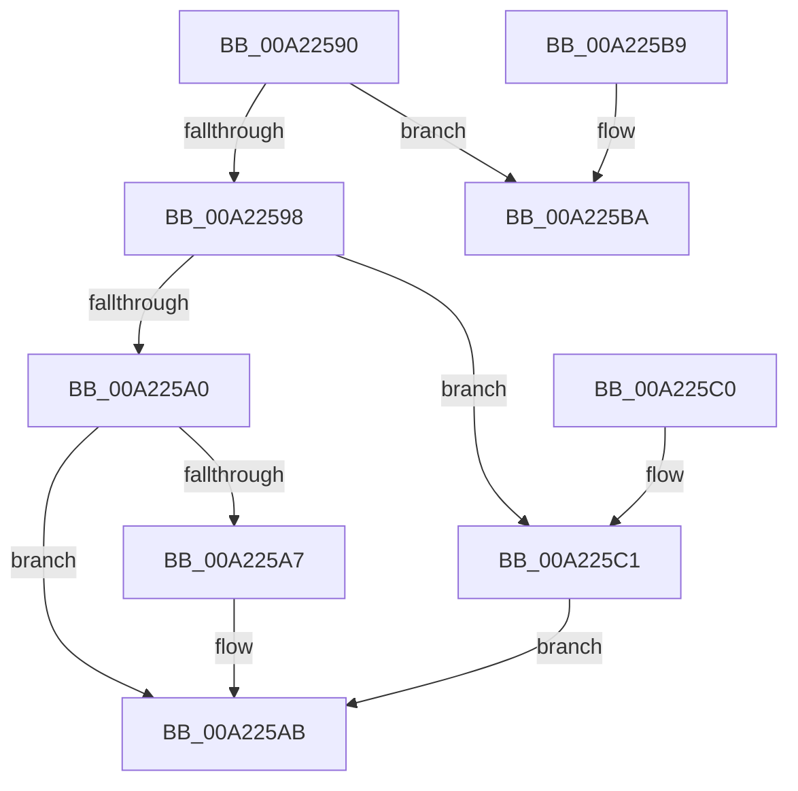

# RtlGetOwnerSecurityDescriptor

- RVA: `0x00A22590`–`0x00A225C7` (길이 `55` bytes)
- VA: `0x0000000140A22590`
- 실행 섹션: `PAGE`
- PDB 이름 있음: `예`; PDB Function 태그: `아니요`
- unwind 정보 RVA: `0x000DB714`
- 디코드: `22`개 명령, `55/55` bytes 표시
- 미해석 바이트: `0` (있으면 어셈블리에 `.byte`로 보존)

> 이 문서는 커널 이미지의 기계어와 PDB 기호를 분석해 생성했습니다. 4번과 5번은 함수 원형과 자료형을 바이너리 사용 방식에서 추정한 C 해석이며 원본 소스 복구 결과는 아닙니다.

## 1. Dependencies

- 직접 호출 지점: **0**; 고유 호출 대상: **0**
- 직접 호출자로 확인된 함수: **3**
- RIP 상대 이미지 참조: **0**

### Outgoing calls
- 직접 디코드된 call 명령이 없습니다.

### Direct callers
- [RtlReplaceSidInSd](../78/RtlReplaceSidInSd_function_0078E6E0.md) at `0x0078E735`
- [RtlpSysVolCheckOwnerAndSecurity](../79/RtlpSysVolCheckOwnerAndSecurity_function_00791324.md) at `0x00791412`
- [CmpCopySaclToVirtualKey](../7E/CmpCopySaclToVirtualKey_function_007ECA6C.md) at `0x007ECBAB`

### Static image references
- 디코드된 RIP-relative 메모리 참조가 없습니다.

## 2. Other-region calls and transfers

- 다른 실행 섹션으로 향하는 call: **0**
- 별도 외부 분기/꼬리 이동을 확인하지 못했습니다.

## 3. Assembly (complete function range)

```asm
00A22590  80 39 01                        cmp byte ptr [rcx], 1
00A22593  4C 8B CA                        mov r9, rdx
00A22596  75 22                           jne 0x140a225ba
00A22598  33 C0                           xor eax, eax
00A2259A  66 39 41 02                     cmp word ptr [rcx + 2], ax
00A2259E  7D 21                           jge 0x140a225c1
00A225A0  8B 51 04                        mov edx, dword ptr [rcx + 4]
00A225A3  85 D2                           test edx, edx
00A225A5  74 04                           je 0x140a225ab
00A225A7  48 8D 04 11                     lea rax, [rcx + rdx]
00A225AB  49 89 01                        mov qword ptr [r9], rax
00A225AE  8A 41 02                        mov al, byte ptr [rcx + 2]
00A225B1  24 01                           and al, 1
00A225B3  41 88 00                        mov byte ptr [r8], al
00A225B6  33 C0                           xor eax, eax
00A225B8  C3                              ret
00A225B9  CC                              int3
00A225BA  B8 58 00 00 C0                  mov eax, 0xc0000058
00A225BF  C3                              ret
00A225C0  CC                              int3
00A225C1  48 8B 41 08                     mov rax, qword ptr [rcx + 8]
00A225C5  EB E4                           jmp 0x140a225ab
```

## 4. C-style interpretation (structured pseudocode)

```c
__int64 __fastcall RtlGetOwnerSecurityDescriptor(__int64 a1, __int64 a2, __int64 a3)
{
    __int64 result;

    if ((*(unsigned __int8 *)(a1)) != 1) goto loc_00A225BA;
    result = 0;
    if ((*(unsigned __int16 *)(a1 + 2)) >= 0) goto loc_00A225C1;
    if ((unsigned int)((unsigned int)(*(unsigned int *)(a1 + 4))) != 0) {
        result = a1 + (unsigned int)(*(unsigned int *)(a1 + 4)) * 1;
    }
    *(unsigned __int64 *)(a2) = result;
    result = (unsigned __int8)((*(unsigned __int8 *)(a1 + 2)) & (1));
    *(unsigned __int8 *)(a3) = (unsigned __int8)(result);
    result = 0;
    return result;
loc_00A225BA:
    return (unsigned int)(0xC0000058ULL);
loc_00A225C1:
    goto loc_00A225AB;
}
```

## 5. (Beta) C Style

```c
int64_t RtlGetOwnerSecurityDescriptor(void *Arg1, void *Arg2, void *Arg3)
{
    uint8_t *arg1 = (uint8_t *)Arg1;
    uint8_t *arg2 = (uint8_t *)Arg2;
    uint8_t *arg3 = (uint8_t *)Arg3;

    int64_t result;

    if ((*(uint8_t *)(arg1)) != 1) goto loc_00A225BA;
    result = 0;
    if ((*(uint16_t *)(arg1 + 0x2)) >= 0) goto loc_00A225C1;
    if ((uint32_t)((uint32_t)(*(uint32_t *)(arg1 + 0x4))) != 0) {
        result = Arg1 + (uint32_t)(*(uint32_t *)(arg1 + 0x4)) * 1;
    }
    *(uint64_t *)(arg2) = result;
    result = (uint8_t)((*(uint8_t *)(arg1 + 0x2)) & (1));
    *(uint8_t *)(arg3) = (uint8_t)(result);
    result = 0;
    return result;
loc_00A225BA:
    return (uint32_t)(0xC0000058ULL);
loc_00A225C1:
    goto loc_00A225AB;
}
```

### 관측된 메모리 오프셋

구조체 형식이 확인되지 않은 접근은 인자 기준의 오프셋으로만 기록했습니다.

| 기준 인자 | 오프셋 표현 | 폭 (bit) | 접근 |
|---|---:|---:|---|
| `Arg1` | `+ 0x0` | `8` | `R` |
| `Arg1` | `+ 0x0 + rdx*1` | `64` | `R` |
| `Arg1` | `+ 0x2` | `8` | `R` |
| `Arg1` | `+ 0x2` | `16` | `R` |
| `Arg1` | `+ 0x4` | `32` | `R` |
| `Arg1` | `+ 0x8` | `64` | `R` |
| `Arg2` | `+ 0x0` | `64` | `W` |
| `Arg3` | `+ 0x0` | `8` | `W` |

## 6. Execution-region graph

[열기: 2D/3D 그래프와 함수 탐색 컨트롤 패널](../../../control-panel.html?section=page&rva=0x00A22590&view=graph)

- 2D 그래프는 위에서 아래로 흐르고, 3D 그래프는 빈 공간을 드래그해 회전합니다. Shift+드래그는 이동, 휠은 확대·축소, 함수 노드 선택은 대상 보고서 이동입니다.

### Static fallback


