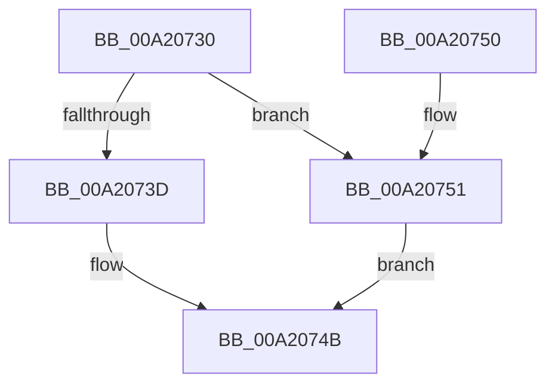

# RtlIsMultiSessionSku

- RVA: `0x00A20730`–`0x00A20762` (길이 `50` bytes)
- VA: `0x0000000140A20730`
- 실행 섹션: `PAGE`
- PDB 이름 있음: `예`; PDB Function 태그: `아니요`
- unwind 정보 RVA: `0x00063CEC`
- 디코드: `14`개 명령, `50/50` bytes 표시
- 미해석 바이트: `0` (있으면 어셈블리에 `.byte`로 보존)

> 이 문서는 커널 이미지의 기계어와 PDB 기호를 분석해 생성했습니다. 4번과 5번은 함수 원형과 자료형을 바이너리 사용 방식에서 추정한 C 해석이며 원본 소스 복구 결과는 아닙니다.

## 1. Dependencies

- 직접 호출 지점: **2**; 고유 호출 대상: **2**
- 직접 호출자로 확인된 함수: **9**
- RIP 상대 이미지 참조: **0**

### Outgoing calls
- `0x00A20734` → [PsIsCurrentThreadInServerSilo](../../text/43/PsIsCurrentThreadInServerSilo_function_004362E0.md) (function, `0x004362E0`)
- `0x00A20751` → [PsGetCurrentServerSiloGlobals](../../text/2F/PsGetCurrentServerSiloGlobals_function_002FE1F0.md) (function, `0x002FE1F0`)

### Direct callers
- [GetGlobalizationUserModelType](../../text/65/GetGlobalizationUserModelType_function_0065D088.md) at `0x0065D096`
- [PopAdaptiveStandbyInitialize](../76/PopAdaptiveStandbyInitialize_function_0076DDF8.md) at `0x0076DED8`
- [RtlCapabilityCheckForSingleSessionSku](../78/RtlCapabilityCheckForSingleSessionSku_function_0078E410.md) at `0x0078E43B`
- [NtSetSystemTime](../7C/NtSetSystemTime_function_007C65F0.md) at `0x007C667E`
- [AuthzBasepInitializeSystemSecurityAttributes](../82/AuthzBasepInitializeSystemSecurityAttributes_function_00821E08.md) at `0x00821E76`
- [RtlCapabilityCheck](RtlCapabilityCheck_function_00A20340.md) at `0x00A20408`
- [SepIsImpersonationAllowedDueToCapability](SepIsImpersonationAllowedDueToCapability_function_00A206CC.md) at `0x00A206FF`
- [PopPowerInformationInternal](../A8/PopPowerInformationInternal_function_00A8B7C0.md) at `0x00A8BB16`
- [NtSetDefaultLocale](../AA/NtSetDefaultLocale_function_00AAE850.md) at `0x00AAEA4A`

### Static image references
- 디코드된 RIP-relative 메모리 참조가 없습니다.

## 2. Other-region calls and transfers

- 다른 실행 섹션으로 향하는 call: **2**
  - `0x00A20734` → [PsIsCurrentThreadInServerSilo](../../text/43/PsIsCurrentThreadInServerSilo_function_004362E0.md) (`PAGE` → `.text`)
  - `0x00A20751` → [PsGetCurrentServerSiloGlobals](../../text/2F/PsGetCurrentServerSiloGlobals_function_002FE1F0.md) (`PAGE` → `.text`)
- 별도 외부 분기/꼬리 이동을 확인하지 못했습니다.

## 3. Assembly (complete function range)

```asm
00A20730  48 83 EC 28                     sub rsp, 0x28
00A20734  E8 A7 5B A1 FF                  call 0x1404362e0
00A20739  84 C0                           test al, al
00A2073B  75 14                           jne 0x140a20751
00A2073D  A1 F0 02 00 00 80 F7 FF FF      movabs eax, dword ptr [0xfffff780000002f0]
00A20746  C1 E8 08                        shr eax, 8
00A20749  24 01                           and al, 1
00A2074B  48 83 C4 28                     add rsp, 0x28
00A2074F  C3                              ret
00A20750  CC                              int3
00A20751  E8 9A DA 8D FF                  call 0x1402fe1f0
00A20756  48 8B 80 08 05 00 00            mov rax, qword ptr [rax + 0x508]
00A2075D  8A 40 1C                        mov al, byte ptr [rax + 0x1c]
00A20760  EB E9                           jmp 0x140a2074b
```

## 4. C-style interpretation (structured pseudocode)

```c
__int64 __fastcall RtlIsMultiSessionSku(void)
{
    __int64 result;
    __int64 v_rsp;

    v_rsp = (v_rsp) - (40);
    result = PsIsCurrentThreadInServerSilo(a1, a2, a3, a4);
    if ((unsigned __int8)(result) != 0) goto loc_00A20751;
    result = (unsigned int)((result) >> (8));
    result = (unsigned __int8)((result) & (1));
loc_00A2074B:
    v_rsp = (v_rsp) + (40);
    return result;
loc_00A20751:
    result = PsGetCurrentServerSiloGlobals(a1, a2, a3, a4);
    goto loc_00A2074B;
}
```

## 5. (Beta) C Style

```c
void RtlIsMultiSessionSku(void)
{
    int64_t result;
    int64_t local_rsp;

    local_rsp = (local_rsp) - (40);
    result = PsIsCurrentThreadInServerSilo(a1, a2, a3, a4);
    if ((uint8_t)(result) != 0) goto loc_00A20751;
    result = (uint32_t)((result) >> (8));
    result = (uint8_t)((result) & (1));
loc_00A2074B:
    local_rsp = (local_rsp) + (40);
    return result;
loc_00A20751:
    result = PsGetCurrentServerSiloGlobals(a1, a2, a3, a4);
    goto loc_00A2074B;
}
```

## 6. Execution-region graph

[열기: 2D/3D 그래프와 함수 탐색 컨트롤 패널](../../../control-panel.html?section=page&rva=0x00A20730&view=graph)

- 2D 그래프는 위에서 아래로 흐르고, 3D 그래프는 빈 공간을 드래그해 회전합니다. Shift+드래그는 이동, 휠은 확대·축소, 함수 노드 선택은 대상 보고서 이동입니다.

### Static fallback


