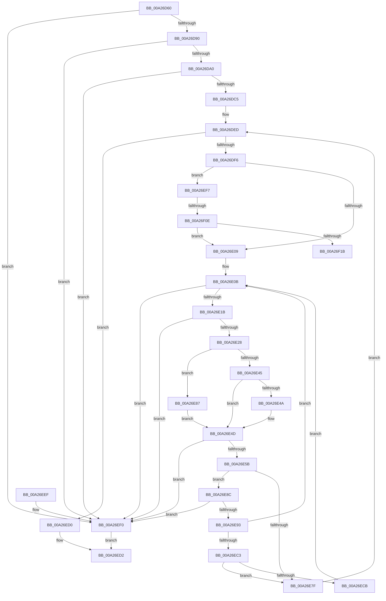

# RtlMarkExceptionHandlingPages

- RVA: `0x00A26D60`–`0x00A26F20` (길이 `448` bytes)
- VA: `0x0000000140A26D60`
- 실행 섹션: `PAGE`
- PDB 이름 있음: `예`; PDB Function 태그: `예`
- unwind 정보 RVA: `0x000ABE9C`
- 디코드: `125`개 명령, `448/448` bytes 표시
- 미해석 바이트: `0` (있으면 어셈블리에 `.byte`로 보존)

> 이 문서는 커널 이미지의 기계어와 PDB 기호를 분석해 생성했습니다. 4번과 5번은 함수 원형과 자료형을 바이너리 사용 방식에서 추정한 C 해석이며 원본 소스 복구 결과는 아닙니다.

## 1. Dependencies

- 직접 호출 지점: **4**; 고유 호출 대상: **3**
- 직접 호출자로 확인된 함수: **1**
- RIP 상대 이미지 참조: **0**

### Outgoing calls
- `0x00A26DE5` → [RtlSetBits](../../text/3E/RtlSetBits_function_003E1610.md) (function, `0x003E1610`)
- `0x00A26E75` → [RtlSetBits](../../text/3E/RtlSetBits_function_003E1610.md) (function, `0x003E1610`)
- `0x00A26EB5` → [RtlpSearchFunctionTable](../../text/3D/RtlpSearchFunctionTable_function_003D49F0.md) (function, `0x003D49F0`)
- `0x00A26EFD` → [RtlpConvertFunctionEntry](../../text/41/RtlpConvertFunctionEntry_function_00416CA0.md) (function, `0x00416CA0`)

### Direct callers
- [MiCaptureImageExceptionValues](../AA/MiCaptureImageExceptionValues_function_00AAA890.md) at `0x00AAA90F`

### Static image references
- 디코드된 RIP-relative 메모리 참조가 없습니다.

## 2. Other-region calls and transfers

- 다른 실행 섹션으로 향하는 call: **4**
  - `0x00A26DE5` → [RtlSetBits](../../text/3E/RtlSetBits_function_003E1610.md) (`PAGE` → `.text`)
  - `0x00A26E75` → [RtlSetBits](../../text/3E/RtlSetBits_function_003E1610.md) (`PAGE` → `.text`)
  - `0x00A26EB5` → [RtlpSearchFunctionTable](../../text/3D/RtlpSearchFunctionTable_function_003D49F0.md) (`PAGE` → `.text`)
  - `0x00A26EFD` → [RtlpConvertFunctionEntry](../../text/41/RtlpConvertFunctionEntry_function_00416CA0.md) (`PAGE` → `.text`)
- call이 아닌 외부 분기/꼬리 이동: **2**
  - `0x00A26F08` → [sub_00B37EB8](../B3/Unknown_function_00B37EB8.md) (`tail-transfer`)
  - `0x00A26F1B` → [sub_00B37EB8](../B3/Unknown_function_00B37EB8.md) (`tail-transfer`)

## 3. Assembly (complete function range)

```asm
00A26D60  48 89 5C 24 10                  mov qword ptr [rsp + 0x10], rbx
00A26D65  48 89 6C 24 18                  mov qword ptr [rsp + 0x18], rbp
00A26D6A  48 89 74 24 20                  mov qword ptr [rsp + 0x20], rsi
00A26D6F  57                              push rdi
00A26D70  41 54                           push r12
00A26D72  41 55                           push r13
00A26D74  41 56                           push r14
00A26D76  41 57                           push r15
00A26D78  48 83 EC 20                     sub rsp, 0x20
00A26D7C  8B F2                           mov esi, edx
00A26D7E  4D 8B F0                        mov r14, r8
00A26D81  48 03 F1                        add rsi, rcx
00A26D84  48 8B F9                        mov rdi, rcx
00A26D87  4C 3B C1                        cmp r8, rcx
00A26D8A  0F 82 60 01 00 00               jb 0x140a26ef0
00A26D90  45 8B C9                        mov r9d, r9d
00A26D93  4F 8D 2C 01                     lea r13, [r9 + r8]
00A26D97  4C 3B EE                        cmp r13, rsi
00A26D9A  0F 87 50 01 00 00               ja 0x140a26ef0
00A26DA0  48 B8 AB AA AA AA AA AA AA AA   movabs rax, 0xaaaaaaaaaaaaaaab
00A26DAA  49 F7 E1                        mul r9
00A26DAD  4C 8B FA                        mov r15, rdx
00A26DB0  49 C1 EF 03                     shr r15, 3
00A26DB4  4B 8D 0C 7F                     lea rcx, [r15 + r15*2]
00A26DB8  48 C1 E1 02                     shl rcx, 2
00A26DBC  4C 3B C9                        cmp r9, rcx
00A26DBF  0F 85 2B 01 00 00               jne 0x140a26ef0
00A26DC5  48 8B 4C 24 70                  mov rcx, qword ptr [rsp + 0x70]
00A26DCA  49 8B D0                        mov rdx, r8
00A26DCD  48 2B D7                        sub rdx, rdi
00A26DD0  4D 8D 81 FF 0F 00 00            lea r8, [r9 + 0xfff]
00A26DD7  4C 03 C2                        add r8, rdx
00A26DDA  48 C1 EA 0C                     shr rdx, 0xc
00A26DDE  49 C1 E8 0C                     shr r8, 0xc
00A26DE2  44 2B C2                        sub r8d, edx
00A26DE5  E8 26 A8 9B FF                  call 0x1403e1610
00A26DEA  45 33 E4                        xor r12d, r12d
00A26DED  45 3B E7                        cmp r12d, r15d
00A26DF0  0F 83 DA 00 00 00               jae 0x140a26ed0
00A26DF6  4B 8D 0C 64                     lea rcx, [r12 + r12*2]
00A26DFA  49 8D 1C 8E                     lea rbx, [r14 + rcx*4]
00A26DFE  8B 43 08                        mov eax, dword ptr [rbx + 8]
00A26E01  A8 01                           test al, 1
00A26E03  0F 85 EE 00 00 00               jne 0x140a26ef7
00A26E09  33 ED                           xor ebp, ebp
00A26E0B  8B 53 08                        mov edx, dword ptr [rbx + 8]
00A26E0E  48 8D 1C 3A                     lea rbx, [rdx + rdi]
00A26E12  48 3B DF                        cmp rbx, rdi
00A26E15  0F 82 D5 00 00 00               jb 0x140a26ef0
00A26E1B  48 8D 43 06                     lea rax, [rbx + 6]
00A26E1F  48 3B C6                        cmp rax, rsi
00A26E22  0F 87 C8 00 00 00               ja 0x140a26ef0
00A26E28  0F B6 43 02                     movzx eax, byte ptr [rbx + 2]
00A26E2C  A8 01                           test al, 1
00A26E2E  8D 0C 45 06 00 00 00            lea ecx, [rax*2 + 6]
00A26E35  8D 41 02                        lea eax, [rcx + 2]
00A26E38  0F 44 C1                        cmove eax, ecx
00A26E3B  8A 0B                           mov cl, byte ptr [rbx]
00A26E3D  C0 E9 03                        shr cl, 3
00A26E40  F6 C1 04                        test cl, 4
00A26E43  75 42                           jne 0x140a26e87
00A26E45  F6 C1 03                        test cl, 3
00A26E48  74 03                           je 0x140a26e4d
00A26E4A  83 C0 08                        add eax, 8
00A26E4D  8B C8                           mov ecx, eax
00A26E4F  48 03 C3                        add rax, rbx
00A26E52  48 3B C6                        cmp rax, rsi
00A26E55  0F 87 95 00 00 00               ja 0x140a26ef0
00A26E5B  4C 8D 81 FF 0F 00 00            lea r8, [rcx + 0xfff]
00A26E62  48 8B 4C 24 70                  mov rcx, qword ptr [rsp + 0x70]
00A26E67  4C 03 C2                        add r8, rdx
00A26E6A  48 C1 EA 0C                     shr rdx, 0xc
00A26E6E  49 C1 E8 0C                     shr r8, 0xc
00A26E72  44 2B C2                        sub r8d, edx
00A26E75  E8 96 A7 9B FF                  call 0x1403e1610
00A26E7A  F6 03 20                        test byte ptr [rbx], 0x20
00A26E7D  75 0D                           jne 0x140a26e8c
00A26E7F  41 FF C4                        inc r12d
00A26E82  E9 66 FF FF FF                  jmp 0x140a26ded
00A26E87  83 C0 0C                        add eax, 0xc
00A26E8A  EB C1                           jmp 0x140a26e4d
00A26E8C  FF C5                           inc ebp
00A26E8E  83 FD 20                        cmp ebp, 0x20
00A26E91  77 5D                           ja 0x140a26ef0
00A26E93  0F B6 43 02                     movzx eax, byte ptr [rbx + 2]
00A26E97  4C 8B CF                        mov r9, rdi
00A26E9A  48 FF C0                        inc rax
00A26E9D  41 8B D7                        mov edx, r15d
00A26EA0  48 83 E0 FE                     and rax, 0xfffffffffffffffe
00A26EA4  49 8B CE                        mov rcx, r14
00A26EA7  48 8D 1C 43                     lea rbx, [rbx + rax*2]
00A26EAB  48 83 C3 04                     add rbx, 4
00A26EAF  44 8B 03                        mov r8d, dword ptr [rbx]
00A26EB2  4C 03 C7                        add r8, rdi
00A26EB5  E8 36 DB 9A FF                  call 0x1403d49f0
00A26EBA  48 85 C0                        test rax, rax
00A26EBD  0F 84 48 FF FF FF               je 0x140a26e0b
00A26EC3  8B 4B 08                        mov ecx, dword ptr [rbx + 8]
00A26EC6  39 48 08                        cmp dword ptr [rax + 8], ecx
00A26EC9  74 B4                           je 0x140a26e7f
00A26ECB  E9 3B FF FF FF                  jmp 0x140a26e0b
00A26ED0  33 C0                           xor eax, eax
00A26ED2  48 8B 5C 24 58                  mov rbx, qword ptr [rsp + 0x58]
00A26ED7  48 8B 6C 24 60                  mov rbp, qword ptr [rsp + 0x60]
00A26EDC  48 8B 74 24 68                  mov rsi, qword ptr [rsp + 0x68]
00A26EE1  48 83 C4 20                     add rsp, 0x20
00A26EE5  41 5F                           pop r15
00A26EE7  41 5E                           pop r14
00A26EE9  41 5D                           pop r13
00A26EEB  41 5C                           pop r12
00A26EED  5F                              pop rdi
00A26EEE  C3                              ret
00A26EEF  CC                              int3
00A26EF0  B8 FF 00 00 C0                  mov eax, 0xc00000ff
00A26EF5  EB DB                           jmp 0x140a26ed2
00A26EF7  48 8B D7                        mov rdx, rdi
00A26EFA  48 8B CB                        mov rcx, rbx
00A26EFD  E8 9E FD 9E FF                  call 0x140416ca0
00A26F02  48 8B D8                        mov rbx, rax
00A26F05  49 3B C6                        cmp rax, r14
00A26F08  0F 82 AA 0F 11 00               jb 0x140b37eb8
00A26F0E  48 83 C0 0C                     add rax, 0xc
00A26F12  49 3B C5                        cmp rax, r13
00A26F15  0F 86 EE FE FF FF               jbe 0x140a26e09
00A26F1B  E9 98 0F 11 00                  jmp 0x140b37eb8
```

## 4. C-style interpretation (structured pseudocode)

```c
__int64 __fastcall RtlMarkExceptionHandlingPages(__int64 a1, __int64 a2, __int64 a3, int a4, __int64 a5)
{
    __int64 result;
    __int64 v_r12;
    __int64 v_r15;
    __int64 v_rbp;
    __int64 v_rbx;
    __int64 v_rsi;
    __int64 v_rsp;
    unsigned __int64 v_stack_p10;
    unsigned __int64 v_stack_p18;
    unsigned __int64 v_stack_p20;

    v_stack_p10 = v_rbx;
    v_stack_p18 = v_rbp;
    v_stack_p20 = v_rsi;
    v_rsp = (v_rsp) - (32);
    v_rsi = ((unsigned int)((unsigned int)(a2))) + (a1);
    if (a3 < a1) goto loc_00A26EF0;
    if (((unsigned int)(a4) + a3 * 1) > v_rsi) goto loc_00A26EF0;
    v_r15 = (a2) >> (3);
    a1 = (v_r15 + v_r15 * 2) << (2);
    if (((unsigned int)(a4)) != a1) goto loc_00A26EF0;
    a2 = (a3) - (a1);
    a3 = ((unsigned int)(a4) + 4095) + (a2);
    a2 = (a2) >> (12);
    a3 = (a3) >> (12);
    a3 = (unsigned int)((a3) - ((unsigned int)(a2)));
    result = RtlSetBits(a5, a2, a3, (unsigned int)(a4));
    v_r12 = 0;
loc_00A26DED:
    if (0 >= ((unsigned int)(v_r15))) goto loc_00A26ED0;
    if ((((unsigned __int8)((unsigned int)(*(unsigned int *)(a3 + v_r12 + v_r12 * 2 * 4 + 8)))) & (1)) != 0) goto loc_00A26EF7;
loc_00A26E09:
    v_rbp = 0;
loc_00A26E0B:
    if (((unsigned int)(*(unsigned int *)(a3 + v_r12 + v_r12 * 2 * 4 + 8)) + a1 * 1) < a1) goto loc_00A26EF0;
    if (((unsigned int)(*(unsigned int *)(a3 + v_r12 + v_r12 * 2 * 4 + 8)) + a1 * 1 + 6) > v_rsi) goto loc_00A26EF0;
    result = *(unsigned __int8 *)((unsigned int)(*(unsigned int *)(a3 + v_r12 + v_r12 * 2 * 4 + 8)) + a1 * 1 + 2) * 2 + 6 + 2;
    if ((((unsigned __int8)(*(unsigned __int8 *)((unsigned int)(*(unsigned int *)(a3 + v_r12 + v_r12 * 2 * 4 + 8)) + a1 * 1 + 2))) & (1)) == 0) { result = (unsigned int)(*(unsigned __int8 *)((unsigned int)(*(unsigned int *)(a3 + v_r12 + v_r12 * 2 * 4 + 8)) + a1 * 1 + 2) * 2 + 6); }
    a1 = (unsigned __int8)((*(unsigned __int8 *)((unsigned int)(*(unsigned int *)(a3 + v_r12 + v_r12 * 2 * 4 + 8)) + a1 * 1)) >> (3));
    if ((((unsigned __int8)(a1)) & (4)) != 0) goto loc_00A26E87;
    if ((((unsigned __int8)(a1)) & (3)) != 0) {
        result = (unsigned int)((result) + (8));
    }
    result = (result) + ((unsigned int)(*(unsigned int *)(a3 + v_r12 + v_r12 * 2 * 4 + 8)) + a1 * 1);
    if (result > v_rsi) goto loc_00A26EF0;
    a3 = ((unsigned int)((unsigned int)(result)) + 4095) + ((unsigned int)(*(unsigned int *)(a3 + v_r12 + v_r12 * 2 * 4 + 8)));
    a2 = ((unsigned int)(*(unsigned int *)(a3 + v_r12 + v_r12 * 2 * 4 + 8))) >> (12);
    a3 = (a3) >> (12);
    a3 = (unsigned int)((a3) - ((unsigned int)(a2)));
    result = RtlSetBits(a5, a2, a3, (unsigned int)(a4));
    if (((*(unsigned __int8 *)((unsigned int)(*(unsigned int *)(a3 + v_r12 + v_r12 * 2 * 4 + 8)) + a1 * 1)) & (32)) != 0) goto loc_00A26E8C;
loc_00A26E7F:
    v_r12 = (unsigned int)((v_r12) + 1);
    goto loc_00A26DED;
loc_00A26E87:
    result = (unsigned int)((result) + (12));
    goto loc_00A26E4D;
loc_00A26E8C:
    v_rbp = (unsigned int)((v_rbp) + 1);
    if (((unsigned int)(v_rbp)) > 32) goto loc_00A26EF0;
    result = (*(unsigned __int8 *)((unsigned int)(*(unsigned int *)(a3 + v_r12 + v_r12 * 2 * 4 + 8)) + a1 * 1 + 2)) + 1;
    result = (result) & (-2);
    v_rbx = ((unsigned int)(*(unsigned int *)(a3 + v_r12 + v_r12 * 2 * 4 + 8)) + a1 * 1 + result * 2) + (4);
    a3 = ((unsigned int)(*(unsigned int *)(v_rbx))) + (a1);
    result = RtlpSearchFunctionTable(a3, (unsigned int)((unsigned int)(v_r15)), a3, a1);
    if (result == 0) goto loc_00A26E0B;
    if ((*(unsigned int *)(result + 8)) == ((unsigned int)((unsigned int)(*(unsigned int *)(v_rbx + 8))))) goto loc_00A26E7F;
    goto loc_00A26E0B;
loc_00A26ED0:
    result = 0;
loc_00A26ED2:
    v_rsp = (v_rsp) + (32);
    return result;
loc_00A26EF0:
    goto loc_00A26ED2;
loc_00A26EF7:
    result = RtlpConvertFunctionEntry(v_stack_p10, a1, a3, a1);
    result = (result) + (12);
    if (result <= ((unsigned int)(a4) + a3 * 1)) goto loc_00A26E09;
}
```

## 5. (Beta) C Style

```c
int64_t RtlMarkExceptionHandlingPages(int64_t Arg1, int64_t Arg2, void *Arg3, void *Arg4, int64_t Arg5)
{
    uint8_t *arg3 = (uint8_t *)Arg3;
    uint8_t *arg4 = (uint8_t *)Arg4;

    int64_t result;
    int64_t local_r12;
    int64_t local_r15;
    int64_t local_rbp;
    int64_t local_rbx;
    int64_t local_rsi;
    int64_t local_rsp;
    uint64_t v_stack_p10;
    uint64_t v_stack_p18;
    uint64_t v_stack_p20;

    v_stack_p10 = local_rbx;
    v_stack_p18 = local_rbp;
    v_stack_p20 = local_rsi;
    local_rsp = (local_rsp) - (32);
    local_rsi = ((uint32_t)((uint32_t)(Arg2))) + (Arg1);
    if (Arg3 < Arg1) goto loc_00A26EF0;
    if (((uint32_t)(Arg4) + Arg3 * 1) > local_rsi) goto loc_00A26EF0;
    local_r15 = (Arg2) >> (3);
    Arg1 = (local_r15 + local_r15 * 2) << (2);
    if (((uint32_t)(Arg4)) != Arg1) goto loc_00A26EF0;
    Arg2 = (Arg3) - (Arg1);
    Arg3 = ((uint32_t)(Arg4) + 4095) + (Arg2);
    Arg2 = (Arg2) >> (12);
    Arg3 = (Arg3) >> (12);
    Arg3 = (uint32_t)((Arg3) - ((uint32_t)(Arg2)));
    result = RtlSetBits(Arg5, Arg2, Arg3, (uint32_t)(Arg4));
    local_r12 = 0;
loc_00A26DED:
    if (0 >= ((uint32_t)(local_r15))) goto loc_00A26ED0;
    if ((((uint8_t)((uint32_t)(*(uint32_t *)(arg3 + local_r12 + local_r12 * 2 * 4 + 0x8)))) & (1)) != 0) goto loc_00A26EF7;
loc_00A26E09:
    local_rbp = 0;
loc_00A26E0B:
    if (((uint32_t)(*(uint32_t *)(arg3 + local_r12 + local_r12 * 2 * 4 + 0x8)) + Arg1 * 1) < Arg1) goto loc_00A26EF0;
    if (((uint32_t)(*(uint32_t *)(arg3 + local_r12 + local_r12 * 2 * 4 + 0x8)) + Arg1 * 1 + 6) > local_rsi) goto loc_00A26EF0;
    result = *(uint8_t *)((uint32_t)(*(uint32_t *)(arg3 + local_r12 + local_r12 * 2 * 4 + 0x8)) + Arg1 * 1 + 0x2) * 2 + 6 + 2;
    if ((((uint8_t)(*(uint8_t *)((uint32_t)(*(uint32_t *)(arg3 + local_r12 + local_r12 * 2 * 4 + 0x8)) + Arg1 * 1 + 0x2))) & (1)) == 0) { result = (uint32_t)(*(uint8_t *)((uint32_t)(*(uint32_t *)(arg3 + local_r12 + local_r12 * 2 * 4 + 0x8)) + Arg1 * 1 + 0x2) * 2 + 6); }
    Arg1 = (uint8_t)((*(uint8_t *)((uint32_t)(*(uint32_t *)(arg3 + local_r12 + local_r12 * 2 * 4 + 0x8)) + Arg1 * 1)) >> (3));
    if ((((uint8_t)(Arg1)) & (4)) != 0) goto loc_00A26E87;
    if ((((uint8_t)(Arg1)) & (3)) != 0) {
        result = (uint32_t)((result) + (8));
    }
    result = (result) + ((uint32_t)(*(uint32_t *)(arg3 + local_r12 + local_r12 * 2 * 4 + 0x8)) + Arg1 * 1);
    if (result > local_rsi) goto loc_00A26EF0;
    Arg3 = ((uint32_t)((uint32_t)(result)) + 4095) + ((uint32_t)(*(uint32_t *)(arg3 + local_r12 + local_r12 * 2 * 4 + 0x8)));
    Arg2 = ((uint32_t)(*(uint32_t *)(arg3 + local_r12 + local_r12 * 2 * 4 + 0x8))) >> (12);
    Arg3 = (Arg3) >> (12);
    Arg3 = (uint32_t)((Arg3) - ((uint32_t)(Arg2)));
    result = RtlSetBits(Arg5, Arg2, Arg3, (uint32_t)(Arg4));
    if (((*(uint8_t *)((uint32_t)(*(uint32_t *)(arg3 + local_r12 + local_r12 * 2 * 4 + 0x8)) + Arg1 * 1)) & (32)) != 0) goto loc_00A26E8C;
loc_00A26E7F:
    local_r12 = (uint32_t)((local_r12) + 1);
    goto loc_00A26DED;
loc_00A26E87:
    result = (uint32_t)((result) + (12));
    goto loc_00A26E4D;
loc_00A26E8C:
    local_rbp = (uint32_t)((local_rbp) + 1);
    if (((uint32_t)(local_rbp)) > 32) goto loc_00A26EF0;
    result = (*(uint8_t *)((uint32_t)(*(uint32_t *)(arg3 + local_r12 + local_r12 * 2 * 4 + 0x8)) + Arg1 * 1 + 0x2)) + 1;
    result = (result) & (-2);
    local_rbx = ((uint32_t)(*(uint32_t *)(arg3 + local_r12 + local_r12 * 2 * 4 + 0x8)) + Arg1 * 1 + result * 2) + (4);
    Arg3 = ((uint32_t)(*(uint32_t *)(local_rbx))) + (Arg1);
    result = RtlpSearchFunctionTable(Arg3, (uint32_t)((uint32_t)(local_r15)), Arg3, Arg1);
    if (result == 0) goto loc_00A26E0B;
    if ((*(uint32_t *)(result + 0x8)) == ((uint32_t)((uint32_t)(*(uint32_t *)(local_rbx + 0x8))))) goto loc_00A26E7F;
    goto loc_00A26E0B;
loc_00A26ED0:
    result = 0;
loc_00A26ED2:
    local_rsp = (local_rsp) + (32);
    return result;
loc_00A26EF0:
    goto loc_00A26ED2;
loc_00A26EF7:
    result = RtlpConvertFunctionEntry(v_stack_p10, Arg1, Arg3, Arg1);
    result = (result) + (12);
    if (result <= ((uint32_t)(Arg4) + Arg3 * 1)) goto loc_00A26E09;
}
```

### 관측된 메모리 오프셋

구조체 형식이 확인되지 않은 접근은 인자 기준의 오프셋으로만 기록했습니다.

| 기준 인자 | 오프셋 표현 | 폭 (bit) | 접근 |
|---|---:|---:|---|
| `Arg3` | `+ 0x0 + rcx*4` | `64` | `R` |
| `Arg3` | `+ 0x8` | `32` | `R` |
| `Arg4` | `+ 0x0 + r8*1` | `64` | `R` |

## 6. Execution-region graph

[열기: 2D/3D 그래프와 함수 탐색 컨트롤 패널](../../../control-panel.html?section=page&rva=0x00A26D60&view=graph)

- 2D 그래프는 위에서 아래로 흐르고, 3D 그래프는 빈 공간을 드래그해 회전합니다. Shift+드래그는 이동, 휠은 확대·축소, 함수 노드 선택은 대상 보고서 이동입니다.

### Static fallback


