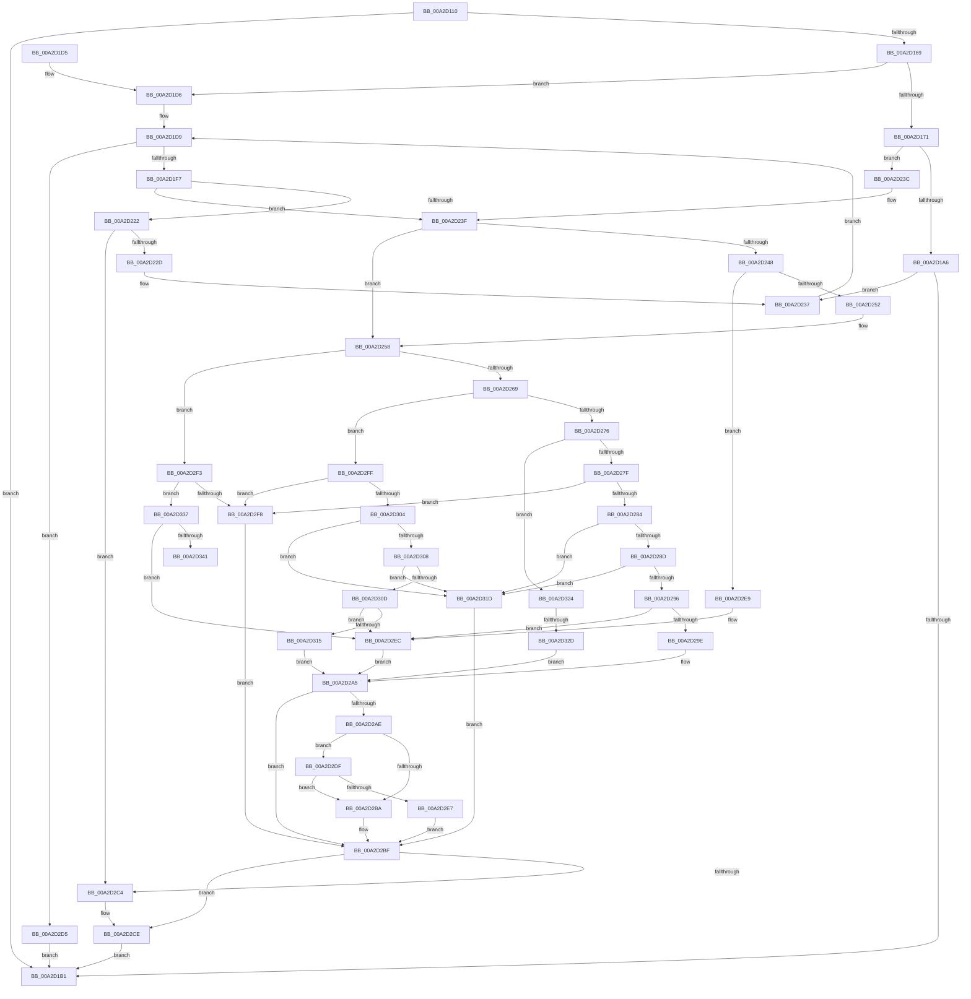

# RtlQueryImageFileKeyOption

- RVA: `0x00A2D110`–`0x00A2D346` (길이 `566` bytes)
- VA: `0x0000000140A2D110`
- 실행 섹션: `PAGE`
- PDB 이름 있음: `예`; PDB Function 태그: `예`
- unwind 정보 RVA: `0x000AC748`
- 디코드: `167`개 명령, `566/566` bytes 표시
- 미해석 바이트: `0` (있으면 어셈블리에 `.byte`로 보존)

> 이 문서는 커널 이미지의 기계어와 PDB 기호를 분석해 생성했습니다. 4번과 5번은 함수 원형과 자료형을 바이너리 사용 방식에서 추정한 C 해석이며 원본 소스 복구 결과는 아닙니다.

## 1. Dependencies

- 직접 호출 지점: **7**; 고유 호출 대상: **5**
- 직접 호출자로 확인된 함수: **10**
- RIP 상대 이미지 참조: **1**

### Outgoing calls
- `0x00A2D160` → [RtlInitUnicodeStringEx](../../text/46/RtlInitUnicodeStringEx_function_00463960.md) (function, `0x00463960`)
- `0x00A2D197` → [ZwQueryValueKey](../../text/6A/ZwQueryValueKey_function_006AD3B0.md) (function, `0x006AD3B0`)
- `0x00A2D1B8` → [_security_check_cookie](../../text/6A/_security_check_cookie_function_006AC640.md) (function, `0x006AC640`)
- `0x00A2D1E6` → [ExAllocatePool2](../../poolcode/B8/ExAllocatePool2_function_00B820F0.md) (function, `0x00B820F0`)
- `0x00A2D217` → [ZwQueryValueKey](../../text/6A/ZwQueryValueKey_function_006AD3B0.md) (function, `0x006AD3B0`)
- `0x00A2D232` → [ExFreePoolWithTag](../../poolcode/B8/ExFreePoolWithTag_function_00B82870.md) (function, `0x00B82870`)
- `0x00A2D2C9` → [ExFreePoolWithTag](../../poolcode/B8/ExFreePoolWithTag_function_00B82870.md) (function, `0x00B82870`)

### Direct callers
- [KiInitializeNormalPriorityAntiStarvationPolicies](../../text/5B/KiInitializeNormalPriorityAntiStarvationPolicies_function_005B8178.md) at `0x005B820D`
- [KiInitializeNormalPriorityAntiStarvationPolicies](../../text/5B/KiInitializeNormalPriorityAntiStarvationPolicies_function_005B8178.md) at `0x005B825B`
- [KiInitializeNormalPriorityAntiStarvationPolicies](../../text/5B/KiInitializeNormalPriorityAntiStarvationPolicies_function_005B8178.md) at `0x005B82A9`
- [KiInitializeNormalPriorityAntiStarvationPolicies](../../text/5B/KiInitializeNormalPriorityAntiStarvationPolicies_function_005B8178.md) at `0x005B82F7`
- [PspReadDfssConfigurationValues](../../text/5E/PspReadDfssConfigurationValues_function_005E2508.md) at `0x005E25AF`
- [PspIsDfssEnabled](../77/PspIsDfssEnabled_function_0077EFF4.md) at `0x0077F084`
- [PspReadIFEOPerfOptions](../78/PspReadIFEOPerfOptions_function_007845F0.md) at `0x00784625`
- [PspReadIFEOPerfOptions](../78/PspReadIFEOPerfOptions_function_007845F0.md) at `0x0078464C`
- [PspReadIFEOPerfOptions](../78/PspReadIFEOPerfOptions_function_007845F0.md) at `0x00784673`
- [PspReadIFEOPerfOptions](../78/PspReadIFEOPerfOptions_function_007845F0.md) at `0x0078469A`
- [PspReadIFEOPerfOptions](../78/PspReadIFEOPerfOptions_function_007845F0.md) at `0x007846CE`
- [RtlQueryImageFileExecutionOptions](../78/RtlQueryImageFileExecutionOptions_function_0078B090.md) at `0x0078B0DA`
- [SepCheckAndSetAuditModeForProcess](../A1/SepCheckAndSetAuditModeForProcess_function_00A134FC.md) at `0x00A13568`
- [PspAllocateProcess](../A1/PspAllocateProcess_function_00A13B3C.md) at `0x00A14658`
- [PspAllocateProcess](../A1/PspAllocateProcess_function_00A13B3C.md) at `0x00A146A6`
- [PspAllocateProcess](../A1/PspAllocateProcess_function_00A13B3C.md) at `0x00A146F2`
- [PspAllocateProcess](../A1/PspAllocateProcess_function_00A13B3C.md) at `0x00A147BC`
- [PspAllocateProcess](../A1/PspAllocateProcess_function_00A13B3C.md) at `0x00A14842`
- [PspAllocateProcess](../A1/PspAllocateProcess_function_00A13B3C.md) at `0x00A14882`
- [PspAllocateProcess](../A1/PspAllocateProcess_function_00A13B3C.md) at `0x00A14900`
- [PspAllocateProcess](../A1/PspAllocateProcess_function_00A13B3C.md) at `0x00A149D6`
- [PspReadIFEONodeOptions](PspReadIFEONodeOptions_function_00A2CEB8.md) at `0x00A2CEEF`
- [PspReadOptionsMapFromIFEO](PspReadOptionsMapFromIFEO_function_00A2D078.md) at `0x00A2D0CD`
- [PspQueryComPlusRunUnderWoW](../AB/PspQueryComPlusRunUnderWoW_function_00ABC8EC.md) at `0x00ABC960`

### Static image references
- `0x00A2D127` → RVA `0x00E0A740` (`.data`; read)

## 2. Other-region calls and transfers

- 다른 실행 섹션으로 향하는 call: **7**
  - `0x00A2D160` → [RtlInitUnicodeStringEx](../../text/46/RtlInitUnicodeStringEx_function_00463960.md) (`PAGE` → `.text`)
  - `0x00A2D197` → [ZwQueryValueKey](../../text/6A/ZwQueryValueKey_function_006AD3B0.md) (`PAGE` → `.text`)
  - `0x00A2D1B8` → [_security_check_cookie](../../text/6A/_security_check_cookie_function_006AC640.md) (`PAGE` → `.text`)
  - `0x00A2D1E6` → [ExAllocatePool2](../../poolcode/B8/ExAllocatePool2_function_00B820F0.md) (`PAGE` → `POOLCODE`)
  - `0x00A2D217` → [ZwQueryValueKey](../../text/6A/ZwQueryValueKey_function_006AD3B0.md) (`PAGE` → `.text`)
  - `0x00A2D232` → [ExFreePoolWithTag](../../poolcode/B8/ExFreePoolWithTag_function_00B82870.md) (`PAGE` → `POOLCODE`)
  - `0x00A2D2C9` → [ExFreePoolWithTag](../../poolcode/B8/ExFreePoolWithTag_function_00B82870.md) (`PAGE` → `POOLCODE`)
- call이 아닌 외부 분기/꼬리 이동: **2**
  - `0x00A2D327` → [sub_00B393C0](../B3/Unknown_function_00B393C0.md) (`tail-transfer`)
  - `0x00A2D341` → [sub_00B393C0 + 0x5E](../B3/Unknown_function_00B393C0.md) (`tail-transfer`)

## 3. Assembly (complete function range)

```asm
00A2D110  48 89 5C 24 18                  mov qword ptr [rsp + 0x18], rbx
00A2D115  55                              push rbp
00A2D116  56                              push rsi
00A2D117  57                              push rdi
00A2D118  41 54                           push r12
00A2D11A  41 55                           push r13
00A2D11C  41 56                           push r14
00A2D11E  41 57                           push r15
00A2D120  48 8B EC                        mov rbp, rsp
00A2D123  48 83 EC 70                     sub rsp, 0x70
00A2D127  48 8B 05 12 D6 3D 00            mov rax, qword ptr [rip + 0x3dd612]
00A2D12E  48 33 C4                        xor rax, rsp
00A2D131  48 89 45 F8                     mov qword ptr [rbp - 8], rax
00A2D135  48 8B 45 68                     mov rax, qword ptr [rbp + 0x68]
00A2D139  4C 8B E9                        mov r13, rcx
00A2D13C  48 89 45 D8                     mov qword ptr [rbp - 0x28], rax
00A2D140  48 8D 4D C8                     lea rcx, [rbp - 0x38]
00A2D144  33 C0                           xor eax, eax
00A2D146  0F 57 C0                        xorps xmm0, xmm0
00A2D149  21 45 C0                        and dword ptr [rbp - 0x40], eax
00A2D14C  0F 57 C9                        xorps xmm1, xmm1
00A2D14F  89 45 F0                        mov dword ptr [rbp - 0x10], eax
00A2D152  4D 8B F1                        mov r14, r9
00A2D155  45 8B F8                        mov r15d, r8d
00A2D158  0F 11 45 C8                     movups xmmword ptr [rbp - 0x38], xmm0
00A2D15C  0F 11 4D E0                     movups xmmword ptr [rbp - 0x20], xmm1
00A2D160  E8 FB 67 A3 FF                  call 0x140463960
00A2D165  85 C0                           test eax, eax
00A2D167  78 48                           js 0x140a2d1b1
00A2D169  8B 75 60                        mov esi, dword ptr [rbp + 0x60]
00A2D16C  83 FE 08                        cmp esi, 8
00A2D16F  73 65                           jae 0x140a2d1d6
00A2D171  48 8D 45 C0                     lea rax, [rbp - 0x40]
00A2D175  41 B8 02 00 00 00               mov r8d, 2
00A2D17B  48 89 44 24 28                  mov qword ptr [rsp + 0x28], rax
00A2D180  4C 8D 4D E0                     lea r9, [rbp - 0x20]
00A2D184  48 8D 55 C8                     lea rdx, [rbp - 0x38]
00A2D188  C7 44 24 20 14 00 00 00         mov dword ptr [rsp + 0x20], 0x14
00A2D190  49 8B CD                        mov rcx, r13
00A2D193  48 8D 7D E0                     lea rdi, [rbp - 0x20]
00A2D197  E8 14 02 C8 FF                  call 0x1406ad3b0
00A2D19C  8B D8                           mov ebx, eax
00A2D19E  85 C0                           test eax, eax
00A2D1A0  0F 89 96 00 00 00               jns 0x140a2d23c
00A2D1A6  3D 05 00 00 80                  cmp eax, 0x80000005
00A2D1AB  0F 84 86 00 00 00               je 0x140a2d237
00A2D1B1  48 8B 4D F8                     mov rcx, qword ptr [rbp - 8]
00A2D1B5  48 33 CC                        xor rcx, rsp
00A2D1B8  E8 83 F4 C7 FF                  call 0x1406ac640
00A2D1BD  48 8B 9C 24 C0 00 00 00         mov rbx, qword ptr [rsp + 0xc0]
00A2D1C5  48 83 C4 70                     add rsp, 0x70
00A2D1C9  41 5F                           pop r15
00A2D1CB  41 5E                           pop r14
00A2D1CD  41 5D                           pop r13
00A2D1CF  41 5C                           pop r12
00A2D1D1  5F                              pop rdi
00A2D1D2  5E                              pop rsi
00A2D1D3  5D                              pop rbp
00A2D1D4  C3                              ret
00A2D1D5  CC                              int3
00A2D1D6  8D 5E 0C                        lea ebx, [rsi + 0xc]
00A2D1D9  8B D3                           mov edx, ebx
00A2D1DB  B9 41 00 00 00                  mov ecx, 0x41
00A2D1E0  41 B8 52 74 49 6B               mov r8d, 0x6b497452
00A2D1E6  E8 05 4F 15 00                  call 0x140b820f0
00A2D1EB  4C 8B E0                        mov r12, rax
00A2D1EE  48 85 C0                        test rax, rax
00A2D1F1  0F 84 DE 00 00 00               je 0x140a2d2d5
00A2D1F7  48 8B F8                        mov rdi, rax
00A2D1FA  48 8D 55 C8                     lea rdx, [rbp - 0x38]
00A2D1FE  48 8D 45 C0                     lea rax, [rbp - 0x40]
00A2D202  4C 8B CF                        mov r9, rdi
00A2D205  48 89 44 24 28                  mov qword ptr [rsp + 0x28], rax
00A2D20A  41 B8 02 00 00 00               mov r8d, 2
00A2D210  49 8B CD                        mov rcx, r13
00A2D213  89 5C 24 20                     mov dword ptr [rsp + 0x20], ebx
00A2D217  E8 94 01 C8 FF                  call 0x1406ad3b0
00A2D21C  8B D8                           mov ebx, eax
00A2D21E  85 C0                           test eax, eax
00A2D220  79 1D                           jns 0x140a2d23f
00A2D222  3D 05 00 00 80                  cmp eax, 0x80000005
00A2D227  0F 85 97 00 00 00               jne 0x140a2d2c4
00A2D22D  33 D2                           xor edx, edx
00A2D22F  48 8B CF                        mov rcx, rdi
00A2D232  E8 39 56 15 00                  call 0x140b82870
00A2D237  8B 5D C0                        mov ebx, dword ptr [rbp - 0x40]
00A2D23A  EB 9D                           jmp 0x140a2d1d9
00A2D23C  45 33 E4                        xor r12d, r12d
00A2D23F  48 8D 57 08                     lea rdx, [rdi + 8]
00A2D243  45 85 FF                        test r15d, r15d
00A2D246  75 10                           jne 0x140a2d258
00A2D248  8B 02                           mov eax, dword ptr [rdx]
00A2D24A  3B C6                           cmp eax, esi
00A2D24C  0F 87 97 00 00 00               ja 0x140a2d2e9
00A2D252  44 8B 7F 04                     mov r15d, dword ptr [rdi + 4]
00A2D256  8B F0                           mov esi, eax
00A2D258  8B 4F 04                        mov ecx, dword ptr [rdi + 4]
00A2D25B  8D 41 FD                        lea eax, [rcx - 3]
00A2D25E  A9 FB FF FF FF                  test eax, 0xfffffffb
00A2D263  0F 84 8A 00 00 00               je 0x140a2d2f3
00A2D269  B8 04 00 00 00                  mov eax, 4
00A2D26E  3B C8                           cmp ecx, eax
00A2D270  0F 84 89 00 00 00               je 0x140a2d2ff
00A2D276  83 F9 0B                        cmp ecx, 0xb
00A2D279  0F 85 A5 00 00 00               jne 0x140a2d324
00A2D27F  44 3B F9                        cmp r15d, ecx
00A2D282  75 74                           jne 0x140a2d2f8
00A2D284  83 FE 08                        cmp esi, 8
00A2D287  0F 85 90 00 00 00               jne 0x140a2d31d
00A2D28D  39 77 08                        cmp dword ptr [rdi + 8], esi
00A2D290  0F 85 87 00 00 00               jne 0x140a2d31d
00A2D296  89 75 C0                        mov dword ptr [rbp - 0x40], esi
00A2D299  4D 85 F6                        test r14, r14
00A2D29C  74 4E                           je 0x140a2d2ec
00A2D29E  48 8B 47 0C                     mov rax, qword ptr [rdi + 0xc]
00A2D2A2  49 89 06                        mov qword ptr [r14], rax
00A2D2A5  48 8B 4D D8                     mov rcx, qword ptr [rbp - 0x28]
00A2D2A9  48 85 C9                        test rcx, rcx
00A2D2AC  74 11                           je 0x140a2d2bf
00A2D2AE  BA 00 00 00 80                  mov edx, 0x80000000
00A2D2B3  8D 04 13                        lea eax, [rbx + rdx]
00A2D2B6  85 C2                           test edx, eax
00A2D2B8  74 25                           je 0x140a2d2df
00A2D2BA  8B 45 C0                        mov eax, dword ptr [rbp - 0x40]
00A2D2BD  89 01                           mov dword ptr [rcx], eax
00A2D2BF  4D 85 E4                        test r12, r12
00A2D2C2  74 0A                           je 0x140a2d2ce
00A2D2C4  33 D2                           xor edx, edx
00A2D2C6  49 8B CC                        mov rcx, r12
00A2D2C9  E8 A2 55 15 00                  call 0x140b82870
00A2D2CE  8B C3                           mov eax, ebx
00A2D2D0  E9 DC FE FF FF                  jmp 0x140a2d1b1
00A2D2D5  B8 17 00 00 C0                  mov eax, 0xc0000017
00A2D2DA  E9 D2 FE FF FF                  jmp 0x140a2d1b1
00A2D2DF  81 FB 05 00 00 80               cmp ebx, 0x80000005
00A2D2E5  74 D3                           je 0x140a2d2ba
00A2D2E7  EB D6                           jmp 0x140a2d2bf
00A2D2E9  89 45 C0                        mov dword ptr [rbp - 0x40], eax
00A2D2EC  BB 05 00 00 80                  mov ebx, 0x80000005
00A2D2F1  EB B2                           jmp 0x140a2d2a5
00A2D2F3  44 3B F9                        cmp r15d, ecx
00A2D2F6  74 3F                           je 0x140a2d337
00A2D2F8  BB 24 00 00 C0                  mov ebx, 0xc0000024
00A2D2FD  EB C0                           jmp 0x140a2d2bf
00A2D2FF  44 3B F8                        cmp r15d, eax
00A2D302  75 F4                           jne 0x140a2d2f8
00A2D304  3B F0                           cmp esi, eax
00A2D306  75 15                           jne 0x140a2d31d
00A2D308  39 47 08                        cmp dword ptr [rdi + 8], eax
00A2D30B  75 10                           jne 0x140a2d31d
00A2D30D  89 45 C0                        mov dword ptr [rbp - 0x40], eax
00A2D310  4D 85 F6                        test r14, r14
00A2D313  74 D7                           je 0x140a2d2ec
00A2D315  8B 47 0C                        mov eax, dword ptr [rdi + 0xc]
00A2D318  41 89 06                        mov dword ptr [r14], eax
00A2D31B  EB 88                           jmp 0x140a2d2a5
00A2D31D  BB 04 00 00 C0                  mov ebx, 0xc0000004
00A2D322  EB 9B                           jmp 0x140a2d2bf
00A2D324  83 F9 01                        cmp ecx, 1
00A2D327  0F 84 93 C0 10 00               je 0x140b393c0
00A2D32D  BB 24 00 00 C0                  mov ebx, 0xc0000024
00A2D332  E9 6E FF FF FF                  jmp 0x140a2d2a5
00A2D337  8B 02                           mov eax, dword ptr [rdx]
00A2D339  89 45 C0                        mov dword ptr [rbp - 0x40], eax
00A2D33C  4D 85 F6                        test r14, r14
00A2D33F  74 AB                           je 0x140a2d2ec
00A2D341  E9 D8 C0 10 00                  jmp 0x140b3941e
```

## 4. C-style interpretation (structured pseudocode)

```c
__int64 __fastcall RtlQueryImageFileKeyOption(__int64 a1, __int64 a2, int a3, __int64 a4, unsigned int a5, __int64 a6)
{
    __int64 result;
    __int64 v_r12;
    __int64 v_rsp;
    unsigned __int64 v_stack_m40;
    unsigned int v_stack_m48;
    unsigned __int64 v_stack_m58;
    unsigned __int64 v_stack_m60;
    unsigned __int64 v_stack_m70;
    unsigned int v_stack_m78;
    unsigned __int64 v_stack_m80;
    unsigned int v_stack_m88;
    unsigned __int64 v_stack_p18;
    unsigned int v_stack_p20;
    unsigned __int64 v_stack_p28;

    v_stack_p18 = v_rbx;
    v_rsp = (v_rsp) - (112);
    result = (*(unsigned __int64 *)(v_rip + 4052498)) ^ (v_rsp);
    v_stack_m40 = result;
    v_stack_m60 = a6;
    result = 0;
    v_stack_m48 = 0;
    v_stack_m70 = v_xmm0;
    v_stack_m58 = v_xmm1;
    result = RtlInitUnicodeStringEx(v_stack_m70, a2, a3, a4);
    if (sign_flag) goto loc_00A2D1B1;
    if (((unsigned int)((unsigned int)(a5))) >= 8) goto loc_00A2D1D6;
    v_stack_m80 = v_stack_m78;
    v_stack_m88 = 20;
    result = ZwQueryValueKey(a1, v_stack_m70, 2, v_stack_m58);
    if (!sign_flag) goto loc_00A2D23C;
    if (((unsigned int)(result)) == 0x80000005ULL) goto loc_00A2D237;
loc_00A2D1B1:
    a1 = (v_stack_m40) ^ (v_rsp);
    result = _security_check_cookie(a1, v_stack_m70, 2, v_stack_m58);
    v_rsp = (v_rsp) + (112);
    return result;
loc_00A2D1D6:
loc_00A2D1D9:
    result = ExAllocatePool2(65, (unsigned int)((unsigned int)((unsigned int)(a5) + 12)), (unsigned int)(0x6B497452ULL), v_stack_m58);
    if (result == 0) goto loc_00A2D2D5;
    v_stack_p28 = v_stack_m78;
    v_stack_p20 = (unsigned int)((unsigned int)(a5) + 12);
    result = ZwQueryValueKey(a1, v_stack_m70, 2, result);
    if (!sign_flag) goto loc_00A2D23F;
    if (((unsigned int)(result)) != 0x80000005ULL) goto loc_00A2D2C4;
    a2 = 0;
    result = ExFreePoolWithTag(result, a2, 2, result);
loc_00A2D237:
    goto loc_00A2D1D9;
loc_00A2D23C:
    v_r12 = 0;
loc_00A2D23F:
    if ((unsigned int)((unsigned int)(a3)) != 0) goto loc_00A2D258;
    if (((unsigned int)((unsigned int)(*(unsigned int *)(result + 8)))) > ((unsigned int)((unsigned int)(a5)))) goto loc_00A2D2E9;
loc_00A2D258:
    if ((((unsigned int)((unsigned int)(*(unsigned int *)(result + 4)) - 3)) & (0xFFFFFFFBULL)) == 0) goto loc_00A2D2F3;
    if (((unsigned int)((unsigned int)(*(unsigned int *)(result + 4)))) == 4) goto loc_00A2D2FF;
    if (((unsigned int)((unsigned int)(*(unsigned int *)(result + 4)))) != 11) goto loc_00A2D324;
    if (((unsigned int)((unsigned int)(*(unsigned int *)(result + 4)))) != ((unsigned int)((unsigned int)(*(unsigned int *)(result + 4))))) goto loc_00A2D2F8;
    if (((unsigned int)((unsigned int)((unsigned int)((unsigned int)(*(unsigned int *)(result + 8)))))) != 8) goto loc_00A2D31D;
    if ((*(unsigned int *)(result + 8)) != ((unsigned int)((unsigned int)((unsigned int)((unsigned int)(*(unsigned int *)(result + 8))))))) goto loc_00A2D31D;
    v_stack_m78 = (unsigned int)((unsigned int)((unsigned int)((unsigned int)(*(unsigned int *)(result + 8)))));
    if (a4 == 0) goto loc_00A2D2EC;
    *(unsigned __int64 *)(a4) = *(unsigned __int64 *)(result + 12);
loc_00A2D2A5:
    if (v_stack_m60 == 0) goto loc_00A2D2BF;
    if ((((unsigned int)((unsigned int)(0x80000000ULL))) & ((unsigned int)((unsigned int)(v_stack_m78) + (unsigned int)(0x80000000ULL) * 1))) == 0) goto loc_00A2D2DF;
loc_00A2D2BA:
    *(unsigned int *)(v_stack_m60) = (unsigned int)((unsigned int)(v_stack_m78));
loc_00A2D2BF:
    result = (unsigned int)(v_stack_m78);
    if (0 != 0) {
        a2 = 0;
        a1 = 0;
        result = ExFreePoolWithTag(a1, a2, 2, result);
    }
    goto loc_00A2D1B1;
loc_00A2D2D5:
    goto loc_00A2D1B1;
loc_00A2D2DF:
    if (((unsigned int)((unsigned int)(v_stack_m78))) == 0x80000005ULL) goto loc_00A2D2BA;
    goto loc_00A2D2BF;
loc_00A2D2E9:
    v_stack_m78 = (unsigned int)((unsigned int)(0xC0000017ULL));
loc_00A2D2EC:
    goto loc_00A2D2A5;
loc_00A2D2F3:
    if (((unsigned int)((unsigned int)(*(unsigned int *)(result + 4)))) == ((unsigned int)(a1))) goto loc_00A2D337;
loc_00A2D2F8:
    goto loc_00A2D2BF;
loc_00A2D2FF:
    if (((unsigned int)((unsigned int)(*(unsigned int *)(result + 4)))) != ((unsigned int)((unsigned int)(0xC0000017ULL)))) goto loc_00A2D2F8;
    if (((unsigned int)((unsigned int)((unsigned int)((unsigned int)(*(unsigned int *)(result + 8)))))) != ((unsigned int)((unsigned int)(0xC0000017ULL)))) goto loc_00A2D31D;
    if ((*(unsigned int *)(result + 8)) != ((unsigned int)((unsigned int)(0xC0000017ULL)))) goto loc_00A2D31D;
    v_stack_m78 = (unsigned int)((unsigned int)(0xC0000017ULL));
    if (a4 == 0) goto loc_00A2D2EC;
    *(unsigned int *)(a4) = (unsigned int)((unsigned int)(*(unsigned int *)(result + 12)));
    goto loc_00A2D2A5;
loc_00A2D31D:
    goto loc_00A2D2BF;
loc_00A2D324:
    goto loc_00A2D2A5;
loc_00A2D337:
    v_stack_m78 = (unsigned int)((unsigned int)(*(unsigned int *)(a2)));
    if (a4 == 0) goto loc_00A2D2EC;
}
```

## 5. (Beta) C Style

```c
int64_t RtlQueryImageFileKeyOption(int64_t Arg1, int64_t Arg2, int32_t Arg3, int64_t Arg4, uint32_t Arg5, int64_t Arg6)
{
    int64_t result;
    int64_t local_r12;
    int64_t local_rsp;
    uint64_t v_stack_m40;
    uint32_t v_stack_m48;
    uint64_t v_stack_m58;
    uint64_t v_stack_m60;
    uint64_t v_stack_m70;
    uint32_t v_stack_m78;
    uint64_t v_stack_m80;
    uint32_t v_stack_m88;
    uint64_t v_stack_p18;
    uint32_t v_stack_p20;
    uint64_t v_stack_p28;

    v_stack_p18 = local_rbx;
    local_rsp = (local_rsp) - (112);
    result = (*(uint64_t *)(v_rip + 0x3DD612)) ^ (local_rsp);
    v_stack_m40 = result;
    v_stack_m60 = Arg6;
    result = 0;
    v_stack_m48 = 0;
    v_stack_m70 = v_xmm0;
    v_stack_m58 = v_xmm1;
    result = RtlInitUnicodeStringEx(v_stack_m70, Arg2, Arg3, Arg4);
    if (sign_flag) goto loc_00A2D1B1;
    if (((uint32_t)((uint32_t)(Arg5))) >= 8) goto loc_00A2D1D6;
    v_stack_m80 = v_stack_m78;
    v_stack_m88 = 20;
    result = ZwQueryValueKey(Arg1, v_stack_m70, 2, v_stack_m58);
    if (!sign_flag) goto loc_00A2D23C;
    if (((uint32_t)(result)) == 0x80000005ULL) goto loc_00A2D237;
loc_00A2D1B1:
    Arg1 = (v_stack_m40) ^ (local_rsp);
    result = _security_check_cookie(Arg1, v_stack_m70, 2, v_stack_m58);
    local_rsp = (local_rsp) + (112);
    return result;
loc_00A2D1D6:
loc_00A2D1D9:
    result = ExAllocatePool2(65, (uint32_t)((uint32_t)((uint32_t)(Arg5) + 12)), (uint32_t)(0x6B497452ULL), v_stack_m58);
    if (result == 0) goto loc_00A2D2D5;
    v_stack_p28 = v_stack_m78;
    v_stack_p20 = (uint32_t)((uint32_t)(Arg5) + 12);
    result = ZwQueryValueKey(Arg1, v_stack_m70, 2, result);
    if (!sign_flag) goto loc_00A2D23F;
    if (((uint32_t)(result)) != 0x80000005ULL) goto loc_00A2D2C4;
    Arg2 = 0;
    result = ExFreePoolWithTag(result, Arg2, 2, result);
loc_00A2D237:
    goto loc_00A2D1D9;
loc_00A2D23C:
    local_r12 = 0;
loc_00A2D23F:
    if ((uint32_t)((uint32_t)(Arg3)) != 0) goto loc_00A2D258;
    if (((uint32_t)((uint32_t)(*(uint32_t *)(result + 0x8)))) > ((uint32_t)((uint32_t)(Arg5)))) goto loc_00A2D2E9;
loc_00A2D258:
    if ((((uint32_t)((uint32_t)(*(uint32_t *)(result + 0x4)) - 3)) & (0xFFFFFFFBULL)) == 0) goto loc_00A2D2F3;
    if (((uint32_t)((uint32_t)(*(uint32_t *)(result + 0x4)))) == 4) goto loc_00A2D2FF;
    if (((uint32_t)((uint32_t)(*(uint32_t *)(result + 0x4)))) != 11) goto loc_00A2D324;
    if (((uint32_t)((uint32_t)(*(uint32_t *)(result + 0x4)))) != ((uint32_t)((uint32_t)(*(uint32_t *)(result + 0x4))))) goto loc_00A2D2F8;
    if (((uint32_t)((uint32_t)((uint32_t)((uint32_t)(*(uint32_t *)(result + 0x8)))))) != 8) goto loc_00A2D31D;
    if ((*(uint32_t *)(result + 0x8)) != ((uint32_t)((uint32_t)((uint32_t)((uint32_t)(*(uint32_t *)(result + 0x8))))))) goto loc_00A2D31D;
    v_stack_m78 = (uint32_t)((uint32_t)((uint32_t)((uint32_t)(*(uint32_t *)(result + 0x8)))));
    if (Arg4 == 0) goto loc_00A2D2EC;
    *(uint64_t *)(Arg4) = *(uint64_t *)(result + 0xC);
loc_00A2D2A5:
    if (v_stack_m60 == 0) goto loc_00A2D2BF;
    if ((((uint32_t)((uint32_t)(0x80000000ULL))) & ((uint32_t)((uint32_t)(v_stack_m78) + (uint32_t)(0x80000000ULL) * 1))) == 0) goto loc_00A2D2DF;
loc_00A2D2BA:
    *(uint32_t *)(v_stack_m60) = (uint32_t)((uint32_t)(v_stack_m78));
loc_00A2D2BF:
    result = (uint32_t)(v_stack_m78);
    if (0 != 0) {
        Arg2 = 0;
        Arg1 = 0;
        result = ExFreePoolWithTag(Arg1, Arg2, 2, result);
    }
    goto loc_00A2D1B1;
loc_00A2D2D5:
    goto loc_00A2D1B1;
loc_00A2D2DF:
    if (((uint32_t)((uint32_t)(v_stack_m78))) == 0x80000005ULL) goto loc_00A2D2BA;
    goto loc_00A2D2BF;
loc_00A2D2E9:
    v_stack_m78 = (uint32_t)((uint32_t)(0xC0000017ULL));
loc_00A2D2EC:
    goto loc_00A2D2A5;
loc_00A2D2F3:
    if (((uint32_t)((uint32_t)(*(uint32_t *)(result + 0x4)))) == ((uint32_t)(Arg1))) goto loc_00A2D337;
loc_00A2D2F8:
    goto loc_00A2D2BF;
loc_00A2D2FF:
    if (((uint32_t)((uint32_t)(*(uint32_t *)(result + 0x4)))) != ((uint32_t)((uint32_t)(0xC0000017ULL)))) goto loc_00A2D2F8;
    if (((uint32_t)((uint32_t)((uint32_t)((uint32_t)(*(uint32_t *)(result + 0x8)))))) != ((uint32_t)((uint32_t)(0xC0000017ULL)))) goto loc_00A2D31D;
    if ((*(uint32_t *)(result + 0x8)) != ((uint32_t)((uint32_t)(0xC0000017ULL)))) goto loc_00A2D31D;
    v_stack_m78 = (uint32_t)((uint32_t)(0xC0000017ULL));
    if (Arg4 == 0) goto loc_00A2D2EC;
    *(uint32_t *)(Arg4) = (uint32_t)((uint32_t)(*(uint32_t *)(result + 0xC)));
    goto loc_00A2D2A5;
loc_00A2D31D:
    goto loc_00A2D2BF;
loc_00A2D324:
    goto loc_00A2D2A5;
loc_00A2D337:
    v_stack_m78 = (uint32_t)((uint32_t)(*(uint32_t *)(Arg2)));
    if (Arg4 == 0) goto loc_00A2D2EC;
}
```

## 6. Execution-region graph

[열기: 2D/3D 그래프와 함수 탐색 컨트롤 패널](../../../control-panel.html?section=page&rva=0x00A2D110&view=graph)

- 2D 그래프는 위에서 아래로 흐르고, 3D 그래프는 빈 공간을 드래그해 회전합니다. Shift+드래그는 이동, 휠은 확대·축소, 함수 노드 선택은 대상 보고서 이동입니다.

### Static fallback


