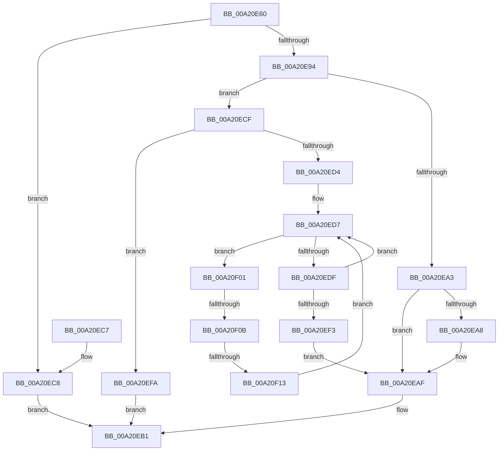

# RtlRunOnceBeginInitialize

- RVA: `0x00A20E60`–`0x00A20F20` (길이 `192` bytes)
- VA: `0x0000000140A20E60`
- 실행 섹션: `PAGE`
- PDB 이름 있음: `예`; PDB Function 태그: `예`
- unwind 정보 RVA: `0x000AAF48`
- 디코드: `60`개 명령, `192/192` bytes 표시
- 미해석 바이트: `0` (있으면 어셈블리에 `.byte`로 보존)

> 이 문서는 커널 이미지의 기계어와 PDB 기호를 분석해 생성했습니다. 4번과 5번은 함수 원형과 자료형을 바이너리 사용 방식에서 추정한 C 해석이며 원본 소스 복구 결과는 아닙니다.

## 1. Dependencies

- 직접 호출 지점: **1**; 고유 호출 대상: **1**
- 직접 호출자로 확인된 함수: **0**
- RIP 상대 이미지 참조: **0**

### Outgoing calls
- `0x00A20F19` → [RtlpRunOnceWaitForInit](../79/RtlpRunOnceWaitForInit_function_00794AF8.md) (function, `0x00794AF8`)

### Direct callers
- 이 함수 시작 RVA로 연결되는 직접 call은 확인되지 않았습니다. 간접 호출은 완전히 역산할 수 없습니다.

### Static image references
- 디코드된 RIP-relative 메모리 참조가 없습니다.

## 2. Other-region calls and transfers

- 다른 실행 섹션으로 향하는 call: **0**
- call이 아닌 외부 분기/꼬리 이동: **2**
  - `0x00A20F05` → [sub_00B379A2 + 0xA](../B3/Unknown_function_00B379A2.md) (`tail-transfer`)
  - `0x00A20F0D` → [sub_00B379A2](../B3/Unknown_function_00B379A2.md) (`tail-transfer`)

## 3. Assembly (complete function range)

```asm
00A20E60  48 89 5C 24 08                  mov qword ptr [rsp + 8], rbx
00A20E65  48 89 74 24 10                  mov qword ptr [rsp + 0x10], rsi
00A20E6A  48 89 7C 24 18                  mov qword ptr [rsp + 0x18], rdi
00A20E6F  41 56                           push r14
00A20E71  48 83 EC 20                     sub rsp, 0x20
00A20E75  8D 42 FF                        lea eax, [rdx - 1]
00A20E78  49 8B F0                        mov rsi, r8
00A20E7B  85 C2                           test edx, eax
00A20E7D  8B DA                           mov ebx, edx
00A20E7F  4C 8B F1                        mov r14, rcx
00A20E82  41 0F 94 C1                     sete r9b
00A20E86  F7 C2 FC FF FF FF               test edx, 0xfffffffc
00A20E8C  0F 94 C0                        sete al
00A20E8F  44 84 C8                        test al, r9b
00A20E92  74 34                           je 0x140a20ec8
00A20E94  48 8B 01                        mov rax, qword ptr [rcx]
00A20E97  33 FF                           xor edi, edi
00A20E99  8A D0                           mov dl, al
00A20E9B  80 E2 03                        and dl, 3
00A20E9E  80 FA 02                        cmp dl, 2
00A20EA1  75 2C                           jne 0x140a20ecf
00A20EA3  48 85 F6                        test rsi, rsi
00A20EA6  74 07                           je 0x140a20eaf
00A20EA8  48 83 E0 FC                     and rax, 0xfffffffffffffffc
00A20EAC  48 89 06                        mov qword ptr [rsi], rax
00A20EAF  8B C7                           mov eax, edi
00A20EB1  48 8B 5C 24 30                  mov rbx, qword ptr [rsp + 0x30]
00A20EB6  48 8B 74 24 38                  mov rsi, qword ptr [rsp + 0x38]
00A20EBB  48 8B 7C 24 40                  mov rdi, qword ptr [rsp + 0x40]
00A20EC0  48 83 C4 20                     add rsp, 0x20
00A20EC4  41 5E                           pop r14
00A20EC6  C3                              ret
00A20EC7  CC                              int3
00A20EC8  B8 F0 00 00 C0                  mov eax, 0xc00000f0
00A20ECD  EB E2                           jmp 0x140a20eb1
00A20ECF  F6 C3 01                        test bl, 1
00A20ED2  75 26                           jne 0x140a20efa
00A20ED4  83 E3 02                        and ebx, 2
00A20ED7  48 8B C8                        mov rcx, rax
00A20EDA  83 E1 03                        and ecx, 3
00A20EDD  75 22                           jne 0x140a20f01
00A20EDF  8B CB                           mov ecx, ebx
00A20EE1  F7 D9                           neg ecx
00A20EE3  48 1B C9                        sbb rcx, rcx
00A20EE6  83 E1 02                        and ecx, 2
00A20EE9  48 FF C1                        inc rcx
00A20EEC  F0 49 0F B1 0E                  lock cmpxchg qword ptr [r14], rcx
00A20EF1  75 E4                           jne 0x140a20ed7
00A20EF3  BF 03 01 00 00                  mov edi, 0x103
00A20EF8  EB B5                           jmp 0x140a20eaf
00A20EFA  B8 01 00 00 C0                  mov eax, 0xc0000001
00A20EFF  EB B0                           jmp 0x140a20eb1
00A20F01  48 83 F9 01                     cmp rcx, 1
00A20F05  0F 85 A1 6A 11 00               jne 0x140b379ac
00A20F0B  85 DB                           test ebx, ebx
00A20F0D  0F 85 8F 6A 11 00               jne 0x140b379a2
00A20F13  49 8B D6                        mov rdx, r14
00A20F16  48 8B C8                        mov rcx, rax
00A20F19  E8 DA 3B D7 FF                  call 0x140794af8
00A20F1E  EB B7                           jmp 0x140a20ed7
```

## 4. C-style interpretation (structured pseudocode)

```c
__int64 __fastcall RtlRunOnceBeginInitialize(__int64 a1, __int64 a2, __int64 a3)
{
    __int64 result;
    __int64 v_rbx;
    __int64 v_rdi;
    __int64 v_rsp;
    unsigned __int64 v_stack_p10;
    unsigned __int64 v_stack_p18;
    unsigned __int64 v_stack_p8;

    v_stack_p8 = v_rbx;
    v_stack_p10 = v_rsi;
    v_stack_p18 = v_rdi;
    v_rsp = (v_rsp) - (32);
    a4 = ((((unsigned int)(a2)) & ((unsigned int)(a2 - 1))) == 0) ? 1 : 0;
    result = ((((unsigned int)(a2)) & (0xFFFFFFFCULL)) == 0) ? 1 : 0;
    if ((((unsigned __int8)(result)) & ((unsigned __int8)(a4))) == 0) goto loc_00A20EC8;
    v_rdi = 0;
    a2 = (unsigned __int8)(((unsigned __int8)(*(unsigned __int64 *)(a1))) & (3));
    if (((unsigned __int8)(a2)) != 2) goto loc_00A20ECF;
    result = *(unsigned __int64 *)(a1);
    if (a3 != 0) {
        result = (*(unsigned __int64 *)(a1)) & (-4);
        *(unsigned __int64 *)(a3) = result;
    }
loc_00A20EB1:
    v_rsp = (v_rsp) + (32);
    return 0;
loc_00A20EC8:
    goto loc_00A20EB1;
loc_00A20ECF:
    if ((((unsigned __int8)(v_stack_p8)) & (1)) != 0) goto loc_00A20EFA;
    v_rbx = (unsigned int)((v_stack_p8) & (2));
loc_00A20ED7:
    a1 = (unsigned int)(((unsigned int)(0xC00000F0ULL)) & (3));
    if (condition_is_not_equal) goto loc_00A20F01;
    a1 = (unsigned int)(-((unsigned int)((unsigned int)(v_rbx))));
    a1 = (unsigned int)((a1) & (2));
    a1 = (a1) + 1;
    if (condition_is_not_equal) goto loc_00A20ED7;
    goto loc_00A20EAF;
loc_00A20EFA:
    goto loc_00A20EB1;
loc_00A20F01:
    result = RtlpRunOnceWaitForInit((unsigned int)(0xC0000001ULL), a1, a3, a4);
    goto loc_00A20ED7;
}
```

## 5. (Beta) C Style

```c
int64_t RtlRunOnceBeginInitialize(void *Arg1, void *Arg2, int64_t Arg3)
{
    uint8_t *arg1 = (uint8_t *)Arg1;
    uint8_t *arg2 = (uint8_t *)Arg2;

    int64_t result;
    int64_t local_rbx;
    int64_t local_rdi;
    int64_t local_rsp;
    uint64_t v_stack_p10;
    uint64_t v_stack_p18;
    uint64_t v_stack_p8;

    v_stack_p8 = local_rbx;
    v_stack_p10 = local_rsi;
    v_stack_p18 = local_rdi;
    local_rsp = (local_rsp) - (32);
    a4 = ((((uint32_t)(Arg2)) & ((uint32_t)(Arg2 - 1))) == 0) ? 1 : 0;
    result = ((((uint32_t)(Arg2)) & (0xFFFFFFFCULL)) == 0) ? 1 : 0;
    if ((((uint8_t)(result)) & ((uint8_t)(a4))) == 0) goto loc_00A20EC8;
    local_rdi = 0;
    Arg2 = (uint8_t)(((uint8_t)(*(uint64_t *)(arg1))) & (3));
    if (((uint8_t)(Arg2)) != 2) goto loc_00A20ECF;
    result = *(uint64_t *)(arg1);
    if (Arg3 != 0) {
        result = (*(uint64_t *)(arg1)) & (-4);
        *(uint64_t *)(Arg3) = result;
    }
loc_00A20EB1:
    local_rsp = (local_rsp) + (32);
    return 0;
loc_00A20EC8:
    goto loc_00A20EB1;
loc_00A20ECF:
    if ((((uint8_t)(v_stack_p8)) & (1)) != 0) goto loc_00A20EFA;
    local_rbx = (uint32_t)((v_stack_p8) & (2));
loc_00A20ED7:
    Arg1 = (uint32_t)(((uint32_t)(0xC00000F0ULL)) & (3));
    if (condition_is_not_equal) goto loc_00A20F01;
    Arg1 = (uint32_t)(-((uint32_t)((uint32_t)(local_rbx))));
    Arg1 = (uint32_t)((Arg1) & (2));
    Arg1 = (Arg1) + 1;
    if (condition_is_not_equal) goto loc_00A20ED7;
    goto loc_00A20EAF;
loc_00A20EFA:
    goto loc_00A20EB1;
loc_00A20F01:
    result = RtlpRunOnceWaitForInit((uint32_t)(0xC0000001ULL), Arg1, Arg3, a4);
    goto loc_00A20ED7;
}
```

### 관측된 메모리 오프셋

구조체 형식이 확인되지 않은 접근은 인자 기준의 오프셋으로만 기록했습니다.

| 기준 인자 | 오프셋 표현 | 폭 (bit) | 접근 |
|---|---:|---:|---|
| `Arg1` | `+ 0x0` | `64` | `R` |
| `Arg2` | `- 0x1` | `32` | `R` |

## 6. Execution-region graph

[열기: 2D/3D 그래프와 함수 탐색 컨트롤 패널](../../../control-panel.html?section=page&rva=0x00A20E60&view=graph)

- 2D 그래프는 위에서 아래로 흐르고, 3D 그래프는 빈 공간을 드래그해 회전합니다. Shift+드래그는 이동, 휠은 확대·축소, 함수 노드 선택은 대상 보고서 이동입니다.

### Static fallback


