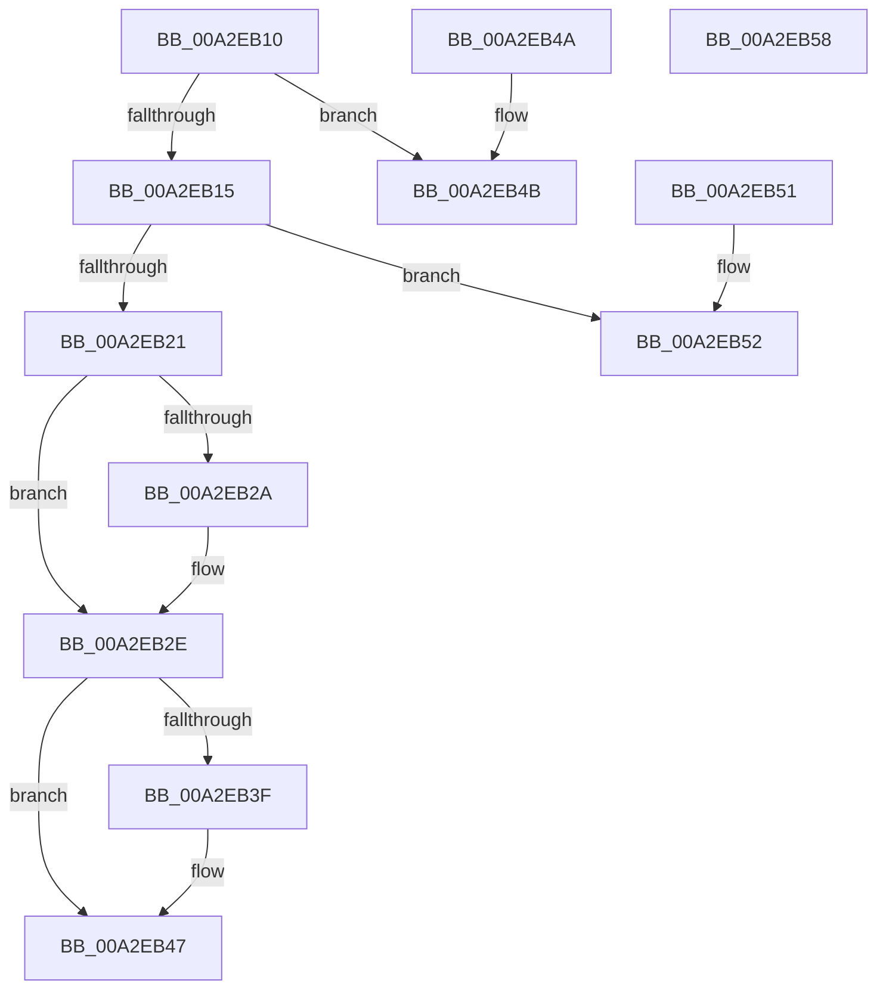

# RtlSetGroupSecurityDescriptor

- RVA: `0x00A2EB10`–`0x00A2EB59` (길이 `73` bytes)
- VA: `0x0000000140A2EB10`
- 실행 섹션: `PAGE`
- PDB 이름 있음: `예`; PDB Function 태그: `아니요`
- unwind 정보 RVA: `0x000DB714`
- 디코드: `26`개 명령, `73/73` bytes 표시
- 미해석 바이트: `0` (있으면 어셈블리에 `.byte`로 보존)

> 이 문서는 커널 이미지의 기계어와 PDB 기호를 분석해 생성했습니다. 4번과 5번은 함수 원형과 자료형을 바이너리 사용 방식에서 추정한 C 해석이며 원본 소스 복구 결과는 아닙니다.

## 1. Dependencies

- 직접 호출 지점: **0**; 고유 호출 대상: **0**
- 직접 호출자로 확인된 함수: **19**
- RIP 상대 이미지 참조: **0**

### Outgoing calls
- 직접 디코드된 call 명령이 없습니다.

### Direct callers
- [RtlCheckTokenCapability](../../text/3A/RtlCheckTokenCapability_function_003A5520.md) at `0x003A56A9`
- [RtlCheckTokenMembershipEx](../../text/3A/RtlCheckTokenMembershipEx_function_003A5A30.md) at `0x003A5B19`
- [PiAuCheckTokenMembership](../73/PiAuCheckTokenMembership_function_00731348.md) at `0x007313FA`
- [PiAuGetServiceStateSecurityObject](../73/PiAuGetServiceStateSecurityObject_function_007314F0.md) at `0x00731690`
- [PiAuGetStateDirectorySecurityObject](../73/PiAuGetStateDirectorySecurityObject_function_00731738.md) at `0x00731970`
- [CmpCopySaclToVirtualKey](../7E/CmpCopySaclToVirtualKey_function_007ECA6C.md) at `0x007ECBFB`
- [CmpGenerateAppHiveSecurityDescriptor](../7E/CmpGenerateAppHiveSecurityDescriptor_function_007ECEAC.md) at `0x007ECF8F`
- [PnpGetEnumSecurityDescriptor](../83/PnpGetEnumSecurityDescriptor_function_00831FCC.md) at `0x00832242`
- [DrvDbGetSecurityDescriptor](../83/DrvDbGetSecurityDescriptor_function_0083580C.md) at `0x00835AD2`
- [sub_00B4403A](../B4/Unknown_function_00B4403A.md) at `0x00B44092`
- [PiAuCreateLocalSystemSecurityObject](../../init/C3/PiAuCreateLocalSystemSecurityObject_function_00C34570.md) at `0x00C34660`
- [PiAuCreateStandardSecurityObject](../../init/C3/PiAuCreateStandardSecurityObject_function_00C34710.md) at `0x00C34BA3`
- [PiAuGetDriverDataDirectorySecurityObject](../../init/C3/PiAuGetDriverDataDirectorySecurityObject_function_00C34EEC.md) at `0x00C35075`
- [PspInitializeCpuPartitionsDefaultSd](../../init/C4/PspInitializeCpuPartitionsDefaultSd_function_00C457D4.md) at `0x00C459A8`
- [SepInitSystemDacls](../../init/C4/SepInitSystemDacls_function_00C478DC.md) at `0x00C4821E`
- [SepInitSystemDacls](../../init/C4/SepInitSystemDacls_function_00C478DC.md) at `0x00C48267`
- [SepInitSystemDacls](../../init/C4/SepInitSystemDacls_function_00C478DC.md) at `0x00C482C5`
- [SeMakeAnonymousLogonToken](../../init/C4/SeMakeAnonymousLogonToken_function_00C4A8D8.md) at `0x00C4AA82`
- [SeMakeAnonymousLogonTokenNoEveryone](../../init/C4/SeMakeAnonymousLogonTokenNoEveryone_function_00C4AB5C.md) at `0x00C4ACE0`
- [SeMakeSystemToken](../../init/C4/SeMakeSystemToken_function_00C4ADBC.md) at `0x00C4B256`
- [WmipInitializeSecurity](../../init/C4/WmipInitializeSecurity_function_00C4D840.md) at `0x00C4DA0C`

### Static image references
- 디코드된 RIP-relative 메모리 참조가 없습니다.

## 2. Other-region calls and transfers

- 다른 실행 섹션으로 향하는 call: **0**
- 별도 외부 분기/꼬리 이동을 확인하지 못했습니다.

## 3. Assembly (complete function range)

```asm
00A2EB10  80 39 01                        cmp byte ptr [rcx], 1
00A2EB13  75 36                           jne 0x140a2eb4b
00A2EB15  0F B7 41 02                     movzx eax, word ptr [rcx + 2]
00A2EB19  45 33 C9                        xor r9d, r9d
00A2EB1C  66 85 C0                        test ax, ax
00A2EB1F  78 31                           js 0x140a2eb52
00A2EB21  4C 89 49 10                     mov qword ptr [rcx + 0x10], r9
00A2EB25  48 85 D2                        test rdx, rdx
00A2EB28  74 04                           je 0x140a2eb2e
00A2EB2A  48 89 51 10                     mov qword ptr [rcx + 0x10], rdx
00A2EB2E  BA FD FF 00 00                  mov edx, 0xfffd
00A2EB33  66 23 C2                        and ax, dx
00A2EB36  66 89 41 02                     mov word ptr [rcx + 2], ax
00A2EB3A  45 84 C0                        test r8b, r8b
00A2EB3D  74 08                           je 0x140a2eb47
00A2EB3F  66 83 C8 02                     or ax, 2
00A2EB43  66 89 41 02                     mov word ptr [rcx + 2], ax
00A2EB47  33 C0                           xor eax, eax
00A2EB49  C3                              ret
00A2EB4A  CC                              int3
00A2EB4B  B8 58 00 00 C0                  mov eax, 0xc0000058
00A2EB50  C3                              ret
00A2EB51  CC                              int3
00A2EB52  B8 79 00 00 C0                  mov eax, 0xc0000079
00A2EB57  C3                              ret
00A2EB58  CC                              int3
```

## 4. C-style interpretation (structured pseudocode)

```c
__int64 __fastcall RtlSetGroupSecurityDescriptor(__int64 a1, __int64 a2, unsigned __int8 a3, int a4)
{
    __int64 result;

    if ((*(unsigned __int8 *)(a1)) != 1) goto loc_00A2EB4B;
    a4 = 0;
    if (sign_flag) goto loc_00A2EB52;
    *(unsigned __int64 *)(a1 + 16) = 0;
    if (a2 != 0) {
        *(unsigned __int64 *)(a1 + 16) = a2;
    }
    result = (unsigned __int16)((*(unsigned __int16 *)(a1 + 2)) & ((unsigned __int16)((unsigned int)(0xFFFDULL))));
    *(unsigned __int16 *)(a1 + 2) = (unsigned __int16)(result);
    if (a3 != 0) {
        result = (unsigned __int16)((result) | (2));
        *(unsigned __int16 *)(a1 + 2) = (unsigned __int16)(result);
    }
    result = 0;
    return result;
loc_00A2EB4B:
    return (unsigned int)(0xC0000058ULL);
loc_00A2EB52:
    return (unsigned int)(0xC0000079ULL);
}
```

## 5. (Beta) C Style

```c
int64_t RtlSetGroupSecurityDescriptor(void *Arg1, int64_t Arg2, uint8_t Arg3, int32_t Arg4)
{
    uint8_t *arg1 = (uint8_t *)Arg1;

    int64_t result;

    if ((*(uint8_t *)(arg1)) != 1) goto loc_00A2EB4B;
    Arg4 = 0;
    if (sign_flag) goto loc_00A2EB52;
    *(uint64_t *)(arg1 + 0x10) = 0;
    if (Arg2 != 0) {
        *(uint64_t *)(arg1 + 0x10) = Arg2;
    }
    result = (uint16_t)((*(uint16_t *)(arg1 + 0x2)) & ((uint16_t)((uint32_t)(0xFFFDULL))));
    *(uint16_t *)(arg1 + 0x2) = (uint16_t)(result);
    if (Arg3 != 0) {
        result = (uint16_t)((result) | (2));
        *(uint16_t *)(arg1 + 0x2) = (uint16_t)(result);
    }
    result = 0;
    return result;
loc_00A2EB4B:
    return (uint32_t)(0xC0000058ULL);
loc_00A2EB52:
    return (uint32_t)(0xC0000079ULL);
}
```

### 관측된 메모리 오프셋

구조체 형식이 확인되지 않은 접근은 인자 기준의 오프셋으로만 기록했습니다.

| 기준 인자 | 오프셋 표현 | 폭 (bit) | 접근 |
|---|---:|---:|---|
| `Arg1` | `+ 0x0` | `8` | `R` |
| `Arg1` | `+ 0x2` | `16` | `R` |
| `Arg1` | `+ 0x2` | `16` | `W` |
| `Arg1` | `+ 0x10` | `64` | `W` |

## 6. Execution-region graph

[열기: 2D/3D 그래프와 함수 탐색 컨트롤 패널](../../../control-panel.html?section=page&rva=0x00A2EB10&view=graph)

- 2D 그래프는 위에서 아래로 흐르고, 3D 그래프는 빈 공간을 드래그해 회전합니다. Shift+드래그는 이동, 휠은 확대·축소, 함수 노드 선택은 대상 보고서 이동입니다.

### Static fallback


