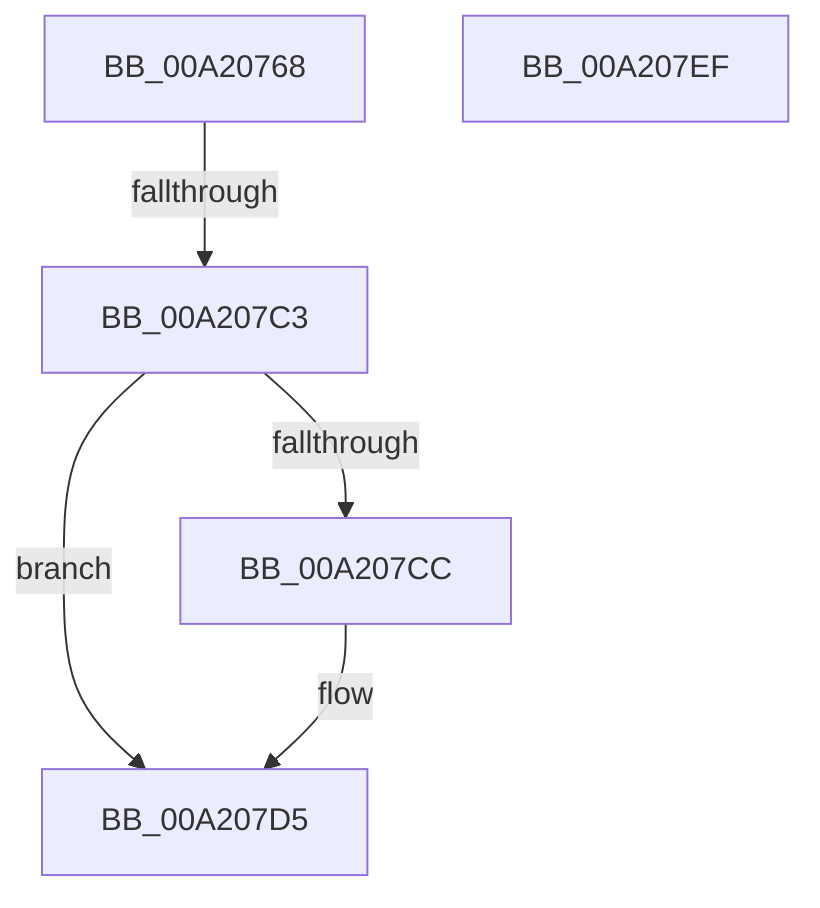

# RtlpCapabilityCheckSystemCapability

- RVA: `0x00A20768`–`0x00A207F0` (길이 `136` bytes)
- VA: `0x0000000140A20768`
- 실행 섹션: `PAGE`
- PDB 이름 있음: `예`; PDB Function 태그: `예`
- unwind 정보 RVA: `0x000AAD98`
- 디코드: `43`개 명령, `136/136` bytes 표시
- 미해석 바이트: `0` (있으면 어셈블리에 `.byte`로 보존)

> 이 문서는 커널 이미지의 기계어와 PDB 기호를 분석해 생성했습니다. 4번과 5번은 함수 원형과 자료형을 바이너리 사용 방식에서 추정한 C 해석이며 원본 소스 복구 결과는 아닙니다.

## 1. Dependencies

- 직접 호출 지점: **3**; 고유 호출 대상: **3**
- 직접 호출자로 확인된 함수: **1**
- RIP 상대 이미지 참조: **1**

### Outgoing calls
- `0x00A207B1` → [RtlpGetPolicyValueForSystemCapability](RtlpGetPolicyValueForSystemCapability_function_00A207F8.md) (function, `0x00A207F8`)
- `0x00A207D0` → [ExFreePool](../../poolcode/B8/ExFreePool_function_00B82850.md) (function, `0x00B82850`)
- `0x00A207DE` → [_security_check_cookie](../../text/6A/_security_check_cookie_function_006AC640.md) (function, `0x006AC640`)

### Direct callers
- [RtlCapabilityCheck](RtlCapabilityCheck_function_00A20340.md) at `0x00A20629`

### Static image references
- `0x00A20777` → RVA `0x00E0A740` (`.data`; read)

## 2. Other-region calls and transfers

- 다른 실행 섹션으로 향하는 call: **2**
  - `0x00A207D0` → [ExFreePool](../../poolcode/B8/ExFreePool_function_00B82850.md) (`PAGE` → `POOLCODE`)
  - `0x00A207DE` → [_security_check_cookie](../../text/6A/_security_check_cookie_function_006AC640.md) (`PAGE` → `.text`)
- call이 아닌 외부 분기/꼬리 이동: **1**
  - `0x00A207BD` → [sub_00B37784](../B3/Unknown_function_00B37784.md) (`tail-transfer`)

## 3. Assembly (complete function range)

```asm
00A20768  40 55                           push rbp
00A2076A  53                              push rbx
00A2076B  56                              push rsi
00A2076C  41 56                           push r14
00A2076E  41 57                           push r15
00A20770  48 8B EC                        mov rbp, rsp
00A20773  48 83 EC 70                     sub rsp, 0x70
00A20777  48 8B 05 C2 9F 3E 00            mov rax, qword ptr [rip + 0x3e9fc2]
00A2077E  48 33 C4                        xor rax, rsp
00A20781  48 89 45 F0                     mov qword ptr [rbp - 0x10], rax
00A20785  48 8B C2                        mov rax, rdx
00A20788  66 C7 45 C8 00 05               mov word ptr [rbp - 0x38], 0x500
00A2078E  45 33 FF                        xor r15d, r15d
00A20791  48 8D 55 D0                     lea rdx, [rbp - 0x30]
00A20795  4C 8B F1                        mov r14, rcx
00A20798  44 89 7D C4                     mov dword ptr [rbp - 0x3c], r15d
00A2079C  0F 57 C0                        xorps xmm0, xmm0
00A2079F  44 88 7D C0                     mov byte ptr [rbp - 0x40], r15b
00A207A3  48 8B C8                        mov rcx, rax
00A207A6  44 88 7D C1                     mov byte ptr [rbp - 0x3f], r15b
00A207AA  49 8B F0                        mov rsi, r8
00A207AD  0F 11 45 D0                     movups xmmword ptr [rbp - 0x30], xmm0
00A207B1  E8 42 00 00 00                  call 0x140a207f8
00A207B6  8B D8                           mov ebx, eax
00A207B8  3D 34 00 00 C0                  cmp eax, 0xc0000034
00A207BD  0F 85 C1 6F 11 00               jne 0x140b37784
00A207C3  41 8B DF                        mov ebx, r15d
00A207C6  4C 39 7D D8                     cmp qword ptr [rbp - 0x28], r15
00A207CA  74 09                           je 0x140a207d5
00A207CC  48 8B 4D D8                     mov rcx, qword ptr [rbp - 0x28]
00A207D0  E8 7B 20 16 00                  call 0x140b82850
00A207D5  8B C3                           mov eax, ebx
00A207D7  48 8B 4D F0                     mov rcx, qword ptr [rbp - 0x10]
00A207DB  48 33 CC                        xor rcx, rsp
00A207DE  E8 5D BE C8 FF                  call 0x1406ac640
00A207E3  48 83 C4 70                     add rsp, 0x70
00A207E7  41 5F                           pop r15
00A207E9  41 5E                           pop r14
00A207EB  5E                              pop rsi
00A207EC  5B                              pop rbx
00A207ED  5D                              pop rbp
00A207EE  C3                              ret
00A207EF  CC                              int3
```

## 4. C-style interpretation (structured pseudocode)

```c
__int64 __fastcall RtlpCapabilityCheckSystemCapability(__int64 a1, __int64 a2, __int64 a3)
{
    __int64 result;
    __int64 v_r15;
    __int64 v_rsp;
    unsigned __int64 v_stack_m38;
    unsigned __int64 v_stack_m50;
    unsigned __int64 v_stack_m58;
    unsigned __int16 v_stack_m60;
    unsigned int v_stack_m64;
    unsigned __int8 v_stack_m67;
    unsigned __int8 v_stack_m68;

    v_rsp = (v_rsp) - (112);
    result = (*(unsigned __int64 *)(v_rip + 4104130)) ^ (v_rsp);
    v_stack_m38 = result;
    v_stack_m60 = 0x500ULL;
    v_r15 = 0;
    v_stack_m64 = 0;
    v_stack_m68 = 0;
    v_stack_m67 = 0;
    v_stack_m58 = v_xmm0;
    result = RtlpGetPolicyValueForSystemCapability(a2, v_stack_m58, a3, a4);
    if (v_stack_m50 != 0) {
        a1 = v_stack_m50;
        result = ExFreePool(a1, v_stack_m58, a3, a4);
    }
    a1 = (v_stack_m38) ^ (v_rsp);
    result = _security_check_cookie(a1, v_stack_m58, a3, a4);
    v_rsp = (v_rsp) + (112);
    return result;
}
```

## 5. (Beta) C Style

```c
int64_t RtlpCapabilityCheckSystemCapability(int64_t Arg1, int64_t Arg2, int64_t Arg3)
{
    int64_t result;
    int64_t local_r15;
    int64_t local_rsp;
    uint64_t v_stack_m38;
    uint64_t v_stack_m50;
    uint64_t v_stack_m58;
    uint16_t v_stack_m60;
    uint32_t v_stack_m64;
    uint8_t v_stack_m67;
    uint8_t v_stack_m68;

    local_rsp = (local_rsp) - (112);
    result = (*(uint64_t *)(v_rip + 0x3E9FC2)) ^ (local_rsp);
    v_stack_m38 = result;
    v_stack_m60 = 0x500ULL;
    local_r15 = 0;
    v_stack_m64 = 0;
    v_stack_m68 = 0;
    v_stack_m67 = 0;
    v_stack_m58 = v_xmm0;
    result = RtlpGetPolicyValueForSystemCapability(Arg2, v_stack_m58, Arg3, a4);
    if (v_stack_m50 != 0) {
        Arg1 = v_stack_m50;
        result = ExFreePool(Arg1, v_stack_m58, Arg3, a4);
    }
    Arg1 = (v_stack_m38) ^ (local_rsp);
    result = _security_check_cookie(Arg1, v_stack_m58, Arg3, a4);
    local_rsp = (local_rsp) + (112);
    return result;
}
```

## 6. Execution-region graph

[열기: 2D/3D 그래프와 함수 탐색 컨트롤 패널](../../../control-panel.html?section=page&rva=0x00A20768&view=graph)

- 2D 그래프는 위에서 아래로 흐르고, 3D 그래프는 빈 공간을 드래그해 회전합니다. Shift+드래그는 이동, 휠은 확대·축소, 함수 노드 선택은 대상 보고서 이동입니다.

### Static fallback


