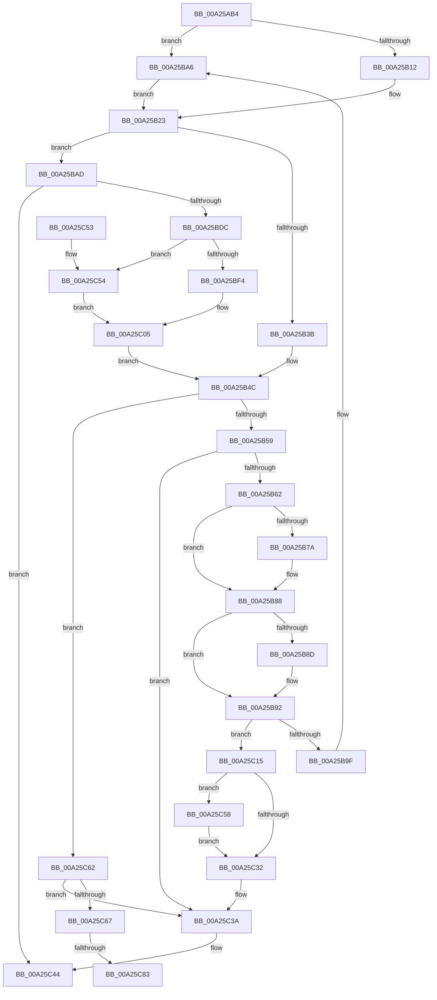

# RtlpFlsSetValueSlot

- RVA: `0x00A25AB4`–`0x00A25C97` (길이 `483` bytes)
- VA: `0x0000000140A25AB4`
- 실행 섹션: `PAGE`
- PDB 이름 있음: `예`; PDB Function 태그: `예`
- unwind 정보 RVA: `0x000ABC0C`
- 디코드: `147`개 명령, `483/483` bytes 표시
- 미해석 바이트: `0` (있으면 어셈블리에 `.byte`로 보존)

> 이 문서는 커널 이미지의 기계어와 PDB 기호를 분석해 생성했습니다. 4번과 5번은 함수 원형과 자료형을 바이너리 사용 방식에서 추정한 C 해석이며 원본 소스 복구 결과는 아닙니다.

## 1. Dependencies

- 직접 호출 지점: **7**; 고유 호출 대상: **5**
- 직접 호출자로 확인된 함수: **1**
- RIP 상대 이미지 참조: **1**

### Outgoing calls
- `0x00A25B6A` → [KeAbPreAcquire](../../text/21/KeAbPreAcquire_function_00210230.md) (function, `0x00210230`)
- `0x00A25B83` → [ExfAcquirePushLockExclusiveEx](../../text/20/ExfAcquirePushLockExclusiveEx_function_0020FC90.md) (function, `0x0020FC90`)
- `0x00A25BD3` → [RTL_BINARY_ARRAY<RTLP_FLS_SLOT,4,4>::SetValue](../../text/46/RTL_BINARY_ARRAY_RTLP_FLS_SLOT_4_4_SetValue_function_0046BEF0.md) (function, `0x0046BEF0`)
- `0x00A25C35` → [KeAbPostRelease](../../text/2E/KeAbPostRelease_function_002E1600.md) (function, `0x002E1600`)
- `0x00A25C5B` → [ExfTryToWakePushLock](../../text/26/ExfTryToWakePushLock_function_00265DD0.md) (function, `0x00265DD0`)
- `0x00A25C6F` → [KeAbPreAcquire](../../text/21/KeAbPreAcquire_function_00210230.md) (function, `0x00210230`)
- `0x00A25C8C` → [ExfAcquirePushLockExclusiveEx](../../text/20/ExfAcquirePushLockExclusiveEx_function_0020FC90.md) (function, `0x0020FC90`)

### Direct callers
- [PsTlsSetValue](PsTlsSetValue_function_00A259F0.md) at `0x00A25A7A`

### Static image references
- `0x00A25AFE` → RVA `0x00E281D0` (`.data`; read)

## 2. Other-region calls and transfers

- 다른 실행 섹션으로 향하는 call: **7**
  - `0x00A25B6A` → [KeAbPreAcquire](../../text/21/KeAbPreAcquire_function_00210230.md) (`PAGE` → `.text`)
  - `0x00A25B83` → [ExfAcquirePushLockExclusiveEx](../../text/20/ExfAcquirePushLockExclusiveEx_function_0020FC90.md) (`PAGE` → `.text`)
  - `0x00A25BD3` → [RTL_BINARY_ARRAY<RTLP_FLS_SLOT,4,4>::SetValue](../../text/46/RTL_BINARY_ARRAY_RTLP_FLS_SLOT_4_4_SetValue_function_0046BEF0.md) (`PAGE` → `.text`)
  - `0x00A25C35` → [KeAbPostRelease](../../text/2E/KeAbPostRelease_function_002E1600.md) (`PAGE` → `.text`)
  - `0x00A25C5B` → [ExfTryToWakePushLock](../../text/26/ExfTryToWakePushLock_function_00265DD0.md) (`PAGE` → `.text`)
  - `0x00A25C6F` → [KeAbPreAcquire](../../text/21/KeAbPreAcquire_function_00210230.md) (`PAGE` → `.text`)
  - `0x00A25C8C` → [ExfAcquirePushLockExclusiveEx](../../text/20/ExfAcquirePushLockExclusiveEx_function_0020FC90.md) (`PAGE` → `.text`)
- call이 아닌 외부 분기/꼬리 이동: **2**
  - `0x00A25C7D` → [sub_00B37DEE](../B3/Unknown_function_00B37DEE.md) (`tail-transfer`)
  - `0x00A25C92` → [sub_00B37DEE](../B3/Unknown_function_00B37DEE.md) (`tail-transfer`)

## 3. Assembly (complete function range)

```asm
00A25AB4  48 89 4C 24 08                  mov qword ptr [rsp + 8], rcx
00A25AB9  55                              push rbp
00A25ABA  53                              push rbx
00A25ABB  56                              push rsi
00A25ABC  57                              push rdi
00A25ABD  41 54                           push r12
00A25ABF  41 56                           push r14
00A25AC1  41 57                           push r15
00A25AC3  48 8B EC                        mov rbp, rsp
00A25AC6  48 83 EC 60                     sub rsp, 0x60
00A25ACA  48 83 65 C0 00                  and qword ptr [rbp - 0x40], 0
00A25ACF  48 8D 45 C8                     lea rax, [rbp - 0x38]
00A25AD3  41 0F BD C8                     bsr ecx, r8d
00A25AD7  4C 8B FA                        mov r15, rdx
00A25ADA  48 89 45 D0                     mov qword ptr [rbp - 0x30], rax
00A25ADE  48 8D 45 C8                     lea rax, [rbp - 0x38]
00A25AE2  89 4D 50                        mov dword ptr [rbp + 0x50], ecx
00A25AE5  41 8B F8                        mov edi, r8d
00A25AE8  48 89 45 C8                     mov qword ptr [rbp - 0x38], rax
00A25AEC  BE 01 00 00 00                  mov esi, 1
00A25AF1  4D 8B E1                        mov r12, r9
00A25AF4  8B D6                           mov edx, esi
00A25AF6  8D 41 FC                        lea eax, [rcx - 4]
00A25AF9  D3 E2                           shl edx, cl
00A25AFB  41 33 D0                        xor edx, r8d
00A25AFE  4C 8D 05 CB 26 40 00            lea r8, [rip + 0x4026cb]
00A25B05  4D 8B 04 C0                     mov r8, qword ptr [r8 + rax*8]
00A25B09  4D 85 C0                        test r8, r8
00A25B0C  0F 84 94 00 00 00               je 0x140a25ba6
00A25B12  8B C2                           mov eax, edx
00A25B14  48 8D 1C 95 01 00 00 00         lea rbx, [rdx*4 + 1]
00A25B1C  48 03 D8                        add rbx, rax
00A25B1F  49 8D 1C D8                     lea rbx, [r8 + rbx*8]
00A25B23  0F BD CF                        bsr ecx, edi
00A25B26  8B D6                           mov edx, esi
00A25B28  D3 E2                           shl edx, cl
00A25B2A  33 D7                           xor edx, edi
00A25B2C  89 4D 40                        mov dword ptr [rbp + 0x40], ecx
00A25B2F  8D 41 FC                        lea eax, [rcx - 4]
00A25B32  4D 8B 04 C7                     mov r8, qword ptr [r15 + rax*8]
00A25B36  4D 85 C0                        test r8, r8
00A25B39  74 72                           je 0x140a25bad
00A25B3B  8B C2                           mov eax, edx
00A25B3D  48 8D 34 55 01 00 00 00         lea rsi, [rdx*2 + 1]
00A25B45  48 03 F0                        add rsi, rax
00A25B48  49 8D 34 F0                     lea rsi, [r8 + rsi*8]
00A25B4C  48 8D 7E 08                     lea rdi, [rsi + 8]
00A25B50  48 39 3F                        cmp qword ptr [rdi], rdi
00A25B53  0F 85 09 01 00 00               jne 0x140a25c62
00A25B59  4D 85 E4                        test r12, r12
00A25B5C  0F 84 D8 00 00 00               je 0x140a25c3a
00A25B62  45 33 C0                        xor r8d, r8d
00A25B65  33 D2                           xor edx, edx
00A25B67  48 8B CB                        mov rcx, rbx
00A25B6A  E8 C1 A6 7E FF                  call 0x140210230
00A25B6F  F0 48 0F BA 2B 00               lock bts qword ptr [rbx], 0
00A25B75  4C 8B F0                        mov r14, rax
00A25B78  73 0E                           jae 0x140a25b88
00A25B7A  4C 8B C3                        mov r8, rbx
00A25B7D  48 8B D0                        mov rdx, rax
00A25B80  48 8B CB                        mov rcx, rbx
00A25B83  E8 08 A1 7E FF                  call 0x14020fc90
00A25B88  4D 85 F6                        test r14, r14
00A25B8B  74 05                           je 0x140a25b92
00A25B8D  41 C6 46 0A 01                  mov byte ptr [r14 + 0xa], 1
00A25B92  48 8D 43 18                     lea rax, [rbx + 0x18]
00A25B96  48 8B 48 08                     mov rcx, qword ptr [rax + 8]
00A25B9A  48 39 01                        cmp qword ptr [rcx], rax
00A25B9D  74 76                           je 0x140a25c15
00A25B9F  B9 03 00 00 00                  mov ecx, 3
00A25BA4  CD 29                           int 0x29
00A25BA6  33 DB                           xor ebx, ebx
00A25BA8  E9 76 FF FF FF                  jmp 0x140a25b23
00A25BAD  0F 57 C9                        xorps xmm1, xmm1
00A25BB0  4C 89 65 C0                     mov qword ptr [rbp - 0x40], r12
00A25BB4  F3 0F 7F 4D C8                  movdqu xmmword ptr [rbp - 0x38], xmm1
00A25BB9  4C 8D 45 E0                     lea r8, [rbp - 0x20]
00A25BBD  8B D7                           mov edx, edi
00A25BBF  0F 10 45 C0                     movups xmm0, xmmword ptr [rbp - 0x40]
00A25BC3  49 8B CF                        mov rcx, r15
00A25BC6  66 0F 15 C9                     unpckhpd xmm1, xmm1
00A25BCA  0F 29 45 E0                     movaps xmmword ptr [rbp - 0x20], xmm0
00A25BCE  F2 0F 11 4D F0                  movsd qword ptr [rbp - 0x10], xmm1
00A25BD3  E8 18 63 A4 FF                  call 0x14046bef0
00A25BD8  85 C0                           test eax, eax
00A25BDA  78 68                           js 0x140a25c44
00A25BDC  0F BD CF                        bsr ecx, edi
00A25BDF  8B D6                           mov edx, esi
00A25BE1  D3 E2                           shl edx, cl
00A25BE3  33 D7                           xor edx, edi
00A25BE5  89 4D 48                        mov dword ptr [rbp + 0x48], ecx
00A25BE8  8D 41 FC                        lea eax, [rcx - 4]
00A25BEB  4D 8B 04 C7                     mov r8, qword ptr [r15 + rax*8]
00A25BEF  4D 85 C0                        test r8, r8
00A25BF2  74 60                           je 0x140a25c54
00A25BF4  8B C2                           mov eax, edx
00A25BF6  48 8D 34 55 01 00 00 00         lea rsi, [rdx*2 + 1]
00A25BFE  48 03 F0                        add rsi, rax
00A25C01  49 8D 34 F0                     lea rsi, [r8 + rsi*8]
00A25C05  48 8D 46 08                     lea rax, [rsi + 8]
00A25C09  48 89 40 08                     mov qword ptr [rax + 8], rax
00A25C0D  48 89 00                        mov qword ptr [rax], rax
00A25C10  E9 37 FF FF FF                  jmp 0x140a25b4c
00A25C15  48 89 07                        mov qword ptr [rdi], rax
00A25C18  48 89 4F 08                     mov qword ptr [rdi + 8], rcx
00A25C1C  48 89 39                        mov qword ptr [rcx], rdi
00A25C1F  48 89 78 08                     mov qword ptr [rax + 8], rdi
00A25C23  48 83 C8 FF                     or rax, 0xffffffffffffffff
00A25C27  F0 48 0F C1 03                  lock xadd qword ptr [rbx], rax
00A25C2C  24 06                           and al, 6
00A25C2E  3C 02                           cmp al, 2
00A25C30  74 26                           je 0x140a25c58
00A25C32  48 8B CB                        mov rcx, rbx
00A25C35  E8 C6 B9 8B FF                  call 0x1402e1600
00A25C3A  33 C0                           xor eax, eax
00A25C3C  4C 89 26                        mov qword ptr [rsi], r12
00A25C3F  41 83 4F 20 01                  or dword ptr [r15 + 0x20], 1
00A25C44  48 83 C4 60                     add rsp, 0x60
00A25C48  41 5F                           pop r15
00A25C4A  41 5E                           pop r14
00A25C4C  41 5C                           pop r12
00A25C4E  5F                              pop rdi
00A25C4F  5E                              pop rsi
00A25C50  5B                              pop rbx
00A25C51  5D                              pop rbp
00A25C52  C3                              ret
00A25C53  CC                              int3
00A25C54  33 F6                           xor esi, esi
00A25C56  EB AD                           jmp 0x140a25c05
00A25C58  48 8B CB                        mov rcx, rbx
00A25C5B  E8 70 01 84 FF                  call 0x140265dd0
00A25C60  EB D0                           jmp 0x140a25c32
00A25C62  4D 85 E4                        test r12, r12
00A25C65  75 D3                           jne 0x140a25c3a
00A25C67  45 33 C0                        xor r8d, r8d
00A25C6A  33 D2                           xor edx, edx
00A25C6C  48 8B CB                        mov rcx, rbx
00A25C6F  E8 BC A5 7E FF                  call 0x140210230
00A25C74  F0 48 0F BA 2B 00               lock bts qword ptr [rbx], 0
00A25C7A  4C 8B F0                        mov r14, rax
00A25C7D  0F 83 6B 21 11 00               jae 0x140b37dee
00A25C83  4C 8B C3                        mov r8, rbx
00A25C86  48 8B D0                        mov rdx, rax
00A25C89  48 8B CB                        mov rcx, rbx
00A25C8C  E8 FF 9F 7E FF                  call 0x14020fc90
00A25C91  90                              nop
00A25C92  E9 57 21 11 00                  jmp 0x140b37dee
```

## 4. C-style interpretation (structured pseudocode)

```c
__int64 __fastcall RtlpFlsSetValueSlot(__int64 a1, __int64 a2, int a3, __int64 a4)
{
    __int64 result;
    __int64 v_rbx;
    __int64 v_rsi;
    __int64 v_rsp;
    unsigned __int64 v_stack_m48;
    unsigned __int64 v_stack_m58;
    unsigned __int64 v_stack_m68;
    unsigned __int64 v_stack_m70;
    unsigned __int64 v_stack_m78;
    unsigned int v_stack_p10;
    unsigned int v_stack_p18;
    unsigned __int64 v_stack_p8;

    v_stack_p8 = a1;
    v_rsp = (v_rsp) - (96);
    v_stack_m68 = v_stack_m70;
    v_stack_p18 = (unsigned int)(a1);
    v_stack_m70 = v_stack_m70;
    a2 = (unsigned int)((1) << ((unsigned __int8)(a1)));
    a2 = (unsigned int)((a2) ^ (a3));
    if (*(unsigned __int64 *)(v_rip + 4204235 + a1 - 4 * 8) == 0) goto loc_00A25BA6;
    v_rbx = (a2 * 4 + 1) + ((unsigned int)((unsigned int)(a2)));
loc_00A25B23:
    a2 = (unsigned int)((1) << ((unsigned __int8)(a1)));
    a2 = (unsigned int)((a2) ^ ((unsigned int)((unsigned int)(a3))));
    v_stack_p8 = (unsigned int)(a1);
    if (*(unsigned __int64 *)(a2 + a1 - 4 * 8) == 0) goto loc_00A25BAD;
    v_rsi = (a2 * 2 + 1) + ((unsigned int)((unsigned int)(a2)));
loc_00A25B4C:
    if ((*(unsigned __int64 *)(*(unsigned __int64 *)(a2 + a1 - 4 * 8) + v_rsi * 8 + 8)) != (*(unsigned __int64 *)(a2 + a1 - 4 * 8) + v_rsi * 8 + 8)) goto loc_00A25C62;
    if (a4 == 0) goto loc_00A25C3A;
    a3 = 0;
    a2 = 0;
    result = KeAbPreAcquire(*(unsigned __int64 *)(v_rip + 4204235 + a1 - 4 * 8) + v_rbx * 8, a2, a3, a4);
    if (!(condition_is_above_or_equal)) {
        a3 = *(unsigned __int64 *)(v_rip + 4204235 + a1 - 4 * 8) + v_rbx * 8;
        a2 = result;
        a1 = *(unsigned __int64 *)(v_rip + 4204235 + a1 - 4 * 8) + v_rbx * 8;
        result = ExfAcquirePushLockExclusiveEx(a1, a2, a3, a4);
    }
    if (result != 0) {
        *(unsigned __int8 *)(result + 10) = 1;
    }
    if ((*(unsigned __int64 *)(*(unsigned __int64 *)(*(unsigned __int64 *)(v_rip + 4204235 + a1 - 4 * 8) + v_rbx * 8 + 24 + 8))) == (*(unsigned __int64 *)(v_rip + 4204235 + a1 - 4 * 8) + v_rbx * 8 + 24)) goto loc_00A25C15;
loc_00A25BA6:
    v_rbx = 0;
    goto loc_00A25B23;
loc_00A25BAD:
    v_stack_m78 = a4;
    v_stack_m70 = v_xmm1;
    v_stack_m58 = v_xmm0;
    v_stack_m48 = v_xmm1;
    result = RTL_BINARY_ARRAY_RTLP_FLS_SLOT_4_4___SetValue(a2, (unsigned int)((unsigned int)(*(unsigned __int64 *)(a2 + a1 - 4 * 8) + v_rsi * 8 + 8)), v_stack_m58, a4);
    if (sign_flag) goto loc_00A25C44;
    a2 = (unsigned int)(((unsigned int)((unsigned int)(*(unsigned __int64 *)(a2 + a1 - 4 * 8) + v_rsi * 8))) << ((unsigned __int8)(a2)));
    a2 = (unsigned int)((a2) ^ ((unsigned int)(*(unsigned __int64 *)(a2 + a1 - 4 * 8) + v_rsi * 8 + 8)));
    v_stack_p10 = (unsigned int)(a2);
    if (*(unsigned __int64 *)(a2 + a2 - 4 * 8) == 0) goto loc_00A25C54;
    v_rsi = (a2 * 2 + 1) + ((unsigned int)((unsigned int)(a2)));
loc_00A25C05:
    *(unsigned __int64 *)(*(unsigned __int64 *)(a2 + a2 - 4 * 8) + v_rsi * 8 + 8 + 8) = *(unsigned __int64 *)(a2 + a2 - 4 * 8) + v_rsi * 8 + 8;
    *(unsigned __int64 *)(*(unsigned __int64 *)(a2 + a2 - 4 * 8) + v_rsi * 8 + 8) = *(unsigned __int64 *)(a2 + a2 - 4 * 8) + v_rsi * 8 + 8;
    goto loc_00A25B4C;
loc_00A25C15:
    *(unsigned __int64 *)(*(unsigned __int64 *)(a2 + a1 - 4 * 8) + v_rsi * 8 + 8) = *(unsigned __int64 *)(a2 + a2 - 4 * 8) + v_rsi * 8 + 8;
    *(unsigned __int64 *)(*(unsigned __int64 *)(a2 + a1 - 4 * 8) + v_rsi * 8 + 8 + 8) = a2;
    *(unsigned __int64 *)(a2) = *(unsigned __int64 *)(a2 + a1 - 4 * 8) + v_rsi * 8 + 8;
    *(unsigned __int64 *)(*(unsigned __int64 *)(a2 + a2 - 4 * 8) + v_rsi * 8 + 8 + 8) = *(unsigned __int64 *)(a2 + a1 - 4 * 8) + v_rsi * 8 + 8;
    result = (*(unsigned __int64 *)(a2 + a2 - 4 * 8) + v_rsi * 8 + 8) | (-1);
    result = (unsigned __int8)((result) & (6));
    if (((unsigned __int8)(result)) == 2) goto loc_00A25C58;
loc_00A25C32:
    result = KeAbPostRelease(0, a2, *(unsigned __int64 *)(a2 + a2 - 4 * 8), a4);
loc_00A25C3A:
    result = 0;
    *(unsigned __int64 *)(*(unsigned __int64 *)(a2 + a2 - 4 * 8) + v_rsi * 8) = a4;
loc_00A25C44:
    v_rsp = (v_rsp) + (96);
    return result;
loc_00A25C54:
    v_rsi = 0;
    goto loc_00A25C05;
loc_00A25C58:
    result = ExfTryToWakePushLock(0, a2, *(unsigned __int64 *)(a2 + a2 - 4 * 8), a4);
    goto loc_00A25C32;
loc_00A25C62:
    if (a4 != 0) goto loc_00A25C3A;
    a3 = 0;
    a2 = 0;
    result = KeAbPreAcquire(0, a2, a3, a4);
    result = ExfAcquirePushLockExclusiveEx(0, result, 0, a4);
}
```

## 5. (Beta) C Style

```c
int64_t RtlpFlsSetValueSlot(int64_t Arg1, void *Arg2, int32_t Arg3, int64_t Arg4)
{
    uint8_t *arg2 = (uint8_t *)Arg2;

    int64_t result;
    int64_t local_rbx;
    int64_t local_rsi;
    int64_t local_rsp;
    uint64_t v_stack_m48;
    uint64_t v_stack_m58;
    uint64_t v_stack_m68;
    uint64_t v_stack_m70;
    uint64_t v_stack_m78;
    uint32_t v_stack_p10;
    uint32_t v_stack_p18;
    uint64_t v_stack_p8;

    v_stack_p8 = Arg1;
    local_rsp = (local_rsp) - (96);
    v_stack_m68 = v_stack_m70;
    v_stack_p18 = (uint32_t)(Arg1);
    v_stack_m70 = v_stack_m70;
    Arg2 = (uint32_t)((1) << ((uint8_t)(Arg1)));
    Arg2 = (uint32_t)((Arg2) ^ (Arg3));
    if (*(uint64_t *)(v_rip + 0x4026CB + Arg1 - 0x4 * 8) == 0) goto loc_00A25BA6;
    local_rbx = (Arg2 * 4 + 1) + ((uint32_t)((uint32_t)(Arg2)));
loc_00A25B23:
    Arg2 = (uint32_t)((1) << ((uint8_t)(Arg1)));
    Arg2 = (uint32_t)((Arg2) ^ ((uint32_t)((uint32_t)(Arg3))));
    v_stack_p8 = (uint32_t)(Arg1);
    if (*(uint64_t *)(arg2 + Arg1 - 0x4 * 8) == 0) goto loc_00A25BAD;
    local_rsi = (Arg2 * 2 + 1) + ((uint32_t)((uint32_t)(Arg2)));
loc_00A25B4C:
    if ((*(uint64_t *)(*(uint64_t *)(arg2 + Arg1 - 0x4 * 8) + local_rsi * 8 + 0x8)) != (*(uint64_t *)(arg2 + Arg1 - 0x4 * 8) + local_rsi * 8 + 8)) goto loc_00A25C62;
    if (Arg4 == 0) goto loc_00A25C3A;
    Arg3 = 0;
    Arg2 = 0;
    result = KeAbPreAcquire(*(uint64_t *)(v_rip + 0x4026CB + Arg1 - 0x4 * 8) + local_rbx * 8, Arg2, Arg3, Arg4);
    if (!(condition_is_above_or_equal)) {
        Arg3 = *(uint64_t *)(v_rip + 0x4026CB + Arg1 - 0x4 * 8) + local_rbx * 8;
        Arg2 = result;
        Arg1 = *(uint64_t *)(v_rip + 0x4026CB + Arg1 - 0x4 * 8) + local_rbx * 8;
        result = ExfAcquirePushLockExclusiveEx(Arg1, Arg2, Arg3, Arg4);
    }
    if (result != 0) {
        *(uint8_t *)(result + 0xA) = 1;
    }
    if ((*(uint64_t *)(*(uint64_t *)(*(uint64_t *)(v_rip + 0x4026CB + Arg1 - 0x4 * 8) + local_rbx * 8 + 0x18 + 0x8))) == (*(uint64_t *)(v_rip + 0x4026CB + Arg1 - 0x4 * 8) + local_rbx * 8 + 24)) goto loc_00A25C15;
loc_00A25BA6:
    local_rbx = 0;
    goto loc_00A25B23;
loc_00A25BAD:
    v_stack_m78 = Arg4;
    v_stack_m70 = v_xmm1;
    v_stack_m58 = v_xmm0;
    v_stack_m48 = v_xmm1;
    result = RTL_BINARY_ARRAY_RTLP_FLS_SLOT_4_4___SetValue(Arg2, (uint32_t)((uint32_t)(*(uint64_t *)(arg2 + Arg1 - 0x4 * 8) + local_rsi * 8 + 8)), v_stack_m58, Arg4);
    if (sign_flag) goto loc_00A25C44;
    Arg2 = (uint32_t)(((uint32_t)((uint32_t)(*(uint64_t *)(arg2 + Arg1 - 0x4 * 8) + local_rsi * 8))) << ((uint8_t)(Arg2)));
    Arg2 = (uint32_t)((Arg2) ^ ((uint32_t)(*(uint64_t *)(arg2 + Arg1 - 0x4 * 8) + local_rsi * 8 + 8)));
    v_stack_p10 = (uint32_t)(Arg2);
    if (*(uint64_t *)(arg2 + arg2 - 0x4 * 8) == 0) goto loc_00A25C54;
    local_rsi = (Arg2 * 2 + 1) + ((uint32_t)((uint32_t)(Arg2)));
loc_00A25C05:
    *(uint64_t *)(*(uint64_t *)(arg2 + arg2 - 0x4 * 8) + local_rsi * 8 + 0x8 + 0x8) = *(uint64_t *)(arg2 + arg2 - 0x4 * 8) + local_rsi * 8 + 8;
    *(uint64_t *)(*(uint64_t *)(arg2 + arg2 - 0x4 * 8) + local_rsi * 8 + 0x8) = *(uint64_t *)(arg2 + arg2 - 0x4 * 8) + local_rsi * 8 + 8;
    goto loc_00A25B4C;
loc_00A25C15:
    *(uint64_t *)(*(uint64_t *)(arg2 + Arg1 - 0x4 * 8) + local_rsi * 8 + 0x8) = *(uint64_t *)(arg2 + arg2 - 0x4 * 8) + local_rsi * 8 + 8;
    *(void **)(*(uint64_t *)(arg2 + Arg1 - 0x4 * 8) + local_rsi * 8 + 0x8 + 0x8) = Arg2;
    *(uint64_t *)(arg2) = *(uint64_t *)(arg2 + Arg1 - 0x4 * 8) + local_rsi * 8 + 8;
    *(uint64_t *)(*(uint64_t *)(arg2 + arg2 - 0x4 * 8) + local_rsi * 8 + 0x8 + 0x8) = *(uint64_t *)(arg2 + Arg1 - 0x4 * 8) + local_rsi * 8 + 8;
    result = (*(uint64_t *)(arg2 + arg2 - 0x4 * 8) + local_rsi * 8 + 8) | (-1);
    result = (uint8_t)((result) & (6));
    if (((uint8_t)(result)) == 2) goto loc_00A25C58;
loc_00A25C32:
    result = KeAbPostRelease(0, Arg2, *(uint64_t *)(arg2 + arg2 - 0x4 * 8), Arg4);
loc_00A25C3A:
    result = 0;
    *(uint64_t *)(*(uint64_t *)(arg2 + arg2 - 0x4 * 8) + local_rsi * 8) = Arg4;
loc_00A25C44:
    local_rsp = (local_rsp) + (96);
    return result;
loc_00A25C54:
    local_rsi = 0;
    goto loc_00A25C05;
loc_00A25C58:
    result = ExfTryToWakePushLock(0, Arg2, *(uint64_t *)(arg2 + arg2 - 0x4 * 8), Arg4);
    goto loc_00A25C32;
loc_00A25C62:
    if (Arg4 != 0) goto loc_00A25C3A;
    Arg3 = 0;
    Arg2 = 0;
    result = KeAbPreAcquire(0, Arg2, Arg3, Arg4);
    result = ExfAcquirePushLockExclusiveEx(0, result, 0, Arg4);
}
```

### 관측된 메모리 오프셋

구조체 형식이 확인되지 않은 접근은 인자 기준의 오프셋으로만 기록했습니다.

| 기준 인자 | 오프셋 표현 | 폭 (bit) | 접근 |
|---|---:|---:|---|
| `Arg2` | `+ 0x0 + rax*8` | `64` | `R` |
| `Arg2` | `+ 0x20` | `32` | `R/W` |

## 6. Execution-region graph

[열기: 2D/3D 그래프와 함수 탐색 컨트롤 패널](../../../control-panel.html?section=page&rva=0x00A25AB4&view=graph)

- 2D 그래프는 위에서 아래로 흐르고, 3D 그래프는 빈 공간을 드래그해 회전합니다. Shift+드래그는 이동, 휠은 확대·축소, 함수 노드 선택은 대상 보고서 이동입니다.

### Static fallback


