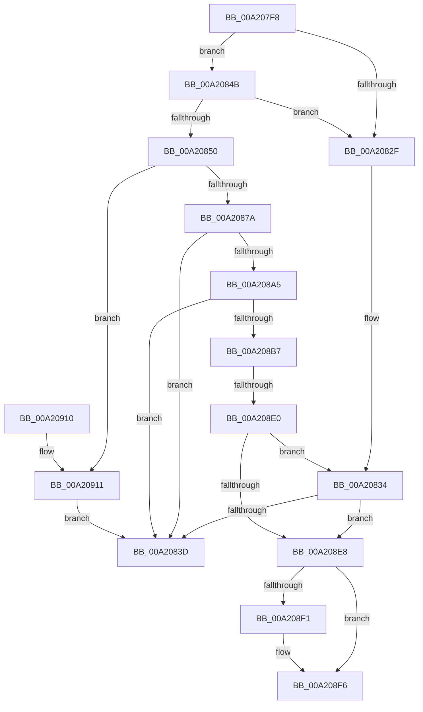

# RtlpGetPolicyValueForSystemCapability

- RVA: `0x00A207F8`–`0x00A2091B` (길이 `291` bytes)
- VA: `0x0000000140A207F8`
- 실행 섹션: `PAGE`
- PDB 이름 있음: `예`; PDB Function 태그: `예`
- unwind 정보 RVA: `0x000AADC4`
- 디코드: `87`개 명령, `291/291` bytes 표시
- 미해석 바이트: `0` (있으면 어셈블리에 `.byte`로 보존)

> 이 문서는 커널 이미지의 기계어와 PDB 기호를 분석해 생성했습니다. 4번과 5번은 함수 원형과 자료형을 바이너리 사용 방식에서 추정한 C 해석이며 원본 소스 복구 결과는 아닙니다.

## 1. Dependencies

- 직접 호출 지점: **7**; 고유 호출 대상: **6**
- 직접 호출자로 확인된 함수: **1**
- RIP 상대 이미지 참조: **1**

### Outgoing calls
- `0x00A20840` → [RtlFreeAnsiString](../9C/RtlFreeAnsiString_function_009C0800.md) (function, `0x009C0800`)
- `0x00A20869` → [ExAllocatePool2](../../poolcode/B8/ExAllocatePool2_function_00B820F0.md) (function, `0x00B820F0`)
- `0x00A20882` → [memset](../../text/6C/memset_function_006C6C40.md) (function, `0x006C6C40`)
- `0x00A2089A` → [RtlAppendUnicodeStringToString](../../text/40/RtlAppendUnicodeStringToString_function_0040FA50.md) (function, `0x0040FA50`)
- `0x00A208AC` → [RtlAppendUnicodeStringToString](../../text/40/RtlAppendUnicodeStringToString_function_0040FA50.md) (function, `0x0040FA50`)
- `0x00A208CE` → [ZwQueryLicenseValue](../../text/6A/ZwQueryLicenseValue_function_006AFCF0.md) (function, `0x006AFCF0`)
- `0x00A208F1` → [ExFreePool](../../poolcode/B8/ExFreePool_function_00B82850.md) (function, `0x00B82850`)

### Direct callers
- [RtlpCapabilityCheckSystemCapability](RtlpCapabilityCheckSystemCapability_function_00A20768.md) at `0x00A207B1`

### Static image references
- `0x00A20887` → RVA `0x00002F38` (`.rdata`; read)

## 2. Other-region calls and transfers

- 다른 실행 섹션으로 향하는 call: **6**
  - `0x00A20869` → [ExAllocatePool2](../../poolcode/B8/ExAllocatePool2_function_00B820F0.md) (`PAGE` → `POOLCODE`)
  - `0x00A20882` → [memset](../../text/6C/memset_function_006C6C40.md) (`PAGE` → `.text`)
  - `0x00A2089A` → [RtlAppendUnicodeStringToString](../../text/40/RtlAppendUnicodeStringToString_function_0040FA50.md) (`PAGE` → `.text`)
  - `0x00A208AC` → [RtlAppendUnicodeStringToString](../../text/40/RtlAppendUnicodeStringToString_function_0040FA50.md) (`PAGE` → `.text`)
  - `0x00A208CE` → [ZwQueryLicenseValue](../../text/6A/ZwQueryLicenseValue_function_006AFCF0.md) (`PAGE` → `.text`)
  - `0x00A208F1` → [ExFreePool](../../poolcode/B8/ExFreePool_function_00B82850.md) (`PAGE` → `POOLCODE`)
- call이 아닌 외부 분기/꼬리 이동: **2**
  - `0x00A20846` → [sub_00B3788E + 0xE4](../B3/Unknown_function_00B3788E.md) (`tail-transfer`)
  - `0x00A208DA` → [sub_00B3788E](../B3/Unknown_function_00B3788E.md) (`tail-transfer`)

## 3. Assembly (complete function range)

```asm
00A207F8  48 89 5C 24 10                  mov qword ptr [rsp + 0x10], rbx
00A207FD  55                              push rbp
00A207FE  56                              push rsi
00A207FF  57                              push rdi
00A20800  41 54                           push r12
00A20802  41 55                           push r13
00A20804  41 56                           push r14
00A20806  41 57                           push r15
00A20808  48 8B EC                        mov rbp, rsp
00A2080B  48 83 EC 40                     sub rsp, 0x40
00A2080F  45 33 ED                        xor r13d, r13d
00A20812  0F 57 C0                        xorps xmm0, xmm0
00A20815  44 89 6D 40                     mov dword ptr [rbp + 0x40], r13d
00A20819  48 8B FA                        mov rdi, rdx
00A2081C  44 89 6D 50                     mov dword ptr [rbp + 0x50], r13d
00A20820  48 8B F1                        mov rsi, rcx
00A20823  45 8B F5                        mov r14d, r13d
00A20826  0F 11 45 F0                     movups xmmword ptr [rbp - 0x10], xmm0
00A2082A  48 85 C9                        test rcx, rcx
00A2082D  75 1C                           jne 0x140a2084b
00A2082F  BB 0D 00 00 C0                  mov ebx, 0xc000000d
00A20834  48 85 FF                        test rdi, rdi
00A20837  0F 84 AB 00 00 00               je 0x140a208e8
00A2083D  48 8B CF                        mov rcx, rdi
00A20840  E8 BB FF F9 FF                  call 0x1409c0800
00A20845  90                              nop
00A20846  E9 27 71 11 00                  jmp 0x140b37972
00A2084B  48 85 FF                        test rdi, rdi
00A2084E  74 DF                           je 0x140a2082f
00A20850  0F B7 19                        movzx ebx, word ptr [rcx]
00A20853  41 B8 53 74 72 67               mov r8d, 0x67727453
00A20859  66 83 C3 38                     add bx, 0x38
00A2085D  B9 00 01 00 00                  mov ecx, 0x100
00A20862  44 0F B7 E3                     movzx r12d, bx
00A20866  41 8B D4                        mov edx, r12d
00A20869  E8 82 18 16 00                  call 0x140b820f0
00A2086E  4C 8B F8                        mov r15, rax
00A20871  48 85 C0                        test rax, rax
00A20874  0F 84 97 00 00 00               je 0x140a20911
00A2087A  45 8B C4                        mov r8d, r12d
00A2087D  33 D2                           xor edx, edx
00A2087F  48 8B C8                        mov rcx, rax
00A20882  E8 B9 63 CA FF                  call 0x1406c6c40
00A20887  48 8D 15 AA 26 5E FF            lea rdx, [rip - 0xa1d956]
00A2088E  66 89 5D F2                     mov word ptr [rbp - 0xe], bx
00A20892  48 8D 4D F0                     lea rcx, [rbp - 0x10]
00A20896  4C 89 7D F8                     mov qword ptr [rbp - 8], r15
00A2089A  E8 B1 F1 9E FF                  call 0x14040fa50
00A2089F  8B D8                           mov ebx, eax
00A208A1  85 C0                           test eax, eax
00A208A3  78 98                           js 0x140a2083d
00A208A5  48 8B D6                        mov rdx, rsi
00A208A8  48 8D 4D F0                     lea rcx, [rbp - 0x10]
00A208AC  E8 9F F1 9E FF                  call 0x14040fa50
00A208B1  8B D8                           mov ebx, eax
00A208B3  85 C0                           test eax, eax
00A208B5  78 86                           js 0x140a2083d
00A208B7  48 8D 45 40                     lea rax, [rbp + 0x40]
00A208BB  45 33 C9                        xor r9d, r9d
00A208BE  45 33 C0                        xor r8d, r8d
00A208C1  48 89 44 24 20                  mov qword ptr [rsp + 0x20], rax
00A208C6  48 8D 55 50                     lea rdx, [rbp + 0x50]
00A208CA  48 8D 4D F0                     lea rcx, [rbp - 0x10]
00A208CE  E8 1D F4 C8 FF                  call 0x1406afcf0
00A208D3  8B D8                           mov ebx, eax
00A208D5  3D 23 00 00 C0                  cmp eax, 0xc0000023
00A208DA  0F 84 AE 6F 11 00               je 0x140b3788e
00A208E0  85 C0                           test eax, eax
00A208E2  0F 88 4C FF FF FF               js 0x140a20834
00A208E8  48 8B 4D F8                     mov rcx, qword ptr [rbp - 8]
00A208EC  48 85 C9                        test rcx, rcx
00A208EF  74 05                           je 0x140a208f6
00A208F1  E8 5A 1F 16 00                  call 0x140b82850
00A208F6  8B C3                           mov eax, ebx
00A208F8  48 8B 9C 24 88 00 00 00         mov rbx, qword ptr [rsp + 0x88]
00A20900  48 83 C4 40                     add rsp, 0x40
00A20904  41 5F                           pop r15
00A20906  41 5E                           pop r14
00A20908  41 5D                           pop r13
00A2090A  41 5C                           pop r12
00A2090C  5F                              pop rdi
00A2090D  5E                              pop rsi
00A2090E  5D                              pop rbp
00A2090F  C3                              ret
00A20910  CC                              int3
00A20911  BB 17 00 00 C0                  mov ebx, 0xc0000017
00A20916  E9 22 FF FF FF                  jmp 0x140a2083d
```

## 4. C-style interpretation (structured pseudocode)

```c
__int64 __fastcall RtlpGetPolicyValueForSystemCapability(__int64 a1, __int64 a2, __int64 a3, int a4)
{
    __int64 result;
    __int64 v_r13;
    __int64 v_rbx;
    __int64 v_rsp;
    unsigned __int64 v_stack_m40;
    unsigned __int16 v_stack_m46;
    unsigned __int64 v_stack_m48;
    unsigned __int64 v_stack_m58;
    unsigned __int64 v_stack_p10;
    unsigned int v_stack_p18;
    unsigned int v_stack_p8;

    v_stack_p10 = v_rbx;
    v_rsp = (v_rsp) - (64);
    v_r13 = 0;
    v_stack_p8 = 0;
    v_stack_p18 = 0;
    v_stack_m48 = v_xmm0;
    if (a1 != 0) goto loc_00A2084B;
loc_00A2082F:
loc_00A20834:
    if (a2 == 0) goto loc_00A208E8;
loc_00A2083D:
    result = RtlFreeAnsiString(a2, a2, a3, a4);
loc_00A2084B:
    if (a2 == 0) goto loc_00A2082F;
    v_rbx = (unsigned __int16)((*(unsigned __int16 *)(a2)) + (56));
    result = ExAllocatePool2(256, (unsigned int)((unsigned int)((unsigned __int16)(v_rbx))), (unsigned int)(0x67727453ULL), a4);
    if (result == 0) goto loc_00A20911;
    a2 = 0;
    result = memset(result, a2, (unsigned int)((unsigned int)((unsigned __int16)(v_rbx))), a4);
    v_stack_m46 = (unsigned __int16)(v_rbx);
    v_stack_m40 = result;
    result = RtlAppendUnicodeStringToString(v_stack_m48, v_rip - 10606934, (unsigned int)((unsigned int)((unsigned __int16)(v_rbx))), a4);
    if (sign_flag) goto loc_00A2083D;
    result = RtlAppendUnicodeStringToString(v_stack_m48, a1, (unsigned int)((unsigned int)((unsigned __int16)(v_rbx))), a4);
    if (sign_flag) goto loc_00A2083D;
    a4 = 0;
    a3 = 0;
    v_stack_m58 = v_stack_p8;
    result = ZwQueryLicenseValue(v_stack_m48, v_stack_p18, a3, a4);
    if (sign_flag) goto loc_00A20834;
loc_00A208E8:
    if (v_stack_m40 != 0) {
        result = ExFreePool(v_stack_m40, v_stack_p18, a3, a4);
    }
    v_rsp = (v_rsp) + (64);
    return (unsigned int)((unsigned int)((unsigned int)((unsigned int)(result))));
loc_00A20911:
    goto loc_00A2083D;
}
```

## 5. (Beta) C Style

```c
int64_t RtlpGetPolicyValueForSystemCapability(int64_t Arg1, int64_t Arg2, int64_t Arg3, int32_t Arg4)
{
    int64_t result;
    int64_t local_r13;
    int64_t local_rbx;
    int64_t local_rsp;
    uint64_t v_stack_m40;
    uint16_t v_stack_m46;
    uint64_t v_stack_m48;
    uint64_t v_stack_m58;
    uint64_t v_stack_p10;
    uint32_t v_stack_p18;
    uint32_t v_stack_p8;

    v_stack_p10 = local_rbx;
    local_rsp = (local_rsp) - (64);
    local_r13 = 0;
    v_stack_p8 = 0;
    v_stack_p18 = 0;
    v_stack_m48 = v_xmm0;
    if (Arg1 != 0) goto loc_00A2084B;
loc_00A2082F:
loc_00A20834:
    if (Arg2 == 0) goto loc_00A208E8;
loc_00A2083D:
    result = RtlFreeAnsiString(Arg2, Arg2, Arg3, Arg4);
loc_00A2084B:
    if (Arg2 == 0) goto loc_00A2082F;
    local_rbx = (uint16_t)((*(uint16_t *)(Arg2)) + (56));
    result = ExAllocatePool2(256, (uint32_t)((uint32_t)((uint16_t)(local_rbx))), (uint32_t)(0x67727453ULL), Arg4);
    if (result == 0) goto loc_00A20911;
    Arg2 = 0;
    result = memset(result, Arg2, (uint32_t)((uint32_t)((uint16_t)(local_rbx))), Arg4);
    v_stack_m46 = (uint16_t)(local_rbx);
    v_stack_m40 = result;
    result = RtlAppendUnicodeStringToString(v_stack_m48, v_rip - 10606934, (uint32_t)((uint32_t)((uint16_t)(local_rbx))), Arg4);
    if (sign_flag) goto loc_00A2083D;
    result = RtlAppendUnicodeStringToString(v_stack_m48, Arg1, (uint32_t)((uint32_t)((uint16_t)(local_rbx))), Arg4);
    if (sign_flag) goto loc_00A2083D;
    Arg4 = 0;
    Arg3 = 0;
    v_stack_m58 = v_stack_p8;
    result = ZwQueryLicenseValue(v_stack_m48, v_stack_p18, Arg3, Arg4);
    if (sign_flag) goto loc_00A20834;
loc_00A208E8:
    if (v_stack_m40 != 0) {
        result = ExFreePool(v_stack_m40, v_stack_p18, Arg3, Arg4);
    }
    local_rsp = (local_rsp) + (64);
    return (uint32_t)((uint32_t)((uint32_t)((uint32_t)(result))));
loc_00A20911:
    goto loc_00A2083D;
}
```

## 6. Execution-region graph

[열기: 2D/3D 그래프와 함수 탐색 컨트롤 패널](../../../control-panel.html?section=page&rva=0x00A207F8&view=graph)

- 2D 그래프는 위에서 아래로 흐르고, 3D 그래프는 빈 공간을 드래그해 회전합니다. Shift+드래그는 이동, 휠은 확대·축소, 함수 노드 선택은 대상 보고서 이동입니다.

### Static fallback


