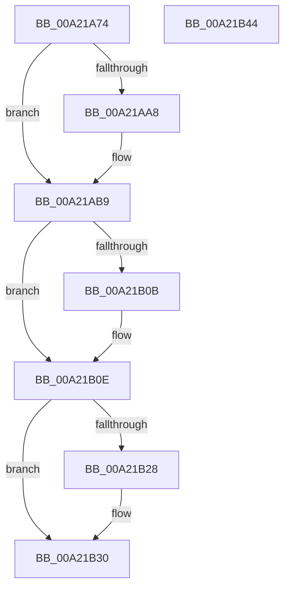

# SeIsAppContainerOrIdentifyLevelContext

- RVA: `0x00A21A74`–`0x00A21B45` (길이 `209` bytes)
- VA: `0x0000000140A21A74`
- 실행 섹션: `PAGE`
- PDB 이름 있음: `예`; PDB Function 태그: `아니요`
- unwind 정보 RVA: `0x000AB1F8`
- 디코드: `52`개 명령, `209/209` bytes 표시
- 미해석 바이트: `0` (있으면 어셈블리에 `.byte`로 보존)

> 이 문서는 커널 이미지의 기계어와 PDB 기호를 분석해 생성했습니다. 4번과 5번은 함수 원형과 자료형을 바이너리 사용 방식에서 추정한 C 해석이며 원본 소스 복구 결과는 아닙니다.

## 1. Dependencies

- 직접 호출 지점: **3**; 고유 호출 대상: **3**
- 직접 호출자로 확인된 함수: **5**
- RIP 상대 이미지 참조: **2**

### Outgoing calls
- `0x00A21AAC` → [SeCaptureSubjectContext](../86/SeCaptureSubjectContext_function_0086B820.md) (function, `0x0086B820`)
- `0x00A21B02` → [SeAccessCheck](../../text/3A/SeAccessCheck_function_003A6BC0.md) (function, `0x003A6BC0`)
- `0x00A21B2B` → [SeReleaseSubjectContext](../86/SeReleaseSubjectContext_function_0086B710.md) (function, `0x0086B710`)

### Direct callers
- [IopParseDevice](../89/IopParseDevice_function_0089E510.md) at `0x0089E842`
- [IopParseDevice](../89/IopParseDevice_function_0089E510.md) at `0x0089E989`
- [PfpPrivSourceEnum](../91/PfpPrivSourceEnum_function_0091BF00.md) at `0x0091C52A`
- [NtPowerInformation](../95/NtPowerInformation_function_00955D80.md) at `0x00955EEB`
- [PopPowerRequestActionInfo](PopPowerRequestActionInfo_function_00A21968.md) at `0x00A21A22`
- [PopPowerInformationInternal](../A8/PopPowerInformationInternal_function_00A8B7C0.md) at `0x00A8D32C`

### Static image references
- `0x00A21AB9` → RVA `0x00FD9F70` (`PAGEDATA`; read)
- `0x00A21AEB` → RVA `0x00019EC0` (`.rdata`; read)

## 2. Other-region calls and transfers

- 다른 실행 섹션으로 향하는 call: **1**
  - `0x00A21B02` → [SeAccessCheck](../../text/3A/SeAccessCheck_function_003A6BC0.md) (`PAGE` → `.text`)
- 별도 외부 분기/꼬리 이동을 확인하지 못했습니다.

## 3. Assembly (complete function range)

```asm
00A21A74  48 8B C4                        mov rax, rsp
00A21A77  48 89 58 18                     mov qword ptr [rax + 0x18], rbx
00A21A7B  48 89 70 20                     mov qword ptr [rax + 0x20], rsi
00A21A7F  57                              push rdi
00A21A80  48 83 EC 70                     sub rsp, 0x70
00A21A84  83 60 08 00                     and dword ptr [rax + 8], 0
00A21A88  0F 57 C0                        xorps xmm0, xmm0
00A21A8B  83 60 10 00                     and dword ptr [rax + 0x10], 0
00A21A8F  40 32 F6                        xor sil, sil
00A21A92  C6 02 01                        mov byte ptr [rdx], 1
00A21A95  48 8B DA                        mov rbx, rdx
00A21A98  48 8B F9                        mov rdi, rcx
00A21A9B  0F 11 40 D8                     movups xmmword ptr [rax - 0x28], xmm0
00A21A9F  0F 11 40 E8                     movups xmmword ptr [rax - 0x18], xmm0
00A21AA3  48 85 C9                        test rcx, rcx
00A21AA6  75 11                           jne 0x140a21ab9
00A21AA8  48 8D 48 D8                     lea rcx, [rax - 0x28]
00A21AAC  E8 6F 9D E4 FF                  call 0x14086b820
00A21AB1  48 8D 7C 24 50                  lea rdi, [rsp + 0x50]
00A21AB6  40 B6 01                        mov sil, 1
00A21AB9  48 8B 0D B0 84 5B 00            mov rcx, qword ptr [rip + 0x5b84b0]
00A21AC0  48 8D 84 24 80 00 00 00         lea rax, [rsp + 0x80]
00A21AC8  48 89 44 24 48                  mov qword ptr [rsp + 0x48], rax
00A21ACD  41 B9 01 00 00 00               mov r9d, 1
00A21AD3  48 8D 84 24 88 00 00 00         lea rax, [rsp + 0x88]
00A21ADB  45 33 C0                        xor r8d, r8d
00A21ADE  48 89 44 24 40                  mov qword ptr [rsp + 0x40], rax
00A21AE3  48 8B D7                        mov rdx, rdi
00A21AE6  C6 44 24 38 01                  mov byte ptr [rsp + 0x38], 1
00A21AEB  48 8D 05 CE 83 5F FF            lea rax, [rip - 0xa07c32]
00A21AF2  48 89 44 24 30                  mov qword ptr [rsp + 0x30], rax
00A21AF7  48 83 64 24 28 00               and qword ptr [rsp + 0x28], 0
00A21AFD  83 64 24 20 00                  and dword ptr [rsp + 0x20], 0
00A21B02  E8 B9 50 98 FF                  call 0x1403a6bc0
00A21B07  84 C0                           test al, al
00A21B09  74 03                           je 0x140a21b0e
00A21B0B  C6 03 00                        mov byte ptr [rbx], 0
00A21B0E  33 DB                           xor ebx, ebx
00A21B10  81 BC 24 80 00 00 00 22 00 00 C0  cmp dword ptr [rsp + 0x80], 0xc0000022
00A21B1B  0F 45 9C 24 80 00 00 00         cmovne ebx, dword ptr [rsp + 0x80]
00A21B23  40 84 F6                        test sil, sil
00A21B26  74 08                           je 0x140a21b30
00A21B28  48 8B CF                        mov rcx, rdi
00A21B2B  E8 E0 9B E4 FF                  call 0x14086b710
00A21B30  4C 8D 5C 24 70                  lea r11, [rsp + 0x70]
00A21B35  8B C3                           mov eax, ebx
00A21B37  49 8B 5B 20                     mov rbx, qword ptr [r11 + 0x20]
00A21B3B  49 8B 73 28                     mov rsi, qword ptr [r11 + 0x28]
00A21B3F  49 8B E3                        mov rsp, r11
00A21B42  5F                              pop rdi
00A21B43  C3                              ret
00A21B44  CC                              int3
```

## 4. C-style interpretation (structured pseudocode)

```c
__int64 __fastcall SeIsAppContainerOrIdentifyLevelContext(__int64 a1, __int64 a2, int a3)
{
    __int64 result;
    __int64 v_rbx;
    __int64 v_rdi;
    __int64 v_rsi;
    __int64 v_rsp;
    unsigned __int64 v_stack_m28;
    unsigned __int64 v_stack_m30;
    unsigned __int64 v_stack_m38;
    unsigned __int8 v_stack_m40;
    unsigned __int64 v_stack_m48;
    unsigned __int64 v_stack_m50;
    unsigned int v_stack_m58;
    unsigned __int64 v_stack_m8;
    unsigned __int64 v_stack_p10;
    unsigned __int64 v_stack_p8;

    *(unsigned __int64 *)(v_rsp + 24) = v_rbx;
    *(unsigned __int64 *)(v_rsp + 32) = v_rsi;
    v_rsp = (v_rsp) - (112);
    v_rsi = 0;
    *(unsigned __int8 *)(a2) = 1;
    *(unsigned __int64 *)(v_rsp - 40) = v_xmm0;
    *(unsigned __int64 *)(v_rsp - 24) = v_xmm0;
    result = v_rsp;
    v_rdi = a1;
    if (a1 == 0) {
        a1 = v_rsp - 40;
        result = SeCaptureSubjectContext(a1, a2, a3, a4);
        v_rdi = v_stack_m28;
        v_rsi = 1;
    }
    v_stack_m30 = v_stack_p8;
    a3 = 0;
    v_stack_m38 = v_stack_p10;
    v_stack_m40 = 1;
    v_stack_m48 = v_rip - 10517554;
    result = SeAccessCheck(*(unsigned __int64 *)(v_rip + 5997744), v_rdi, a3, 1);
    if ((unsigned __int8)(result) != 0) {
        *(unsigned __int8 *)(a2) = 0;
    }
    v_rbx = 0;
    if (v_stack_p8 != 0xC0000022ULL) { v_rbx = v_stack_p8; }
    if ((unsigned __int8)(v_rsi) != 0) {
        a1 = v_rdi;
        result = SeReleaseSubjectContext(a1, v_rdi, a3, 1);
    }
    return (unsigned int)((unsigned int)(v_rbx));
}
```

## 5. (Beta) C Style

```c
int64_t SeIsAppContainerOrIdentifyLevelContext(int64_t Arg1, void *Arg2, int32_t Arg3)
{
    uint8_t *arg2 = (uint8_t *)Arg2;

    int64_t result;
    int64_t local_rbx;
    int64_t local_rdi;
    int64_t local_rsi;
    int64_t local_rsp;
    uint64_t v_stack_m28;
    uint64_t v_stack_m30;
    uint64_t v_stack_m38;
    uint8_t v_stack_m40;
    uint64_t v_stack_m48;
    uint64_t v_stack_m50;
    uint32_t v_stack_m58;
    uint64_t v_stack_m8;
    uint64_t v_stack_p10;
    uint64_t v_stack_p8;

    *(uint64_t *)(local_rsp + 0x18) = local_rbx;
    *(uint64_t *)(local_rsp + 0x20) = local_rsi;
    local_rsp = (local_rsp) - (112);
    local_rsi = 0;
    *(uint8_t *)(arg2) = 1;
    *(uint64_t *)(local_rsp - 0x28) = v_xmm0;
    *(uint64_t *)(local_rsp - 0x18) = v_xmm0;
    result = local_rsp;
    local_rdi = Arg1;
    if (Arg1 == 0) {
        Arg1 = local_rsp - 40;
        result = SeCaptureSubjectContext(Arg1, Arg2, Arg3, a4);
        local_rdi = v_stack_m28;
        local_rsi = 1;
    }
    v_stack_m30 = v_stack_p8;
    Arg3 = 0;
    v_stack_m38 = v_stack_p10;
    v_stack_m40 = 1;
    v_stack_m48 = v_rip - 10517554;
    result = SeAccessCheck(*(uint64_t *)(v_rip + 0x5B84B0), local_rdi, Arg3, 1);
    if ((uint8_t)(result) != 0) {
        *(uint8_t *)(arg2) = 0;
    }
    local_rbx = 0;
    if (v_stack_p8 != 0xC0000022ULL) { local_rbx = v_stack_p8; }
    if ((uint8_t)(local_rsi) != 0) {
        Arg1 = local_rdi;
        result = SeReleaseSubjectContext(Arg1, local_rdi, Arg3, 1);
    }
    return (uint32_t)((uint32_t)(local_rbx));
}
```

### 관측된 메모리 오프셋

구조체 형식이 확인되지 않은 접근은 인자 기준의 오프셋으로만 기록했습니다.

| 기준 인자 | 오프셋 표현 | 폭 (bit) | 접근 |
|---|---:|---:|---|
| `Arg2` | `+ 0x0` | `8` | `W` |

## 6. Execution-region graph

[열기: 2D/3D 그래프와 함수 탐색 컨트롤 패널](../../../control-panel.html?section=page&rva=0x00A21A74&view=graph)

- 2D 그래프는 위에서 아래로 흐르고, 3D 그래프는 빈 공간을 드래그해 회전합니다. Shift+드래그는 이동, 휠은 확대·축소, 함수 노드 선택은 대상 보고서 이동입니다.

### Static fallback


