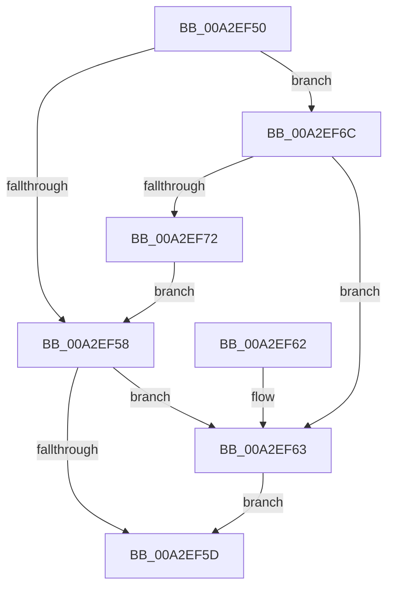

# SeReleaseSid

- RVA: `0x00A2EF50`–`0x00A2EF74` (길이 `36` bytes)
- VA: `0x0000000140A2EF50`
- 실행 섹션: `PAGE`
- PDB 이름 있음: `예`; PDB Function 태그: `아니요`
- unwind 정보 RVA: `0x00063CEC`
- 디코드: `14`개 명령, `36/36` bytes 표시
- 미해석 바이트: `0` (있으면 어셈블리에 `.byte`로 보존)

> 이 문서는 커널 이미지의 기계어와 PDB 기호를 분석해 생성했습니다. 4번과 5번은 함수 원형과 자료형을 바이너리 사용 방식에서 추정한 C 해석이며 원본 소스 복구 결과는 아닙니다.

## 1. Dependencies

- 직접 호출 지점: **1**; 고유 호출 대상: **1**
- 직접 호출자로 확인된 함수: **5**
- RIP 상대 이미지 참조: **0**

### Outgoing calls
- `0x00A2EF65` → [ExFreePoolWithTag](../../poolcode/B8/ExFreePoolWithTag_function_00B82870.md) (function, `0x00B82870`)

### Direct callers
- [SeAccessCheckByType](../../text/44/SeAccessCheckByType_function_00440BC8.md) at `0x00442714`
- [NtCreateTokenEx](../9C/NtCreateTokenEx_function_009C7C80.md) at `0x009C83AC`
- [NtCreateTokenEx](../9C/NtCreateTokenEx_function_009C7C80.md) at `0x009C83C3`
- [SepAccessCheckAndAuditAlarm](../A1/SepAccessCheckAndAuditAlarm_function_00A1AF4C.md) at `0x00A1D7A3`
- [NtCreateLowBoxToken](../AB/NtCreateLowBoxToken_function_00AB9880.md) at `0x00AB9B51`
- [NtCreateLowBoxToken](../AB/NtCreateLowBoxToken_function_00AB9880.md) at `0x00ABA3C0`
- [NtSetInformationToken](../AF/NtSetInformationToken_function_00AF0530.md) at `0x00AF0AA4`
- [NtSetInformationToken](../AF/NtSetInformationToken_function_00AF0530.md) at `0x00AF0BF4`
- [NtSetInformationToken](../AF/NtSetInformationToken_function_00AF0530.md) at `0x00AF0C6E`
- [NtSetInformationToken](../AF/NtSetInformationToken_function_00AF0530.md) at `0x00AF0CA2`

### Static image references
- 디코드된 RIP-relative 메모리 참조가 없습니다.

## 2. Other-region calls and transfers

- 다른 실행 섹션으로 향하는 call: **1**
  - `0x00A2EF65` → [ExFreePoolWithTag](../../poolcode/B8/ExFreePoolWithTag_function_00B82870.md) (`PAGE` → `POOLCODE`)
- 별도 외부 분기/꼬리 이동을 확인하지 못했습니다.

## 3. Assembly (complete function range)

```asm
00A2EF50  48 83 EC 28                     sub rsp, 0x28
00A2EF54  84 D2                           test dl, dl
00A2EF56  74 14                           je 0x140a2ef6c
00A2EF58  80 FA 01                        cmp dl, 1
00A2EF5B  74 06                           je 0x140a2ef63
00A2EF5D  48 83 C4 28                     add rsp, 0x28
00A2EF61  C3                              ret
00A2EF62  CC                              int3
00A2EF63  33 D2                           xor edx, edx
00A2EF65  E8 06 39 15 00                  call 0x140b82870
00A2EF6A  EB F1                           jmp 0x140a2ef5d
00A2EF6C  41 80 F8 01                     cmp r8b, 1
00A2EF70  74 F1                           je 0x140a2ef63
00A2EF72  EB E4                           jmp 0x140a2ef58
```

## 4. C-style interpretation (structured pseudocode)

```c
__int64 __fastcall SeReleaseSid(__int64 a1, int a2, unsigned __int8 a3)
{
    __int64 result;
    __int64 v_rsp;

    v_rsp = (v_rsp) - (40);
    if ((unsigned __int8)(a2) == 0) goto loc_00A2EF6C;
loc_00A2EF58:
    if (((unsigned __int8)(a2)) == 1) goto loc_00A2EF63;
loc_00A2EF5D:
    v_rsp = (v_rsp) + (40);
    return result;
loc_00A2EF63:
    a2 = 0;
    result = ExFreePoolWithTag(a1, a2, a3, a4);
    goto loc_00A2EF5D;
loc_00A2EF6C:
    if (a3 == 1) goto loc_00A2EF63;
    goto loc_00A2EF58;
}
```

## 5. (Beta) C Style

```c
int64_t SeReleaseSid(int64_t Arg1, int32_t Arg2, uint8_t Arg3)
{
    int64_t result;
    int64_t local_rsp;

    local_rsp = (local_rsp) - (40);
    if ((uint8_t)(Arg2) == 0) goto loc_00A2EF6C;
loc_00A2EF58:
    if (((uint8_t)(Arg2)) == 1) goto loc_00A2EF63;
loc_00A2EF5D:
    local_rsp = (local_rsp) + (40);
    return result;
loc_00A2EF63:
    Arg2 = 0;
    result = ExFreePoolWithTag(Arg1, Arg2, Arg3, a4);
    goto loc_00A2EF5D;
loc_00A2EF6C:
    if (Arg3 == 1) goto loc_00A2EF63;
    goto loc_00A2EF58;
}
```

## 6. Execution-region graph

[열기: 2D/3D 그래프와 함수 탐색 컨트롤 패널](../../../control-panel.html?section=page&rva=0x00A2EF50&view=graph)

- 2D 그래프는 위에서 아래로 흐르고, 3D 그래프는 빈 공간을 드래그해 회전합니다. Shift+드래그는 이동, 휠은 확대·축소, 함수 노드 선택은 대상 보고서 이동입니다.

### Static fallback


