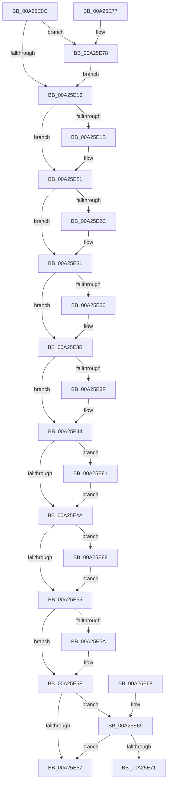

# SeSetSecurityAccessMask

- RVA: `0x00A25E0C`–`0x00A25E8F` (길이 `131` bytes)
- VA: `0x0000000140A25E0C`
- 실행 섹션: `PAGE`
- PDB 이름 있음: `예`; PDB Function 태그: `아니요`
- unwind 정보 RVA: `0x000DB714`
- 디코드: `49`개 명령, `131/131` bytes 표시
- 미해석 바이트: `0` (있으면 어셈블리에 `.byte`로 보존)

> 이 문서는 커널 이미지의 기계어와 PDB 기호를 분석해 생성했습니다. 4번과 5번은 함수 원형과 자료형을 바이너리 사용 방식에서 추정한 C 해석이며 원본 소스 복구 결과는 아닙니다.

## 1. Dependencies

- 직접 호출 지점: **0**; 고유 호출 대상: **0**
- 직접 호출자로 확인된 함수: **3**
- RIP 상대 이미지 참조: **0**

### Outgoing calls
- 직접 디코드된 call 명령이 없습니다.

### Direct callers
- [CmpSetKeySecurity](../94/CmpSetKeySecurity_function_0094A124.md) at `0x0094A5D8`
- [IoCheckFunctionAccess](../A0/IoCheckFunctionAccess_function_00A04290.md) at `0x00A043F3`
- [NtSetSecurityObject](../AD/NtSetSecurityObject_function_00ADE2B0.md) at `0x00ADE367`

### Static image references
- 디코드된 RIP-relative 메모리 참조가 없습니다.

## 2. Other-region calls and transfers

- 다른 실행 섹션으로 향하는 call: **0**
- 별도 외부 분기/꼬리 이동을 확인하지 못했습니다.

## 3. Assembly (complete function range)

```asm
00A25E0C  33 C0                           xor eax, eax
00A25E0E  89 02                           mov dword ptr [rdx], eax
00A25E10  0F BA E1 10                     bt ecx, 0x10
00A25E14  72 62                           jb 0x140a25e78
00A25E16  F6 C1 13                        test cl, 0x13
00A25E19  74 06                           je 0x140a25e21
00A25E1B  0F BA E8 13                     bts eax, 0x13
00A25E1F  89 02                           mov dword ptr [rdx], eax
00A25E21  41 B8 00 00 04 00               mov r8d, 0x40000
00A25E27  F6 C1 04                        test cl, 4
00A25E2A  74 05                           je 0x140a25e31
00A25E2C  41 0B C0                        or eax, r8d
00A25E2F  89 02                           mov dword ptr [rdx], eax
00A25E31  F6 C1 20                        test cl, 0x20
00A25E34  74 05                           je 0x140a25e3b
00A25E36  41 0B C0                        or eax, r8d
00A25E39  89 02                           mov dword ptr [rdx], eax
00A25E3B  84 C9                           test cl, cl
00A25E3D  79 05                           jns 0x140a25e44
00A25E3F  41 0B C0                        or eax, r8d
00A25E42  89 02                           mov dword ptr [rdx], eax
00A25E44  0F BA E1 08                     bt ecx, 8
00A25E48  72 37                           jb 0x140a25e81
00A25E4A  41 B8 00 00 00 01               mov r8d, 0x1000000
00A25E50  F6 C1 40                        test cl, 0x40
00A25E53  75 33                           jne 0x140a25e88
00A25E55  F6 C1 08                        test cl, 8
00A25E58  74 05                           je 0x140a25e5f
00A25E5A  41 0B C0                        or eax, r8d
00A25E5D  89 02                           mov dword ptr [rdx], eax
00A25E5F  F7 C1 F8 01 00 00               test ecx, 0x1f8
00A25E65  75 02                           jne 0x140a25e69
00A25E67  C3                              ret
00A25E68  CC                              int3
00A25E69  F7 C1 00 00 00 50               test ecx, 0x50000000
00A25E6F  74 F6                           je 0x140a25e67
00A25E71  41 0B C0                        or eax, r8d
00A25E74  89 02                           mov dword ptr [rdx], eax
00A25E76  C3                              ret
00A25E77  CC                              int3
00A25E78  B8 00 00 0C 01                  mov eax, 0x10c0000
00A25E7D  89 02                           mov dword ptr [rdx], eax
00A25E7F  EB 95                           jmp 0x140a25e16
00A25E81  41 0B C0                        or eax, r8d
00A25E84  89 02                           mov dword ptr [rdx], eax
00A25E86  EB C2                           jmp 0x140a25e4a
00A25E88  41 0B C0                        or eax, r8d
00A25E8B  89 02                           mov dword ptr [rdx], eax
00A25E8D  EB C6                           jmp 0x140a25e55
```

## 4. C-style interpretation (structured pseudocode)

```c
__int64 __fastcall SeSetSecurityAccessMask(int a1, __int64 a2)
{
    __int64 result;

    result = 0;
    *(unsigned int *)(a2) = 0;
    if (condition_is_below) goto loc_00A25E78;
loc_00A25E16:
    if ((((unsigned __int8)(a1)) & (19)) != 0) {
        *(unsigned int *)(a2) = 0;
    }
    if ((((unsigned __int8)(a1)) & (4)) != 0) {
        result = (unsigned int)((result) | ((unsigned int)((unsigned int)(0x40000ULL))));
        *(unsigned int *)(a2) = (unsigned int)(result);
    }
    if ((((unsigned __int8)(a1)) & (32)) != 0) {
        result = (unsigned int)((result) | ((unsigned int)((unsigned int)(0x40000ULL))));
        *(unsigned int *)(a2) = (unsigned int)(result);
    }
    if (sign_flag) {
        result = (unsigned int)((result) | ((unsigned int)((unsigned int)(0x40000ULL))));
        *(unsigned int *)(a2) = (unsigned int)(result);
    }
    if (condition_is_below) goto loc_00A25E81;
loc_00A25E4A:
    if ((((unsigned __int8)(a1)) & (64)) != 0) goto loc_00A25E88;
loc_00A25E55:
    if ((((unsigned __int8)(a1)) & (8)) != 0) {
        result = (unsigned int)((result) | ((unsigned int)((unsigned int)(0x1000000ULL))));
        *(unsigned int *)(a2) = (unsigned int)(result);
    }
    if (((a1) & (504)) != 0) goto loc_00A25E69;
loc_00A25E67:
    return result;
loc_00A25E69:
    if (((a1) & (0x50000000ULL)) == 0) goto loc_00A25E67;
    result = (unsigned int)((result) | ((unsigned int)((unsigned int)(0x1000000ULL))));
    *(unsigned int *)(a2) = (unsigned int)(result);
    return result;
loc_00A25E78:
    *(unsigned int *)(a2) = (unsigned int)((unsigned int)(0x10C0000ULL));
    goto loc_00A25E16;
loc_00A25E81:
    result = (unsigned int)(((unsigned int)(0x10C0000ULL)) | ((unsigned int)((unsigned int)(0x1000000ULL))));
    *(unsigned int *)(a2) = (unsigned int)(result);
    goto loc_00A25E4A;
loc_00A25E88:
    result = (unsigned int)((result) | ((unsigned int)((unsigned int)(0x1000000ULL))));
    *(unsigned int *)(a2) = (unsigned int)(result);
    goto loc_00A25E55;
}
```

## 5. (Beta) C Style

```c
int64_t SeSetSecurityAccessMask(int32_t Arg1, void *Arg2)
{
    uint8_t *arg2 = (uint8_t *)Arg2;

    int64_t result;

    result = 0;
    *(uint32_t *)(arg2) = 0;
    if (condition_is_below) goto loc_00A25E78;
loc_00A25E16:
    if ((((uint8_t)(Arg1)) & (19)) != 0) {
        *(uint32_t *)(arg2) = 0;
    }
    if ((((uint8_t)(Arg1)) & (4)) != 0) {
        result = (uint32_t)((result) | ((uint32_t)((uint32_t)(0x40000ULL))));
        *(uint32_t *)(arg2) = (uint32_t)(result);
    }
    if ((((uint8_t)(Arg1)) & (32)) != 0) {
        result = (uint32_t)((result) | ((uint32_t)((uint32_t)(0x40000ULL))));
        *(uint32_t *)(arg2) = (uint32_t)(result);
    }
    if (sign_flag) {
        result = (uint32_t)((result) | ((uint32_t)((uint32_t)(0x40000ULL))));
        *(uint32_t *)(arg2) = (uint32_t)(result);
    }
    if (condition_is_below) goto loc_00A25E81;
loc_00A25E4A:
    if ((((uint8_t)(Arg1)) & (64)) != 0) goto loc_00A25E88;
loc_00A25E55:
    if ((((uint8_t)(Arg1)) & (8)) != 0) {
        result = (uint32_t)((result) | ((uint32_t)((uint32_t)(0x1000000ULL))));
        *(uint32_t *)(arg2) = (uint32_t)(result);
    }
    if (((Arg1) & (504)) != 0) goto loc_00A25E69;
loc_00A25E67:
    return result;
loc_00A25E69:
    if (((Arg1) & (0x50000000ULL)) == 0) goto loc_00A25E67;
    result = (uint32_t)((result) | ((uint32_t)((uint32_t)(0x1000000ULL))));
    *(uint32_t *)(arg2) = (uint32_t)(result);
    return result;
loc_00A25E78:
    *(uint32_t *)(arg2) = (uint32_t)((uint32_t)(0x10C0000ULL));
    goto loc_00A25E16;
loc_00A25E81:
    result = (uint32_t)(((uint32_t)(0x10C0000ULL)) | ((uint32_t)((uint32_t)(0x1000000ULL))));
    *(uint32_t *)(arg2) = (uint32_t)(result);
    goto loc_00A25E4A;
loc_00A25E88:
    result = (uint32_t)((result) | ((uint32_t)((uint32_t)(0x1000000ULL))));
    *(uint32_t *)(arg2) = (uint32_t)(result);
    goto loc_00A25E55;
}
```

### 관측된 메모리 오프셋

구조체 형식이 확인되지 않은 접근은 인자 기준의 오프셋으로만 기록했습니다.

| 기준 인자 | 오프셋 표현 | 폭 (bit) | 접근 |
|---|---:|---:|---|
| `Arg2` | `+ 0x0` | `32` | `W` |

## 6. Execution-region graph

[열기: 2D/3D 그래프와 함수 탐색 컨트롤 패널](../../../control-panel.html?section=page&rva=0x00A25E0C&view=graph)

- 2D 그래프는 위에서 아래로 흐르고, 3D 그래프는 빈 공간을 드래그해 회전합니다. Shift+드래그는 이동, 휠은 확대·축소, 함수 노드 선택은 대상 보고서 이동입니다.

### Static fallback


