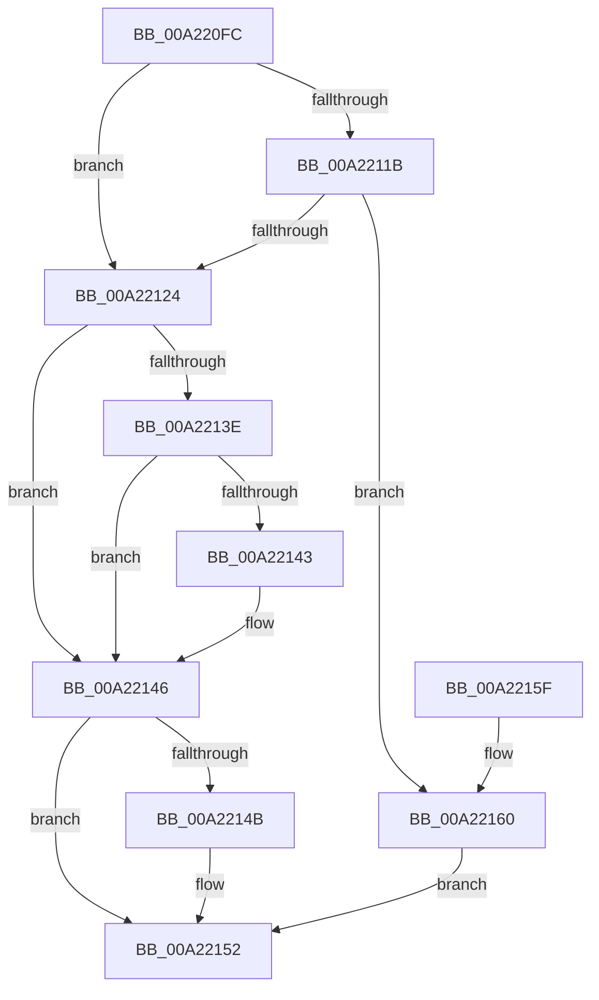

# SeTokenIsElevated

- RVA: `0x00A220FC`–`0x00A22164` (길이 `104` bytes)
- VA: `0x0000000140A220FC`
- 실행 섹션: `PAGE`
- PDB 이름 있음: `예`; PDB Function 태그: `아니요`
- unwind 정보 RVA: `0x0008C5A0`
- 디코드: `32`개 명령, `104/104` bytes 표시
- 미해석 바이트: `0` (있으면 어셈블리에 `.byte`로 보존)

> 이 문서는 커널 이미지의 기계어와 PDB 기호를 분석해 생성했습니다. 4번과 5번은 함수 원형과 자료형을 바이너리 사용 방식에서 추정한 C 해석이며 원본 소스 복구 결과는 아닙니다.

## 1. Dependencies

- 직접 호출 지점: **2**; 고유 호출 대상: **2**
- 직접 호출자로 확인된 함수: **1**
- RIP 상대 이미지 참조: **0**

### Outgoing calls
- `0x00A2212E` → [SeQueryInformationToken](../8B/SeQueryInformationToken_function_008B5090.md) (function, `0x008B5090`)
- `0x00A2214D` → [ExFreePoolWithTag](../../poolcode/B8/ExFreePoolWithTag_function_00B82870.md) (function, `0x00B82870`)

### Direct callers
- [sub_008CC5C2](../8C/Unknown_function_008CC5C2.md) at `0x008CC695`
- [sub_008CC5C2](../8C/Unknown_function_008CC5C2.md) at `0x008CC6B9`

### Static image references
- 디코드된 RIP-relative 메모리 참조가 없습니다.

## 2. Other-region calls and transfers

- 다른 실행 섹션으로 향하는 call: **1**
  - `0x00A2214D` → [ExFreePoolWithTag](../../poolcode/B8/ExFreePoolWithTag_function_00B82870.md) (`PAGE` → `POOLCODE`)
- 별도 외부 분기/꼬리 이동을 확인하지 못했습니다.

## 3. Assembly (complete function range)

```asm
00A220FC  48 89 5C 24 10                  mov qword ptr [rsp + 0x10], rbx
00A22101  57                              push rdi
00A22102  48 83 EC 20                     sub rsp, 0x20
00A22106  48 83 64 24 30 00               and qword ptr [rsp + 0x30], 0
00A2210C  48 8B FA                        mov rdi, rdx
00A2210F  83 B9 C0 00 00 00 02            cmp dword ptr [rcx + 0xc0], 2
00A22116  C6 02 00                        mov byte ptr [rdx], 0
00A22119  75 09                           jne 0x140a22124
00A2211B  83 B9 C4 00 00 00 02            cmp dword ptr [rcx + 0xc4], 2
00A22122  7C 3C                           jl 0x140a22160
00A22124  4C 8D 44 24 30                  lea r8, [rsp + 0x30]
00A22129  BA 14 00 00 00                  mov edx, 0x14
00A2212E  E8 5D 2F E9 FF                  call 0x1408b5090
00A22133  48 8B 4C 24 30                  mov rcx, qword ptr [rsp + 0x30]
00A22138  8B D8                           mov ebx, eax
00A2213A  85 C0                           test eax, eax
00A2213C  78 08                           js 0x140a22146
00A2213E  83 39 00                        cmp dword ptr [rcx], 0
00A22141  74 03                           je 0x140a22146
00A22143  C6 07 01                        mov byte ptr [rdi], 1
00A22146  48 85 C9                        test rcx, rcx
00A22149  74 07                           je 0x140a22152
00A2214B  33 D2                           xor edx, edx
00A2214D  E8 1E 07 16 00                  call 0x140b82870
00A22152  8B C3                           mov eax, ebx
00A22154  48 8B 5C 24 38                  mov rbx, qword ptr [rsp + 0x38]
00A22159  48 83 C4 20                     add rsp, 0x20
00A2215D  5F                              pop rdi
00A2215E  C3                              ret
00A2215F  CC                              int3
00A22160  33 DB                           xor ebx, ebx
00A22162  EB EE                           jmp 0x140a22152
```

## 4. C-style interpretation (structured pseudocode)

```c
__int64 __fastcall SeTokenIsElevated(__int64 a1, __int64 a2)
{
    __int64 result;
    __int64 v_rbx;
    __int64 v_rsp;
    unsigned __int64 v_stack_p10;
    unsigned __int64 v_stack_p8;

    v_stack_p10 = v_rbx;
    v_rsp = (v_rsp) - (32);
    *(unsigned __int8 *)(a2) = 0;
    if ((*(unsigned int *)(a1 + 192)) != 2) goto loc_00A22124;
    if ((*(unsigned int *)(a1 + 196)) < 2) goto loc_00A22160;
loc_00A22124:
    result = SeQueryInformationToken(a1, 20, v_stack_p8, a4);
    if (sign_flag) goto loc_00A22146;
    if ((*(unsigned int *)(v_stack_p8)) != 0) {
        *(unsigned __int8 *)(a2) = 1;
    }
    if (v_stack_p8 != 0) {
        a2 = 0;
        result = ExFreePoolWithTag(v_stack_p8, a2, v_stack_p8, a4);
    }
    v_rsp = (v_rsp) + (32);
    return (unsigned int)((unsigned int)((unsigned int)((unsigned int)(result))));
loc_00A22160:
    v_rbx = 0;
    goto loc_00A22152;
}
```

## 5. (Beta) C Style

```c
int64_t SeTokenIsElevated(void *Arg1, void *Arg2)
{
    uint8_t *arg1 = (uint8_t *)Arg1;
    uint8_t *arg2 = (uint8_t *)Arg2;

    int64_t result;
    int64_t local_rbx;
    int64_t local_rsp;
    uint64_t v_stack_p10;
    uint64_t v_stack_p8;

    v_stack_p10 = local_rbx;
    local_rsp = (local_rsp) - (32);
    *(uint8_t *)(arg2) = 0;
    if ((*(uint32_t *)(arg1 + 0xC0)) != 2) goto loc_00A22124;
    if ((*(uint32_t *)(arg1 + 0xC4)) < 2) goto loc_00A22160;
loc_00A22124:
    result = SeQueryInformationToken(Arg1, 20, v_stack_p8, a4);
    if (sign_flag) goto loc_00A22146;
    if ((*(uint32_t *)(v_stack_p8)) != 0) {
        *(uint8_t *)(arg2) = 1;
    }
    if (v_stack_p8 != 0) {
        Arg2 = 0;
        result = ExFreePoolWithTag(v_stack_p8, Arg2, v_stack_p8, a4);
    }
    local_rsp = (local_rsp) + (32);
    return (uint32_t)((uint32_t)((uint32_t)((uint32_t)(result))));
loc_00A22160:
    local_rbx = 0;
    goto loc_00A22152;
}
```

### 관측된 메모리 오프셋

구조체 형식이 확인되지 않은 접근은 인자 기준의 오프셋으로만 기록했습니다.

| 기준 인자 | 오프셋 표현 | 폭 (bit) | 접근 |
|---|---:|---:|---|
| `Arg1` | `+ 0xC0` | `32` | `R` |
| `Arg1` | `+ 0xC4` | `32` | `R` |
| `Arg2` | `+ 0x0` | `8` | `W` |

## 6. Execution-region graph

[열기: 2D/3D 그래프와 함수 탐색 컨트롤 패널](../../../control-panel.html?section=page&rva=0x00A220FC&view=graph)

- 2D 그래프는 위에서 아래로 흐르고, 3D 그래프는 빈 공간을 드래그해 회전합니다. Shift+드래그는 이동, 휠은 확대·축소, 함수 노드 선택은 대상 보고서 이동입니다.

### Static fallback


