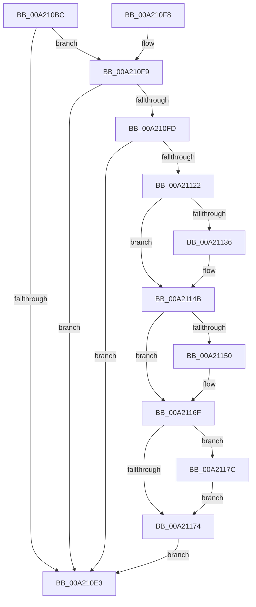

# SepAssemblePrivileges

- RVA: `0x00A210BC`–`0x00A2119B` (길이 `223` bytes)
- VA: `0x0000000140A210BC`
- 실행 섹션: `PAGE`
- PDB 이름 있음: `예`; PDB Function 태그: `아니요`
- unwind 정보 RVA: `0x000AAFD8`
- 디코드: `63`개 명령, `223/223` bytes 표시
- 미해석 바이트: `0` (있으면 어셈블리에 `.byte`로 보존)

> 이 문서는 커널 이미지의 기계어와 PDB 기호를 분석해 생성했습니다. 4번과 5번은 함수 원형과 자료형을 바이너리 사용 방식에서 추정한 C 해석이며 원본 소스 복구 결과는 아닙니다.

## 1. Dependencies

- 직접 호출 지점: **1**; 고유 호출 대상: **1**
- 직접 호출자로 확인된 함수: **3**
- RIP 상대 이미지 참조: **3**

### Outgoing calls
- `0x00A21115` → [ExAllocatePool2](../../poolcode/B8/ExAllocatePool2_function_00B820F0.md) (function, `0x00B820F0`)

### Direct callers
- [SepAccessCheckEx](../../text/3C/SepAccessCheckEx_function_003CF7B0.md) at `0x003CFC34`
- [SepAccessCheck](../../text/3D/SepAccessCheck_function_003D0E54.md) at `0x003D130A`
- [sub_006E91C2](../../text/6E/Unknown_function_006E91C2.md) at `0x006E924D`

### Static image references
- `0x00A21136` → RVA `0x00FD9B00` (`PAGEDATA`; read)
- `0x00A21154` → RVA `0x00FD9B38` (`PAGEDATA`; read)
- `0x00A21180` → RVA `0x00FD9B28` (`PAGEDATA`; read)

## 2. Other-region calls and transfers

- 다른 실행 섹션으로 향하는 call: **1**
  - `0x00A21115` → [ExAllocatePool2](../../poolcode/B8/ExAllocatePool2_function_00B820F0.md) (`PAGE` → `POOLCODE`)
- 별도 외부 분기/꼬리 이동을 확인하지 못했습니다.

## 3. Assembly (complete function range)

```asm
00A210BC  48 89 5C 24 08                  mov qword ptr [rsp + 8], rbx
00A210C1  48 89 6C 24 10                  mov qword ptr [rsp + 0x10], rbp
00A210C6  48 89 74 24 18                  mov qword ptr [rsp + 0x18], rsi
00A210CB  57                              push rdi
00A210CC  48 83 EC 20                     sub rsp, 0x20
00A210D0  48 8B 5C 24 50                  mov rbx, qword ptr [rsp + 0x50]
00A210D5  41 8A E9                        mov bpl, r9b
00A210D8  41 8A F0                        mov sil, r8b
00A210DB  40 8A FA                        mov dil, dl
00A210DE  48 85 DB                        test rbx, rbx
00A210E1  75 16                           jne 0x140a210f9
00A210E3  48 8B 5C 24 30                  mov rbx, qword ptr [rsp + 0x30]
00A210E8  48 8B 6C 24 38                  mov rbp, qword ptr [rsp + 0x38]
00A210ED  48 8B 74 24 40                  mov rsi, qword ptr [rsp + 0x40]
00A210F2  48 83 C4 20                     add rsp, 0x20
00A210F6  5F                              pop rdi
00A210F7  C3                              ret
00A210F8  CC                              int3
00A210F9  85 C9                           test ecx, ecx
00A210FB  74 E6                           je 0x140a210e3
00A210FD  8D 41 FF                        lea eax, [rcx - 1]
00A21100  41 B8 53 65 50 72               mov r8d, 0x72506553
00A21106  8D 0C 40                        lea ecx, [rax + rax*2]
00A21109  8D 14 8D 14 00 00 00            lea edx, [rcx*4 + 0x14]
00A21110  B9 00 01 00 00                  mov ecx, 0x100
00A21115  E8 D6 0F 16 00                  call 0x140b820f0
00A2111A  48 8B D0                        mov rdx, rax
00A2111D  48 85 C0                        test rax, rax
00A21120  74 C1                           je 0x140a210e3
00A21122  83 20 00                        and dword ptr [rax], 0
00A21125  41 B8 00 00 00 80               mov r8d, 0x80000000
00A2112B  83 60 04 00                     and dword ptr [rax + 4], 0
00A2112F  33 C0                           xor eax, eax
00A21131  40 84 FF                        test dil, dil
00A21134  74 15                           je 0x140a2114b
00A21136  48 8B 0D C3 89 5B 00            mov rcx, qword ptr [rip + 0x5b89c3]
00A2113D  48 89 4A 08                     mov qword ptr [rdx + 8], rcx
00A21141  8B 02                           mov eax, dword ptr [rdx]
00A21143  FF C0                           inc eax
00A21145  44 89 42 10                     mov dword ptr [rdx + 0x10], r8d
00A21149  89 02                           mov dword ptr [rdx], eax
00A2114B  40 84 F6                        test sil, sil
00A2114E  74 1F                           je 0x140a2116f
00A21150  48 8D 0C 40                     lea rcx, [rax + rax*2]
00A21154  48 8B 05 DD 89 5B 00            mov rax, qword ptr [rip + 0x5b89dd]
00A2115B  48 89 44 8A 08                  mov qword ptr [rdx + rcx*4 + 8], rax
00A21160  8B 02                           mov eax, dword ptr [rdx]
00A21162  48 8D 0C 40                     lea rcx, [rax + rax*2]
00A21166  44 89 44 8A 10                  mov dword ptr [rdx + rcx*4 + 0x10], r8d
00A2116B  FF 02                           inc dword ptr [rdx]
00A2116D  8B 02                           mov eax, dword ptr [rdx]
00A2116F  40 84 ED                        test bpl, bpl
00A21172  75 08                           jne 0x140a2117c
00A21174  48 89 13                        mov qword ptr [rbx], rdx
00A21177  E9 67 FF FF FF                  jmp 0x140a210e3
00A2117C  48 8D 0C 40                     lea rcx, [rax + rax*2]
00A21180  48 8B 05 A1 89 5B 00            mov rax, qword ptr [rip + 0x5b89a1]
00A21187  48 89 44 8A 08                  mov qword ptr [rdx + rcx*4 + 8], rax
00A2118C  8B 02                           mov eax, dword ptr [rdx]
00A2118E  48 8D 0C 40                     lea rcx, [rax + rax*2]
00A21192  44 89 44 8A 10                  mov dword ptr [rdx + rcx*4 + 0x10], r8d
00A21197  FF 02                           inc dword ptr [rdx]
00A21199  EB D9                           jmp 0x140a21174
```

## 4. C-style interpretation (structured pseudocode)

```c
__int64 __fastcall SepAssemblePrivileges(__int64 a1, unsigned __int8 a2, unsigned __int8 a3, unsigned __int8 a4, __int64 a5)
{
    __int64 result;
    __int64 v_rsp;
    unsigned __int64 v_stack_p10;
    unsigned __int64 v_stack_p18;
    unsigned __int64 v_stack_p8;

    v_stack_p8 = v_rbx;
    v_stack_p10 = v_rbp;
    v_stack_p18 = v_rsi;
    v_rsp = (v_rsp) - (32);
    if (a5 != 0) goto loc_00A210F9;
loc_00A210E3:
    v_rsp = (v_rsp) + (32);
    return result;
loc_00A210F9:
    if ((unsigned int)(a1) == 0) goto loc_00A210E3;
    result = ExAllocatePool2(256, a1 - 1 + a1 - 1 * 2 * 4 + 20, (unsigned int)(0x72506553ULL), a4);
    if (result == 0) goto loc_00A210E3;
    result = 0;
    if (a2 != 0) {
        a1 = *(unsigned __int64 *)(v_rip + 5999043);
        *(unsigned __int64 *)(result + 8) = a1;
        result = *(unsigned int *)(result);
        result = (unsigned int)((result) + 1);
        *(unsigned int *)(result + 16) = (unsigned int)((unsigned int)(0x80000000ULL));
        *(unsigned int *)(result) = (unsigned int)(result);
    }
    if ((unsigned __int8)(v_stack_p18) != 0) {
        a1 = result + result * 2;
        result = *(unsigned __int64 *)(v_rip + 5999069);
        *(unsigned __int64 *)(result + a1 * 4 + 8) = result;
        result = *(unsigned int *)(result);
        a1 = result + result * 2;
        *(unsigned int *)(result + a1 * 4 + 16) = (unsigned int)((unsigned int)(0x80000000ULL));
        result = *(unsigned int *)(result);
    }
    if ((unsigned __int8)(v_stack_p10) != 0) goto loc_00A2117C;
loc_00A21174:
    *(unsigned __int64 *)(v_stack_p8) = result;
    goto loc_00A210E3;
loc_00A2117C:
    *(unsigned __int64 *)(result + result + result * 2 * 4 + 8) = *(unsigned __int64 *)(v_rip + 5999009);
    *(unsigned int *)(result + (unsigned int)(*(unsigned int *)(result)) + (unsigned int)(*(unsigned int *)(result)) * 2 * 4 + 16) = (unsigned int)((unsigned int)(0x80000000ULL));
    goto loc_00A21174;
}
```

## 5. (Beta) C Style

```c
int64_t SepAssemblePrivileges(int64_t Arg1, uint8_t Arg2, uint8_t Arg3, uint8_t Arg4, int64_t Arg5)
{
    int64_t result;
    int64_t local_rsp;
    uint64_t v_stack_p10;
    uint64_t v_stack_p18;
    uint64_t v_stack_p8;

    v_stack_p8 = local_rbx;
    v_stack_p10 = local_rbp;
    v_stack_p18 = local_rsi;
    local_rsp = (local_rsp) - (32);
    if (Arg5 != 0) goto loc_00A210F9;
loc_00A210E3:
    local_rsp = (local_rsp) + (32);
    return result;
loc_00A210F9:
    if ((uint32_t)(Arg1) == 0) goto loc_00A210E3;
    result = ExAllocatePool2(256, Arg1 - 1 + Arg1 - 1 * 2 * 4 + 20, (uint32_t)(0x72506553ULL), Arg4);
    if (result == 0) goto loc_00A210E3;
    result = 0;
    if (Arg2 != 0) {
        Arg1 = *(uint64_t *)(v_rip + 0x5B89C3);
        *(uint64_t *)(result + 0x8) = Arg1;
        result = *(uint32_t *)(result);
        result = (uint32_t)((result) + 1);
        *(uint32_t *)(result + 0x10) = (uint32_t)((uint32_t)(0x80000000ULL));
        *(uint32_t *)(result) = (uint32_t)(result);
    }
    if ((uint8_t)(v_stack_p18) != 0) {
        Arg1 = result + result * 2;
        result = *(uint64_t *)(v_rip + 0x5B89DD);
        *(uint64_t *)(result + Arg1 * 4 + 0x8) = result;
        result = *(uint32_t *)(result);
        Arg1 = result + result * 2;
        *(uint32_t *)(result + Arg1 * 4 + 0x10) = (uint32_t)((uint32_t)(0x80000000ULL));
        result = *(uint32_t *)(result);
    }
    if ((uint8_t)(v_stack_p10) != 0) goto loc_00A2117C;
loc_00A21174:
    *(uint64_t *)(v_stack_p8) = result;
    goto loc_00A210E3;
loc_00A2117C:
    *(uint64_t *)(result + result + result * 2 * 4 + 0x8) = *(uint64_t *)(v_rip + 0x5B89A1);
    *(uint32_t *)(result + (uint32_t)(*(uint32_t *)(result)) + (uint32_t)(*(uint32_t *)(result)) * 2 * 4 + 0x10) = (uint32_t)((uint32_t)(0x80000000ULL));
    goto loc_00A21174;
}
```

## 6. Execution-region graph

[열기: 2D/3D 그래프와 함수 탐색 컨트롤 패널](../../../control-panel.html?section=page&rva=0x00A210BC&view=graph)

- 2D 그래프는 위에서 아래로 흐르고, 3D 그래프는 빈 공간을 드래그해 회전합니다. Shift+드래그는 이동, 휠은 확대·축소, 함수 노드 선택은 대상 보고서 이동입니다.

### Static fallback


