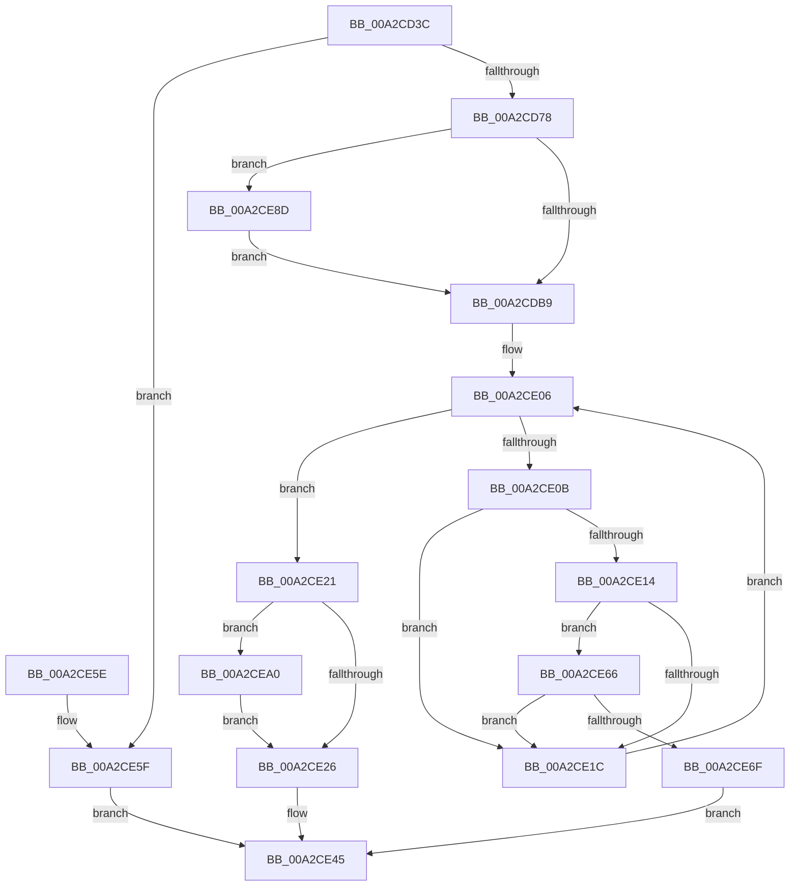

# SepCreateLogonSessionTrack

- RVA: `0x00A2CD3C`–`0x00A2CEB2` (길이 `374` bytes)
- VA: `0x0000000140A2CD3C`
- 실행 섹션: `PAGE`
- PDB 이름 있음: `예`; PDB Function 태그: `아니요`
- unwind 정보 RVA: `0x000AC6A0`
- 디코드: `96`개 명령, `374/374` bytes 표시
- 미해석 바이트: `0` (있으면 어셈블리에 `.byte`로 보존)

> 이 문서는 커널 이미지의 기계어와 PDB 기호를 분석해 생성했습니다. 4번과 5번은 함수 원형과 자료형을 바이너리 사용 방식에서 추정한 C 해석이며 원본 소스 복구 결과는 아닙니다.

## 1. Dependencies

- 직접 호출 지점: **10**; 고유 호출 대상: **8**
- 직접 호출자로 확인된 함수: **3**
- RIP 상대 이미지 참조: **3**

### Outgoing calls
- `0x00A2CD67` → [ExAllocatePool2](../../poolcode/B8/ExAllocatePool2_function_00B820F0.md) (function, `0x00B820F0`)
- `0x00A2CD80` → [memset](../../text/6C/memset_function_006C6C40.md) (function, `0x006C6C40`)
- `0x00A2CDF6` → [ExAcquireResourceExclusiveLite](../../text/21/ExAcquireResourceExclusiveLite_function_00214E20.md) (function, `0x00214E20`)
- `0x00A2CDFE` → [PsGetCurrentServerSilo](../../text/22/PsGetCurrentServerSilo_function_00225710.md) (function, `0x00225710`)
- `0x00A2CE39` → [ExReleaseResourceLite](../../text/25/ExReleaseResourceLite_function_0025FA10.md) (function, `0x0025FA10`)
- `0x00A2CE3E` → [KeLeaveCriticalRegion](../../text/25/KeLeaveCriticalRegion_function_0025D8B0.md) (function, `0x0025D8B0`)
- `0x00A2CE72` → [ExReleaseResourceLite](../../text/25/ExReleaseResourceLite_function_0025FA10.md) (function, `0x0025FA10`)
- `0x00A2CE77` → [KeLeaveCriticalRegion](../../text/25/KeLeaveCriticalRegion_function_0025D8B0.md) (function, `0x0025D8B0`)
- `0x00A2CE81` → [ExFreePoolWithTag](../../poolcode/B8/ExFreePoolWithTag_function_00B82870.md) (function, `0x00B82870`)
- `0x00A2CEA8` → [ObfReferenceObjectWithTag](../../text/21/ObfReferenceObjectWithTag_function_00210710.md) (function, `0x00210710`)

### Direct callers
- [SeInitServerSilo](../79/SeInitServerSilo_function_0079C3EC.md) at `0x0079C43D`
- [SeInitServerSilo](../79/SeInitServerSilo_function_0079C3EC.md) at `0x0079C47B`
- [SepRmCreateLogonSessionWrkr](SepRmCreateLogonSessionWrkr_function_00A2CD10.md) at `0x00A2CD27`
- [SepRmDbInitialization](../../init/C4/SepRmDbInitialization_function_00C4BAF4.md) at `0x00C4BBA9`
- [SepRmDbInitialization](../../init/C4/SepRmDbInitialization_function_00C4BAF4.md) at `0x00C4BBB9`

### Static image references
- `0x00A2CDAC` → RVA `0x00FD8010` (`PAGEDATA`; read)
- `0x00A2CDC2` → RVA `0x00FD9AF0` (`PAGEDATA`; read)
- `0x00A2CDE8` → RVA `0x00E67F20` (`.data`; read)

## 2. Other-region calls and transfers

- 다른 실행 섹션으로 향하는 call: **10**
  - `0x00A2CD67` → [ExAllocatePool2](../../poolcode/B8/ExAllocatePool2_function_00B820F0.md) (`PAGE` → `POOLCODE`)
  - `0x00A2CD80` → [memset](../../text/6C/memset_function_006C6C40.md) (`PAGE` → `.text`)
  - `0x00A2CDF6` → [ExAcquireResourceExclusiveLite](../../text/21/ExAcquireResourceExclusiveLite_function_00214E20.md) (`PAGE` → `.text`)
  - `0x00A2CDFE` → [PsGetCurrentServerSilo](../../text/22/PsGetCurrentServerSilo_function_00225710.md) (`PAGE` → `.text`)
  - `0x00A2CE39` → [ExReleaseResourceLite](../../text/25/ExReleaseResourceLite_function_0025FA10.md) (`PAGE` → `.text`)
  - `0x00A2CE3E` → [KeLeaveCriticalRegion](../../text/25/KeLeaveCriticalRegion_function_0025D8B0.md) (`PAGE` → `.text`)
  - `0x00A2CE72` → [ExReleaseResourceLite](../../text/25/ExReleaseResourceLite_function_0025FA10.md) (`PAGE` → `.text`)
  - `0x00A2CE77` → [KeLeaveCriticalRegion](../../text/25/KeLeaveCriticalRegion_function_0025D8B0.md) (`PAGE` → `.text`)
  - `0x00A2CE81` → [ExFreePoolWithTag](../../poolcode/B8/ExFreePoolWithTag_function_00B82870.md) (`PAGE` → `POOLCODE`)
  - `0x00A2CEA8` → [ObfReferenceObjectWithTag](../../text/21/ObfReferenceObjectWithTag_function_00210710.md) (`PAGE` → `.text`)
- 별도 외부 분기/꼬리 이동을 확인하지 못했습니다.

## 3. Assembly (complete function range)

```asm
00A2CD3C  48 89 5C 24 08                  mov qword ptr [rsp + 8], rbx
00A2CD41  48 89 6C 24 10                  mov qword ptr [rsp + 0x10], rbp
00A2CD46  48 89 74 24 18                  mov qword ptr [rsp + 0x18], rsi
00A2CD4B  57                              push rdi
00A2CD4C  41 56                           push r14
00A2CD4E  41 57                           push r15
00A2CD50  48 83 EC 20                     sub rsp, 0x20
00A2CD54  BF C8 00 00 00                  mov edi, 0xc8
00A2CD59  4C 8B F1                        mov r14, rcx
00A2CD5C  41 B8 53 65 4C 73               mov r8d, 0x734c6553
00A2CD62  8B D7                           mov edx, edi
00A2CD64  8D 4F 38                        lea ecx, [rdi + 0x38]
00A2CD67  E8 84 53 15 00                  call 0x140b820f0
00A2CD6C  48 8B D8                        mov rbx, rax
00A2CD6F  48 85 C0                        test rax, rax
00A2CD72  0F 84 E7 00 00 00               je 0x140a2ce5f
00A2CD78  44 8B C7                        mov r8d, edi
00A2CD7B  33 D2                           xor edx, edx
00A2CD7D  48 8B C8                        mov rcx, rax
00A2CD80  E8 BB 9E C9 FF                  call 0x1406c6c40
00A2CD85  49 8B 06                        mov rax, qword ptr [r14]
00A2CD88  48 89 43 08                     mov qword ptr [rbx + 8], rax
00A2CD8C  48 8D 83 88 00 00 00            lea rax, [rbx + 0x88]
00A2CD93  48 C7 43 20 01 00 00 00         mov qword ptr [rbx + 0x20], 1
00A2CD9B  48 89 40 08                     mov qword ptr [rax + 8], rax
00A2CD9F  48 89 00                        mov qword ptr [rax], rax
00A2CDA2  48 83 60 10 00                  and qword ptr [rax + 0x10], 0
00A2CDA7  48 83 60 18 00                  and qword ptr [rax + 0x18], 0
00A2CDAC  83 3D 5D B2 5A 00 00            cmp dword ptr [rip + 0x5ab25d], 0
00A2CDB3  0F 85 D4 00 00 00               jne 0x140a2ce8d
00A2CDB9  41 69 0E 24 0A 25 5B            imul ecx, dword ptr [r14], 0x5b250a24
00A2CDC0  B2 01                           mov dl, 1
00A2CDC2  48 8B 05 27 CD 5A 00            mov rax, qword ptr [rip + 0x5acd27]
00A2CDC9  48 C1 E9 1C                     shr rcx, 0x1c
00A2CDCD  4C 8D 3C C8                     lea r15, [rax + rcx*8]
00A2CDD1  65 48 8B 04 25 88 01 00 00      mov rax, qword ptr gs:[0x188]
00A2CDDA  83 E1 03                        and ecx, 3
00A2CDDD  48 6B E9 68                     imul rbp, rcx, 0x68
00A2CDE1  66 FF 88 E4 01 00 00            dec word ptr [rax + 0x1e4]
00A2CDE8  48 8D 05 31 B1 43 00            lea rax, [rip + 0x43b131]
00A2CDEF  48 03 E8                        add rbp, rax
00A2CDF2  90                              nop
00A2CDF3  48 8B CD                        mov rcx, rbp
00A2CDF6  E8 25 80 7E FF                  call 0x140214e20
00A2CDFB  49 8B 3F                        mov rdi, qword ptr [r15]
00A2CDFE  E8 0D 89 7F FF                  call 0x140225710
00A2CE03  48 8B F0                        mov rsi, rax
00A2CE06  48 85 FF                        test rdi, rdi
00A2CE09  74 16                           je 0x140a2ce21
00A2CE0B  48 3B B7 A8 00 00 00            cmp rsi, qword ptr [rdi + 0xa8]
00A2CE12  75 08                           jne 0x140a2ce1c
00A2CE14  8B 4F 08                        mov ecx, dword ptr [rdi + 8]
00A2CE17  41 39 0E                        cmp dword ptr [r14], ecx
00A2CE1A  74 4A                           je 0x140a2ce66
00A2CE1C  48 8B 3F                        mov rdi, qword ptr [rdi]
00A2CE1F  EB E5                           jmp 0x140a2ce06
00A2CE21  48 85 F6                        test rsi, rsi
00A2CE24  75 7A                           jne 0x140a2cea0
00A2CE26  48 89 B3 A8 00 00 00            mov qword ptr [rbx + 0xa8], rsi
00A2CE2D  48 8B CD                        mov rcx, rbp
00A2CE30  49 8B 07                        mov rax, qword ptr [r15]
00A2CE33  48 89 03                        mov qword ptr [rbx], rax
00A2CE36  49 89 1F                        mov qword ptr [r15], rbx
00A2CE39  E8 D2 2B 83 FF                  call 0x14025fa10
00A2CE3E  E8 6D 0A 83 FF                  call 0x14025d8b0
00A2CE43  33 C0                           xor eax, eax
00A2CE45  48 8B 5C 24 40                  mov rbx, qword ptr [rsp + 0x40]
00A2CE4A  48 8B 6C 24 48                  mov rbp, qword ptr [rsp + 0x48]
00A2CE4F  48 8B 74 24 50                  mov rsi, qword ptr [rsp + 0x50]
00A2CE54  48 83 C4 20                     add rsp, 0x20
00A2CE58  41 5F                           pop r15
00A2CE5A  41 5E                           pop r14
00A2CE5C  5F                              pop rdi
00A2CE5D  C3                              ret
00A2CE5E  CC                              int3
00A2CE5F  B8 9A 00 00 C0                  mov eax, 0xc000009a
00A2CE64  EB DF                           jmp 0x140a2ce45
00A2CE66  8B 47 0C                        mov eax, dword ptr [rdi + 0xc]
00A2CE69  41 39 46 04                     cmp dword ptr [r14 + 4], eax
00A2CE6D  75 AD                           jne 0x140a2ce1c
00A2CE6F  48 8B CD                        mov rcx, rbp
00A2CE72  E8 99 2B 83 FF                  call 0x14025fa10
00A2CE77  E8 34 0A 83 FF                  call 0x14025d8b0
00A2CE7C  33 D2                           xor edx, edx
00A2CE7E  48 8B CB                        mov rcx, rbx
00A2CE81  E8 EA 59 15 00                  call 0x140b82870
00A2CE86  B8 EE 00 00 C0                  mov eax, 0xc00000ee
00A2CE8B  EB B8                           jmp 0x140a2ce45
00A2CE8D  48 8D 83 B8 00 00 00            lea rax, [rbx + 0xb8]
00A2CE94  48 89 40 08                     mov qword ptr [rax + 8], rax
00A2CE98  48 89 00                        mov qword ptr [rax], rax
00A2CE9B  E9 19 FF FF FF                  jmp 0x140a2cdb9
00A2CEA0  BA 53 65 4C 73                  mov edx, 0x734c6553
00A2CEA5  48 8B CE                        mov rcx, rsi
00A2CEA8  E8 63 38 7E FF                  call 0x140210710
00A2CEAD  E9 74 FF FF FF                  jmp 0x140a2ce26
```

## 4. C-style interpretation (structured pseudocode)

```c
__int64 __fastcall SepCreateLogonSessionTrack(__int64 a1)
{
    __int64 result;
    __int64 v_rbp;
    __int64 v_rsp;
    unsigned __int64 v_stack_p10;
    unsigned __int64 v_stack_p18;
    unsigned __int64 v_stack_p8;

    v_stack_p8 = v_rbx;
    v_stack_p10 = v_rbp;
    v_stack_p18 = v_rsi;
    v_rsp = (v_rsp) - (32);
    result = ExAllocatePool2(200 + 56, 200, (unsigned int)(0x734C6553ULL), a4);
    if (result == 0) goto loc_00A2CE5F;
    a2 = 0;
    result = memset(result, a2, 200, a4);
    *(unsigned __int64 *)(result + 8) = *(unsigned __int64 *)(a1);
    *(unsigned __int64 *)(result + 32) = 1;
    *(unsigned __int64 *)(result + 136 + 8) = result + 136;
    *(unsigned __int64 *)(result + 136) = result + 136;
    if ((*(unsigned int *)(v_rip + 5943901)) != 0) goto loc_00A2CE8D;
loc_00A2CDB9:
    a1 = (unsigned int)((result) * (*(unsigned int *)(a1)));
    a1 = (a1) >> (28);
    a1 = (unsigned int)((a1) & (3));
    v_rbp = (v_rbp) * (a1);
    v_rbp = (v_rbp) + (v_rip + 4436273);
    result = ExAcquireResourceExclusiveLite(v_rbp, 1, 200, a4);
    result = PsGetCurrentServerSilo(v_rbp, 1, 200, a4);
loc_00A2CE06:
    if (*(unsigned __int64 *)(*(unsigned __int64 *)(v_rip + 5950759) + a1 * 8) == 0) goto loc_00A2CE21;
    if (result != (*(unsigned __int64 *)(*(unsigned __int64 *)(*(unsigned __int64 *)(v_rip + 5950759) + a1 * 8) + 168))) goto loc_00A2CE1C;
    if ((*(unsigned int *)(a1)) == ((unsigned int)((unsigned int)(*(unsigned int *)(*(unsigned __int64 *)(*(unsigned __int64 *)(v_rip + 5950759) + a1 * 8) + 8))))) goto loc_00A2CE66;
loc_00A2CE1C:
    goto loc_00A2CE06;
loc_00A2CE21:
    if (result != 0) goto loc_00A2CEA0;
loc_00A2CE26:
    *(unsigned __int64 *)(result + 168) = result;
    *(unsigned __int64 *)(result) = *(unsigned __int64 *)(*(unsigned __int64 *)(v_rip + 5950759) + a1 * 8);
    *(unsigned __int64 *)(*(unsigned __int64 *)(v_rip + 5950759) + a1 * 8) = result;
    result = ExReleaseResourceLite(v_rbp, 1, 200, a4);
    result = KeLeaveCriticalRegion(v_rbp, 1, 200, a4);
    result = 0;
loc_00A2CE45:
    v_rsp = (v_rsp) + (32);
    return result;
loc_00A2CE5F:
    goto loc_00A2CE45;
loc_00A2CE66:
    if ((*(unsigned int *)(a1 + 4)) != ((unsigned int)((unsigned int)(*(unsigned int *)(*(unsigned __int64 *)(*(unsigned __int64 *)(*(unsigned __int64 *)(v_rip + 5950759) + a1 * 8)) + 12))))) goto loc_00A2CE1C;
    result = ExReleaseResourceLite(v_stack_p10, 1, 200, a4);
    result = KeLeaveCriticalRegion(v_stack_p10, 1, 200, a4);
    a2 = 0;
    result = ExFreePoolWithTag(v_stack_p8, a2, 200, a4);
    goto loc_00A2CE45;
loc_00A2CE8D:
    *(unsigned __int64 *)(v_stack_p8 + 184 + 8) = v_stack_p8 + 184;
    *(unsigned __int64 *)(v_stack_p8 + 184) = v_stack_p8 + 184;
    goto loc_00A2CDB9;
loc_00A2CEA0:
    result = ObfReferenceObjectWithTag(v_stack_p18, (unsigned int)(0x734C6553ULL), 200, a4);
    goto loc_00A2CE26;
}
```

## 5. (Beta) C Style

```c
int64_t SepCreateLogonSessionTrack(void *Arg1)
{
    uint8_t *arg1 = (uint8_t *)Arg1;

    int64_t result;
    int64_t local_rbp;
    int64_t local_rsp;
    uint64_t v_stack_p10;
    uint64_t v_stack_p18;
    uint64_t v_stack_p8;

    v_stack_p8 = local_rbx;
    v_stack_p10 = local_rbp;
    v_stack_p18 = local_rsi;
    local_rsp = (local_rsp) - (32);
    result = ExAllocatePool2(200 + 56, 200, (uint32_t)(0x734C6553ULL), a4);
    if (result == 0) goto loc_00A2CE5F;
    a2 = 0;
    result = memset(result, a2, 200, a4);
    *(uint64_t *)(result + 0x8) = *(uint64_t *)(arg1);
    *(uint64_t *)(result + 0x20) = 1;
    *(uint64_t *)(result + 0x88 + 0x8) = result + 136;
    *(uint64_t *)(result + 0x88) = result + 136;
    if ((*(uint32_t *)(v_rip + 0x5AB25D)) != 0) goto loc_00A2CE8D;
loc_00A2CDB9:
    Arg1 = (uint32_t)((result) * (*(uint32_t *)(arg1)));
    Arg1 = (Arg1) >> (28);
    Arg1 = (uint32_t)((Arg1) & (3));
    local_rbp = (local_rbp) * (Arg1);
    local_rbp = (local_rbp) + (v_rip + 4436273);
    result = ExAcquireResourceExclusiveLite(local_rbp, 1, 200, a4);
    result = PsGetCurrentServerSilo(local_rbp, 1, 200, a4);
loc_00A2CE06:
    if (*(uint64_t *)(*(uint64_t *)(v_rip + 0x5ACD27) + arg1 * 8) == 0) goto loc_00A2CE21;
    if (result != (*(uint64_t *)(*(uint64_t *)(*(uint64_t *)(v_rip + 0x5ACD27) + arg1 * 8) + 0xA8))) goto loc_00A2CE1C;
    if ((*(uint32_t *)(arg1)) == ((uint32_t)((uint32_t)(*(uint32_t *)(*(uint64_t *)(*(uint64_t *)(v_rip + 0x5ACD27) + arg1 * 8) + 0x8))))) goto loc_00A2CE66;
loc_00A2CE1C:
    goto loc_00A2CE06;
loc_00A2CE21:
    if (result != 0) goto loc_00A2CEA0;
loc_00A2CE26:
    *(uint64_t *)(result + 0xA8) = result;
    *(uint64_t *)(result) = *(uint64_t *)(*(uint64_t *)(v_rip + 0x5ACD27) + arg1 * 8);
    *(uint64_t *)(*(uint64_t *)(v_rip + 0x5ACD27) + arg1 * 8) = result;
    result = ExReleaseResourceLite(local_rbp, 1, 200, a4);
    result = KeLeaveCriticalRegion(local_rbp, 1, 200, a4);
    result = 0;
loc_00A2CE45:
    local_rsp = (local_rsp) + (32);
    return result;
loc_00A2CE5F:
    goto loc_00A2CE45;
loc_00A2CE66:
    if ((*(uint32_t *)(arg1 + 0x4)) != ((uint32_t)((uint32_t)(*(uint32_t *)(*(uint64_t *)(*(uint64_t *)(*(uint64_t *)(v_rip + 0x5ACD27) + arg1 * 8)) + 0xC))))) goto loc_00A2CE1C;
    result = ExReleaseResourceLite(v_stack_p10, 1, 200, a4);
    result = KeLeaveCriticalRegion(v_stack_p10, 1, 200, a4);
    a2 = 0;
    result = ExFreePoolWithTag(v_stack_p8, a2, 200, a4);
    goto loc_00A2CE45;
loc_00A2CE8D:
    *(uint64_t *)(v_stack_p8 + 0xB8 + 0x8) = v_stack_p8 + 184;
    *(uint64_t *)(v_stack_p8 + 0xB8) = v_stack_p8 + 184;
    goto loc_00A2CDB9;
loc_00A2CEA0:
    result = ObfReferenceObjectWithTag(v_stack_p18, (uint32_t)(0x734C6553ULL), 200, a4);
    goto loc_00A2CE26;
}
```

### 관측된 메모리 오프셋

구조체 형식이 확인되지 않은 접근은 인자 기준의 오프셋으로만 기록했습니다.

| 기준 인자 | 오프셋 표현 | 폭 (bit) | 접근 |
|---|---:|---:|---|
| `Arg1` | `+ 0x0` | `32` | `R` |
| `Arg1` | `+ 0x0` | `64` | `R` |
| `Arg1` | `+ 0x4` | `32` | `R` |

## 6. Execution-region graph

[열기: 2D/3D 그래프와 함수 탐색 컨트롤 패널](../../../control-panel.html?section=page&rva=0x00A2CD3C&view=graph)

- 2D 그래프는 위에서 아래로 흐르고, 3D 그래프는 빈 공간을 드래그해 회전합니다. Shift+드래그는 이동, 휠은 확대·축소, 함수 노드 선택은 대상 보고서 이동입니다.

### Static fallback


