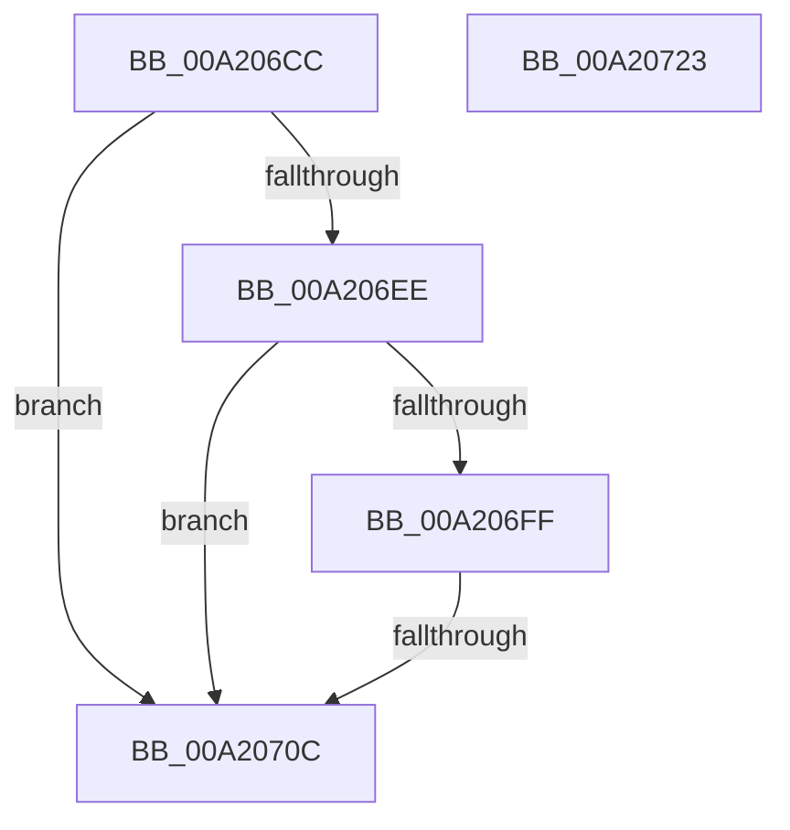

# SepIsImpersonationAllowedDueToCapability

- RVA: `0x00A206CC`–`0x00A20724` (길이 `88` bytes)
- VA: `0x0000000140A206CC`
- 실행 섹션: `PAGE`
- PDB 이름 있음: `예`; PDB Function 태그: `예`
- unwind 정보 RVA: `0x000A118C`
- 디코드: `25`개 명령, `88/88` bytes 표시
- 미해석 바이트: `0` (있으면 어셈블리에 `.byte`로 보존)

> 이 문서는 커널 이미지의 기계어와 PDB 기호를 분석해 생성했습니다. 4번과 5번은 함수 원형과 자료형을 바이너리 사용 방식에서 추정한 C 해석이며 원본 소스 복구 결과는 아닙니다.

## 1. Dependencies

- 직접 호출 지점: **1**; 고유 호출 대상: **1**
- 직접 호출자로 확인된 함수: **1**
- RIP 상대 이미지 참조: **0**

### Outgoing calls
- `0x00A206FF` → [RtlIsMultiSessionSku](RtlIsMultiSessionSku_function_00A20730.md) (function, `0x00A20730`)

### Direct callers
- [sub_008CC5C2](../8C/Unknown_function_008CC5C2.md) at `0x008CC620`

### Static image references
- 디코드된 RIP-relative 메모리 참조가 없습니다.

## 2. Other-region calls and transfers

- 다른 실행 섹션으로 향하는 call: **0**
- call이 아닌 외부 분기/꼬리 이동: **1**
  - `0x00A20706` → [sub_00B375D4](../B3/Unknown_function_00B375D4.md) (`tail-transfer`)

## 3. Assembly (complete function range)

```asm
00A206CC  48 89 5C 24 10                  mov qword ptr [rsp + 0x10], rbx
00A206D1  48 89 6C 24 18                  mov qword ptr [rsp + 0x18], rbp
00A206D6  48 89 74 24 20                  mov qword ptr [rsp + 0x20], rsi
00A206DB  57                              push rdi
00A206DC  48 83 EC 30                     sub rsp, 0x30
00A206E0  8B 41 78                        mov eax, dword ptr [rcx + 0x78]
00A206E3  48 8B FA                        mov rdi, rdx
00A206E6  48 8B D9                        mov rbx, rcx
00A206E9  39 42 78                        cmp dword ptr [rdx + 0x78], eax
00A206EC  75 1E                           jne 0x140a2070c
00A206EE  48 8B 82 D8 00 00 00            mov rax, qword ptr [rdx + 0xd8]
00A206F5  44 8B 40 28                     mov r8d, dword ptr [rax + 0x28]
00A206F9  41 F6 C0 10                     test r8b, 0x10
00A206FD  75 0D                           jne 0x140a2070c
00A206FF  E8 2C 00 00 00                  call 0x140a20730
00A20704  84 C0                           test al, al
00A20706  0F 84 C8 6E 11 00               je 0x140b375d4
00A2070C  32 C0                           xor al, al
00A2070E  48 8B 5C 24 48                  mov rbx, qword ptr [rsp + 0x48]
00A20713  48 8B 6C 24 50                  mov rbp, qword ptr [rsp + 0x50]
00A20718  48 8B 74 24 58                  mov rsi, qword ptr [rsp + 0x58]
00A2071D  48 83 C4 30                     add rsp, 0x30
00A20721  5F                              pop rdi
00A20722  C3                              ret
00A20723  CC                              int3
```

## 4. C-style interpretation (structured pseudocode)

```c
__int64 __fastcall SepIsImpersonationAllowedDueToCapability(__int64 a1, __int64 a2)
{
    __int64 result;
    __int64 v_rsp;
    unsigned __int64 v_stack_p10;
    unsigned __int64 v_stack_p18;
    unsigned __int64 v_stack_p20;

    v_stack_p10 = v_rbx;
    v_stack_p18 = v_rbp;
    v_stack_p20 = v_rsi;
    v_rsp = (v_rsp) - (48);
    if ((*(unsigned int *)(a2 + 120)) != ((unsigned int)((unsigned int)(*(unsigned int *)(a1 + 120))))) goto loc_00A2070C;
    if ((((unsigned __int8)((unsigned int)(*(unsigned int *)(*(unsigned __int64 *)(a2 + 216) + 40)))) & (16)) != 0) goto loc_00A2070C;
    result = RtlIsMultiSessionSku(a1, a2, (unsigned int)(*(unsigned int *)(*(unsigned __int64 *)(a2 + 216) + 40)), a4);
loc_00A2070C:
    result = 0;
    v_rsp = (v_rsp) + (48);
    return result;
}
```

## 5. (Beta) C Style

```c
int64_t SepIsImpersonationAllowedDueToCapability(void *Arg1, void *Arg2)
{
    uint8_t *arg1 = (uint8_t *)Arg1;
    uint8_t *arg2 = (uint8_t *)Arg2;

    int64_t result;
    int64_t local_rsp;
    uint64_t v_stack_p10;
    uint64_t v_stack_p18;
    uint64_t v_stack_p20;

    v_stack_p10 = local_rbx;
    v_stack_p18 = local_rbp;
    v_stack_p20 = local_rsi;
    local_rsp = (local_rsp) - (48);
    if ((*(uint32_t *)(arg2 + 0x78)) != ((uint32_t)((uint32_t)(*(uint32_t *)(arg1 + 0x78))))) goto loc_00A2070C;
    if ((((uint8_t)((uint32_t)(*(uint32_t *)(*(uint64_t *)(arg2 + 0xD8) + 0x28)))) & (16)) != 0) goto loc_00A2070C;
    result = RtlIsMultiSessionSku(Arg1, Arg2, (uint32_t)(*(uint32_t *)(*(uint64_t *)(arg2 + 0xD8) + 0x28)), a4);
loc_00A2070C:
    result = 0;
    local_rsp = (local_rsp) + (48);
    return result;
}
```

### 관측된 메모리 오프셋

구조체 형식이 확인되지 않은 접근은 인자 기준의 오프셋으로만 기록했습니다.

| 기준 인자 | 오프셋 표현 | 폭 (bit) | 접근 |
|---|---:|---:|---|
| `Arg1` | `+ 0x78` | `32` | `R` |
| `Arg2` | `+ 0x78` | `32` | `R` |
| `Arg2` | `+ 0xD8` | `64` | `R` |

## 6. Execution-region graph

[열기: 2D/3D 그래프와 함수 탐색 컨트롤 패널](../../../control-panel.html?section=page&rva=0x00A206CC&view=graph)

- 2D 그래프는 위에서 아래로 흐르고, 3D 그래프는 빈 공간을 드래그해 회전합니다. Shift+드래그는 이동, 휠은 확대·축소, 함수 노드 선택은 대상 보고서 이동입니다.

### Static fallback


