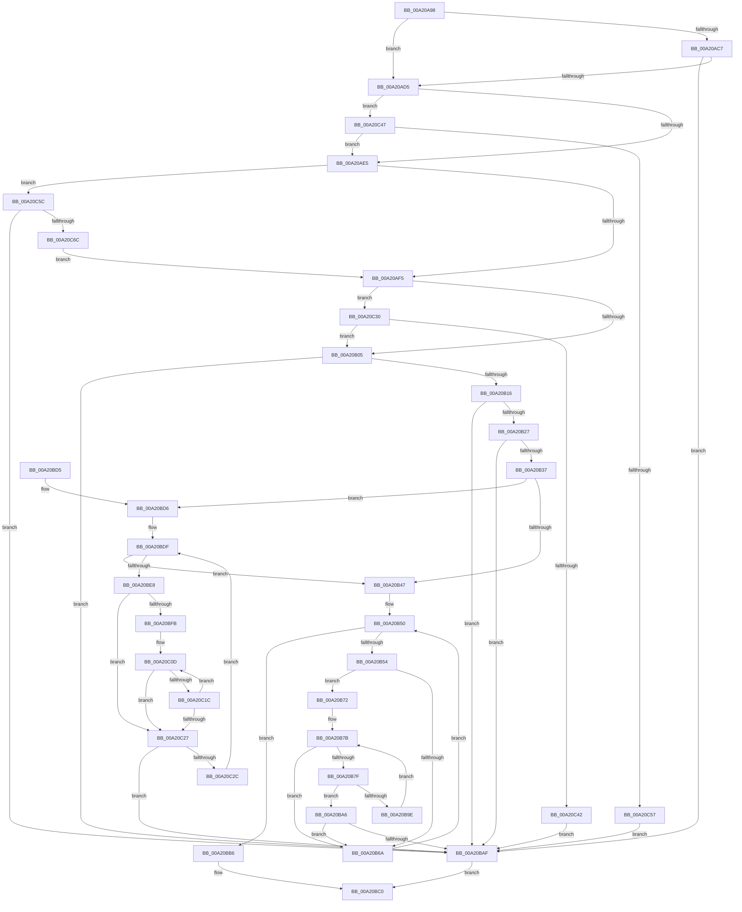

# SepNewTokenAsRestrictedAsProcessToken

- RVA: `0x00A20A98`–`0x00A20C71` (길이 `473` bytes)
- VA: `0x0000000140A20A98`
- 실행 섹션: `PAGE`
- PDB 이름 있음: `예`; PDB Function 태그: `아니요`
- unwind 정보 RVA: `0x000A7210`
- 디코드: `136`개 명령, `473/473` bytes 표시
- 미해석 바이트: `0` (있으면 어셈블리에 `.byte`로 보존)

> 이 문서는 커널 이미지의 기계어와 PDB 기호를 분석해 생성했습니다. 4번과 5번은 함수 원형과 자료형을 바이너리 사용 방식에서 추정한 C 해석이며 원본 소스 복구 결과는 아닙니다.

## 1. Dependencies

- 직접 호출 지점: **8**; 고유 호출 대상: **3**
- 직접 호출자로 확인된 함수: **2**
- RIP 상대 이미지 참조: **0**

### Outgoing calls
- `0x00A20AD8` → [SeTokenIsRestricted](../../text/43/SeTokenIsRestricted_function_00438CE0.md) (function, `0x00438CE0`)
- `0x00A20AE8` → [SeTokenIsWriteRestricted](../../text/46/SeTokenIsWriteRestricted_function_00463380.md) (function, `0x00463380`)
- `0x00A20AF8` → [SeTokenIsRestricted](../../text/43/SeTokenIsRestricted_function_00438CE0.md) (function, `0x00438CE0`)
- `0x00A20B3A` → [SeTokenIsRestricted](../../text/43/SeTokenIsRestricted_function_00438CE0.md) (function, `0x00438CE0`)
- `0x00A20B95` → [RtlEqualSid](../../text/40/RtlEqualSid_function_00400AD0.md) (function, `0x00400AD0`)
- `0x00A20C13` → [RtlEqualSid](../../text/40/RtlEqualSid_function_00400AD0.md) (function, `0x00400AD0`)
- `0x00A20C4A` → [SeTokenIsRestricted](../../text/43/SeTokenIsRestricted_function_00438CE0.md) (function, `0x00438CE0`)
- `0x00A20C5F` → [SeTokenIsWriteRestricted](../../text/46/SeTokenIsWriteRestricted_function_00463380.md) (function, `0x00463380`)

### Direct callers
- [NtDuplicateToken](../8B/NtDuplicateToken_function_008B6DF0.md) at `0x008B70F4`
- [SepFilterToken](../9C/SepFilterToken_function_009C6B80.md) at `0x009C775A`

### Static image references
- 디코드된 RIP-relative 메모리 참조가 없습니다.

## 2. Other-region calls and transfers

- 다른 실행 섹션으로 향하는 call: **8**
  - `0x00A20AD8` → [SeTokenIsRestricted](../../text/43/SeTokenIsRestricted_function_00438CE0.md) (`PAGE` → `.text`)
  - `0x00A20AE8` → [SeTokenIsWriteRestricted](../../text/46/SeTokenIsWriteRestricted_function_00463380.md) (`PAGE` → `.text`)
  - `0x00A20AF8` → [SeTokenIsRestricted](../../text/43/SeTokenIsRestricted_function_00438CE0.md) (`PAGE` → `.text`)
  - `0x00A20B3A` → [SeTokenIsRestricted](../../text/43/SeTokenIsRestricted_function_00438CE0.md) (`PAGE` → `.text`)
  - `0x00A20B95` → [RtlEqualSid](../../text/40/RtlEqualSid_function_00400AD0.md) (`PAGE` → `.text`)
  - `0x00A20C13` → [RtlEqualSid](../../text/40/RtlEqualSid_function_00400AD0.md) (`PAGE` → `.text`)
  - `0x00A20C4A` → [SeTokenIsRestricted](../../text/43/SeTokenIsRestricted_function_00438CE0.md) (`PAGE` → `.text`)
  - `0x00A20C5F` → [SeTokenIsWriteRestricted](../../text/46/SeTokenIsWriteRestricted_function_00463380.md) (`PAGE` → `.text`)
- 별도 외부 분기/꼬리 이동을 확인하지 못했습니다.

## 3. Assembly (complete function range)

```asm
00A20A98  48 89 5C 24 08                  mov qword ptr [rsp + 8], rbx
00A20A9D  4C 89 44 24 18                  mov qword ptr [rsp + 0x18], r8
00A20AA2  55                              push rbp
00A20AA3  56                              push rsi
00A20AA4  57                              push rdi
00A20AA5  41 54                           push r12
00A20AA7  41 55                           push r13
00A20AA9  41 56                           push r14
00A20AAB  41 57                           push r15
00A20AAD  48 83 EC 20                     sub rsp, 0x20
00A20AB1  41 C6 00 00                     mov byte ptr [r8], 0
00A20AB5  48 8B DA                        mov rbx, rdx
00A20AB8  8B B2 C8 00 00 00               mov esi, dword ptr [rdx + 0xc8]
00A20ABE  48 8B F9                        mov rdi, rcx
00A20AC1  0F BA E6 0B                     bt esi, 0xb
00A20AC5  73 0E                           jae 0x140a20ad5
00A20AC7  0F BA A1 C8 00 00 00 0B         bt dword ptr [rcx + 0xc8], 0xb
00A20ACF  0F 83 DA 00 00 00               jae 0x140a20baf
00A20AD5  48 8B CB                        mov rcx, rbx
00A20AD8  E8 03 82 A1 FF                  call 0x140438ce0
00A20ADD  84 C0                           test al, al
00A20ADF  0F 85 62 01 00 00               jne 0x140a20c47
00A20AE5  48 8B CB                        mov rcx, rbx
00A20AE8  E8 93 28 A4 FF                  call 0x140463380
00A20AED  84 C0                           test al, al
00A20AEF  0F 85 67 01 00 00               jne 0x140a20c5c
00A20AF5  48 8B CB                        mov rcx, rbx
00A20AF8  E8 E3 81 A1 FF                  call 0x140438ce0
00A20AFD  84 C0                           test al, al
00A20AFF  0F 85 2B 01 00 00               jne 0x140a20c30
00A20B05  48 8B 43 48                     mov rax, qword ptr [rbx + 0x48]
00A20B09  48 F7 D0                        not rax
00A20B0C  48 85 47 48                     test qword ptr [rdi + 0x48], rax
00A20B10  0F 85 99 00 00 00               jne 0x140a20baf
00A20B16  48 8B 43 40                     mov rax, qword ptr [rbx + 0x40]
00A20B1A  48 F7 D0                        not rax
00A20B1D  48 85 47 40                     test qword ptr [rdi + 0x40], rax
00A20B21  0F 85 88 00 00 00               jne 0x140a20baf
00A20B27  8B 87 C8 00 00 00               mov eax, dword ptr [rdi + 0xc8]
00A20B2D  F7 D6                           not esi
00A20B2F  23 C6                           and eax, esi
00A20B31  0F BA E0 0C                     bt eax, 0xc
00A20B35  72 78                           jb 0x140a20baf
00A20B37  48 8B CB                        mov rcx, rbx
00A20B3A  E8 A1 81 A1 FF                  call 0x140438ce0
00A20B3F  84 C0                           test al, al
00A20B41  0F 85 8F 00 00 00               jne 0x140a20bd6
00A20B47  8B 43 7C                        mov eax, dword ptr [rbx + 0x7c]
00A20B4A  33 F6                           xor esi, esi
00A20B4C  89 44 24 78                     mov dword ptr [rsp + 0x78], eax
00A20B50  3B F0                           cmp esi, eax
00A20B52  73 62                           jae 0x140a20bb6
00A20B54  4C 8B AB 98 00 00 00            mov r13, qword ptr [rbx + 0x98]
00A20B5B  44 8B F6                        mov r14d, esi
00A20B5E  4D 03 F6                        add r14, r14
00A20B61  43 8B 44 F5 08                  mov eax, dword ptr [r13 + r14*8 + 8]
00A20B66  A8 10                           test al, 0x10
00A20B68  75 08                           jne 0x140a20b72
00A20B6A  8B 44 24 78                     mov eax, dword ptr [rsp + 0x78]
00A20B6E  FF C6                           inc esi
00A20B70  EB DE                           jmp 0x140a20b50
00A20B72  8B 47 7C                        mov eax, dword ptr [rdi + 0x7c]
00A20B75  33 ED                           xor ebp, ebp
00A20B77  89 44 24 68                     mov dword ptr [rsp + 0x68], eax
00A20B7B  3B E8                           cmp ebp, eax
00A20B7D  73 EB                           jae 0x140a20b6a
00A20B7F  4C 8B A7 98 00 00 00            mov r12, qword ptr [rdi + 0x98]
00A20B86  4B 8B 4C F5 00                  mov rcx, qword ptr [r13 + r14*8]
00A20B8B  44 8B FD                        mov r15d, ebp
00A20B8E  4D 03 FF                        add r15, r15
00A20B91  4B 8B 14 FC                     mov rdx, qword ptr [r12 + r15*8]
00A20B95  E8 36 FF 9D FF                  call 0x140400ad0
00A20B9A  84 C0                           test al, al
00A20B9C  75 08                           jne 0x140a20ba6
00A20B9E  8B 44 24 68                     mov eax, dword ptr [rsp + 0x68]
00A20BA2  FF C5                           inc ebp
00A20BA4  EB D5                           jmp 0x140a20b7b
00A20BA6  43 8B 44 FC 08                  mov eax, dword ptr [r12 + r15*8 + 8]
00A20BAB  A8 10                           test al, 0x10
00A20BAD  75 BB                           jne 0x140a20b6a
00A20BAF  B8 61 00 00 C0                  mov eax, 0xc0000061
00A20BB4  EB 0A                           jmp 0x140a20bc0
00A20BB6  48 8B 44 24 70                  mov rax, qword ptr [rsp + 0x70]
00A20BBB  C6 00 01                        mov byte ptr [rax], 1
00A20BBE  33 C0                           xor eax, eax
00A20BC0  48 8B 5C 24 60                  mov rbx, qword ptr [rsp + 0x60]
00A20BC5  48 83 C4 20                     add rsp, 0x20
00A20BC9  41 5F                           pop r15
00A20BCB  41 5E                           pop r14
00A20BCD  41 5D                           pop r13
00A20BCF  41 5C                           pop r12
00A20BD1  5F                              pop rdi
00A20BD2  5E                              pop rsi
00A20BD3  5D                              pop rbp
00A20BD4  C3                              ret
00A20BD5  CC                              int3
00A20BD6  44 8B AF 80 00 00 00            mov r13d, dword ptr [rdi + 0x80]
00A20BDD  33 F6                           xor esi, esi
00A20BDF  41 3B F5                        cmp esi, r13d
00A20BE2  0F 83 5F FF FF FF               jae 0x140a20b47
00A20BE8  44 8B BB 80 00 00 00            mov r15d, dword ptr [rbx + 0x80]
00A20BEF  33 ED                           xor ebp, ebp
00A20BF1  8B CE                           mov ecx, esi
00A20BF3  48 03 C9                        add rcx, rcx
00A20BF6  45 85 FF                        test r15d, r15d
00A20BF9  74 2C                           je 0x140a20c27
00A20BFB  48 8B 87 A0 00 00 00            mov rax, qword ptr [rdi + 0xa0]
00A20C02  4C 8B B3 A0 00 00 00            mov r14, qword ptr [rbx + 0xa0]
00A20C09  4C 8B 24 C8                     mov r12, qword ptr [rax + rcx*8]
00A20C0D  49 8B 16                        mov rdx, qword ptr [r14]
00A20C10  49 8B CC                        mov rcx, r12
00A20C13  E8 B8 FE 9D FF                  call 0x140400ad0
00A20C18  84 C0                           test al, al
00A20C1A  75 0B                           jne 0x140a20c27
00A20C1C  FF C5                           inc ebp
00A20C1E  49 83 C6 10                     add r14, 0x10
00A20C22  41 3B EF                        cmp ebp, r15d
00A20C25  72 E6                           jb 0x140a20c0d
00A20C27  41 3B EF                        cmp ebp, r15d
00A20C2A  74 83                           je 0x140a20baf
00A20C2C  FF C6                           inc esi
00A20C2E  EB AF                           jmp 0x140a20bdf
00A20C30  8B 87 80 00 00 00               mov eax, dword ptr [rdi + 0x80]
00A20C36  39 83 80 00 00 00               cmp dword ptr [rbx + 0x80], eax
00A20C3C  0F 83 C3 FE FF FF               jae 0x140a20b05
00A20C42  E9 68 FF FF FF                  jmp 0x140a20baf
00A20C47  48 8B CF                        mov rcx, rdi
00A20C4A  E8 91 80 A1 FF                  call 0x140438ce0
00A20C4F  84 C0                           test al, al
00A20C51  0F 85 8E FE FF FF               jne 0x140a20ae5
00A20C57  E9 53 FF FF FF                  jmp 0x140a20baf
00A20C5C  48 8B CF                        mov rcx, rdi
00A20C5F  E8 1C 27 A4 FF                  call 0x140463380
00A20C64  84 C0                           test al, al
00A20C66  0F 84 43 FF FF FF               je 0x140a20baf
00A20C6C  E9 84 FE FF FF                  jmp 0x140a20af5
```

## 4. C-style interpretation (structured pseudocode)

```c
__int64 __fastcall SepNewTokenAsRestrictedAsProcessToken(__int64 a1, __int64 a2, __int64 a3)
{
    __int64 result;
    __int64 v_r14;
    __int64 v_r15;
    __int64 v_rbp;
    __int64 v_rsi;
    __int64 v_rsp;
    unsigned int v_stack_p10;
    unsigned __int64 v_stack_p18;
    unsigned int v_stack_p20;
    unsigned __int64 v_stack_p8;

    v_stack_p8 = v_rbx;
    v_stack_p18 = a3;
    v_rsp = (v_rsp) - (32);
    *(unsigned __int8 *)(a3) = 0;
    if (condition_is_above_or_equal) goto loc_00A20AD5;
    if (condition_is_above_or_equal) goto loc_00A20BAF;
loc_00A20AD5:
    result = SeTokenIsRestricted(a2, a2, a3, a4);
    if ((unsigned __int8)(result) != 0) goto loc_00A20C47;
loc_00A20AE5:
    result = SeTokenIsWriteRestricted(a2, a2, a3, a4);
    if ((unsigned __int8)(result) != 0) goto loc_00A20C5C;
loc_00A20AF5:
    result = SeTokenIsRestricted(a2, a2, a3, a4);
    if ((unsigned __int8)(result) != 0) goto loc_00A20C30;
loc_00A20B05:
    result = ~(*(unsigned __int64 *)(a2 + 72));
    if (((*(unsigned __int64 *)(a1 + 72)) & (result)) != 0) goto loc_00A20BAF;
    result = ~(*(unsigned __int64 *)(a2 + 64));
    if (((*(unsigned __int64 *)(a1 + 64)) & (result)) != 0) goto loc_00A20BAF;
    v_rsi = (unsigned int)(~((unsigned int)(*(unsigned int *)(a2 + 200))));
    result = (unsigned int)(((unsigned int)(*(unsigned int *)(a1 + 200))) & ((unsigned int)(v_rsi)));
    if (condition_is_below) goto loc_00A20BAF;
    result = SeTokenIsRestricted(a2, a2, a3, a4);
    if ((unsigned __int8)(result) != 0) goto loc_00A20BD6;
loc_00A20B47:
    v_rsi = 0;
    v_stack_p20 = (unsigned int)((unsigned int)(*(unsigned int *)(a2 + 124)));
loc_00A20B50:
    if (0 >= ((unsigned int)((unsigned int)(*(unsigned int *)(a2 + 124))))) goto loc_00A20BB6;
    v_r14 = (0) + (0);
    if ((((unsigned __int8)((unsigned int)(*(unsigned int *)(*(unsigned __int64 *)(a2 + 152) + v_r14 * 8 + 8)))) & (16)) != 0) goto loc_00A20B72;
loc_00A20B6A:
    v_rsi = (unsigned int)((v_rsi) + 1);
    goto loc_00A20B50;
loc_00A20B72:
    v_rbp = 0;
    v_stack_p10 = (unsigned int)((unsigned int)(*(unsigned int *)(a1 + 124)));
loc_00A20B7B:
    if (0 >= ((unsigned int)((unsigned int)(*(unsigned int *)(a1 + 124))))) goto loc_00A20B6A;
    v_r15 = (0) + (0);
    result = RtlEqualSid(*(unsigned __int64 *)(*(unsigned __int64 *)(a2 + 152) + v_r14 * 8), *(unsigned __int64 *)(*(unsigned __int64 *)(a1 + 152) + v_r15 * 8), a3, a4);
    if ((unsigned __int8)(result) != 0) goto loc_00A20BA6;
    v_rbp = (unsigned int)((v_rbp) + 1);
    goto loc_00A20B7B;
loc_00A20BA6:
    if ((((unsigned __int8)((unsigned int)(*(unsigned int *)(*(unsigned __int64 *)(a1 + 152) + v_r15 * 8 + 8)))) & (16)) != 0) goto loc_00A20B6A;
loc_00A20BAF:
    goto loc_00A20BC0;
loc_00A20BB6:
    *(unsigned __int8 *)(v_stack_p18) = 1;
    result = 0;
loc_00A20BC0:
    v_rsp = (v_rsp) + (32);
    return result;
loc_00A20BD6:
    v_rsi = 0;
loc_00A20BDF:
    if (0 >= ((unsigned int)((unsigned int)(*(unsigned int *)(a1 + 128))))) goto loc_00A20B47;
    v_rbp = 0;
    a1 = (0) + (0);
    if ((unsigned int)((unsigned int)(*(unsigned int *)(v_stack_p8 + 128))) == 0) goto loc_00A20C27;
loc_00A20C0D:
    result = RtlEqualSid(*(unsigned __int64 *)(*(unsigned __int64 *)(a1 + 160) + a1 * 8), *(unsigned __int64 *)(*(unsigned __int64 *)(v_stack_p8 + 160)), a3, a4);
    if ((unsigned __int8)(result) != 0) goto loc_00A20C27;
    v_rbp = (unsigned int)((v_rbp) + 1);
    v_r14 = (*(unsigned __int64 *)(v_stack_p8 + 160)) + (16);
    if (((unsigned int)(v_rbp)) < ((unsigned int)((unsigned int)(*(unsigned int *)(v_stack_p8 + 128))))) goto loc_00A20C0D;
loc_00A20C27:
    if (((unsigned int)(v_rbp)) == ((unsigned int)((unsigned int)(*(unsigned int *)(v_stack_p8 + 128))))) goto loc_00A20BAF;
    v_rsi = (unsigned int)((v_rsi) + 1);
    goto loc_00A20BDF;
loc_00A20C30:
    if ((*(unsigned int *)(v_stack_p8 + 128)) >= ((unsigned int)((unsigned int)(*(unsigned int *)(a1 + 128))))) goto loc_00A20B05;
    goto loc_00A20BAF;
loc_00A20C47:
    result = SeTokenIsRestricted(a1, *(unsigned __int64 *)(*(unsigned __int64 *)(v_stack_p8 + 160)), a3, a4);
    if ((unsigned __int8)(result) != 0) goto loc_00A20AE5;
    goto loc_00A20BAF;
loc_00A20C5C:
    result = SeTokenIsWriteRestricted(a1, *(unsigned __int64 *)(*(unsigned __int64 *)(v_stack_p8 + 160)), a3, a4);
    if ((unsigned __int8)(result) == 0) goto loc_00A20BAF;
    goto loc_00A20AF5;
}
```

## 5. (Beta) C Style

```c
int64_t SepNewTokenAsRestrictedAsProcessToken(void *Arg1, void *Arg2, void *Arg3)
{
    uint8_t *arg1 = (uint8_t *)Arg1;
    uint8_t *arg2 = (uint8_t *)Arg2;
    uint8_t *arg3 = (uint8_t *)Arg3;

    int64_t result;
    int64_t local_r14;
    int64_t local_r15;
    int64_t local_rbp;
    int64_t local_rsi;
    int64_t local_rsp;
    uint32_t v_stack_p10;
    uint64_t v_stack_p18;
    uint32_t v_stack_p20;
    uint64_t v_stack_p8;

    v_stack_p8 = local_rbx;
    v_stack_p18 = Arg3;
    local_rsp = (local_rsp) - (32);
    *(uint8_t *)(arg3) = 0;
    if (condition_is_above_or_equal) goto loc_00A20AD5;
    if (condition_is_above_or_equal) goto loc_00A20BAF;
loc_00A20AD5:
    result = SeTokenIsRestricted(Arg2, Arg2, Arg3, a4);
    if ((uint8_t)(result) != 0) goto loc_00A20C47;
loc_00A20AE5:
    result = SeTokenIsWriteRestricted(Arg2, Arg2, Arg3, a4);
    if ((uint8_t)(result) != 0) goto loc_00A20C5C;
loc_00A20AF5:
    result = SeTokenIsRestricted(Arg2, Arg2, Arg3, a4);
    if ((uint8_t)(result) != 0) goto loc_00A20C30;
loc_00A20B05:
    result = ~(*(uint64_t *)(arg2 + 0x48));
    if (((*(uint64_t *)(arg1 + 0x48)) & (result)) != 0) goto loc_00A20BAF;
    result = ~(*(uint64_t *)(arg2 + 0x40));
    if (((*(uint64_t *)(arg1 + 0x40)) & (result)) != 0) goto loc_00A20BAF;
    local_rsi = (uint32_t)(~((uint32_t)(*(uint32_t *)(arg2 + 0xC8))));
    result = (uint32_t)(((uint32_t)(*(uint32_t *)(arg1 + 0xC8))) & ((uint32_t)(local_rsi)));
    if (condition_is_below) goto loc_00A20BAF;
    result = SeTokenIsRestricted(Arg2, Arg2, Arg3, a4);
    if ((uint8_t)(result) != 0) goto loc_00A20BD6;
loc_00A20B47:
    local_rsi = 0;
    v_stack_p20 = (uint32_t)((uint32_t)(*(uint32_t *)(arg2 + 0x7C)));
loc_00A20B50:
    if (0 >= ((uint32_t)((uint32_t)(*(uint32_t *)(arg2 + 0x7C))))) goto loc_00A20BB6;
    local_r14 = (0) + (0);
    if ((((uint8_t)((uint32_t)(*(uint32_t *)(*(uint64_t *)(arg2 + 0x98) + local_r14 * 8 + 0x8)))) & (16)) != 0) goto loc_00A20B72;
loc_00A20B6A:
    local_rsi = (uint32_t)((local_rsi) + 1);
    goto loc_00A20B50;
loc_00A20B72:
    local_rbp = 0;
    v_stack_p10 = (uint32_t)((uint32_t)(*(uint32_t *)(arg1 + 0x7C)));
loc_00A20B7B:
    if (0 >= ((uint32_t)((uint32_t)(*(uint32_t *)(arg1 + 0x7C))))) goto loc_00A20B6A;
    local_r15 = (0) + (0);
    result = RtlEqualSid(*(uint64_t *)(*(uint64_t *)(arg2 + 0x98) + local_r14 * 8), *(uint64_t *)(*(uint64_t *)(arg1 + 0x98) + local_r15 * 8), Arg3, a4);
    if ((uint8_t)(result) != 0) goto loc_00A20BA6;
    local_rbp = (uint32_t)((local_rbp) + 1);
    goto loc_00A20B7B;
loc_00A20BA6:
    if ((((uint8_t)((uint32_t)(*(uint32_t *)(*(uint64_t *)(arg1 + 0x98) + local_r15 * 8 + 0x8)))) & (16)) != 0) goto loc_00A20B6A;
loc_00A20BAF:
    goto loc_00A20BC0;
loc_00A20BB6:
    *(uint8_t *)(v_stack_p18) = 1;
    result = 0;
loc_00A20BC0:
    local_rsp = (local_rsp) + (32);
    return result;
loc_00A20BD6:
    local_rsi = 0;
loc_00A20BDF:
    if (0 >= ((uint32_t)((uint32_t)(*(uint32_t *)(arg1 + 0x80))))) goto loc_00A20B47;
    local_rbp = 0;
    Arg1 = (0) + (0);
    if ((uint32_t)((uint32_t)(*(uint32_t *)(v_stack_p8 + 0x80))) == 0) goto loc_00A20C27;
loc_00A20C0D:
    result = RtlEqualSid(*(uint64_t *)(*(uint64_t *)(arg1 + 0xA0) + arg1 * 8), *(uint64_t *)(*(uint64_t *)(v_stack_p8 + 0xA0)), Arg3, a4);
    if ((uint8_t)(result) != 0) goto loc_00A20C27;
    local_rbp = (uint32_t)((local_rbp) + 1);
    local_r14 = (*(uint64_t *)(v_stack_p8 + 0xA0)) + (16);
    if (((uint32_t)(local_rbp)) < ((uint32_t)((uint32_t)(*(uint32_t *)(v_stack_p8 + 0x80))))) goto loc_00A20C0D;
loc_00A20C27:
    if (((uint32_t)(local_rbp)) == ((uint32_t)((uint32_t)(*(uint32_t *)(v_stack_p8 + 0x80))))) goto loc_00A20BAF;
    local_rsi = (uint32_t)((local_rsi) + 1);
    goto loc_00A20BDF;
loc_00A20C30:
    if ((*(uint32_t *)(v_stack_p8 + 0x80)) >= ((uint32_t)((uint32_t)(*(uint32_t *)(arg1 + 0x80))))) goto loc_00A20B05;
    goto loc_00A20BAF;
loc_00A20C47:
    result = SeTokenIsRestricted(Arg1, *(uint64_t *)(*(uint64_t *)(v_stack_p8 + 0xA0)), Arg3, a4);
    if ((uint8_t)(result) != 0) goto loc_00A20AE5;
    goto loc_00A20BAF;
loc_00A20C5C:
    result = SeTokenIsWriteRestricted(Arg1, *(uint64_t *)(*(uint64_t *)(v_stack_p8 + 0xA0)), Arg3, a4);
    if ((uint8_t)(result) == 0) goto loc_00A20BAF;
    goto loc_00A20AF5;
}
```

### 관측된 메모리 오프셋

구조체 형식이 확인되지 않은 접근은 인자 기준의 오프셋으로만 기록했습니다.

| 기준 인자 | 오프셋 표현 | 폭 (bit) | 접근 |
|---|---:|---:|---|
| `Arg1` | `+ 0x40` | `64` | `R` |
| `Arg1` | `+ 0x48` | `64` | `R` |
| `Arg1` | `+ 0x7C` | `32` | `R` |
| `Arg1` | `+ 0x80` | `32` | `R` |
| `Arg1` | `+ 0x98` | `64` | `R` |
| `Arg1` | `+ 0xA0` | `64` | `R` |
| `Arg1` | `+ 0xC8` | `32` | `R` |
| `Arg2` | `+ 0x40` | `64` | `R` |
| `Arg2` | `+ 0x48` | `64` | `R` |
| `Arg2` | `+ 0x7C` | `32` | `R` |
| `Arg2` | `+ 0x80` | `32` | `R` |
| `Arg2` | `+ 0x98` | `64` | `R` |
| `Arg2` | `+ 0xA0` | `64` | `R` |
| `Arg2` | `+ 0xC8` | `32` | `R` |
| `Arg3` | `+ 0x0` | `8` | `W` |

## 6. Execution-region graph

[열기: 2D/3D 그래프와 함수 탐색 컨트롤 패널](../../../control-panel.html?section=page&rva=0x00A20A98&view=graph)

- 2D 그래프는 위에서 아래로 흐르고, 3D 그래프는 빈 공간을 드래그해 회전합니다. Shift+드래그는 이동, 휠은 확대·축소, 함수 노드 선택은 대상 보고서 이동입니다.

### Static fallback


