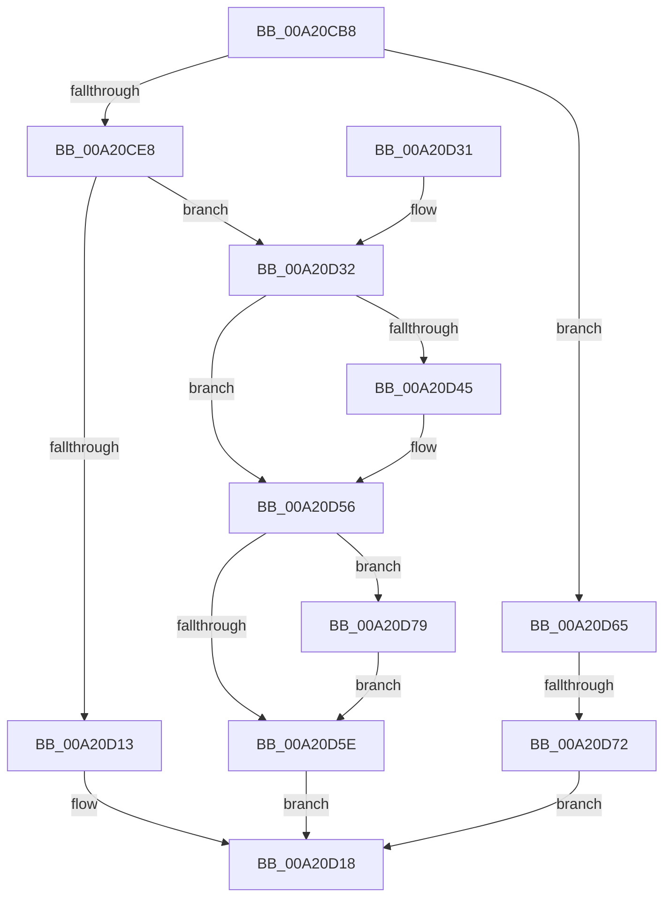

# SepSetTokenPackage

- RVA: `0x00A20CB8`–`0x00A20D86` (길이 `206` bytes)
- VA: `0x0000000140A20CB8`
- 실행 섹션: `PAGE`
- PDB 이름 있음: `예`; PDB Function 태그: `예`
- unwind 정보 RVA: `0x000AAE84`
- 디코드: `59`개 명령, `206/206` bytes 표시
- 미해석 바이트: `0` (있으면 어셈블리에 `.byte`로 보존)

> 이 문서는 커널 이미지의 기계어와 PDB 기호를 분석해 생성했습니다. 4번과 5번은 함수 원형과 자료형을 바이너리 사용 방식에서 추정한 C 해석이며 원본 소스 복구 결과는 아닙니다.

## 1. Dependencies

- 직접 호출 지점: **4**; 고유 호출 대상: **4**
- 직접 호출자로 확인된 함수: **5**
- RIP 상대 이미지 참조: **0**

### Outgoing calls
- `0x00A20D06` → [ExAllocatePool2](../../poolcode/B8/ExAllocatePool2_function_00B820F0.md) (function, `0x00B820F0`)
- `0x00A20D4E` → [memcpy](../../text/6C/memcpy_function_006C6840.md) (function, `0x006C6840`)
- `0x00A20D65` → [RtlIsParentOfChildAppContainer](../70/RtlIsParentOfChildAppContainer_function_007047CC.md) (function, `0x007047CC`)
- `0x00A20D7B` → [ExFreePoolWithTag](../../poolcode/B8/ExFreePoolWithTag_function_00B82870.md) (function, `0x00B82870`)

### Direct callers
- [SepGetAnonymousToken](../../text/30/SepGetAnonymousToken_function_00301830.md) at `0x003018E6`
- [SepCreateAppContainerToken](../../text/4F/SepCreateAppContainerToken_function_004F43AC.md) at `0x004F4B2E`
- [SepDuplicateToken](../8B/SepDuplicateToken_function_008B87EC.md) at `0x008B8E2E`
- [SepFilterToken](../9C/SepFilterToken_function_009C6B80.md) at `0x009C75A5`
- [NtCreateLowBoxToken](../AB/NtCreateLowBoxToken_function_00AB9880.md) at `0x00ABA1BF`

### Static image references
- 디코드된 RIP-relative 메모리 참조가 없습니다.

## 2. Other-region calls and transfers

- 다른 실행 섹션으로 향하는 call: **3**
  - `0x00A20D06` → [ExAllocatePool2](../../poolcode/B8/ExAllocatePool2_function_00B820F0.md) (`PAGE` → `POOLCODE`)
  - `0x00A20D4E` → [memcpy](../../text/6C/memcpy_function_006C6840.md) (`PAGE` → `.text`)
  - `0x00A20D7B` → [ExFreePoolWithTag](../../poolcode/B8/ExFreePoolWithTag_function_00B82870.md) (`PAGE` → `POOLCODE`)
- call이 아닌 외부 분기/꼬리 이동: **1**
  - `0x00A20D6C` → [sub_00B37996](../B3/Unknown_function_00B37996.md) (`tail-transfer`)

## 3. Assembly (complete function range)

```asm
00A20CB8  48 89 5C 24 08                  mov qword ptr [rsp + 8], rbx
00A20CBD  48 89 6C 24 10                  mov qword ptr [rsp + 0x10], rbp
00A20CC2  48 89 74 24 18                  mov qword ptr [rsp + 0x18], rsi
00A20CC7  57                              push rdi
00A20CC8  41 56                           push r14
00A20CCA  41 57                           push r15
00A20CCC  48 83 EC 20                     sub rsp, 0x20
00A20CD0  48 8D B9 10 03 00 00            lea rdi, [rcx + 0x310]
00A20CD7  48 8B D9                        mov rbx, rcx
00A20CDA  48 8B 0F                        mov rcx, qword ptr [rdi]
00A20CDD  48 8B F2                        mov rsi, rdx
00A20CE0  4C 8B F7                        mov r14, rdi
00A20CE3  48 85 C9                        test rcx, rcx
00A20CE6  75 7D                           jne 0x140a20d65
00A20CE8  0F B6 46 01                     movzx eax, byte ptr [rsi + 1]
00A20CEC  B9 00 01 00 00                  mov ecx, 0x100
00A20CF1  41 B8 53 65 53 69               mov r8d, 0x69536553
00A20CF7  44 8D 3C 85 0B 00 00 00         lea r15d, [rax*4 + 0xb]
00A20CFF  41 83 E7 FC                     and r15d, 0xfffffffc
00A20D03  41 8B D7                        mov edx, r15d
00A20D06  E8 E5 13 16 00                  call 0x140b820f0
00A20D0B  48 8B E8                        mov rbp, rax
00A20D0E  48 85 C0                        test rax, rax
00A20D11  75 1F                           jne 0x140a20d32
00A20D13  B8 9A 00 00 C0                  mov eax, 0xc000009a
00A20D18  48 8B 5C 24 40                  mov rbx, qword ptr [rsp + 0x40]
00A20D1D  48 8B 6C 24 48                  mov rbp, qword ptr [rsp + 0x48]
00A20D22  48 8B 74 24 50                  mov rsi, qword ptr [rsp + 0x50]
00A20D27  48 83 C4 20                     add rsp, 0x20
00A20D2B  41 5F                           pop r15
00A20D2D  41 5E                           pop r14
00A20D2F  5F                              pop rdi
00A20D30  C3                              ret
00A20D31  CC                              int3
00A20D32  0F B6 46 01                     movzx eax, byte ptr [rsi + 1]
00A20D36  48 8B DF                        mov rbx, rdi
00A20D39  8D 04 85 08 00 00 00            lea eax, [rax*4 + 8]
00A20D40  41 3B C7                        cmp eax, r15d
00A20D43  77 11                           ja 0x140a20d56
00A20D45  44 8B C0                        mov r8d, eax
00A20D48  48 8B D6                        mov rdx, rsi
00A20D4B  48 8B CD                        mov rcx, rbp
00A20D4E  E8 ED 5A CA FF                  call 0x1406c6840
00A20D53  49 8B DE                        mov rbx, r14
00A20D56  48 8B 0F                        mov rcx, qword ptr [rdi]
00A20D59  48 85 C9                        test rcx, rcx
00A20D5C  75 1B                           jne 0x140a20d79
00A20D5E  48 89 2B                        mov qword ptr [rbx], rbp
00A20D61  33 C0                           xor eax, eax
00A20D63  EB B3                           jmp 0x140a20d18
00A20D65  E8 62 3A CE FF                  call 0x1407047cc
00A20D6A  84 C0                           test al, al
00A20D6C  0F 85 24 6C 11 00               jne 0x140b37996
00A20D72  B8 22 00 00 C0                  mov eax, 0xc0000022
00A20D77  EB 9F                           jmp 0x140a20d18
00A20D79  33 D2                           xor edx, edx
00A20D7B  E8 F0 1A 16 00                  call 0x140b82870
00A20D80  48 83 23 00                     and qword ptr [rbx], 0
00A20D84  EB D8                           jmp 0x140a20d5e
```

## 4. C-style interpretation (structured pseudocode)

```c
__int64 __fastcall SepSetTokenPackage(__int64 a1, __int64 a2)
{
    __int64 result;
    __int64 v_r15;
    __int64 v_rbx;
    __int64 v_rsp;
    unsigned __int64 v_stack_p10;
    unsigned __int64 v_stack_p18;
    unsigned __int64 v_stack_p8;

    v_stack_p8 = v_rbx;
    v_stack_p10 = v_rbp;
    v_stack_p18 = v_rsi;
    v_rsp = (v_rsp) - (32);
    if (*(unsigned __int64 *)(a1 + 784) != 0) goto loc_00A20D65;
    v_r15 = (unsigned int)((*(unsigned __int8 *)(a2 + 1) * 4 + 11) & (0xFFFFFFFCULL));
    result = ExAllocatePool2(256, (unsigned int)((unsigned int)(v_r15)), (unsigned int)(0x69536553ULL), a4);
    if (result != 0) goto loc_00A20D32;
loc_00A20D18:
    v_rsp = (v_rsp) + (32);
    return (unsigned int)(0xC000009AULL);
loc_00A20D32:
    result = *(unsigned __int8 *)(v_stack_p18 + 1) * 4 + 8;
    v_rbx = a1 + 784;
    if (((unsigned int)(*(unsigned __int8 *)(v_stack_p18 + 1) * 4 + 8)) <= ((unsigned int)(v_r15))) {
        a3 = (unsigned int)(*(unsigned __int8 *)(v_stack_p18 + 1) * 4 + 8);
        a2 = v_stack_p18;
        a1 = v_stack_p10;
        result = memcpy(a1, a2, a3, a4);
        v_rbx = a1 + 784;
    }
    if (*(unsigned __int64 *)(a1 + 784) != 0) goto loc_00A20D79;
loc_00A20D5E:
    *(unsigned __int64 *)(v_rbx) = v_stack_p10;
    result = 0;
    goto loc_00A20D18;
loc_00A20D65:
    result = RtlIsParentOfChildAppContainer(*(unsigned __int64 *)(a1 + 784), a2, a3, a4);
    goto loc_00A20D18;
loc_00A20D79:
    a2 = 0;
    result = ExFreePoolWithTag(*(unsigned __int64 *)(a1 + 784), a2, a3, a4);
    goto loc_00A20D5E;
}
```

## 5. (Beta) C Style

```c
int64_t SepSetTokenPackage(void *Arg1, void *Arg2)
{
    uint8_t *arg1 = (uint8_t *)Arg1;
    uint8_t *arg2 = (uint8_t *)Arg2;

    int64_t result;
    int64_t local_r15;
    int64_t local_rbx;
    int64_t local_rsp;
    uint64_t v_stack_p10;
    uint64_t v_stack_p18;
    uint64_t v_stack_p8;

    v_stack_p8 = local_rbx;
    v_stack_p10 = local_rbp;
    v_stack_p18 = local_rsi;
    local_rsp = (local_rsp) - (32);
    if (*(uint64_t *)(arg1 + 0x310) != 0) goto loc_00A20D65;
    local_r15 = (uint32_t)((*(uint8_t *)(arg2 + 0x1) * 4 + 11) & (0xFFFFFFFCULL));
    result = ExAllocatePool2(256, (uint32_t)((uint32_t)(local_r15)), (uint32_t)(0x69536553ULL), a4);
    if (result != 0) goto loc_00A20D32;
loc_00A20D18:
    local_rsp = (local_rsp) + (32);
    return (uint32_t)(0xC000009AULL);
loc_00A20D32:
    result = *(uint8_t *)(v_stack_p18 + 0x1) * 4 + 8;
    local_rbx = Arg1 + 784;
    if (((uint32_t)(*(uint8_t *)(v_stack_p18 + 0x1) * 4 + 8)) <= ((uint32_t)(local_r15))) {
        a3 = (uint32_t)(*(uint8_t *)(v_stack_p18 + 0x1) * 4 + 8);
        Arg2 = v_stack_p18;
        Arg1 = v_stack_p10;
        result = memcpy(Arg1, Arg2, a3, a4);
        local_rbx = Arg1 + 784;
    }
    if (*(uint64_t *)(arg1 + 0x310) != 0) goto loc_00A20D79;
loc_00A20D5E:
    *(uint64_t *)(local_rbx) = v_stack_p10;
    result = 0;
    goto loc_00A20D18;
loc_00A20D65:
    result = RtlIsParentOfChildAppContainer(*(uint64_t *)(arg1 + 0x310), Arg2, a3, a4);
    goto loc_00A20D18;
loc_00A20D79:
    Arg2 = 0;
    result = ExFreePoolWithTag(*(uint64_t *)(arg1 + 0x310), Arg2, a3, a4);
    goto loc_00A20D5E;
}
```

### 관측된 메모리 오프셋

구조체 형식이 확인되지 않은 접근은 인자 기준의 오프셋으로만 기록했습니다.

| 기준 인자 | 오프셋 표현 | 폭 (bit) | 접근 |
|---|---:|---:|---|
| `Arg1` | `+ 0x0` | `64` | `R` |
| `Arg1` | `+ 0x0` | `64` | `R/W` |
| `Arg1` | `+ 0x0` | `64` | `W` |
| `Arg1` | `+ 0x310` | `64` | `R` |
| `Arg2` | `+ 0x1` | `8` | `R` |

## 6. Execution-region graph

[열기: 2D/3D 그래프와 함수 탐색 컨트롤 패널](../../../control-panel.html?section=page&rva=0x00A20CB8&view=graph)

- 2D 그래프는 위에서 아래로 흐르고, 3D 그래프는 빈 공간을 드래그해 회전합니다. Shift+드래그는 이동, 휠은 확대·축소, 함수 노드 선택은 대상 보고서 이동입니다.

### Static fallback


