# SleepstudyHelperBuildBlocker

- RVA: `0x00A2DAD0`–`0x00A2DE6E` (길이 `926` bytes)
- VA: `0x0000000140A2DAD0`
- 실행 섹션: `PAGE`
- PDB 이름 있음: `예`; PDB Function 태그: `예`
- unwind 정보 RVA: `0x000AC85C`
- 디코드: `245`개 명령, `926/926` bytes 표시
- 미해석 바이트: `0` (있으면 어셈블리에 `.byte`로 보존)

> 이 문서는 커널 이미지의 기계어와 PDB 기호를 분석해 생성했습니다. 4번과 5번은 함수 원형과 자료형을 바이너리 사용 방식에서 추정한 C 해석이며 원본 소스 복구 결과는 아닙니다.

## 1. Dependencies

- 직접 호출 지점: **20**; 고유 호출 대상: **14**
- 직접 호출자로 확인된 함수: **6**
- RIP 상대 이미지 참조: **6**

### Outgoing calls
- `0x00A2DB3F` → [PopIsPlatformAoAcCapable](../../text/49/PopIsPlatformAoAcCapable_function_0049BF40.md) (function, `0x0049BF40`)
- `0x00A2DB63` → [KeAbPreAcquire](../../text/21/KeAbPreAcquire_function_00210230.md) (function, `0x00210230`)
- `0x00A2DB7D` → [ExfAcquirePushLockExclusiveEx](../../text/20/ExfAcquirePushLockExclusiveEx_function_0020FC90.md) (function, `0x0020FC90`)
- `0x00A2DB96` → [SshpCacheLookupBlocker](SshpCacheLookupBlocker_function_00A2DF1C.md) (function, `0x00A2DF1C`)
- `0x00A2DBEA` → [SSHSupportAllocateNonPaged](../../text/4A/SSHSupportAllocateNonPaged_function_004A6134.md) (function, `0x004A6134`)
- `0x00A2DC04` → [ExAllocatePool2](../../poolcode/B8/ExAllocatePool2_function_00B820F0.md) (function, `0x00B820F0`)
- `0x00A2DCC3` → [RtlInsertElementGenericTableAvl](../../text/3E/RtlInsertElementGenericTableAvl_function_003EE510.md) (function, `0x003EE510`)
- `0x00A2DCDB` → [SSHSupportReleasePushLockExclusive](../../text/49/SSHSupportReleasePushLockExclusive_function_004954EC.md) (function, `0x004954EC`)
- `0x00A2DCFE` → [SleepstudyHelperDestroyBlockerBuilder](SleepstudyHelperDestroyBlockerBuilder_function_00A2DE80.md) (function, `0x00A2DE80`)
- `0x00A2DD0C` → [_security_check_cookie](../../text/6A/_security_check_cookie_function_006AC640.md) (function, `0x006AC640`)
- `0x00A2DD37` → [SshpReferenceBlocker](../../text/49/SshpReferenceBlocker_function_0049164C.md) (function, `0x0049164C`)
- `0x00A2DD81` → [SSHSupportReleasePushLockExclusive](../../text/49/SSHSupportReleasePushLockExclusive_function_004954EC.md) (function, `0x004954EC`)
- `0x00A2DD8E` → [KeAbPreAcquire](../../text/21/KeAbPreAcquire_function_00210230.md) (function, `0x00210230`)
- `0x00A2DDA7` → [ExfAcquirePushLockExclusiveEx](../../text/20/ExfAcquirePushLockExclusiveEx_function_0020FC90.md) (function, `0x0020FC90`)
- `0x00A2DDF6` → [SSHSupportQueryInterruptTime](../../text/4B/SSHSupportQueryInterruptTime_function_004BB458.md) (function, `0x004BB458`)
- `0x00A2DE0A` → [SSHSupportReleasePushLockExclusive](../../text/49/SSHSupportReleasePushLockExclusive_function_004954EC.md) (function, `0x004954EC`)
- `0x00A2DE19` → [SshpTracingWriteBlockerStateRundown](../../text/49/SshpTracingWriteBlockerStateRundown_function_00491A20.md) (function, `0x00491A20`)
- `0x00A2DE47` → [SshpReferenceBlocker](../../text/49/SshpReferenceBlocker_function_0049164C.md) (function, `0x0049164C`)
- `0x00A2DE54` → [CmpFreePoolWithTag](../../text/44/CmpFreePoolWithTag_function_004489E0.md) (function, `0x004489E0`)
- `0x00A2DE64` → [CmpFreePoolWithTag](../../text/44/CmpFreePoolWithTag_function_004489E0.md) (function, `0x004489E0`)

### Direct callers
- [SleepstudyHelper_RegisterComponentEx](../77/SleepstudyHelper_RegisterComponentEx_function_00774A50.md) at `0x00774AC0`
- [SleepstudyHelper_RegisterPdoWithParentGuid](../77/SleepstudyHelper_RegisterPdoWithParentGuid_function_00774B30.md) at `0x00774B8B`
- [SleepstudyHelper_RegisterPdoWithParentHandle](../77/SleepstudyHelper_RegisterPdoWithParentHandle_function_00774C00.md) at `0x00774C86`
- [SleepstudyHelper_RegisterPdoWithParentPdo](../77/SleepstudyHelper_RegisterPdoWithParentPdo_function_00774D00.md) at `0x00774D60`
- [PopPowerRequestStatsCreateSleepstudyBlocker](PopPowerRequestStatsCreateSleepstudyBlocker_function_00A2D9B0.md) at `0x00A2DA53`
- [PopUserShutdownInitializeSleepstudyDiagnostics](../../init/C3/PopUserShutdownInitializeSleepstudyDiagnostics_function_00C3EF88.md) at `0x00C3F07C`

### Static image references
- `0x00A2DAEC` → RVA `0x00E0A740` (`.data`; read)
- `0x00A2DB2F` → RVA `0x00E08400` (`.data`; read)
- `0x00A2DBA5` → RVA `0x00E0C478` (`.data`; read)
- `0x00A2DBB1` → RVA `0x00E0C47C` (`.data`; read)
- `0x00A2DBBB` → RVA `0x00F07088` (`.data`; read/write)
- `0x00A2DE12` → RVA `0x0001A1B0` (`.rdata`; read)

## 2. Other-region calls and transfers

- 다른 실행 섹션으로 향하는 call: **18**
  - `0x00A2DB3F` → [PopIsPlatformAoAcCapable](../../text/49/PopIsPlatformAoAcCapable_function_0049BF40.md) (`PAGE` → `.text`)
  - `0x00A2DB63` → [KeAbPreAcquire](../../text/21/KeAbPreAcquire_function_00210230.md) (`PAGE` → `.text`)
  - `0x00A2DB7D` → [ExfAcquirePushLockExclusiveEx](../../text/20/ExfAcquirePushLockExclusiveEx_function_0020FC90.md) (`PAGE` → `.text`)
  - `0x00A2DBEA` → [SSHSupportAllocateNonPaged](../../text/4A/SSHSupportAllocateNonPaged_function_004A6134.md) (`PAGE` → `.text`)
  - `0x00A2DC04` → [ExAllocatePool2](../../poolcode/B8/ExAllocatePool2_function_00B820F0.md) (`PAGE` → `POOLCODE`)
  - `0x00A2DCC3` → [RtlInsertElementGenericTableAvl](../../text/3E/RtlInsertElementGenericTableAvl_function_003EE510.md) (`PAGE` → `.text`)
  - `0x00A2DCDB` → [SSHSupportReleasePushLockExclusive](../../text/49/SSHSupportReleasePushLockExclusive_function_004954EC.md) (`PAGE` → `.text`)
  - `0x00A2DD0C` → [_security_check_cookie](../../text/6A/_security_check_cookie_function_006AC640.md) (`PAGE` → `.text`)
  - `0x00A2DD37` → [SshpReferenceBlocker](../../text/49/SshpReferenceBlocker_function_0049164C.md) (`PAGE` → `.text`)
  - `0x00A2DD81` → [SSHSupportReleasePushLockExclusive](../../text/49/SSHSupportReleasePushLockExclusive_function_004954EC.md) (`PAGE` → `.text`)
  - `0x00A2DD8E` → [KeAbPreAcquire](../../text/21/KeAbPreAcquire_function_00210230.md) (`PAGE` → `.text`)
  - `0x00A2DDA7` → [ExfAcquirePushLockExclusiveEx](../../text/20/ExfAcquirePushLockExclusiveEx_function_0020FC90.md) (`PAGE` → `.text`)
  - `0x00A2DDF6` → [SSHSupportQueryInterruptTime](../../text/4B/SSHSupportQueryInterruptTime_function_004BB458.md) (`PAGE` → `.text`)
  - `0x00A2DE0A` → [SSHSupportReleasePushLockExclusive](../../text/49/SSHSupportReleasePushLockExclusive_function_004954EC.md) (`PAGE` → `.text`)
  - `0x00A2DE19` → [SshpTracingWriteBlockerStateRundown](../../text/49/SshpTracingWriteBlockerStateRundown_function_00491A20.md) (`PAGE` → `.text`)
  - `0x00A2DE47` → [SshpReferenceBlocker](../../text/49/SshpReferenceBlocker_function_0049164C.md) (`PAGE` → `.text`)
  - `0x00A2DE54` → [CmpFreePoolWithTag](../../text/44/CmpFreePoolWithTag_function_004489E0.md) (`PAGE` → `.text`)
  - `0x00A2DE64` → [CmpFreePoolWithTag](../../text/44/CmpFreePoolWithTag_function_004489E0.md) (`PAGE` → `.text`)
- call이 아닌 외부 분기/꼬리 이동: **2**
  - `0x00A2DBCA` → [sub_00B3943E](../B3/Unknown_function_00B3943E.md) (`tail-transfer`)
  - `0x00A2DBD7` → [sub_00B3943E](../B3/Unknown_function_00B3943E.md) (`tail-transfer`)

## 3. Assembly (complete function range)

```asm
00A2DAD0  48 89 5C 24 18                  mov qword ptr [rsp + 0x18], rbx
00A2DAD5  55                              push rbp
00A2DAD6  56                              push rsi
00A2DAD7  57                              push rdi
00A2DAD8  41 54                           push r12
00A2DADA  41 55                           push r13
00A2DADC  41 56                           push r14
00A2DADE  41 57                           push r15
00A2DAE0  48 8D 6C 24 E0                  lea rbp, [rsp - 0x20]
00A2DAE5  48 81 EC 20 01 00 00            sub rsp, 0x120
00A2DAEC  48 8B 05 4D CC 3D 00            mov rax, qword ptr [rip + 0x3dcc4d]
00A2DAF3  48 33 C4                        xor rax, rsp
00A2DAF6  48 89 45 10                     mov qword ptr [rbp + 0x10], rax
00A2DAFA  33 DB                           xor ebx, ebx
00A2DAFC  48 89 54 24 40                  mov qword ptr [rsp + 0x40], rdx
00A2DB01  45 33 FF                        xor r15d, r15d
00A2DB04  48 89 5C 24 38                  mov qword ptr [rsp + 0x38], rbx
00A2DB09  33 F6                           xor esi, esi
00A2DB0B  48 8B C2                        mov rax, rdx
00A2DB0E  4C 8B F1                        mov r14, rcx
00A2DB11  48 85 C9                        test rcx, rcx
00A2DB14  0F 84 45 02 00 00               je 0x140a2dd5f
00A2DB1A  48 85 C0                        test rax, rax
00A2DB1D  0F 84 3C 02 00 00               je 0x140a2dd5f
00A2DB23  48 63 41 08                     movsxd rax, dword ptr [rcx + 8]
00A2DB27  4C 8D 3C 40                     lea r15, [rax + rax*2]
00A2DB2B  49 C1 E7 04                     shl r15, 4
00A2DB2F  48 8D 05 CA A8 3D 00            lea rax, [rip + 0x3da8ca]
00A2DB36  4C 03 F8                        add r15, rax
00A2DB39  41 38 5F 18                     cmp byte ptr [r15 + 0x18], bl
00A2DB3D  74 0D                           je 0x140a2db4c
00A2DB3F  E8 FC E3 A6 FF                  call 0x14049bf40
00A2DB44  84 C0                           test al, al
00A2DB46  0F 84 1D 02 00 00               je 0x140a2dd69
00A2DB4C  4C 8B 29                        mov r13, qword ptr [rcx]
00A2DB4F  45 33 C0                        xor r8d, r8d
00A2DB52  33 D2                           xor edx, edx
00A2DB54  41 8B 5D 18                     mov ebx, dword ptr [r13 + 0x18]
00A2DB58  4D 8D 65 10                     lea r12, [r13 + 0x10]
00A2DB5C  49 8B CC                        mov rcx, r12
00A2DB5F  89 5C 24 34                     mov dword ptr [rsp + 0x34], ebx
00A2DB63  E8 C8 26 7E FF                  call 0x140210230
00A2DB68  F0 49 0F BA 2C 24 00            lock bts qword ptr [r12], 0
00A2DB6F  48 8B F8                        mov rdi, rax
00A2DB72  73 0E                           jae 0x140a2db82
00A2DB74  4D 8B C4                        mov r8, r12
00A2DB77  48 8B D0                        mov rdx, rax
00A2DB7A  49 8B CC                        mov rcx, r12
00A2DB7D  E8 0E 21 7E FF                  call 0x14020fc90
00A2DB82  48 85 FF                        test rdi, rdi
00A2DB85  74 04                           je 0x140a2db8b
00A2DB87  C6 47 0A 01                     mov byte ptr [rdi + 0xa], 1
00A2DB8B  4C 8D 44 24 38                  lea r8, [rsp + 0x38]
00A2DB90  49 8B D6                        mov rdx, r14
00A2DB93  49 8B CD                        mov rcx, r13
00A2DB96  E8 81 03 00 00                  call 0x140a2df1c
00A2DB9B  8B F8                           mov edi, eax
00A2DB9D  85 C0                           test eax, eax
00A2DB9F  0F 89 88 01 00 00               jns 0x140a2dd2d
00A2DBA5  44 8B 0D CC E8 3D 00            mov r9d, dword ptr [rip + 0x3de8cc]
00A2DBAC  BF 01 00 00 00                  mov edi, 1
00A2DBB1  44 8B 15 C4 E8 3D 00            mov r10d, dword ptr [rip + 0x3de8c4]
00A2DBB8  44 8B C7                        mov r8d, edi
00A2DBBB  F0 4C 0F C1 05 C4 94 4D 00      lock xadd qword ptr [rip + 0x4d94c4], r8
00A2DBC4  4C 03 C7                        add r8, rdi
00A2DBC7  4D 3B C2                        cmp r8, r10
00A2DBCA  0F 8F 6E B8 10 00               jg 0x140b3943e
00A2DBD0  41 8B 45 28                     mov eax, dword ptr [r13 + 0x28]
00A2DBD4  41 3B C1                        cmp eax, r9d
00A2DBD7  0F 83 61 B8 10 00               jae 0x140b3943e
00A2DBDD  FF C0                           inc eax
00A2DBDF  8B D3                           mov edx, ebx
00A2DBE1  B9 38 01 00 00                  mov ecx, 0x138
00A2DBE6  41 89 45 28                     mov dword ptr [r13 + 0x28], eax
00A2DBEA  E8 45 85 A7 FF                  call 0x1404a6134
00A2DBEF  44 8B 44 24 34                  mov r8d, dword ptr [rsp + 0x34]
00A2DBF4  8D 57 77                        lea edx, [rdi + 0x77]
00A2DBF7  B9 00 01 00 00                  mov ecx, 0x100
00A2DBFC  48 89 44 24 38                  mov qword ptr [rsp + 0x38], rax
00A2DC01  48 8B D8                        mov rbx, rax
00A2DC04  E8 E7 44 15 00                  call 0x140b820f0
00A2DC09  48 8B F0                        mov rsi, rax
00A2DC0C  48 85 DB                        test rbx, rbx
00A2DC0F  0F 84 B8 00 00 00               je 0x140a2dccd
00A2DC15  48 85 C0                        test rax, rax
00A2DC18  0F 84 AF 00 00 00               je 0x140a2dccd
00A2DC1E  48 89 83 30 01 00 00            mov qword ptr [rbx + 0x130], rax
00A2DC25  48 89 58 70                     mov qword ptr [rax + 0x70], rbx
00A2DC29  48 83 23 00                     and qword ptr [rbx], 0
00A2DC2D  89 7B 10                        mov dword ptr [rbx + 0x10], edi
00A2DC30  89 7B 0C                        mov dword ptr [rbx + 0xc], edi
00A2DC33  41 80 7E 58 00                  cmp byte ptr [r14 + 0x58], 0
00A2DC38  74 06                           je 0x140a2dc40
00A2DC3A  8D 4F 03                        lea ecx, [rdi + 3]
00A2DC3D  09 4B 08                        or dword ptr [rbx + 8], ecx
00A2DC40  49 8B 46 50                     mov rax, qword ptr [r14 + 0x50]
00A2DC44  48 89 83 28 01 00 00            mov qword ptr [rbx + 0x128], rax
00A2DC4B  48 8D 46 10                     lea rax, [rsi + 0x10]
00A2DC4F  48 89 76 08                     mov qword ptr [rsi + 8], rsi
00A2DC53  48 89 36                        mov qword ptr [rsi], rsi
00A2DC56  48 89 40 08                     mov qword ptr [rax + 8], rax
00A2DC5A  48 89 00                        mov qword ptr [rax], rax
00A2DC5D  4C 89 6E 20                     mov qword ptr [rsi + 0x20], r13
00A2DC61  41 8B 46 08                     mov eax, dword ptr [r14 + 8]
00A2DC65  89 46 28                        mov dword ptr [rsi + 0x28], eax
00A2DC68  49 8B 46 40                     mov rax, qword ptr [r14 + 0x40]
00A2DC6C  48 89 46 60                     mov qword ptr [rsi + 0x60], rax
00A2DC70  49 8B 46 48                     mov rax, qword ptr [r14 + 0x48]
00A2DC74  48 89 46 68                     mov qword ptr [rsi + 0x68], rax
00A2DC78  41 0F 10 46 10                  movups xmm0, xmmword ptr [r14 + 0x10]
00A2DC7D  F3 0F 7F 46 30                  movdqu xmmword ptr [rsi + 0x30], xmm0
00A2DC82  41 0F 10 4E 20                  movups xmm1, xmmword ptr [r14 + 0x20]
00A2DC87  F3 0F 7F 4E 40                  movdqu xmmword ptr [rsi + 0x40], xmm1
00A2DC8C  41 0F 10 46 30                  movups xmm0, xmmword ptr [r14 + 0x30]
00A2DC91  F3 0F 7F 46 50                  movdqu xmmword ptr [rsi + 0x50], xmm0
00A2DC96  41 83 7D 2C 00                  cmp dword ptr [r13 + 0x2c], 0
00A2DC9B  0F 84 A7 00 00 00               je 0x140a2dd48
00A2DCA1  83 64 24 64 00                  and dword ptr [rsp + 0x64], 0
00A2DCA6  49 8D 4D 30                     lea rcx, [r13 + 0x30]
00A2DCAA  4C 8D 4C 24 30                  lea r9, [rsp + 0x30]
00A2DCAF  89 7C 24 60                     mov dword ptr [rsp + 0x60], edi
00A2DCB3  41 B8 10 00 00 00               mov r8d, 0x10
00A2DCB9  48 89 5C 24 68                  mov qword ptr [rsp + 0x68], rbx
00A2DCBE  48 8D 54 24 60                  lea rdx, [rsp + 0x60]
00A2DCC3  E8 48 08 9C FF                  call 0x1403ee510
00A2DCC8  48 85 C0                        test rax, rax
00A2DCCB  75 7B                           jne 0x140a2dd48
00A2DCCD  BF 9A 00 00 C0                  mov edi, 0xc000009a
00A2DCD2  4D 85 ED                        test r13, r13
00A2DCD5  74 09                           je 0x140a2dce0
00A2DCD7  49 8D 4D 10                     lea rcx, [r13 + 0x10]
00A2DCDB  E8 0C 78 A6 FF                  call 0x1404954ec
00A2DCE0  44 8B 7C 24 34                  mov r15d, dword ptr [rsp + 0x34]
00A2DCE5  48 85 DB                        test rbx, rbx
00A2DCE8  0F 85 60 01 00 00               jne 0x140a2de4e
00A2DCEE  48 85 F6                        test rsi, rsi
00A2DCF1  0F 85 67 01 00 00               jne 0x140a2de5e
00A2DCF7  85 FF                           test edi, edi
00A2DCF9  78 08                           js 0x140a2dd03
00A2DCFB  49 8B CE                        mov rcx, r14
00A2DCFE  E8 7D 01 00 00                  call 0x140a2de80
00A2DD03  8B C7                           mov eax, edi
00A2DD05  48 8B 4D 10                     mov rcx, qword ptr [rbp + 0x10]
00A2DD09  48 33 CC                        xor rcx, rsp
00A2DD0C  E8 2F E9 C7 FF                  call 0x1406ac640
00A2DD11  48 8B 9C 24 70 01 00 00         mov rbx, qword ptr [rsp + 0x170]
00A2DD19  48 81 C4 20 01 00 00            add rsp, 0x120
00A2DD20  41 5F                           pop r15
00A2DD22  41 5E                           pop r14
00A2DD24  41 5D                           pop r13
00A2DD26  41 5C                           pop r12
00A2DD28  5F                              pop rdi
00A2DD29  5E                              pop rsi
00A2DD2A  5D                              pop rbp
00A2DD2B  C3                              ret
00A2DD2C  CC                              int3
00A2DD2D  48 8B 5C 24 38                  mov rbx, qword ptr [rsp + 0x38]
00A2DD32  33 D2                           xor edx, edx
00A2DD34  48 8B CB                        mov rcx, rbx
00A2DD37  E8 10 39 A6 FF                  call 0x14049164c
00A2DD3C  48 8B 44 24 40                  mov rax, qword ptr [rsp + 0x40]
00A2DD41  48 89 18                        mov qword ptr [rax], rbx
00A2DD44  33 DB                           xor ebx, ebx
00A2DD46  EB 8A                           jmp 0x140a2dcd2
00A2DD48  49 81 C5 98 00 00 00            add r13, 0x98
00A2DD4F  49 8B 45 08                     mov rax, qword ptr [r13 + 8]
00A2DD53  4C 39 28                        cmp qword ptr [rax], r13
00A2DD56  74 18                           je 0x140a2dd70
00A2DD58  B9 03 00 00 00                  mov ecx, 3
00A2DD5D  CD 29                           int 0x29
00A2DD5F  BF 0D 00 00 C0                  mov edi, 0xc000000d
00A2DD64  E9 7C FF FF FF                  jmp 0x140a2dce5
00A2DD69  BF BB 00 00 C0                  mov edi, 0xc00000bb
00A2DD6E  EB 93                           jmp 0x140a2dd03
00A2DD70  4C 89 2E                        mov qword ptr [rsi], r13
00A2DD73  49 8B CC                        mov rcx, r12
00A2DD76  48 89 46 08                     mov qword ptr [rsi + 8], rax
00A2DD7A  48 89 30                        mov qword ptr [rax], rsi
00A2DD7D  49 89 75 08                     mov qword ptr [r13 + 8], rsi
00A2DD81  E8 66 77 A6 FF                  call 0x1404954ec
00A2DD86  45 33 C0                        xor r8d, r8d
00A2DD89  33 D2                           xor edx, edx
00A2DD8B  49 8B CF                        mov rcx, r15
00A2DD8E  E8 9D 24 7E FF                  call 0x140210230
00A2DD93  F0 49 0F BA 2F 00               lock bts qword ptr [r15], 0
00A2DD99  48 8B D8                        mov rbx, rax
00A2DD9C  73 0E                           jae 0x140a2ddac
00A2DD9E  4D 8B C7                        mov r8, r15
00A2DDA1  48 8B D0                        mov rdx, rax
00A2DDA4  49 8B CF                        mov rcx, r15
00A2DDA7  E8 E4 1E 7E FF                  call 0x14020fc90
00A2DDAC  33 FF                           xor edi, edi
00A2DDAE  48 85 DB                        test rbx, rbx
00A2DDB1  74 04                           je 0x140a2ddb7
00A2DDB3  C6 43 0A 01                     mov byte ptr [rbx + 0xa], 1
00A2DDB7  49 8D 47 20                     lea rax, [r15 + 0x20]
00A2DDBB  48 83 C6 10                     add rsi, 0x10
00A2DDBF  48 8B 48 08                     mov rcx, qword ptr [rax + 8]
00A2DDC3  48 39 01                        cmp qword ptr [rcx], rax
00A2DDC6  75 90                           jne 0x140a2dd58
00A2DDC8  48 8B 5C 24 38                  mov rbx, qword ptr [rsp + 0x38]
00A2DDCD  48 89 4E 08                     mov qword ptr [rsi + 8], rcx
00A2DDD1  48 89 06                        mov qword ptr [rsi], rax
00A2DDD4  48 89 31                        mov qword ptr [rcx], rsi
00A2DDD7  48 89 70 08                     mov qword ptr [rax + 8], rsi
00A2DDDB  8B 43 08                        mov eax, dword ptr [rbx + 8]
00A2DDDE  41 8B 4F 1C                     mov ecx, dword ptr [r15 + 0x1c]
00A2DDE2  03 C9                           add ecx, ecx
00A2DDE4  33 C8                           xor ecx, eax
00A2DDE6  83 E1 02                        and ecx, 2
00A2DDE9  33 C8                           xor ecx, eax
00A2DDEB  89 4B 08                        mov dword ptr [rbx + 8], ecx
00A2DDEE  41 8B 47 1C                     mov eax, dword ptr [r15 + 0x1c]
00A2DDF2  A8 01                           test al, 1
00A2DDF4  74 09                           je 0x140a2ddff
00A2DDF6  E8 5D D6 A8 FF                  call 0x1404bb458
00A2DDFB  48 89 43 20                     mov qword ptr [rbx + 0x20], rax
00A2DDFF  41 8B 47 1C                     mov eax, dword ptr [r15 + 0x1c]
00A2DE03  A8 02                           test al, 2
00A2DE05  75 38                           jne 0x140a2de3f
00A2DE07  49 8B CF                        mov rcx, r15
00A2DE0A  E8 DD 76 A6 FF                  call 0x1404954ec
00A2DE0F  48 8B D3                        mov rdx, rbx
00A2DE12  48 8D 0D 97 C3 5E FF            lea rcx, [rip - 0xa13c69]
00A2DE19  E8 02 3C A6 FF                  call 0x140491a20
00A2DE1E  48 8B 44 24 40                  mov rax, qword ptr [rsp + 0x40]
00A2DE23  0F 57 C0                        xorps xmm0, xmm0
00A2DE26  49 89 7E 50                     mov qword ptr [r14 + 0x50], rdi
00A2DE2A  49 89 7E 40                     mov qword ptr [r14 + 0x40], rdi
00A2DE2E  49 89 7E 48                     mov qword ptr [r14 + 0x48], rdi
00A2DE32  41 0F 11 46 30                  movups xmmword ptr [r14 + 0x30], xmm0
00A2DE37  48 89 18                        mov qword ptr [rax], rbx
00A2DE3A  E9 BC FE FF FF                  jmp 0x140a2dcfb
00A2DE3F  BA 01 00 00 00                  mov edx, 1
00A2DE44  48 8B CB                        mov rcx, rbx
00A2DE47  E8 00 38 A6 FF                  call 0x14049164c
00A2DE4C  EB B9                           jmp 0x140a2de07
00A2DE4E  41 8B D7                        mov edx, r15d
00A2DE51  48 8B CB                        mov rcx, rbx
00A2DE54  E8 87 AB A1 FF                  call 0x1404489e0
00A2DE59  E9 90 FE FF FF                  jmp 0x140a2dcee
00A2DE5E  41 8B D7                        mov edx, r15d
00A2DE61  48 8B CE                        mov rcx, rsi
00A2DE64  E8 77 AB A1 FF                  call 0x1404489e0
00A2DE69  E9 89 FE FF FF                  jmp 0x140a2dcf7
```

## 4. C-style interpretation (structured pseudocode)

```c
__int64 __fastcall SleepstudyHelperBuildBlocker(__int64 a1, __int64 a2, int a3)
{
    __int64 result;
    __int64 v_r13;
    __int64 v_r15;
    __int64 v_rbx;
    __int64 v_rdi;
    __int64 v_rsi;
    __int64 v_rsp;
    unsigned __int64 v_stack_m118;
    unsigned __int64 v_stack_m120;
    unsigned int v_stack_m124;
    unsigned __int64 v_stack_m128;
    unsigned __int64 v_stack_m48;
    unsigned __int64 v_stack_m58;
    unsigned __int64 v_stack_mF0;
    unsigned int v_stack_mF4;
    unsigned int v_stack_mF8;
    unsigned __int64 v_stack_p18;
    unsigned __int64 v_stack_p38;
    unsigned __int64 v_stack_p40;

    v_stack_p18 = v_rbx;
    v_rsp = (v_rsp) - (288);
    result = (*(unsigned __int64 *)(v_rip + 4049997)) ^ (v_rsp);
    v_stack_m48 = result;
    v_rbx = 0;
    v_stack_m118 = a2;
    v_r15 = 0;
    v_stack_m120 = 0;
    v_rsi = 0;
    if (a1 == 0) goto loc_00A2DD5F;
    if (a2 == 0) goto loc_00A2DD5F;
    v_r15 = ((int)(*(unsigned int *)(a1 + 8)) + (int)(*(unsigned int *)(a1 + 8)) * 2) << (4);
    v_r15 = (v_r15) + (v_rip + 4040906);
    if ((*(unsigned __int8 *)(v_r15 + 24)) == 0) goto loc_00A2DB4C;
    result = PopIsPlatformAoAcCapable(a1, a2, a3, a4);
    if ((unsigned __int8)(result) == 0) goto loc_00A2DD69;
loc_00A2DB4C:
    a3 = 0;
    a2 = 0;
    v_stack_m124 = (unsigned int)((unsigned int)(*(unsigned int *)(*(unsigned __int64 *)(a1) + 24)));
    result = KeAbPreAcquire(*(unsigned __int64 *)(a1) + 16, a2, a3, a4);
    if (!(condition_is_above_or_equal)) {
        a3 = *(unsigned __int64 *)(a1) + 16;
        a2 = result;
        a1 = *(unsigned __int64 *)(a1) + 16;
        result = ExfAcquirePushLockExclusiveEx(a1, a2, a3, a4);
    }
    if (result != 0) {
        *(unsigned __int8 *)(result + 10) = 1;
    }
    result = SshpCacheLookupBlocker(*(unsigned __int64 *)(a1), a1, v_stack_m120, a4);
    if (!sign_flag) goto loc_00A2DD2D;
    a3 = (1) + (1);
    result = (unsigned int)(((unsigned int)(*(unsigned int *)(*(unsigned __int64 *)(a1) + 40))) + 1);
    *(unsigned int *)(*(unsigned __int64 *)(a1) + 40) = (unsigned int)(result);
    result = SSHSupportAllocateNonPaged(312, (unsigned int)((unsigned int)((unsigned int)(*(unsigned int *)(*(unsigned __int64 *)(a1) + 24)))), a3, (unsigned int)(*(unsigned int *)(v_rip + 4057292)));
    v_stack_m120 = result;
    result = ExAllocatePool2(256, 1 + 119, (unsigned int)(v_stack_m124), (unsigned int)(*(unsigned int *)(v_rip + 4057292)));
    if (result == 0) goto loc_00A2DCCD;
    if (result == 0) goto loc_00A2DCCD;
    *(unsigned __int64 *)(result + 304) = result;
    *(unsigned __int64 *)(result + 112) = result;
    *(unsigned int *)(result + 16) = 1;
    *(unsigned int *)(result + 12) = 1;
    if ((*(unsigned __int8 *)(a1 + 88)) != 0) {
        a1 = 1 + 3;
    }
    *(unsigned __int64 *)(result + 296) = *(unsigned __int64 *)(a1 + 80);
    *(unsigned __int64 *)(result + 8) = result;
    *(unsigned __int64 *)(result) = result;
    *(unsigned __int64 *)(result + 16 + 8) = result + 16;
    *(unsigned __int64 *)(result + 16) = result + 16;
    *(unsigned __int64 *)(result + 32) = *(unsigned __int64 *)(a1);
    *(unsigned int *)(result + 40) = (unsigned int)((unsigned int)(*(unsigned int *)(a1 + 8)));
    *(unsigned __int64 *)(result + 96) = *(unsigned __int64 *)(a1 + 64);
    *(unsigned __int64 *)(result + 104) = *(unsigned __int64 *)(a1 + 72);
    *(unsigned __int64 *)(result + 48) = v_xmm0;
    *(unsigned __int64 *)(result + 64) = v_xmm1;
    *(unsigned __int64 *)(result + 80) = v_xmm0;
    if ((*(unsigned int *)(*(unsigned __int64 *)(a1) + 44)) == 0) goto loc_00A2DD48;
    v_stack_mF8 = 1;
    v_stack_mF0 = result;
    result = RtlInsertElementGenericTableAvl(*(unsigned __int64 *)(a1) + 48, v_stack_mF8, 16, v_stack_m128);
    if (result != 0) goto loc_00A2DD48;
loc_00A2DCCD:
loc_00A2DCD2:
    if (*(unsigned __int64 *)(a1) != 0) {
        a1 = *(unsigned __int64 *)(a1) + 16;
        result = SSHSupportReleasePushLockExclusive(a1, v_stack_mF8, 16, v_stack_m128);
    }
loc_00A2DCE5:
    if (result != 0) goto loc_00A2DE4E;
loc_00A2DCEE:
    if (result != 0) goto loc_00A2DE5E;
loc_00A2DCF7:
    if (!(sign_flag)) {
        a1 = a1;
        result = SleepstudyHelperDestroyBlockerBuilder(a1, v_stack_mF8, 16, v_stack_m128);
    }
    a1 = (v_stack_m48) ^ (v_rsp);
    result = _security_check_cookie(a1, v_stack_mF8, 16, v_stack_m128);
    v_rsp = (v_rsp) + (288);
    return result;
loc_00A2DD2D:
    a2 = 0;
    result = SshpReferenceBlocker(v_stack_p38, a2, 16, v_stack_m128);
    *(unsigned __int64 *)(v_stack_p40) = v_stack_p38;
    v_rbx = 0;
    goto loc_00A2DCD2;
loc_00A2DD48:
    v_r13 = (*(unsigned __int64 *)(a1)) + (152);
    if ((*(unsigned __int64 *)(*(unsigned __int64 *)(v_r13 + 8))) == v_r13) goto loc_00A2DD70;
loc_00A2DD58:
loc_00A2DD5F:
    goto loc_00A2DCE5;
loc_00A2DD69:
    goto loc_00A2DD03;
loc_00A2DD70:
    *(unsigned __int64 *)(result) = v_r13;
    *(unsigned __int64 *)(result + 8) = *(unsigned __int64 *)(v_r13 + 8);
    *(unsigned __int64 *)(*(unsigned __int64 *)(v_r13 + 8)) = result;
    *(unsigned __int64 *)(v_r13 + 8) = result;
    result = SSHSupportReleasePushLockExclusive(*(unsigned __int64 *)(a1) + 16, a2, 16, v_stack_m128);
    a3 = 0;
    a2 = 0;
    result = KeAbPreAcquire((unsigned int)(v_stack_m124), a2, a3, v_stack_m128);
    if (!(condition_is_above_or_equal)) {
        a3 = (unsigned int)(v_stack_m124);
        a2 = result;
        a1 = (unsigned int)(v_stack_m124);
        result = ExfAcquirePushLockExclusiveEx(a1, a2, a3, v_stack_m128);
    }
    v_rdi = 0;
    if (result != 0) {
        *(unsigned __int8 *)(result + 10) = 1;
    }
    v_rsi = (result) + (16);
    if ((*(unsigned __int64 *)(*(unsigned __int64 *)((unsigned int)(v_stack_m124) + 32 + 8))) != ((unsigned int)(v_stack_m124) + 32)) goto loc_00A2DD58;
    *(unsigned __int64 *)(v_rsi + 8) = *(unsigned __int64 *)((unsigned int)(v_stack_m124) + 32 + 8);
    *(unsigned __int64 *)(v_rsi) = (unsigned int)(v_stack_m124) + 32;
    *(unsigned __int64 *)(*(unsigned __int64 *)((unsigned int)(v_stack_m124) + 32 + 8)) = v_rsi;
    *(unsigned __int64 *)((unsigned int)(v_stack_m124) + 32 + 8) = v_rsi;
    a1 = (unsigned int)(((unsigned int)(*(unsigned int *)((unsigned int)(v_stack_m124) + 28))) + ((unsigned int)((unsigned int)(*(unsigned int *)((unsigned int)(v_stack_m124) + 28)))));
    a1 = (unsigned int)((a1) ^ ((unsigned int)((unsigned int)(*(unsigned int *)(v_stack_p38 + 8)))));
    a1 = (unsigned int)((a1) & (2));
    a1 = (unsigned int)((a1) ^ ((unsigned int)((unsigned int)(*(unsigned int *)(v_stack_p38 + 8)))));
    *(unsigned int *)(v_stack_p38 + 8) = (unsigned int)(a1);
    result = (unsigned int)(*(unsigned int *)((unsigned int)(v_stack_m124) + 28));
    if ((((unsigned __int8)((unsigned int)(*(unsigned int *)((unsigned int)(v_stack_m124) + 28)))) & (1)) != 0) {
        result = SSHSupportQueryInterruptTime(a1, a2, a3, v_stack_m128);
        *(unsigned __int64 *)(v_stack_p38 + 32) = result;
    }
    if ((((unsigned __int8)((unsigned int)(*(unsigned int *)((unsigned int)(v_stack_m124) + 28)))) & (2)) != 0) goto loc_00A2DE3F;
loc_00A2DE07:
    result = SSHSupportReleasePushLockExclusive((unsigned int)(v_stack_m124), a2, a3, v_stack_m128);
    result = SshpTracingWriteBlockerStateRundown(v_rip - 10566761, v_stack_p38, a3, v_stack_m128);
    *(unsigned __int64 *)(a1 + 80) = 0;
    *(unsigned __int64 *)(a1 + 64) = 0;
    *(unsigned __int64 *)(a1 + 72) = 0;
    *(unsigned __int64 *)(a1 + 48) = v_xmm0;
    *(unsigned __int64 *)(v_stack_p40) = v_stack_p38;
    goto loc_00A2DCFB;
loc_00A2DE3F:
    result = SshpReferenceBlocker(v_stack_p38, 1, a3, v_stack_m128);
    goto loc_00A2DE07;
loc_00A2DE4E:
    result = CmpFreePoolWithTag(v_stack_p38, (unsigned int)((unsigned int)((unsigned int)(v_stack_m124))), a3, v_stack_m128);
    goto loc_00A2DCEE;
loc_00A2DE5E:
    result = CmpFreePoolWithTag(v_rsi, (unsigned int)((unsigned int)((unsigned int)(v_stack_m124))), a3, v_stack_m128);
    goto loc_00A2DCF7;
}
```

## 5. (Beta) C Style

```c
int64_t SleepstudyHelperBuildBlocker(void *Arg1, int64_t Arg2, int32_t Arg3)
{
    uint8_t *arg1 = (uint8_t *)Arg1;

    int64_t result;
    int64_t local_r13;
    int64_t local_r15;
    int64_t local_rbx;
    int64_t local_rdi;
    int64_t local_rsi;
    int64_t local_rsp;
    uint64_t v_stack_m118;
    uint64_t v_stack_m120;
    uint32_t v_stack_m124;
    uint64_t v_stack_m128;
    uint64_t v_stack_m48;
    uint64_t v_stack_m58;
    uint64_t v_stack_mF0;
    uint32_t v_stack_mF4;
    uint32_t v_stack_mF8;
    uint64_t v_stack_p18;
    uint64_t v_stack_p38;
    uint64_t v_stack_p40;

    v_stack_p18 = local_rbx;
    local_rsp = (local_rsp) - (288);
    result = (*(uint64_t *)(v_rip + 0x3DCC4D)) ^ (local_rsp);
    v_stack_m48 = result;
    local_rbx = 0;
    v_stack_m118 = Arg2;
    local_r15 = 0;
    v_stack_m120 = 0;
    local_rsi = 0;
    if (Arg1 == NULL) goto loc_00A2DD5F;
    if (Arg2 == 0) goto loc_00A2DD5F;
    local_r15 = ((int32_t)(*(uint32_t *)(arg1 + 0x8)) + (int32_t)(*(uint32_t *)(arg1 + 0x8)) * 2) << (4);
    local_r15 = (local_r15) + (v_rip + 4040906);
    if ((*(uint8_t *)(local_r15 + 0x18)) == 0) goto loc_00A2DB4C;
    result = PopIsPlatformAoAcCapable(Arg1, Arg2, Arg3, a4);
    if ((uint8_t)(result) == 0) goto loc_00A2DD69;
loc_00A2DB4C:
    Arg3 = 0;
    Arg2 = 0;
    v_stack_m124 = (uint32_t)((uint32_t)(*(uint32_t *)(*(uint64_t *)(arg1) + 0x18)));
    result = KeAbPreAcquire(*(uint64_t *)(arg1) + 16, Arg2, Arg3, a4);
    if (!(condition_is_above_or_equal)) {
        Arg3 = *(uint64_t *)(arg1) + 16;
        Arg2 = result;
        Arg1 = *(uint64_t *)(arg1) + 16;
        result = ExfAcquirePushLockExclusiveEx(Arg1, Arg2, Arg3, a4);
    }
    if (result != 0) {
        *(uint8_t *)(result + 0xA) = 1;
    }
    result = SshpCacheLookupBlocker(*(uint64_t *)(arg1), Arg1, v_stack_m120, a4);
    if (!sign_flag) goto loc_00A2DD2D;
    Arg3 = (1) + (1);
    result = (uint32_t)(((uint32_t)(*(uint32_t *)(*(uint64_t *)(arg1) + 0x28))) + 1);
    *(uint32_t *)(*(uint64_t *)(arg1) + 0x28) = (uint32_t)(result);
    result = SSHSupportAllocateNonPaged(312, (uint32_t)((uint32_t)((uint32_t)(*(uint32_t *)(*(uint64_t *)(arg1) + 0x18)))), Arg3, (uint32_t)(*(uint32_t *)(v_rip + 0x3DE8CC)));
    v_stack_m120 = result;
    result = ExAllocatePool2(256, 1 + 119, (uint32_t)(v_stack_m124), (uint32_t)(*(uint32_t *)(v_rip + 0x3DE8CC)));
    if (result == 0) goto loc_00A2DCCD;
    if (result == 0) goto loc_00A2DCCD;
    *(uint64_t *)(result + 0x130) = result;
    *(uint64_t *)(result + 0x70) = result;
    *(uint32_t *)(result + 0x10) = 1;
    *(uint32_t *)(result + 0xC) = 1;
    if ((*(uint8_t *)(arg1 + 0x58)) != 0) {
        Arg1 = 1 + 3;
    }
    *(uint64_t *)(result + 0x128) = *(uint64_t *)(arg1 + 0x50);
    *(uint64_t *)(result + 0x8) = result;
    *(uint64_t *)(result) = result;
    *(uint64_t *)(result + 0x10 + 0x8) = result + 16;
    *(uint64_t *)(result + 0x10) = result + 16;
    *(uint64_t *)(result + 0x20) = *(uint64_t *)(arg1);
    *(uint32_t *)(result + 0x28) = (uint32_t)((uint32_t)(*(uint32_t *)(arg1 + 0x8)));
    *(uint64_t *)(result + 0x60) = *(uint64_t *)(arg1 + 0x40);
    *(uint64_t *)(result + 0x68) = *(uint64_t *)(arg1 + 0x48);
    *(uint64_t *)(result + 0x30) = v_xmm0;
    *(uint64_t *)(result + 0x40) = v_xmm1;
    *(uint64_t *)(result + 0x50) = v_xmm0;
    if ((*(uint32_t *)(*(uint64_t *)(arg1) + 0x2C)) == 0) goto loc_00A2DD48;
    v_stack_mF8 = 1;
    v_stack_mF0 = result;
    result = RtlInsertElementGenericTableAvl(*(uint64_t *)(arg1) + 48, v_stack_mF8, 16, v_stack_m128);
    if (result != 0) goto loc_00A2DD48;
loc_00A2DCCD:
loc_00A2DCD2:
    if (*(uint64_t *)(arg1) != 0) {
        Arg1 = *(uint64_t *)(arg1) + 16;
        result = SSHSupportReleasePushLockExclusive(Arg1, v_stack_mF8, 16, v_stack_m128);
    }
loc_00A2DCE5:
    if (result != 0) goto loc_00A2DE4E;
loc_00A2DCEE:
    if (result != 0) goto loc_00A2DE5E;
loc_00A2DCF7:
    if (!(sign_flag)) {
        Arg1 = Arg1;
        result = SleepstudyHelperDestroyBlockerBuilder(Arg1, v_stack_mF8, 16, v_stack_m128);
    }
    Arg1 = (v_stack_m48) ^ (local_rsp);
    result = _security_check_cookie(Arg1, v_stack_mF8, 16, v_stack_m128);
    local_rsp = (local_rsp) + (288);
    return result;
loc_00A2DD2D:
    Arg2 = 0;
    result = SshpReferenceBlocker(v_stack_p38, Arg2, 16, v_stack_m128);
    *(uint64_t *)(v_stack_p40) = v_stack_p38;
    local_rbx = 0;
    goto loc_00A2DCD2;
loc_00A2DD48:
    local_r13 = (*(uint64_t *)(arg1)) + (152);
    if ((*(uint64_t *)(*(uint64_t *)(local_r13 + 0x8))) == local_r13) goto loc_00A2DD70;
loc_00A2DD58:
loc_00A2DD5F:
    goto loc_00A2DCE5;
loc_00A2DD69:
    goto loc_00A2DD03;
loc_00A2DD70:
    *(uint64_t *)(result) = local_r13;
    *(uint64_t *)(result + 0x8) = *(uint64_t *)(local_r13 + 0x8);
    *(uint64_t *)(*(uint64_t *)(local_r13 + 0x8)) = result;
    *(uint64_t *)(local_r13 + 0x8) = result;
    result = SSHSupportReleasePushLockExclusive(*(uint64_t *)(arg1) + 16, Arg2, 16, v_stack_m128);
    Arg3 = 0;
    Arg2 = 0;
    result = KeAbPreAcquire((uint32_t)(v_stack_m124), Arg2, Arg3, v_stack_m128);
    if (!(condition_is_above_or_equal)) {
        Arg3 = (uint32_t)(v_stack_m124);
        Arg2 = result;
        Arg1 = (uint32_t)(v_stack_m124);
        result = ExfAcquirePushLockExclusiveEx(Arg1, Arg2, Arg3, v_stack_m128);
    }
    local_rdi = 0;
    if (result != 0) {
        *(uint8_t *)(result + 0xA) = 1;
    }
    local_rsi = (result) + (16);
    if ((*(uint64_t *)(*(uint64_t *)((uint32_t)(v_stack_m124) + 0x20 + 0x8))) != ((uint32_t)(v_stack_m124) + 32)) goto loc_00A2DD58;
    *(uint64_t *)(local_rsi + 0x8) = *(uint64_t *)((uint32_t)(v_stack_m124) + 0x20 + 0x8);
    *(uint64_t *)(local_rsi) = (uint32_t)(v_stack_m124) + 32;
    *(uint64_t *)(*(uint64_t *)((uint32_t)(v_stack_m124) + 0x20 + 0x8)) = local_rsi;
    *(uint64_t *)((uint32_t)(v_stack_m124) + 0x20 + 0x8) = local_rsi;
    Arg1 = (uint32_t)(((uint32_t)(*(uint32_t *)((uint32_t)(v_stack_m124) + 0x1C))) + ((uint32_t)((uint32_t)(*(uint32_t *)((uint32_t)(v_stack_m124) + 0x1C)))));
    Arg1 = (uint32_t)((Arg1) ^ ((uint32_t)((uint32_t)(*(uint32_t *)(v_stack_p38 + 0x8)))));
    Arg1 = (uint32_t)((Arg1) & (2));
    Arg1 = (uint32_t)((Arg1) ^ ((uint32_t)((uint32_t)(*(uint32_t *)(v_stack_p38 + 0x8)))));
    *(uint32_t *)(v_stack_p38 + 0x8) = (uint32_t)(Arg1);
    result = (uint32_t)(*(uint32_t *)((uint32_t)(v_stack_m124) + 0x1C));
    if ((((uint8_t)((uint32_t)(*(uint32_t *)((uint32_t)(v_stack_m124) + 0x1C)))) & (1)) != 0) {
        result = SSHSupportQueryInterruptTime(Arg1, Arg2, Arg3, v_stack_m128);
        *(uint64_t *)(v_stack_p38 + 0x20) = result;
    }
    if ((((uint8_t)((uint32_t)(*(uint32_t *)((uint32_t)(v_stack_m124) + 0x1C)))) & (2)) != 0) goto loc_00A2DE3F;
loc_00A2DE07:
    result = SSHSupportReleasePushLockExclusive((uint32_t)(v_stack_m124), Arg2, Arg3, v_stack_m128);
    result = SshpTracingWriteBlockerStateRundown(v_rip - 10566761, v_stack_p38, Arg3, v_stack_m128);
    *(uint64_t *)(arg1 + 0x50) = 0;
    *(uint64_t *)(arg1 + 0x40) = 0;
    *(uint64_t *)(arg1 + 0x48) = 0;
    *(uint64_t *)(arg1 + 0x30) = v_xmm0;
    *(uint64_t *)(v_stack_p40) = v_stack_p38;
    goto loc_00A2DCFB;
loc_00A2DE3F:
    result = SshpReferenceBlocker(v_stack_p38, 1, Arg3, v_stack_m128);
    goto loc_00A2DE07;
loc_00A2DE4E:
    result = CmpFreePoolWithTag(v_stack_p38, (uint32_t)((uint32_t)((uint32_t)(v_stack_m124))), Arg3, v_stack_m128);
    goto loc_00A2DCEE;
loc_00A2DE5E:
    result = CmpFreePoolWithTag(local_rsi, (uint32_t)((uint32_t)((uint32_t)(v_stack_m124))), Arg3, v_stack_m128);
    goto loc_00A2DCF7;
}
```

### 관측된 메모리 오프셋

구조체 형식이 확인되지 않은 접근은 인자 기준의 오프셋으로만 기록했습니다.

| 기준 인자 | 오프셋 표현 | 폭 (bit) | 접근 |
|---|---:|---:|---|
| `Arg1` | `+ 0x8` | `32` | `R` |
| `Arg1` | `+ 0x10` | `128` | `R` |
| `Arg1` | `+ 0x20` | `128` | `R` |
| `Arg1` | `+ 0x30` | `128` | `R` |
| `Arg1` | `+ 0x40` | `64` | `R` |
| `Arg1` | `+ 0x40` | `64` | `W` |
| `Arg1` | `+ 0x48` | `64` | `R` |
| `Arg1` | `+ 0x48` | `64` | `W` |
| `Arg1` | `+ 0x50` | `64` | `R` |
| `Arg1` | `+ 0x50` | `64` | `W` |
| `Arg1` | `+ 0x58` | `8` | `R` |

## 6. Execution-region graph

[열기: 2D/3D 그래프와 함수 탐색 컨트롤 패널](../../../control-panel.html?section=page&rva=0x00A2DAD0&view=graph)

- 2D 그래프는 위에서 아래로 흐르고, 3D 그래프는 빈 공간을 드래그해 회전합니다. Shift+드래그는 이동, 휠은 확대·축소, 함수 노드 선택은 대상 보고서 이동입니다.

### Static fallback

```mermaid
flowchart TD
  bb_00A2DAD0[BB_00A2DAD0]
  bb_00A2DB1A[BB_00A2DB1A]
  bb_00A2DB23[BB_00A2DB23]
  bb_00A2DB3F[BB_00A2DB3F]
  bb_00A2DB4C[BB_00A2DB4C]
  bb_00A2DB74[BB_00A2DB74]
  bb_00A2DB82[BB_00A2DB82]
  bb_00A2DB87[BB_00A2DB87]
  bb_00A2DB8B[BB_00A2DB8B]
  bb_00A2DBA5[BB_00A2DBA5]
  bb_00A2DBD0[BB_00A2DBD0]
  bb_00A2DBDD[BB_00A2DBDD]
  bb_00A2DC15[BB_00A2DC15]
  bb_00A2DC1E[BB_00A2DC1E]
  bb_00A2DC3A[BB_00A2DC3A]
  bb_00A2DC40[BB_00A2DC40]
  bb_00A2DCA1[BB_00A2DCA1]
  bb_00A2DCCD[BB_00A2DCCD]
  bb_00A2DCD2[BB_00A2DCD2]
  bb_00A2DCD7[BB_00A2DCD7]
  bb_00A2DCE0[BB_00A2DCE0]
  bb_00A2DCE5[BB_00A2DCE5]
  bb_00A2DCEE[BB_00A2DCEE]
  bb_00A2DCF7[BB_00A2DCF7]
  bb_00A2DCFB[BB_00A2DCFB]
  bb_00A2DD03[BB_00A2DD03]
  bb_00A2DD2C[BB_00A2DD2C]
  bb_00A2DD2D[BB_00A2DD2D]
  bb_00A2DD48[BB_00A2DD48]
  bb_00A2DD58[BB_00A2DD58]
  bb_00A2DD5F[BB_00A2DD5F]
  bb_00A2DD69[BB_00A2DD69]
  bb_00A2DD70[BB_00A2DD70]
  bb_00A2DD9E[BB_00A2DD9E]
  bb_00A2DDAC[BB_00A2DDAC]
  bb_00A2DDB3[BB_00A2DDB3]
  bb_00A2DDB7[BB_00A2DDB7]
  bb_00A2DDC8[BB_00A2DDC8]
  bb_00A2DDF6[BB_00A2DDF6]
  bb_00A2DDFF[BB_00A2DDFF]
  bb_00A2DE07[BB_00A2DE07]
  bb_00A2DE3F[BB_00A2DE3F]
  bb_00A2DE4E[BB_00A2DE4E]
  bb_00A2DE5E[BB_00A2DE5E]
  bb_00A2DAD0 -->|branch| bb_00A2DD5F
  bb_00A2DAD0 -->|fallthrough| bb_00A2DB1A
  bb_00A2DB1A -->|branch| bb_00A2DD5F
  bb_00A2DB1A -->|fallthrough| bb_00A2DB23
  bb_00A2DB23 -->|branch| bb_00A2DB4C
  bb_00A2DB23 -->|fallthrough| bb_00A2DB3F
  bb_00A2DB3F -->|branch| bb_00A2DD69
  bb_00A2DB3F -->|fallthrough| bb_00A2DB4C
  bb_00A2DB4C -->|branch| bb_00A2DB82
  bb_00A2DB4C -->|fallthrough| bb_00A2DB74
  bb_00A2DB74 -->|flow| bb_00A2DB82
  bb_00A2DB82 -->|branch| bb_00A2DB8B
  bb_00A2DB82 -->|fallthrough| bb_00A2DB87
  bb_00A2DB87 -->|flow| bb_00A2DB8B
  bb_00A2DB8B -->|branch| bb_00A2DD2D
  bb_00A2DB8B -->|fallthrough| bb_00A2DBA5
  bb_00A2DBA5 -->|fallthrough| bb_00A2DBD0
  bb_00A2DBD0 -->|fallthrough| bb_00A2DBDD
  bb_00A2DBDD -->|branch| bb_00A2DCCD
  bb_00A2DBDD -->|fallthrough| bb_00A2DC15
  bb_00A2DC15 -->|branch| bb_00A2DCCD
  bb_00A2DC15 -->|fallthrough| bb_00A2DC1E
  bb_00A2DC1E -->|branch| bb_00A2DC40
  bb_00A2DC1E -->|fallthrough| bb_00A2DC3A
  bb_00A2DC3A -->|flow| bb_00A2DC40
  bb_00A2DC40 -->|branch| bb_00A2DD48
  bb_00A2DC40 -->|fallthrough| bb_00A2DCA1
  bb_00A2DCA1 -->|branch| bb_00A2DD48
  bb_00A2DCA1 -->|fallthrough| bb_00A2DCCD
  bb_00A2DCCD -->|flow| bb_00A2DCD2
  bb_00A2DCD2 -->|branch| bb_00A2DCE0
  bb_00A2DCD2 -->|fallthrough| bb_00A2DCD7
  bb_00A2DCD7 -->|flow| bb_00A2DCE0
  bb_00A2DCE0 -->|flow| bb_00A2DCE5
  bb_00A2DCE5 -->|branch| bb_00A2DE4E
  bb_00A2DCE5 -->|fallthrough| bb_00A2DCEE
  bb_00A2DCEE -->|branch| bb_00A2DE5E
  bb_00A2DCEE -->|fallthrough| bb_00A2DCF7
  bb_00A2DCF7 -->|branch| bb_00A2DD03
  bb_00A2DCF7 -->|fallthrough| bb_00A2DCFB
  bb_00A2DCFB -->|flow| bb_00A2DD03
  bb_00A2DD2C -->|flow| bb_00A2DD2D
  bb_00A2DD2D -->|branch| bb_00A2DCD2
  bb_00A2DD48 -->|branch| bb_00A2DD70
  bb_00A2DD48 -->|fallthrough| bb_00A2DD58
  bb_00A2DD58 -->|flow| bb_00A2DD5F
  bb_00A2DD5F -->|branch| bb_00A2DCE5
  bb_00A2DD69 -->|branch| bb_00A2DD03
  bb_00A2DD70 -->|branch| bb_00A2DDAC
  bb_00A2DD70 -->|fallthrough| bb_00A2DD9E
  bb_00A2DD9E -->|flow| bb_00A2DDAC
  bb_00A2DDAC -->|branch| bb_00A2DDB7
  bb_00A2DDAC -->|fallthrough| bb_00A2DDB3
  bb_00A2DDB3 -->|flow| bb_00A2DDB7
  bb_00A2DDB7 -->|branch| bb_00A2DD58
  bb_00A2DDB7 -->|fallthrough| bb_00A2DDC8
  bb_00A2DDC8 -->|branch| bb_00A2DDFF
  bb_00A2DDC8 -->|fallthrough| bb_00A2DDF6
  bb_00A2DDF6 -->|flow| bb_00A2DDFF
  bb_00A2DDFF -->|branch| bb_00A2DE3F
  bb_00A2DDFF -->|fallthrough| bb_00A2DE07
  bb_00A2DE07 -->|branch| bb_00A2DCFB
  bb_00A2DE3F -->|branch| bb_00A2DE07
  bb_00A2DE4E -->|branch| bb_00A2DCEE
  bb_00A2DE5E -->|branch| bb_00A2DCF7
```


