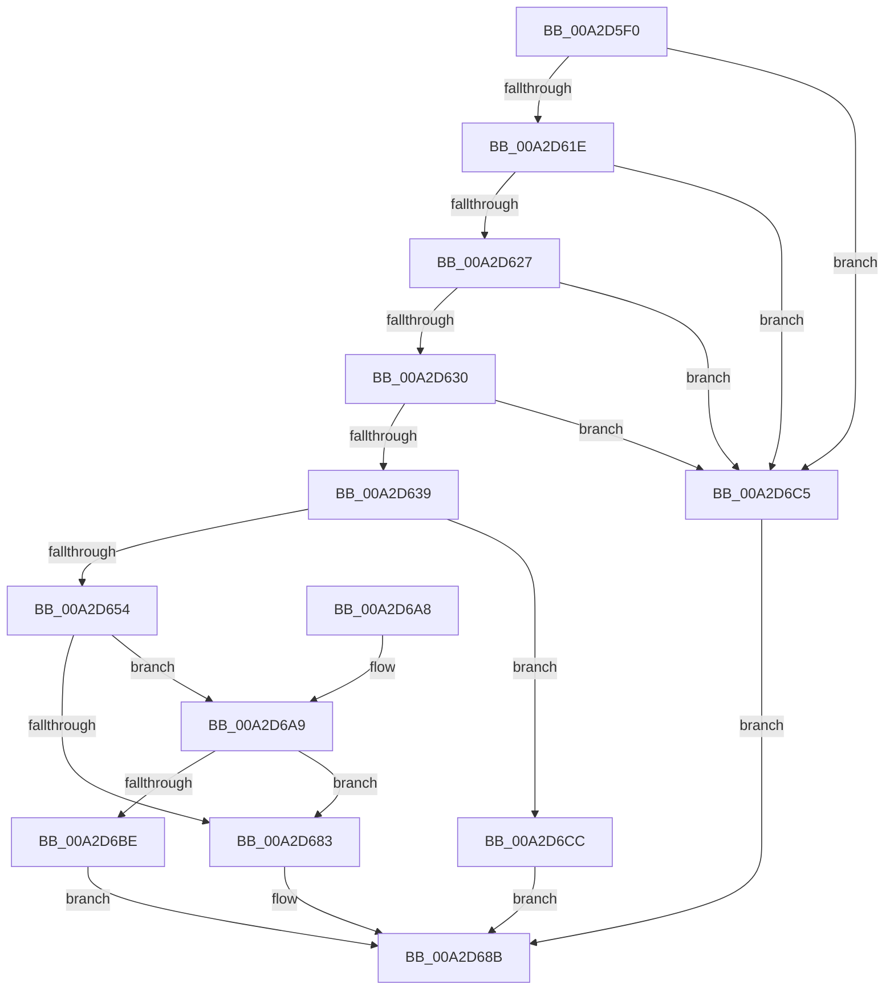

# SleepstudyHelperCreateBlockerFromDevice

- RVA: `0x00A2D5F0`–`0x00A2D6D3` (길이 `227` bytes)
- VA: `0x0000000140A2D5F0`
- 실행 섹션: `PAGE`
- PDB 이름 있음: `예`; PDB Function 태그: `아니요`
- unwind 정보 RVA: `0x00065B90`
- 디코드: `65`개 명령, `227/227` bytes 표시
- 미해석 바이트: `0` (있으면 어셈블리에 `.byte`로 보존)

> 이 문서는 커널 이미지의 기계어와 PDB 기호를 분석해 생성했습니다. 4번과 5번은 함수 원형과 자료형을 바이너리 사용 방식에서 추정한 C 해석이며 원본 소스 복구 결과는 아닙니다.

## 1. Dependencies

- 직접 호출 지점: **4**; 고유 호출 대상: **4**
- 직접 호출자로 확인된 함수: **3**
- RIP 상대 이미지 참조: **0**

### Outgoing calls
- `0x00A2D647` → [ExAllocatePool2](../../poolcode/B8/ExAllocatePool2_function_00B820F0.md) (function, `0x00B820F0`)
- `0x00A2D678` → [SshpGenerateDeviceFriendlyName](SshpGenerateDeviceFriendlyName_function_00A2E184.md) (function, `0x00A2E184`)
- `0x00A2D686` → [SleepstudyHelperDestroyBlockerBuilder](SleepstudyHelperDestroyBlockerBuilder_function_00A2DE80.md) (function, `0x00A2DE80`)
- `0x00A2D6B3` → [SshpGenerateDeviceVerboseDescription](SshpGenerateDeviceVerboseDescription_function_00A2E448.md) (function, `0x00A2E448`)

### Direct callers
- [SleepstudyHelper_RegisterPdoWithParentGuid](../77/SleepstudyHelper_RegisterPdoWithParentGuid_function_00774B30.md) at `0x00774B73`
- [SleepstudyHelper_RegisterPdoWithParentHandle](../77/SleepstudyHelper_RegisterPdoWithParentHandle_function_00774C00.md) at `0x00774C6E`
- [SleepstudyHelper_RegisterPdoWithParentPdo](../77/SleepstudyHelper_RegisterPdoWithParentPdo_function_00774D00.md) at `0x00774D48`

### Static image references
- 디코드된 RIP-relative 메모리 참조가 없습니다.

## 2. Other-region calls and transfers

- 다른 실행 섹션으로 향하는 call: **1**
  - `0x00A2D647` → [ExAllocatePool2](../../poolcode/B8/ExAllocatePool2_function_00B820F0.md) (`PAGE` → `POOLCODE`)
- 별도 외부 분기/꼬리 이동을 확인하지 못했습니다.

## 3. Assembly (complete function range)

```asm
00A2D5F0  48 8B C4                        mov rax, rsp
00A2D5F3  48 89 58 08                     mov qword ptr [rax + 8], rbx
00A2D5F7  48 89 68 10                     mov qword ptr [rax + 0x10], rbp
00A2D5FB  48 89 70 18                     mov qword ptr [rax + 0x18], rsi
00A2D5FF  48 89 78 20                     mov qword ptr [rax + 0x20], rdi
00A2D603  41 56                           push r14
00A2D605  48 83 EC 20                     sub rsp, 0x20
00A2D609  4D 8B F1                        mov r14, r9
00A2D60C  49 8B E8                        mov rbp, r8
00A2D60F  48 8B DA                        mov rbx, rdx
00A2D612  48 8B F1                        mov rsi, rcx
00A2D615  48 85 C9                        test rcx, rcx
00A2D618  0F 84 A7 00 00 00               je 0x140a2d6c5
00A2D61E  48 85 D2                        test rdx, rdx
00A2D621  0F 84 9E 00 00 00               je 0x140a2d6c5
00A2D627  4D 85 C0                        test r8, r8
00A2D62A  0F 84 95 00 00 00               je 0x140a2d6c5
00A2D630  4D 85 C9                        test r9, r9
00A2D633  0F 84 8C 00 00 00               je 0x140a2d6c5
00A2D639  44 8B 41 18                     mov r8d, dword ptr [rcx + 0x18]
00A2D63D  BA 60 00 00 00                  mov edx, 0x60
00A2D642  B9 00 01 00 00                  mov ecx, 0x100
00A2D647  E8 A4 4A 15 00                  call 0x140b820f0
00A2D64C  48 8B F8                        mov rdi, rax
00A2D64F  48 85 C0                        test rax, rax
00A2D652  74 78                           je 0x140a2d6cc
00A2D654  83 60 08 00                     and dword ptr [rax + 8], 0
00A2D658  4C 8D 48 30                     lea r9, [rax + 0x30]
00A2D65C  48 89 30                        mov qword ptr [rax], rsi
00A2D65F  33 D2                           xor edx, edx
00A2D661  0F 10 03                        movups xmm0, xmmword ptr [rbx]
00A2D664  48 89 68 20                     mov qword ptr [rax + 0x20], rbp
00A2D668  48 8B CD                        mov rcx, rbp
00A2D66B  C6 40 58 01                     mov byte ptr [rax + 0x58], 1
00A2D66F  F3 0F 7F 40 10                  movdqu xmmword ptr [rax + 0x10], xmm0
00A2D674  44 8B 46 18                     mov r8d, dword ptr [rsi + 0x18]
00A2D678  E8 07 0B 00 00                  call 0x140a2e184
00A2D67D  8B D8                           mov ebx, eax
00A2D67F  85 C0                           test eax, eax
00A2D681  79 26                           jns 0x140a2d6a9
00A2D683  48 8B CF                        mov rcx, rdi
00A2D686  E8 F5 07 00 00                  call 0x140a2de80
00A2D68B  48 8B 6C 24 38                  mov rbp, qword ptr [rsp + 0x38]
00A2D690  8B C3                           mov eax, ebx
00A2D692  48 8B 5C 24 30                  mov rbx, qword ptr [rsp + 0x30]
00A2D697  48 8B 74 24 40                  mov rsi, qword ptr [rsp + 0x40]
00A2D69C  48 8B 7C 24 48                  mov rdi, qword ptr [rsp + 0x48]
00A2D6A1  48 83 C4 20                     add rsp, 0x20
00A2D6A5  41 5E                           pop r14
00A2D6A7  C3                              ret
00A2D6A8  CC                              int3
00A2D6A9  8B 56 18                        mov edx, dword ptr [rsi + 0x18]
00A2D6AC  4C 8D 47 48                     lea r8, [rdi + 0x48]
00A2D6B0  48 8B CD                        mov rcx, rbp
00A2D6B3  E8 90 0D 00 00                  call 0x140a2e448
00A2D6B8  8B D8                           mov ebx, eax
00A2D6BA  85 C0                           test eax, eax
00A2D6BC  78 C5                           js 0x140a2d683
00A2D6BE  49 89 3E                        mov qword ptr [r14], rdi
00A2D6C1  33 DB                           xor ebx, ebx
00A2D6C3  EB C6                           jmp 0x140a2d68b
00A2D6C5  BB 0D 00 00 C0                  mov ebx, 0xc000000d
00A2D6CA  EB BF                           jmp 0x140a2d68b
00A2D6CC  BB 9A 00 00 C0                  mov ebx, 0xc000009a
00A2D6D1  EB B8                           jmp 0x140a2d68b
```

## 4. C-style interpretation (structured pseudocode)

```c
__int64 __fastcall SleepstudyHelperCreateBlockerFromDevice(__int64 a1, __int64 a2, __int64 a3, __int64 a4)
{
    __int64 result;
    __int64 v_rbx;
    __int64 v_rsp;
    unsigned __int64 v_stack_p10;
    unsigned __int64 v_stack_p18;
    unsigned __int64 v_stack_p20;
    unsigned __int64 v_stack_p8;

    *(unsigned __int64 *)(v_rsp + 8) = v_rbx;
    *(unsigned __int64 *)(v_rsp + 16) = v_rbp;
    *(unsigned __int64 *)(v_rsp + 24) = v_rsi;
    *(unsigned __int64 *)(v_rsp + 32) = v_rdi;
    v_rsp = (v_rsp) - (32);
    if (a1 == 0) goto loc_00A2D6C5;
    if (a2 == 0) goto loc_00A2D6C5;
    if (a3 == 0) goto loc_00A2D6C5;
    if (a4 == 0) goto loc_00A2D6C5;
    result = ExAllocatePool2(256, 96, (unsigned int)(*(unsigned int *)(a1 + 24)), a4);
    if (result == 0) goto loc_00A2D6CC;
    *(unsigned __int64 *)(result) = a1;
    a2 = 0;
    *(unsigned __int64 *)(result + 32) = a3;
    *(unsigned __int8 *)(result + 88) = 1;
    *(unsigned __int64 *)(result + 16) = v_xmm0;
    result = SshpGenerateDeviceFriendlyName(a3, a2, (unsigned int)(*(unsigned int *)(a1 + 24)), result + 48);
    if (!sign_flag) goto loc_00A2D6A9;
loc_00A2D683:
    result = SleepstudyHelperDestroyBlockerBuilder(result, a2, (unsigned int)(*(unsigned int *)(a1 + 24)), result + 48);
loc_00A2D68B:
    v_rsp = (v_rsp) + (32);
    return (unsigned int)((unsigned int)((unsigned int)((unsigned int)(result))));
loc_00A2D6A9:
    result = SshpGenerateDeviceVerboseDescription(v_stack_p10, (unsigned int)(*(unsigned int *)(v_stack_p18 + 24)), v_stack_p20 + 72, result + 48);
    if (sign_flag) goto loc_00A2D683;
    *(unsigned __int64 *)(a4) = v_stack_p20;
    v_rbx = 0;
    goto loc_00A2D68B;
loc_00A2D6C5:
    goto loc_00A2D68B;
loc_00A2D6CC:
    goto loc_00A2D68B;
}
```

## 5. (Beta) C Style

```c
int64_t SleepstudyHelperCreateBlockerFromDevice(void *Arg1, void *Arg2, int64_t Arg3, void *Arg4)
{
    uint8_t *arg1 = (uint8_t *)Arg1;
    uint8_t *arg2 = (uint8_t *)Arg2;
    uint8_t *arg4 = (uint8_t *)Arg4;

    int64_t result;
    int64_t local_rbx;
    int64_t local_rsp;
    uint64_t v_stack_p10;
    uint64_t v_stack_p18;
    uint64_t v_stack_p20;
    uint64_t v_stack_p8;

    *(uint64_t *)(local_rsp + 0x8) = local_rbx;
    *(uint64_t *)(local_rsp + 0x10) = local_rbp;
    *(uint64_t *)(local_rsp + 0x18) = local_rsi;
    *(uint64_t *)(local_rsp + 0x20) = local_rdi;
    local_rsp = (local_rsp) - (32);
    if (Arg1 == NULL) goto loc_00A2D6C5;
    if (Arg2 == NULL) goto loc_00A2D6C5;
    if (Arg3 == 0) goto loc_00A2D6C5;
    if (Arg4 == NULL) goto loc_00A2D6C5;
    result = ExAllocatePool2(256, 96, (uint32_t)(*(uint32_t *)(arg1 + 0x18)), Arg4);
    if (result == 0) goto loc_00A2D6CC;
    *(void **)(result) = Arg1;
    Arg2 = 0;
    *(uint64_t *)(result + 0x20) = Arg3;
    *(uint8_t *)(result + 0x58) = 1;
    *(uint64_t *)(result + 0x10) = v_xmm0;
    result = SshpGenerateDeviceFriendlyName(Arg3, Arg2, (uint32_t)(*(uint32_t *)(arg1 + 0x18)), result + 48);
    if (!sign_flag) goto loc_00A2D6A9;
loc_00A2D683:
    result = SleepstudyHelperDestroyBlockerBuilder(result, Arg2, (uint32_t)(*(uint32_t *)(arg1 + 0x18)), result + 48);
loc_00A2D68B:
    local_rsp = (local_rsp) + (32);
    return (uint32_t)((uint32_t)((uint32_t)((uint32_t)(result))));
loc_00A2D6A9:
    result = SshpGenerateDeviceVerboseDescription(v_stack_p10, (uint32_t)(*(uint32_t *)(v_stack_p18 + 0x18)), v_stack_p20 + 72, result + 48);
    if (sign_flag) goto loc_00A2D683;
    *(uint64_t *)(arg4) = v_stack_p20;
    local_rbx = 0;
    goto loc_00A2D68B;
loc_00A2D6C5:
    goto loc_00A2D68B;
loc_00A2D6CC:
    goto loc_00A2D68B;
}
```

### 관측된 메모리 오프셋

구조체 형식이 확인되지 않은 접근은 인자 기준의 오프셋으로만 기록했습니다.

| 기준 인자 | 오프셋 표현 | 폭 (bit) | 접근 |
|---|---:|---:|---|
| `Arg1` | `+ 0x18` | `32` | `R` |
| `Arg2` | `+ 0x0` | `128` | `R` |
| `Arg4` | `+ 0x0` | `64` | `W` |

## 6. Execution-region graph

[열기: 2D/3D 그래프와 함수 탐색 컨트롤 패널](../../../control-panel.html?section=page&rva=0x00A2D5F0&view=graph)

- 2D 그래프는 위에서 아래로 흐르고, 3D 그래프는 빈 공간을 드래그해 회전합니다. Shift+드래그는 이동, 휠은 확대·축소, 함수 노드 선택은 대상 보고서 이동입니다.

### Static fallback


