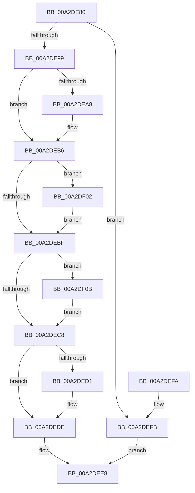

# SleepstudyHelperDestroyBlockerBuilder

- RVA: `0x00A2DE80`–`0x00A2DF14` (길이 `148` bytes)
- VA: `0x0000000140A2DE80`
- 실행 섹션: `PAGE`
- PDB 이름 있음: `예`; PDB Function 태그: `아니요`
- unwind 정보 RVA: `0x000A1AC0`
- 디코드: `47`개 명령, `148/148` bytes 표시
- 미해석 바이트: `0` (있으면 어셈블리에 `.byte`로 보존)

> 이 문서는 커널 이미지의 기계어와 PDB 기호를 분석해 생성했습니다. 4번과 5번은 함수 원형과 자료형을 바이너리 사용 방식에서 추정한 C 해석이며 원본 소스 복구 결과는 아닙니다.

## 1. Dependencies

- 직접 호출 지점: **5**; 고유 호출 대상: **2**
- 직접 호출자로 확인된 함수: **10**
- RIP 상대 이미지 참조: **0**

### Outgoing calls
- `0x00A2DEAD` → [CmpFreePoolWithTag](../../text/44/CmpFreePoolWithTag_function_004489E0.md) (function, `0x004489E0`)
- `0x00A2DED9` → [SshpDereferenceBlocker](../../text/48/SshpDereferenceBlocker_function_00486960.md) (function, `0x00486960`)
- `0x00A2DEE3` → [CmpFreePoolWithTag](../../text/44/CmpFreePoolWithTag_function_004489E0.md) (function, `0x004489E0`)
- `0x00A2DF04` → [CmpFreePoolWithTag](../../text/44/CmpFreePoolWithTag_function_004489E0.md) (function, `0x004489E0`)
- `0x00A2DF0D` → [CmpFreePoolWithTag](../../text/44/CmpFreePoolWithTag_function_004489E0.md) (function, `0x004489E0`)

### Direct callers
- [SleepstudyHelperCreateBlockerFromGuid](../../text/3D/SleepstudyHelperCreateBlockerFromGuid_function_003D3F70.md) at `0x003D4036`
- [SleepstudyHelperCreateBlockerFromComponent](../77/SleepstudyHelperCreateBlockerFromComponent_function_007748B0.md) at `0x0077497F`
- [SleepstudyHelper_RegisterComponentEx](../77/SleepstudyHelper_RegisterComponentEx_function_00774A50.md) at `0x00774AE4`
- [SleepstudyHelper_RegisterPdoWithParentGuid](../77/SleepstudyHelper_RegisterPdoWithParentGuid_function_00774B30.md) at `0x00774BB1`
- [SleepstudyHelper_RegisterPdoWithParentHandle](../77/SleepstudyHelper_RegisterPdoWithParentHandle_function_00774C00.md) at `0x00774CAC`
- [SleepstudyHelper_RegisterPdoWithParentPdo](../77/SleepstudyHelper_RegisterPdoWithParentPdo_function_00774D00.md) at `0x00774D86`
- [SleepstudyHelperCreateBlockerFromDevice](SleepstudyHelperCreateBlockerFromDevice_function_00A2D5F0.md) at `0x00A2D686`
- [PopPowerRequestStatsCreateSleepstudyBlocker](PopPowerRequestStatsCreateSleepstudyBlocker_function_00A2D9B0.md) at `0x00A2DABF`
- [SleepstudyHelperBuildBlocker](SleepstudyHelperBuildBlocker_function_00A2DAD0.md) at `0x00A2DCFE`
- [PopUserShutdownInitializeSleepstudyDiagnostics](../../init/C3/PopUserShutdownInitializeSleepstudyDiagnostics_function_00C3EF88.md) at `0x00C3F09E`

### Static image references
- 디코드된 RIP-relative 메모리 참조가 없습니다.

## 2. Other-region calls and transfers

- 다른 실행 섹션으로 향하는 call: **5**
  - `0x00A2DEAD` → [CmpFreePoolWithTag](../../text/44/CmpFreePoolWithTag_function_004489E0.md) (`PAGE` → `.text`)
  - `0x00A2DED9` → [SshpDereferenceBlocker](../../text/48/SshpDereferenceBlocker_function_00486960.md) (`PAGE` → `.text`)
  - `0x00A2DEE3` → [CmpFreePoolWithTag](../../text/44/CmpFreePoolWithTag_function_004489E0.md) (`PAGE` → `.text`)
  - `0x00A2DF04` → [CmpFreePoolWithTag](../../text/44/CmpFreePoolWithTag_function_004489E0.md) (`PAGE` → `.text`)
  - `0x00A2DF0D` → [CmpFreePoolWithTag](../../text/44/CmpFreePoolWithTag_function_004489E0.md) (`PAGE` → `.text`)
- 별도 외부 분기/꼬리 이동을 확인하지 못했습니다.

## 3. Assembly (complete function range)

```asm
00A2DE80  48 89 5C 24 08                  mov qword ptr [rsp + 8], rbx
00A2DE85  48 89 74 24 10                  mov qword ptr [rsp + 0x10], rsi
00A2DE8A  57                              push rdi
00A2DE8B  48 83 EC 20                     sub rsp, 0x20
00A2DE8F  33 DB                           xor ebx, ebx
00A2DE91  48 8B F9                        mov rdi, rcx
00A2DE94  48 85 C9                        test rcx, rcx
00A2DE97  74 62                           je 0x140a2defb
00A2DE99  48 8B 01                        mov rax, qword ptr [rcx]
00A2DE9C  48 8B 49 38                     mov rcx, qword ptr [rcx + 0x38]
00A2DEA0  8B 70 18                        mov esi, dword ptr [rax + 0x18]
00A2DEA3  48 85 C9                        test rcx, rcx
00A2DEA6  74 0E                           je 0x140a2deb6
00A2DEA8  8B D6                           mov edx, esi
00A2DEAA  89 5F 30                        mov dword ptr [rdi + 0x30], ebx
00A2DEAD  E8 2E AB A1 FF                  call 0x1404489e0
00A2DEB2  48 89 5F 38                     mov qword ptr [rdi + 0x38], rbx
00A2DEB6  48 8B 4F 40                     mov rcx, qword ptr [rdi + 0x40]
00A2DEBA  48 85 C9                        test rcx, rcx
00A2DEBD  75 43                           jne 0x140a2df02
00A2DEBF  48 8B 4F 48                     mov rcx, qword ptr [rdi + 0x48]
00A2DEC3  48 85 C9                        test rcx, rcx
00A2DEC6  75 43                           jne 0x140a2df0b
00A2DEC8  48 8B 4F 50                     mov rcx, qword ptr [rdi + 0x50]
00A2DECC  48 85 C9                        test rcx, rcx
00A2DECF  74 0D                           je 0x140a2dede
00A2DED1  41 B0 01                        mov r8b, 1
00A2DED4  BA 01 00 00 00                  mov edx, 1
00A2DED9  E8 82 8A A5 FF                  call 0x140486960
00A2DEDE  8B D6                           mov edx, esi
00A2DEE0  48 8B CF                        mov rcx, rdi
00A2DEE3  E8 F8 AA A1 FF                  call 0x1404489e0
00A2DEE8  48 8B 74 24 38                  mov rsi, qword ptr [rsp + 0x38]
00A2DEED  8B C3                           mov eax, ebx
00A2DEEF  48 8B 5C 24 30                  mov rbx, qword ptr [rsp + 0x30]
00A2DEF4  48 83 C4 20                     add rsp, 0x20
00A2DEF8  5F                              pop rdi
00A2DEF9  C3                              ret
00A2DEFA  CC                              int3
00A2DEFB  BB 0D 00 00 C0                  mov ebx, 0xc000000d
00A2DF00  EB E6                           jmp 0x140a2dee8
00A2DF02  8B D6                           mov edx, esi
00A2DF04  E8 D7 AA A1 FF                  call 0x1404489e0
00A2DF09  EB B4                           jmp 0x140a2debf
00A2DF0B  8B D6                           mov edx, esi
00A2DF0D  E8 CE AA A1 FF                  call 0x1404489e0
00A2DF12  EB B4                           jmp 0x140a2dec8
```

## 4. C-style interpretation (structured pseudocode)

```c
__int64 __fastcall SleepstudyHelperDestroyBlockerBuilder(__int64 a1)
{
    __int64 result;
    __int64 v_rbx;
    __int64 v_rsp;
    unsigned __int64 v_stack_p10;
    unsigned __int64 v_stack_p8;

    v_stack_p8 = v_rbx;
    v_stack_p10 = v_rsi;
    v_rsp = (v_rsp) - (32);
    v_rbx = 0;
    if (a1 == 0) goto loc_00A2DEFB;
    result = *(unsigned __int64 *)(a1);
    if (*(unsigned __int64 *)(a1 + 56) != 0) {
        a2 = (unsigned int)((unsigned int)(*(unsigned int *)(*(unsigned __int64 *)(a1) + 24)));
        *(unsigned int *)(a1 + 48) = 0;
        result = CmpFreePoolWithTag(*(unsigned __int64 *)(a1 + 56), a2, a3, a4);
        *(unsigned __int64 *)(a1 + 56) = 0;
    }
    if (*(unsigned __int64 *)(a1 + 64) != 0) goto loc_00A2DF02;
loc_00A2DEBF:
    if (*(unsigned __int64 *)(a1 + 72) != 0) goto loc_00A2DF0B;
loc_00A2DEC8:
    if (*(unsigned __int64 *)(a1 + 80) != 0) {
        a3 = 1;
        a2 = 1;
        result = SshpDereferenceBlocker(*(unsigned __int64 *)(a1 + 80), a2, a3, a4);
    }
    result = CmpFreePoolWithTag(a1, (unsigned int)((unsigned int)((unsigned int)(*(unsigned int *)(*(unsigned __int64 *)(a1) + 24)))), a3, a4);
loc_00A2DEE8:
    v_rsp = (v_rsp) + (32);
    return 0;
loc_00A2DEFB:
    goto loc_00A2DEE8;
loc_00A2DF02:
    result = CmpFreePoolWithTag(a1, (unsigned int)((unsigned int)(v_stack_p10)), a3, a4);
    goto loc_00A2DEBF;
loc_00A2DF0B:
    result = CmpFreePoolWithTag(a1, (unsigned int)((unsigned int)(v_stack_p10)), a3, a4);
    goto loc_00A2DEC8;
}
```

## 5. (Beta) C Style

```c
int64_t SleepstudyHelperDestroyBlockerBuilder(void *Arg1)
{
    uint8_t *arg1 = (uint8_t *)Arg1;

    int64_t result;
    int64_t local_rbx;
    int64_t local_rsp;
    uint64_t v_stack_p10;
    uint64_t v_stack_p8;

    v_stack_p8 = local_rbx;
    v_stack_p10 = local_rsi;
    local_rsp = (local_rsp) - (32);
    local_rbx = 0;
    if (Arg1 == NULL) goto loc_00A2DEFB;
    result = *(uint64_t *)(arg1);
    if (*(uint64_t *)(arg1 + 0x38) != 0) {
        a2 = (uint32_t)((uint32_t)(*(uint32_t *)(*(uint64_t *)(arg1) + 0x18)));
        *(uint32_t *)(arg1 + 0x30) = 0;
        result = CmpFreePoolWithTag(*(uint64_t *)(arg1 + 0x38), a2, a3, a4);
        *(uint64_t *)(arg1 + 0x38) = 0;
    }
    if (*(uint64_t *)(arg1 + 0x40) != 0) goto loc_00A2DF02;
loc_00A2DEBF:
    if (*(uint64_t *)(arg1 + 0x48) != 0) goto loc_00A2DF0B;
loc_00A2DEC8:
    if (*(uint64_t *)(arg1 + 0x50) != 0) {
        a3 = 1;
        a2 = 1;
        result = SshpDereferenceBlocker(*(uint64_t *)(arg1 + 0x50), a2, a3, a4);
    }
    result = CmpFreePoolWithTag(Arg1, (uint32_t)((uint32_t)((uint32_t)(*(uint32_t *)(*(uint64_t *)(arg1) + 0x18)))), a3, a4);
loc_00A2DEE8:
    local_rsp = (local_rsp) + (32);
    return 0;
loc_00A2DEFB:
    goto loc_00A2DEE8;
loc_00A2DF02:
    result = CmpFreePoolWithTag(Arg1, (uint32_t)((uint32_t)(v_stack_p10)), a3, a4);
    goto loc_00A2DEBF;
loc_00A2DF0B:
    result = CmpFreePoolWithTag(Arg1, (uint32_t)((uint32_t)(v_stack_p10)), a3, a4);
    goto loc_00A2DEC8;
}
```

### 관측된 메모리 오프셋

구조체 형식이 확인되지 않은 접근은 인자 기준의 오프셋으로만 기록했습니다.

| 기준 인자 | 오프셋 표현 | 폭 (bit) | 접근 |
|---|---:|---:|---|
| `Arg1` | `+ 0x30` | `32` | `W` |
| `Arg1` | `+ 0x38` | `64` | `W` |
| `Arg1` | `+ 0x40` | `64` | `R` |
| `Arg1` | `+ 0x48` | `64` | `R` |
| `Arg1` | `+ 0x50` | `64` | `R` |

## 6. Execution-region graph

[열기: 2D/3D 그래프와 함수 탐색 컨트롤 패널](../../../control-panel.html?section=page&rva=0x00A2DE80&view=graph)

- 2D 그래프는 위에서 아래로 흐르고, 3D 그래프는 빈 공간을 드래그해 회전합니다. Shift+드래그는 이동, 휠은 확대·축소, 함수 노드 선택은 대상 보고서 이동입니다.

### Static fallback


