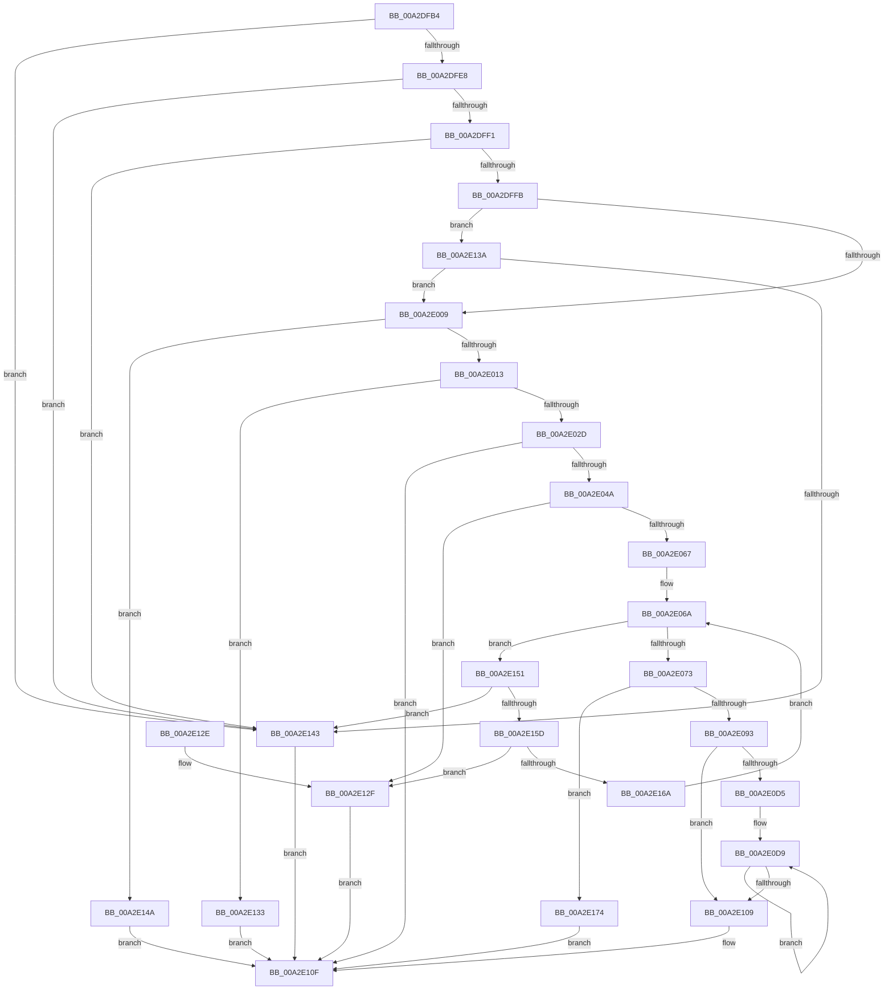

# SleepstudyHelperSetBlockerVerboseDescription

- RVA: `0x00A2DFB4`–`0x00A2E17B` (길이 `455` bytes)
- VA: `0x0000000140A2DFB4`
- 실행 섹션: `PAGE`
- PDB 이름 있음: `예`; PDB Function 태그: `아니요`
- unwind 정보 RVA: `0x000AC8AC`
- 디코드: `126`개 명령, `455/455` bytes 표시
- 미해석 바이트: `0` (있으면 어셈블리에 `.byte`로 보존)

> 이 문서는 커널 이미지의 기계어와 PDB 기호를 분석해 생성했습니다. 4번과 5번은 함수 원형과 자료형을 바이너리 사용 방식에서 추정한 C 해석이며 원본 소스 복구 결과는 아닙니다.

## 1. Dependencies

- 직접 호출 지점: **3**; 고유 호출 대상: **2**
- 직접 호출자로 확인된 함수: **1**
- RIP 상대 이미지 참조: **0**

### Outgoing calls
- `0x00A2E082` → [ExAllocatePool2](../../poolcode/B8/ExAllocatePool2_function_00B820F0.md) (function, `0x00B820F0`)
- `0x00A2E0C4` → [memcpy](../../text/6C/memcpy_function_006C6840.md) (function, `0x006C6840`)
- `0x00A2E0F0` → [memcpy](../../text/6C/memcpy_function_006C6840.md) (function, `0x006C6840`)

### Direct callers
- [PopPowerRequestStatsCreateSleepstudyBlocker](PopPowerRequestStatsCreateSleepstudyBlocker_function_00A2D9B0.md) at `0x00A2DA9E`

### Static image references
- 디코드된 RIP-relative 메모리 참조가 없습니다.

## 2. Other-region calls and transfers

- 다른 실행 섹션으로 향하는 call: **3**
  - `0x00A2E082` → [ExAllocatePool2](../../poolcode/B8/ExAllocatePool2_function_00B820F0.md) (`PAGE` → `POOLCODE`)
  - `0x00A2E0C4` → [memcpy](../../text/6C/memcpy_function_006C6840.md) (`PAGE` → `.text`)
  - `0x00A2E0F0` → [memcpy](../../text/6C/memcpy_function_006C6840.md) (`PAGE` → `.text`)
- 별도 외부 분기/꼬리 이동을 확인하지 못했습니다.

## 3. Assembly (complete function range)

```asm
00A2DFB4  48 89 5C 24 08                  mov qword ptr [rsp + 8], rbx
00A2DFB9  48 89 6C 24 10                  mov qword ptr [rsp + 0x10], rbp
00A2DFBE  48 89 74 24 18                  mov qword ptr [rsp + 0x18], rsi
00A2DFC3  57                              push rdi
00A2DFC4  41 54                           push r12
00A2DFC6  41 55                           push r13
00A2DFC8  41 56                           push r14
00A2DFCA  41 57                           push r15
00A2DFCC  48 83 EC 20                     sub rsp, 0x20
00A2DFD0  45 33 E4                        xor r12d, r12d
00A2DFD3  45 8B F9                        mov r15d, r9d
00A2DFD6  49 8B E8                        mov rbp, r8
00A2DFD9  0F B7 DA                        movzx ebx, dx
00A2DFDC  4C 8B F1                        mov r14, rcx
00A2DFDF  48 85 C9                        test rcx, rcx
00A2DFE2  0F 84 5B 01 00 00               je 0x140a2e143
00A2DFE8  4D 85 C0                        test r8, r8
00A2DFEB  0F 84 52 01 00 00               je 0x140a2e143
00A2DFF1  4D 39 60 08                     cmp qword ptr [r8 + 8], r12
00A2DFF5  0F 84 48 01 00 00               je 0x140a2e143
00A2DFFB  48 8B 74 24 70                  mov rsi, qword ptr [rsp + 0x70]
00A2E000  45 85 C9                        test r9d, r9d
00A2E003  0F 85 31 01 00 00               jne 0x140a2e13a
00A2E009  4C 39 61 40                     cmp qword ptr [rcx + 0x40], r12
00A2E00D  0F 85 37 01 00 00               jne 0x140a2e14a
00A2E013  4E 8D 0C BD 00 00 00 00         lea r9, [r15*4]
00A2E01B  41 B8 FF FF FF FF               mov r8d, 0xffffffff
00A2E021  4D 8B EF                        mov r13, r15
00A2E024  4D 3B C8                        cmp r9, r8
00A2E027  0F 87 06 01 00 00               ja 0x140a2e133
00A2E02D  41 8D 41 0C                     lea eax, [r9 + 0xc]
00A2E031  BA 95 00 00 C0                  mov edx, 0xc0000095
00A2E036  41 3B C1                        cmp eax, r9d
00A2E039  44 0F 43 C0                     cmovae r8d, eax
00A2E03D  1B C9                           sbb ecx, ecx
00A2E03F  23 CA                           and ecx, edx
00A2E041  41 3B C1                        cmp eax, r9d
00A2E044  0F 82 C5 00 00 00               jb 0x140a2e10f
00A2E04A  44 0F B7 4D 00                  movzx r9d, word ptr [rbp]
00A2E04F  B8 10 00 00 00                  mov eax, 0x10
00A2E054  44 3B C0                        cmp r8d, eax
00A2E057  44 0F 46 C0                     cmovbe r8d, eax
00A2E05B  45 03 C8                        add r9d, r8d
00A2E05E  45 3B C8                        cmp r9d, r8d
00A2E061  0F 82 C8 00 00 00               jb 0x140a2e12f
00A2E067  41 8B CC                        mov ecx, r12d
00A2E06A  41 3B CF                        cmp ecx, r15d
00A2E06D  0F 82 DE 00 00 00               jb 0x140a2e151
00A2E073  49 8B 06                        mov rax, qword ptr [r14]
00A2E076  B9 00 01 00 00                  mov ecx, 0x100
00A2E07B  41 8B D1                        mov edx, r9d
00A2E07E  44 8B 40 18                     mov r8d, dword ptr [rax + 0x18]
00A2E082  E8 69 40 15 00                  call 0x140b820f0
00A2E087  48 8B F8                        mov rdi, rax
00A2E08A  48 85 C0                        test rax, rax
00A2E08D  0F 84 E1 00 00 00               je 0x140a2e174
00A2E093  66 89 58 04                     mov word ptr [rax + 4], bx
00A2E097  42 8D 1C BD 0C 00 00 00         lea ebx, [r15*4 + 0xc]
00A2E09F  44 89 38                        mov dword ptr [rax], r15d
00A2E0A2  B8 10 00 00 00                  mov eax, 0x10
00A2E0A7  44 0F B7 45 00                  movzx r8d, word ptr [rbp]
00A2E0AC  3B D8                           cmp ebx, eax
00A2E0AE  0F 46 D8                        cmovbe ebx, eax
00A2E0B1  41 D1 E8                        shr r8d, 1
00A2E0B4  44 89 47 08                     mov dword ptr [rdi + 8], r8d
00A2E0B8  4D 03 C0                        add r8, r8
00A2E0BB  48 8B 55 08                     mov rdx, qword ptr [rbp + 8]
00A2E0BF  8B CB                           mov ecx, ebx
00A2E0C1  48 03 CF                        add rcx, rdi
00A2E0C4  E8 77 87 C9 FF                  call 0x1406c6840
00A2E0C9  8B 47 08                        mov eax, dword ptr [rdi + 8]
00A2E0CC  44 8D 24 43                     lea r12d, [rbx + rax*2]
00A2E0D0  45 85 FF                        test r15d, r15d
00A2E0D3  74 34                           je 0x140a2e109
00A2E0D5  48 8D 5F 0C                     lea rbx, [rdi + 0xc]
00A2E0D9  44 0F B7 06                     movzx r8d, word ptr [rsi]
00A2E0DD  41 D1 E8                        shr r8d, 1
00A2E0E0  44 89 03                        mov dword ptr [rbx], r8d
00A2E0E3  4D 03 C0                        add r8, r8
00A2E0E6  48 8B 56 08                     mov rdx, qword ptr [rsi + 8]
00A2E0EA  41 8B CC                        mov ecx, r12d
00A2E0ED  48 03 CF                        add rcx, rdi
00A2E0F0  E8 4B 87 C9 FF                  call 0x1406c6840
00A2E0F5  8B 03                           mov eax, dword ptr [rbx]
00A2E0F7  48 8D 5B 04                     lea rbx, [rbx + 4]
00A2E0FB  48 8D 76 10                     lea rsi, [rsi + 0x10]
00A2E0FF  45 8D 24 44                     lea r12d, [r12 + rax*2]
00A2E103  49 83 ED 01                     sub r13, 1
00A2E107  75 D0                           jne 0x140a2e0d9
00A2E109  49 89 7E 40                     mov qword ptr [r14 + 0x40], rdi
00A2E10D  33 C9                           xor ecx, ecx
00A2E10F  48 8B 5C 24 50                  mov rbx, qword ptr [rsp + 0x50]
00A2E114  8B C1                           mov eax, ecx
00A2E116  48 8B 6C 24 58                  mov rbp, qword ptr [rsp + 0x58]
00A2E11B  48 8B 74 24 60                  mov rsi, qword ptr [rsp + 0x60]
00A2E120  48 83 C4 20                     add rsp, 0x20
00A2E124  41 5F                           pop r15
00A2E126  41 5E                           pop r14
00A2E128  41 5D                           pop r13
00A2E12A  41 5C                           pop r12
00A2E12C  5F                              pop rdi
00A2E12D  C3                              ret
00A2E12E  CC                              int3
00A2E12F  8B CA                           mov ecx, edx
00A2E131  EB DC                           jmp 0x140a2e10f
00A2E133  B9 95 00 00 C0                  mov ecx, 0xc0000095
00A2E138  EB D5                           jmp 0x140a2e10f
00A2E13A  48 85 F6                        test rsi, rsi
00A2E13D  0F 85 C6 FE FF FF               jne 0x140a2e009
00A2E143  B9 0D 00 00 C0                  mov ecx, 0xc000000d
00A2E148  EB C5                           jmp 0x140a2e10f
00A2E14A  B9 21 00 00 C0                  mov ecx, 0xc0000021
00A2E14F  EB BE                           jmp 0x140a2e10f
00A2E151  8B C1                           mov eax, ecx
00A2E153  48 03 C0                        add rax, rax
00A2E156  4C 39 64 C6 08                  cmp qword ptr [rsi + rax*8 + 8], r12
00A2E15B  74 E6                           je 0x140a2e143
00A2E15D  44 0F B7 04 C6                  movzx r8d, word ptr [rsi + rax*8]
00A2E162  45 03 C1                        add r8d, r9d
00A2E165  45 3B C1                        cmp r8d, r9d
00A2E168  72 C5                           jb 0x140a2e12f
00A2E16A  45 8B C8                        mov r9d, r8d
00A2E16D  FF C1                           inc ecx
00A2E16F  E9 F6 FE FF FF                  jmp 0x140a2e06a
00A2E174  B9 9A 00 00 C0                  mov ecx, 0xc000009a
00A2E179  EB 94                           jmp 0x140a2e10f
```

## 4. C-style interpretation (structured pseudocode)

```c
__int64 __fastcall SleepstudyHelperSetBlockerVerboseDescription(__int64 a1, unsigned __int16 a2, __int64 a3, int a4, __int64 a5)
{
    __int64 result;
    __int64 v_r12;
    __int64 v_r13;
    __int64 v_rbx;
    __int64 v_rsp;
    unsigned __int64 v_stack_p10;
    unsigned __int64 v_stack_p18;
    unsigned __int64 v_stack_p8;

    v_stack_p8 = v_rbx;
    v_stack_p10 = v_rbp;
    v_stack_p18 = v_rsi;
    v_rsp = (v_rsp) - (32);
    v_r12 = 0;
    if (a1 == 0) goto loc_00A2E143;
    if (a3 == 0) goto loc_00A2E143;
    if ((*(unsigned __int64 *)(a3 + 8)) == 0) goto loc_00A2E143;
    if (a4 != 0) goto loc_00A2E13A;
loc_00A2E009:
    if ((*(unsigned __int64 *)(a1 + 64)) != 0) goto loc_00A2E14A;
    if (((unsigned int)(a4) * 4) > ((unsigned int)(0xFFFFFFFFULL))) goto loc_00A2E133;
    a3 = (unsigned int)(0xFFFFFFFFULL);
    if (((unsigned int)((unsigned int)(a4) * 4 + 12)) >= ((unsigned int)((unsigned int)(a4) * 4))) { a3 = (unsigned int)((unsigned int)(a4) * 4 + 12); }
    a1 = (unsigned int)((a1) & ((unsigned int)((unsigned int)(0xC0000095ULL))));
    if (((unsigned int)((unsigned int)(a4) * 4 + 12)) < ((unsigned int)((unsigned int)(a4) * 4))) goto loc_00A2E10F;
    if (((unsigned int)(a3)) <= 16) { a3 = 16; }
    a4 = (unsigned int)((*(unsigned __int16 *)(a3)) + ((unsigned int)(a3)));
    if (a4 < ((unsigned int)(a3))) goto loc_00A2E12F;
loc_00A2E06A:
    if (0 < ((unsigned int)((unsigned int)(a4)))) goto loc_00A2E151;
    result = ExAllocatePool2(256, (unsigned int)(a4), (unsigned int)(*(unsigned int *)(*(unsigned __int64 *)(a1) + 24)), a4);
    if (result == 0) goto loc_00A2E174;
    *(unsigned __int16 *)(result + 4) = a2;
    *(unsigned int *)(result) = (unsigned int)((unsigned int)(a4));
    v_rbx = (unsigned int)(a4) * 4 + 12;
    if (((unsigned int)((unsigned int)(a4) * 4 + 12)) <= 16) { v_rbx = 16; }
    a3 = (unsigned int)((*(unsigned __int16 *)(a3)) >> (1));
    *(unsigned int *)(result + 8) = (unsigned int)(a3);
    a3 = (a3) + (a3);
    a1 = ((unsigned int)((unsigned int)(v_rbx))) + (result);
    result = memcpy(a1, *(unsigned __int64 *)(a3 + 8), a3, a4);
    if ((unsigned int)((unsigned int)(a4)) == 0) goto loc_00A2E109;
loc_00A2E0D9:
    a3 = (unsigned int)((*(unsigned __int16 *)(a5)) >> (1));
    *(unsigned int *)(result + 12) = (unsigned int)(a3);
    a3 = (a3) + (a3);
    a1 = ((unsigned int)((unsigned int)(v_rbx + (unsigned int)(*(unsigned int *)(result + 8)) * 2))) + (result);
    result = memcpy(a1, *(unsigned __int64 *)(a5 + 8), a3, a4);
    v_r13 = ((unsigned int)(a4)) - (1);
    if (condition_is_not_equal) goto loc_00A2E0D9;
loc_00A2E109:
    *(unsigned __int64 *)(a1 + 64) = result;
    a1 = 0;
loc_00A2E10F:
    v_rsp = (v_rsp) + (32);
    return 0;
loc_00A2E12F:
    goto loc_00A2E10F;
loc_00A2E133:
    goto loc_00A2E10F;
loc_00A2E13A:
    if (v_stack_p18 != 0) goto loc_00A2E009;
loc_00A2E143:
    goto loc_00A2E10F;
loc_00A2E14A:
    goto loc_00A2E10F;
loc_00A2E151:
    result = ((unsigned int)((unsigned int)((unsigned int)(0xC0000021ULL)))) + ((unsigned int)((unsigned int)((unsigned int)(0xC0000021ULL))));
    if ((*(unsigned __int64 *)(v_stack_p18 + result * 8 + 8)) == (v_rbx + (unsigned int)(*(unsigned int *)(result + 8)) * 2 + (unsigned int)(*(unsigned int *)(result + 12)) * 2)) goto loc_00A2E143;
    a3 = (unsigned int)((*(unsigned __int16 *)(v_stack_p18 + result * 8)) + (a4));
    if (((unsigned int)(a3)) < a4) goto loc_00A2E12F;
    a1 = (unsigned int)(((unsigned int)(0xC0000021ULL)) + 1);
    goto loc_00A2E06A;
loc_00A2E174:
    goto loc_00A2E10F;
}
```

## 5. (Beta) C Style

```c
int64_t SleepstudyHelperSetBlockerVerboseDescription(void *Arg1, uint16_t Arg2, void *Arg3, int32_t Arg4, int64_t Arg5)
{
    uint8_t *arg1 = (uint8_t *)Arg1;
    uint8_t *arg3 = (uint8_t *)Arg3;

    int64_t result;
    int64_t local_r12;
    int64_t local_r13;
    int64_t local_rbx;
    int64_t local_rsp;
    uint64_t v_stack_p10;
    uint64_t v_stack_p18;
    uint64_t v_stack_p8;

    v_stack_p8 = local_rbx;
    v_stack_p10 = local_rbp;
    v_stack_p18 = local_rsi;
    local_rsp = (local_rsp) - (32);
    local_r12 = 0;
    if (Arg1 == NULL) goto loc_00A2E143;
    if (Arg3 == NULL) goto loc_00A2E143;
    if ((*(uint64_t *)(arg3 + 0x8)) == 0) goto loc_00A2E143;
    if (Arg4 != 0) goto loc_00A2E13A;
loc_00A2E009:
    if ((*(uint64_t *)(arg1 + 0x40)) != 0) goto loc_00A2E14A;
    if (((uint32_t)(Arg4) * 4) > ((uint32_t)(0xFFFFFFFFULL))) goto loc_00A2E133;
    Arg3 = (uint32_t)(0xFFFFFFFFULL);
    if (((uint32_t)((uint32_t)(Arg4) * 4 + 12)) >= ((uint32_t)((uint32_t)(Arg4) * 4))) { Arg3 = (uint32_t)((uint32_t)(Arg4) * 4 + 12); }
    Arg1 = (uint32_t)((Arg1) & ((uint32_t)((uint32_t)(0xC0000095ULL))));
    if (((uint32_t)((uint32_t)(Arg4) * 4 + 12)) < ((uint32_t)((uint32_t)(Arg4) * 4))) goto loc_00A2E10F;
    if (((uint32_t)(Arg3)) <= 16) { Arg3 = 16; }
    Arg4 = (uint32_t)((*(uint16_t *)(arg3)) + ((uint32_t)(Arg3)));
    if (Arg4 < ((uint32_t)(Arg3))) goto loc_00A2E12F;
loc_00A2E06A:
    if (0 < ((uint32_t)((uint32_t)(Arg4)))) goto loc_00A2E151;
    result = ExAllocatePool2(256, (uint32_t)(Arg4), (uint32_t)(*(uint32_t *)(*(uint64_t *)(arg1) + 0x18)), Arg4);
    if (result == 0) goto loc_00A2E174;
    *(uint16_t *)(result + 0x4) = Arg2;
    *(uint32_t *)(result) = (uint32_t)((uint32_t)(Arg4));
    local_rbx = (uint32_t)(Arg4) * 4 + 12;
    if (((uint32_t)((uint32_t)(Arg4) * 4 + 12)) <= 16) { local_rbx = 16; }
    Arg3 = (uint32_t)((*(uint16_t *)(arg3)) >> (1));
    *(uint32_t *)(result + 0x8) = (uint32_t)(Arg3);
    Arg3 = (Arg3) + (Arg3);
    Arg1 = ((uint32_t)((uint32_t)(local_rbx))) + (result);
    result = memcpy(Arg1, *(uint64_t *)(arg3 + 0x8), Arg3, Arg4);
    if ((uint32_t)((uint32_t)(Arg4)) == 0) goto loc_00A2E109;
loc_00A2E0D9:
    Arg3 = (uint32_t)((*(uint16_t *)(Arg5)) >> (1));
    *(uint32_t *)(result + 0xC) = (uint32_t)(Arg3);
    Arg3 = (Arg3) + (Arg3);
    Arg1 = ((uint32_t)((uint32_t)(local_rbx + (uint32_t)(*(uint32_t *)(result + 0x8)) * 2))) + (result);
    result = memcpy(Arg1, *(uint64_t *)(Arg5 + 0x8), Arg3, Arg4);
    local_r13 = ((uint32_t)(Arg4)) - (1);
    if (condition_is_not_equal) goto loc_00A2E0D9;
loc_00A2E109:
    *(uint64_t *)(arg1 + 0x40) = result;
    Arg1 = 0;
loc_00A2E10F:
    local_rsp = (local_rsp) + (32);
    return 0;
loc_00A2E12F:
    goto loc_00A2E10F;
loc_00A2E133:
    goto loc_00A2E10F;
loc_00A2E13A:
    if (v_stack_p18 != 0) goto loc_00A2E009;
loc_00A2E143:
    goto loc_00A2E10F;
loc_00A2E14A:
    goto loc_00A2E10F;
loc_00A2E151:
    result = ((uint32_t)((uint32_t)((uint32_t)(0xC0000021ULL)))) + ((uint32_t)((uint32_t)((uint32_t)(0xC0000021ULL))));
    if ((*(uint64_t *)(v_stack_p18 + result * 8 + 0x8)) == (local_rbx + (uint32_t)(*(uint32_t *)(result + 0x8)) * 2 + (uint32_t)(*(uint32_t *)(result + 0xC)) * 2)) goto loc_00A2E143;
    Arg3 = (uint32_t)((*(uint16_t *)(v_stack_p18 + result * 8)) + (Arg4));
    if (((uint32_t)(Arg3)) < Arg4) goto loc_00A2E12F;
    Arg1 = (uint32_t)(((uint32_t)(0xC0000021ULL)) + 1);
    goto loc_00A2E06A;
loc_00A2E174:
    goto loc_00A2E10F;
}
```

### 관측된 메모리 오프셋

구조체 형식이 확인되지 않은 접근은 인자 기준의 오프셋으로만 기록했습니다.

| 기준 인자 | 오프셋 표현 | 폭 (bit) | 접근 |
|---|---:|---:|---|
| `Arg1` | `+ 0x0` | `64` | `R` |
| `Arg1` | `+ 0x40` | `64` | `W` |
| `Arg3` | `+ 0x0` | `16` | `R` |
| `Arg3` | `+ 0x8` | `64` | `R` |

## 6. Execution-region graph

[열기: 2D/3D 그래프와 함수 탐색 컨트롤 패널](../../../control-panel.html?section=page&rva=0x00A2DFB4&view=graph)

- 2D 그래프는 위에서 아래로 흐르고, 3D 그래프는 빈 공간을 드래그해 회전합니다. Shift+드래그는 이동, 휠은 확대·축소, 함수 노드 선택은 대상 보고서 이동입니다.

### Static fallback


