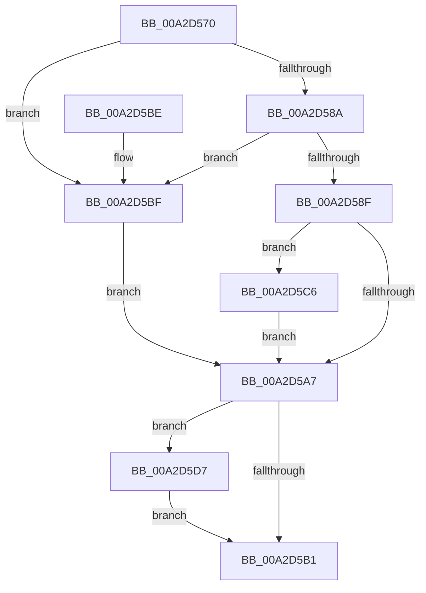

# SleepstudyHelper_GetPdoFriendlyName

- RVA: `0x00A2D570`–`0x00A2D5E3` (길이 `115` bytes)
- VA: `0x0000000140A2D570`
- 실행 섹션: `PAGE`
- PDB 이름 있음: `예`; PDB Function 태그: `아니요`
- unwind 정보 RVA: `0x0007042C`
- 디코드: `36`개 명령, `115/115` bytes 표시
- 미해석 바이트: `0` (있으면 어셈블리에 `.byte`로 보존)

> 이 문서는 커널 이미지의 기계어와 PDB 기호를 분석해 생성했습니다. 4번과 5번은 함수 원형과 자료형을 바이너리 사용 방식에서 추정한 C 해석이며 원본 소스 복구 결과는 아닙니다.

## 1. Dependencies

- 직접 호출 지점: **3**; 고유 호출 대상: **3**
- 직접 호출자로 확인된 함수: **0**
- RIP 상대 이미지 참조: **0**

### Outgoing calls
- `0x00A2D59C` → [SshpGenerateDeviceFriendlyName](SshpGenerateDeviceFriendlyName_function_00A2E184.md) (function, `0x00A2E184`)
- `0x00A2D5CE` → [RtlUnicodeStringCopy](../../text/3D/RtlUnicodeStringCopy_function_003D4130.md) (function, `0x003D4130`)
- `0x00A2D5DC` → [CmpFreePoolWithTag](../../text/44/CmpFreePoolWithTag_function_004489E0.md) (function, `0x004489E0`)

### Direct callers
- 이 함수 시작 RVA로 연결되는 직접 call은 확인되지 않았습니다. 간접 호출은 완전히 역산할 수 없습니다.

### Static image references
- 디코드된 RIP-relative 메모리 참조가 없습니다.

## 2. Other-region calls and transfers

- 다른 실행 섹션으로 향하는 call: **2**
  - `0x00A2D5CE` → [RtlUnicodeStringCopy](../../text/3D/RtlUnicodeStringCopy_function_003D4130.md) (`PAGE` → `.text`)
  - `0x00A2D5DC` → [CmpFreePoolWithTag](../../text/44/CmpFreePoolWithTag_function_004489E0.md) (`PAGE` → `.text`)
- 별도 외부 분기/꼬리 이동을 확인하지 못했습니다.

## 3. Assembly (complete function range)

```asm
00A2D570  48 89 5C 24 08                  mov qword ptr [rsp + 8], rbx
00A2D575  57                              push rdi
00A2D576  48 83 EC 30                     sub rsp, 0x30
00A2D57A  0F 57 C0                        xorps xmm0, xmm0
00A2D57D  48 8B FA                        mov rdi, rdx
00A2D580  0F 11 44 24 20                  movups xmmword ptr [rsp + 0x20], xmm0
00A2D585  48 85 C9                        test rcx, rcx
00A2D588  74 35                           je 0x140a2d5bf
00A2D58A  48 85 D2                        test rdx, rdx
00A2D58D  74 30                           je 0x140a2d5bf
00A2D58F  4C 8D 4C 24 20                  lea r9, [rsp + 0x20]
00A2D594  33 D2                           xor edx, edx
00A2D596  41 B8 73 73 68 6C               mov r8d, 0x6c687373
00A2D59C  E8 E3 0B 00 00                  call 0x140a2e184
00A2D5A1  8B D8                           mov ebx, eax
00A2D5A3  85 C0                           test eax, eax
00A2D5A5  79 1F                           jns 0x140a2d5c6
00A2D5A7  48 8B 4C 24 28                  mov rcx, qword ptr [rsp + 0x28]
00A2D5AC  48 85 C9                        test rcx, rcx
00A2D5AF  75 26                           jne 0x140a2d5d7
00A2D5B1  8B C3                           mov eax, ebx
00A2D5B3  48 8B 5C 24 40                  mov rbx, qword ptr [rsp + 0x40]
00A2D5B8  48 83 C4 30                     add rsp, 0x30
00A2D5BC  5F                              pop rdi
00A2D5BD  C3                              ret
00A2D5BE  CC                              int3
00A2D5BF  BB 0D 00 00 C0                  mov ebx, 0xc000000d
00A2D5C4  EB E1                           jmp 0x140a2d5a7
00A2D5C6  48 8D 54 24 20                  lea rdx, [rsp + 0x20]
00A2D5CB  48 8B CF                        mov rcx, rdi
00A2D5CE  E8 5D 6B 9A FF                  call 0x1403d4130
00A2D5D3  8B D8                           mov ebx, eax
00A2D5D5  EB D0                           jmp 0x140a2d5a7
00A2D5D7  BA 73 73 68 6C                  mov edx, 0x6c687373
00A2D5DC  E8 FF B3 A1 FF                  call 0x1404489e0
00A2D5E1  EB CE                           jmp 0x140a2d5b1
```

## 4. C-style interpretation (structured pseudocode)

```c
__int64 __fastcall SleepstudyHelper_GetPdoFriendlyName(__int64 a1, __int64 a2)
{
    __int64 result;
    __int64 v_rsp;
    unsigned __int64 v_stack_m10;
    unsigned __int64 v_stack_m18;
    unsigned __int64 v_stack_p20;
    unsigned __int64 v_stack_p8;

    v_stack_p8 = v_rbx;
    v_rsp = (v_rsp) - (48);
    v_stack_m18 = v_xmm0;
    if (a1 == 0) goto loc_00A2D5BF;
    if (a2 == 0) goto loc_00A2D5BF;
    a2 = 0;
    result = SshpGenerateDeviceFriendlyName(a1, a2, (unsigned int)(0x6C687373ULL), v_stack_m18);
    if (!sign_flag) goto loc_00A2D5C6;
loc_00A2D5A7:
    if (v_stack_m10 != 0) goto loc_00A2D5D7;
loc_00A2D5B1:
    v_rsp = (v_rsp) + (48);
    return (unsigned int)((unsigned int)((unsigned int)((unsigned int)(result))));
loc_00A2D5BF:
    goto loc_00A2D5A7;
loc_00A2D5C6:
    result = RtlUnicodeStringCopy(0, v_stack_p20, (unsigned int)(0x6C687373ULL), v_stack_m18);
    goto loc_00A2D5A7;
loc_00A2D5D7:
    result = CmpFreePoolWithTag(0, (unsigned int)(0x6C687373ULL), (unsigned int)(0x6C687373ULL), v_stack_m18);
    goto loc_00A2D5B1;
}
```

## 5. (Beta) C Style

```c
int64_t SleepstudyHelper_GetPdoFriendlyName(int64_t Arg1, int64_t Arg2)
{
    int64_t result;
    int64_t local_rsp;
    uint64_t v_stack_m10;
    uint64_t v_stack_m18;
    uint64_t v_stack_p20;
    uint64_t v_stack_p8;

    v_stack_p8 = local_rbx;
    local_rsp = (local_rsp) - (48);
    v_stack_m18 = v_xmm0;
    if (Arg1 == 0) goto loc_00A2D5BF;
    if (Arg2 == 0) goto loc_00A2D5BF;
    Arg2 = 0;
    result = SshpGenerateDeviceFriendlyName(Arg1, Arg2, (uint32_t)(0x6C687373ULL), v_stack_m18);
    if (!sign_flag) goto loc_00A2D5C6;
loc_00A2D5A7:
    if (v_stack_m10 != 0) goto loc_00A2D5D7;
loc_00A2D5B1:
    local_rsp = (local_rsp) + (48);
    return (uint32_t)((uint32_t)((uint32_t)((uint32_t)(result))));
loc_00A2D5BF:
    goto loc_00A2D5A7;
loc_00A2D5C6:
    result = RtlUnicodeStringCopy(0, v_stack_p20, (uint32_t)(0x6C687373ULL), v_stack_m18);
    goto loc_00A2D5A7;
loc_00A2D5D7:
    result = CmpFreePoolWithTag(0, (uint32_t)(0x6C687373ULL), (uint32_t)(0x6C687373ULL), v_stack_m18);
    goto loc_00A2D5B1;
}
```

## 6. Execution-region graph

[열기: 2D/3D 그래프와 함수 탐색 컨트롤 패널](../../../control-panel.html?section=page&rva=0x00A2D570&view=graph)

- 2D 그래프는 위에서 아래로 흐르고, 3D 그래프는 빈 공간을 드래그해 회전합니다. Shift+드래그는 이동, 휠은 확대·축소, 함수 노드 선택은 대상 보고서 이동입니다.

### Static fallback


