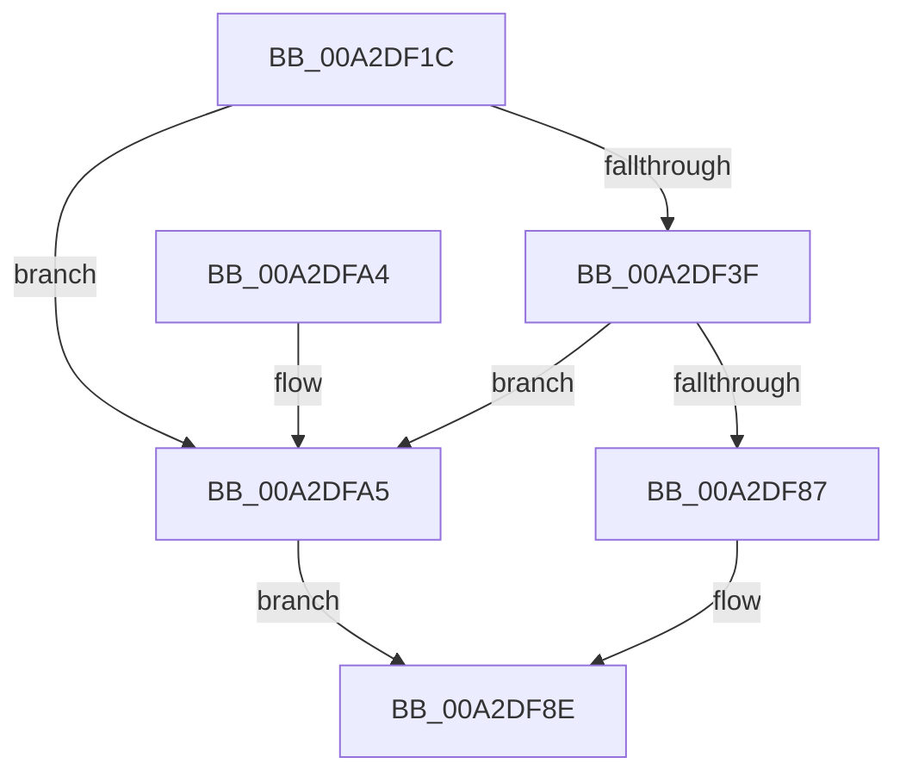

# SshpCacheLookupBlocker

- RVA: `0x00A2DF1C`–`0x00A2DFAC` (길이 `144` bytes)
- VA: `0x0000000140A2DF1C`
- 실행 섹션: `PAGE`
- PDB 이름 있음: `예`; PDB Function 태그: `아니요`
- unwind 정보 RVA: `0x000AC894`
- 디코드: `44`개 명령, `144/144` bytes 표시
- 미해석 바이트: `0` (있으면 어셈블리에 `.byte`로 보존)

> 이 문서는 커널 이미지의 기계어와 PDB 기호를 분석해 생성했습니다. 4번과 5번은 함수 원형과 자료형을 바이너리 사용 방식에서 추정한 C 해석이며 원본 소스 복구 결과는 아닙니다.

## 1. Dependencies

- 직접 호출 지점: **2**; 고유 호출 대상: **2**
- 직접 호출자로 확인된 함수: **1**
- RIP 상대 이미지 참조: **1**

### Outgoing calls
- `0x00A2DF7D` → [RtlLookupElementGenericTableAvl](../../text/3F/RtlLookupElementGenericTableAvl_function_003FEFB0.md) (function, `0x003FEFB0`)
- `0x00A2DF97` → [_security_check_cookie](../../text/6A/_security_check_cookie_function_006AC640.md) (function, `0x006AC640`)

### Direct callers
- [SleepstudyHelperBuildBlocker](SleepstudyHelperBuildBlocker_function_00A2DAD0.md) at `0x00A2DB96`

### Static image references
- `0x00A2DF27` → RVA `0x00E0A740` (`.data`; read)

## 2. Other-region calls and transfers

- 다른 실행 섹션으로 향하는 call: **2**
  - `0x00A2DF7D` → [RtlLookupElementGenericTableAvl](../../text/3F/RtlLookupElementGenericTableAvl_function_003FEFB0.md) (`PAGE` → `.text`)
  - `0x00A2DF97` → [_security_check_cookie](../../text/6A/_security_check_cookie_function_006AC640.md) (`PAGE` → `.text`)
- 별도 외부 분기/꼬리 이동을 확인하지 못했습니다.

## 3. Assembly (complete function range)

```asm
00A2DF1C  40 55                           push rbp
00A2DF1E  53                              push rbx
00A2DF1F  57                              push rdi
00A2DF20  48 8B EC                        mov rbp, rsp
00A2DF23  48 83 EC 70                     sub rsp, 0x70
00A2DF27  48 8B 05 12 C8 3D 00            mov rax, qword ptr [rip + 0x3dc812]
00A2DF2E  48 33 C4                        xor rax, rsp
00A2DF31  48 89 45 F0                     mov qword ptr [rbp - 0x10], rax
00A2DF35  33 DB                           xor ebx, ebx
00A2DF37  49 8B F8                        mov rdi, r8
00A2DF3A  39 59 2C                        cmp dword ptr [rcx + 0x2c], ebx
00A2DF3D  74 66                           je 0x140a2dfa5
00A2DF3F  0F 10 4A 10                     movups xmm1, xmmword ptr [rdx + 0x10]
00A2DF43  48 8D 42 30                     lea rax, [rdx + 0x30]
00A2DF47  48 89 5D B0                     mov qword ptr [rbp - 0x50], rbx
00A2DF4B  0F 57 C0                        xorps xmm0, xmm0
00A2DF4E  48 89 45 E0                     mov qword ptr [rbp - 0x20], rax
00A2DF52  48 8B 42 40                     mov rax, qword ptr [rdx + 0x40]
00A2DF56  48 83 C1 30                     add rcx, 0x30
00A2DF5A  F3 0F 7F 45 C8                  movdqu xmmword ptr [rbp - 0x38], xmm0
00A2DF5F  48 89 45 E8                     mov qword ptr [rbp - 0x18], rax
00A2DF63  48 8D 45 C0                     lea rax, [rbp - 0x40]
00A2DF67  0F 10 42 20                     movups xmm0, xmmword ptr [rdx + 0x20]
00A2DF6B  48 8D 55 B0                     lea rdx, [rbp - 0x50]
00A2DF6F  48 89 45 B8                     mov qword ptr [rbp - 0x48], rax
00A2DF73  F3 0F 7F 4D D0                  movdqu xmmword ptr [rbp - 0x30], xmm1
00A2DF78  F3 0F 7F 45 C0                  movdqu xmmword ptr [rbp - 0x40], xmm0
00A2DF7D  E8 2E 10 9D FF                  call 0x1403fefb0
00A2DF82  48 85 C0                        test rax, rax
00A2DF85  74 1E                           je 0x140a2dfa5
00A2DF87  48 8B 40 08                     mov rax, qword ptr [rax + 8]
00A2DF8B  48 89 07                        mov qword ptr [rdi], rax
00A2DF8E  8B C3                           mov eax, ebx
00A2DF90  48 8B 4D F0                     mov rcx, qword ptr [rbp - 0x10]
00A2DF94  48 33 CC                        xor rcx, rsp
00A2DF97  E8 A4 E6 C7 FF                  call 0x1406ac640
00A2DF9C  48 83 C4 70                     add rsp, 0x70
00A2DFA0  5F                              pop rdi
00A2DFA1  5B                              pop rbx
00A2DFA2  5D                              pop rbp
00A2DFA3  C3                              ret
00A2DFA4  CC                              int3
00A2DFA5  BB 25 02 00 C0                  mov ebx, 0xc0000225
00A2DFAA  EB E2                           jmp 0x140a2df8e
```

## 4. C-style interpretation (structured pseudocode)

```c
__int64 __fastcall SshpCacheLookupBlocker(__int64 a1, __int64 a2, __int64 a3)
{
    __int64 result;
    __int64 v_rbx;
    __int64 v_rsp;
    unsigned __int64 v_stack_m28;
    unsigned __int64 v_stack_m30;
    unsigned __int64 v_stack_m38;
    unsigned __int64 v_stack_m48;
    unsigned __int64 v_stack_m50;
    unsigned __int64 v_stack_m58;
    unsigned __int64 v_stack_m60;
    unsigned __int64 v_stack_m68;

    v_rsp = (v_rsp) - (112);
    result = (*(unsigned __int64 *)(v_rip + 4048914)) ^ (v_rsp);
    v_stack_m28 = result;
    v_rbx = 0;
    if ((*(unsigned int *)(a1 + 44)) == 0) goto loc_00A2DFA5;
    v_stack_m68 = 0;
    v_stack_m38 = a2 + 48;
    a1 = (a1) + (48);
    v_stack_m50 = v_xmm0;
    v_stack_m30 = *(unsigned __int64 *)(a2 + 64);
    v_stack_m60 = v_stack_m58;
    v_stack_m48 = v_xmm1;
    v_stack_m58 = v_xmm0;
    result = RtlLookupElementGenericTableAvl(a1, v_stack_m68, a3, a4);
    if (result == 0) goto loc_00A2DFA5;
    *(unsigned __int64 *)(a3) = *(unsigned __int64 *)(result + 8);
loc_00A2DF8E:
    a1 = (v_stack_m28) ^ (v_rsp);
    result = _security_check_cookie(a1, v_stack_m68, a3, a4);
    v_rsp = (v_rsp) + (112);
    return result;
loc_00A2DFA5:
    goto loc_00A2DF8E;
}
```

## 5. (Beta) C Style

```c
int64_t SshpCacheLookupBlocker(void *Arg1, void *Arg2, void *Arg3)
{
    uint8_t *arg1 = (uint8_t *)Arg1;
    uint8_t *arg2 = (uint8_t *)Arg2;
    uint8_t *arg3 = (uint8_t *)Arg3;

    int64_t result;
    int64_t local_rbx;
    int64_t local_rsp;
    uint64_t v_stack_m28;
    uint64_t v_stack_m30;
    uint64_t v_stack_m38;
    uint64_t v_stack_m48;
    uint64_t v_stack_m50;
    uint64_t v_stack_m58;
    uint64_t v_stack_m60;
    uint64_t v_stack_m68;

    local_rsp = (local_rsp) - (112);
    result = (*(uint64_t *)(v_rip + 0x3DC812)) ^ (local_rsp);
    v_stack_m28 = result;
    local_rbx = 0;
    if ((*(uint32_t *)(arg1 + 0x2C)) == 0) goto loc_00A2DFA5;
    v_stack_m68 = 0;
    v_stack_m38 = Arg2 + 48;
    Arg1 = (Arg1) + (48);
    v_stack_m50 = v_xmm0;
    v_stack_m30 = *(uint64_t *)(arg2 + 0x40);
    v_stack_m60 = v_stack_m58;
    v_stack_m48 = v_xmm1;
    v_stack_m58 = v_xmm0;
    result = RtlLookupElementGenericTableAvl(Arg1, v_stack_m68, Arg3, a4);
    if (result == 0) goto loc_00A2DFA5;
    *(uint64_t *)(arg3) = *(uint64_t *)(result + 0x8);
loc_00A2DF8E:
    Arg1 = (v_stack_m28) ^ (local_rsp);
    result = _security_check_cookie(Arg1, v_stack_m68, Arg3, a4);
    local_rsp = (local_rsp) + (112);
    return result;
loc_00A2DFA5:
    goto loc_00A2DF8E;
}
```

### 관측된 메모리 오프셋

구조체 형식이 확인되지 않은 접근은 인자 기준의 오프셋으로만 기록했습니다.

| 기준 인자 | 오프셋 표현 | 폭 (bit) | 접근 |
|---|---:|---:|---|
| `Arg1` | `+ 0x2C` | `32` | `R` |
| `Arg2` | `+ 0x10` | `128` | `R` |
| `Arg2` | `+ 0x20` | `128` | `R` |
| `Arg2` | `+ 0x30` | `64` | `R` |
| `Arg2` | `+ 0x40` | `64` | `R` |
| `Arg3` | `+ 0x0` | `64` | `W` |

## 6. Execution-region graph

[열기: 2D/3D 그래프와 함수 탐색 컨트롤 패널](../../../control-panel.html?section=page&rva=0x00A2DF1C&view=graph)

- 2D 그래프는 위에서 아래로 흐르고, 3D 그래프는 빈 공간을 드래그해 회전합니다. Shift+드래그는 이동, 휠은 확대·축소, 함수 노드 선택은 대상 보고서 이동입니다.

### Static fallback


